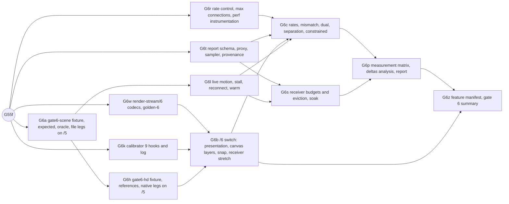

# Gate 6 design: complete declared 2D scene

Status: contract for gate 6, written 2026-10-11 while gate 5 is complete except G5f (live meshes,
in flight) and gate 5.5 is mid-way (G55a, G55b, G55c and G55w are on `main`; G55d is in flight;
G55e and G55f follow). Nothing here is implemented yet. Gate 6 starts when gate 5.5 is complete,
and every increment below assumes render-stream/5 everywhere until G6b switches to /6. Hand it out
piecewise. Each increment (G6a, G6w, G6k, G6r, G6t, G6h, G6b, G6l, G6s, G6c, G6p, G6z) is one
verified commit on `main`, implemented by one agent in its own worktree. Gate 6 needs a new wire
version, `render-stream/6`, specified here as a delta in Q4 and finalized by G6w (D1). The
documents this extends are [gate5_5-design.md](gate5_5-design.md) and, through it, gates 5 to 1.
The wire it builds on is [render-stream-5.md](render-stream-5.md). Background is in
[docs/handoff-headless-render-stream.md](../../../docs/handoff-headless-render-stream.md): the gate
6 row, "Cadence and performance", "Slow receivers and resource dependencies" and "Configuration
for other games".

Source citations are `path:line` in the pinned `../godot-4.5.1-stable` checkout (commit
`f62fdbde15035c5576dad93e586201f4d41ef0cb`), relative to its root. Every cited line was re-read
when this contract was written. Abbreviations, in addition to gate5_5-design.md's: `vp.cpp` is
`scene/main/viewport.cpp`, `win.cpp` is `scene/main/window.cpp`, `sbf.cpp` is
`scene/resources/style_box_flat.cpp`, `sc.cpp` is `scene/gui/scroll_container.cpp`, `cl.cpp` is
`scene/main/canvas_layer.cpp`, `rv.cpp`/`rv.h` are `servers/rendering/renderer_viewport.{cpp,h}`,
`le.cpp` is `scene/gui/line_edit.cpp`, `dt.cpp` is `scene/theme/default_theme.cpp`, `mts.cpp` is
`main/main_timer_sync.cpp`, `g3u.cpp` is `drivers/gles3/storage/utilities.cpp`. Slot numbers come
from `capture/tools/calibrate.py` `parse_virtuals` over the pinned header plus the measured Object
prefix 23. That derivation was run (offline, no engine) when this contract was written and
reproduces every committed slot this gate builds on (`shader_set_code` 55, `viewport_attach_canvas`
313, `viewport_set_canvas_transform` 315, `canvas_set_modulate` 438, `canvas_item_set_material`
488, `free` 549).

**No engine probe was run for this contract.** Every engine statement below is read from source.
Every count, step set, census and threshold in Q6 and Q7 is a prediction or a decision that the
increments check by running. A run that disagrees with a prediction is a finding to explain from
source before anything changes. A run that fails a decided threshold is a finding, never a reason
to raise the threshold.

## What gate 6 proves

The handoff's gate 6 row:

> Combine native controls, custom drawing, text, clipped scrolling, texture changes and animated
> geometry in one scene. Validate all deterministic checkpoints plus live motion, rate control,
> stalls, reconnect and stable resource usage. Add a 1920 by 1080 `canvas_items`-stretch fixture
> alongside the 640 by 360 primitives fixture. Publish the exact supported-feature list and
> measured costs.

Gate 6 keeps the three independent roles and adds the following:

1. **One combined scene, pixel-exact at every checkpoint.** `fixtures/gate6-scene/` (640×360,
   stretch `disabled`) composes native Controls (`Panel`, `Button`, `ProgressBar`, `LineEdit` with
   a forced caret and a selection, `HBoxContainer`, `NinePatchRect`, `TextureRect`), a clipped
   `ScrollContainer` that scrolls, a `Label` and a scrolling `RichTextLabel` with an inline image,
   a custom `_draw`, a texture that changes and is then freed, a mesh deformed every frame, a
   `CanvasItemMaterial`, a `ShaderMaterial` whose parameter an `AnimationPlayer` drives every
   frame, a `Tween`, a `top_level` escape, and a HUD `CanvasLayer` (Q6b).
2. **The same scene at 1920×1080 under `canvas_items` stretch** (`fixtures/gate6-hd/`): a
   `GridContainer` of nine copies of the scene, presented at 1920×1080 (`native`, identity stretch)
   and at 960×540 (`half`, stretch scale 0.5), with a nine-fold workload for the cost measurements
   (Q6e).
3. **A stretch policy the source requires** (D2): the host *evaluates* at the presentation scale,
   because font oversampling (`vp.cpp:1066-1082`) and `StyleBoxFlat`'s antialiasing feather
   (`sbf.cpp:497-511`) are computed on the host from the root stretch transform, and the receiver
   *applies* the stretch transform from the declared session. render-stream/6 declares the
   presentation size, the policy and the oversampling (Q4).
4. **`CanvasLayer`** (D3): calibrator 9 hooks canvas stacking, canvas removal, canvas parenting,
   canvas repeat and the global canvas transform. Attached canvases with a layer and sublayer
   travel on /6 and replay, so the session-level `extra-canvas` refusal that every STS2
   transaction carried stops for root-viewport layers.
5. **Rate control** (D8): a positive target publication rate (15, 30, 60) or uncapped, set on the
   host and declared in the session, with requested, host-frame, published, received, applied,
   submitted and receiver-frame rates reported separately and presentation marked `unavailable`.
6. **Live behaviour of the whole scene**: live motion compared frame for frame with the reference,
   rate mismatches, two receivers at different rates on one host, a 2-second stall across a
   resource update, reconnect, a constrained transport, and an injected receiver delay kept apart
   from a genuinely GPU-limited receiver (Q7c, Q7d).
7. **Stable resource usage** (D14): receiver memory and disk cache budgets with eviction that never
   drops a needed hash, and a 300-second soak whose residency counts stay bounded and whose memory
   stays flat, with sabotages that leak (Q7e).
8. **Measured costs** in a new `render-stream-report/1` (D10, Q7f): one warmup and five repeats,
   cold and warm caches, unarmed, armed-idle and streaming arms, both fixtures, every stage the
   handoff lists, with provenance.
9. **The exact supported-feature list** as a committed, generated, checked manifest,
   `protocol/features/render-stream-6.json` (`render-stream-features/1`, Q8), where every supported
   entry names the committed fixture and check that proves it.

What gate 6 does **not** do: browser receivers (gate 7), non-loopback serving and the target game
(gate 8), late-join adoption (gate 8), several presentation sizes for one capture session (gate 7),
compressed texture formats (gate 8), shader `TIME`, screen texture, `CanvasGroup`, `Light2D` and
particles (later capabilities), RichTextLabel effects (process-time driven), `follow_viewport`
layers and parallax repeat (typed), snap-to-pixel settings (typed), and payload deltas,
hash-at-publish and lazy hashing (measured here, implemented later if the numbers justify it). All
of these are typed or deferred with owners in "Deferred".

## Decisions

| #   | Question                          | Decision |
| --- | --------------------------------- | -------- |
| D1  | Protocol version                  | **`render-stream/6`, a session-and-canvas delta on the existing version-parameterized modules.** It is required, not convenient. A host at a non-logical window size is the only way to make its text atlases and stylebox geometry equal the reference's under `canvas_items` stretch (D2), and /5 can only call such a host `degenerate-window`. Its `root_size_policy` enum has no value for it, and `host_size_status` compares the window with the logical size. CanvasLayer stacking (D3) needs two canvas keys. Under /0's "Versioning" rule, both are a new version. /6 changes only: magic, subprotocol and hello strings; session `viewport` (`root_size_policy` gains `presentation`, plus `presentation_size`, `font_oversampling`, `snap_2d`); a new session key `publication`; canvas keys `layer` and `sublayer`; five session-level unsupported reasons; `features` lists. Transactions, blocks, items, commands, payloads, HTTP and control messages are byte-identical apart from those strings. As with /3 to /5 (memory: g4e1-rs3-version-switch-pattern), `rs2_codec.*`, `rs2_diff.*`, `render-stream-2.ts` and `rs2_decoder.gd` gain `version: … \| 6`. `golden-2/` to `golden-5/` keep passing unchanged. |
| D2  | Stretch policy                    | **The host evaluates at the presentation scale. The receiver applies the stretch transform.** The stream stays in root-canvas space (gate1-design.md D4, `stretch_applied_by: "receiver"` unchanged). A new `GRC_ROOT_SIZE=presentation:<W>x<H>` makes the headless root window W×H (Q3a), so the engine itself computes the stretch transform, the font oversampling and the stylebox feather the reference computes. The session declares `presentation_size`, `font_oversampling` and the stretch settings. The receiver sets its own root content scale from the session and must present at `presentation_size`. Otherwise it types `presentation-mismatch` and still draws (Q5). **One presentation scale per capture session.** A stream is exact only at the presentation size it was evaluated for. Serving several viewer sizes means one host evaluation per size, or a negotiated size, which is gate 7's to decide (Deferred). Stretch mode `viewport` evaluates nothing scale-dependent on the host, but no fixture proves it, so the receiver types it `stretch-mode` (Deferred). |
| D3  | `CanvasLayer`                      | **Supported on /6 for layers attached to the root viewport.** Calibrator 9 (Q2) hooks `viewport_set_canvas_stacking` 324 and `viewport_remove_canvas` 314, which are unhooked today and would make stacking silent. A canvas entry gains `layer` and `sublayer`. The receiver creates, attaches, stacks, transforms and modulates its own canvases. The renderer breaks equal stacking keys by RID order (`rv.h:125-130`), which no receiver can reproduce, so a tie is the typed `canvas-stacking-tie`. `follow_viewport` (`canvas_set_parent`, `cl.cpp:300-302`, composed at `rv.cpp:60-67`) and parallax repeat (`canvas_set_item_mirroring`/`_repeat`) are hooked and typed `canvas-follow-viewport` and `canvas-repeat`, not replayed. Non-root viewports stay `non-root-viewport`. |
| D4  | Degenerate headless window        | **Configuration, declared, never guessed** (gate1-design.md Q1). Stretch `disabled`: `GRC_ROOT_SIZE=enforce-min-size`, unchanged. `canvas_items`: `presentation:<W>x<H>`, with `enforce-min-size` meaning the same as `presentation:` at the logical size. `observe` keeps the 64×64 root (`scene_tree.cpp:2034`) and the typed `degenerate-host-size` (STS2's case, Deferred to gate 8). `presentation:` with stretch `disabled` and W×H ≠ logical refuses to publish (`root-size-invalid`), because it would change layout. |
| D5  | Combined fixtures                  | **`gate6-scene`** (640×360, stretch `disabled`; variants `animate` and `refused`) and **`gate6-hd`** (logical 1920×1080, `canvas_items`, aspect `keep`; presentations `native` 1920×1080 and `half` 960×540; variant `gpu-heavy`). Both are built by one builder script (`scene_builder.gd`), so the HD fixture is nine copies of the 640×360 scene in a `GridContainer`, each with its own phase. Regions, steps and continuous animations are in Q6. |
| D6  | Simulation time                    | **Frame-indexed for correctness, real time for rates, never accelerated.** In `RS_FIXTURE_TIME=steps` (the default), every animation advances exactly 1/60 s per fixture frame: each `Tween` is paused and driven by `custom_step(1/60)` (`tween.cpp:305-313`; a paused tween's ordinary step returns without advancing, `tween.cpp:331-333`), and each `AnimationPlayer` uses `ANIMATION_CALLBACK_MODE_PROCESS_MANUAL` with `advance(1/60)` (`animation_mixer.cpp:439-440`, `:2054-2056`). Host frame f therefore equals reference frame f whatever the wall clock does. In `RS_FIXTURE_TIME=realtime` (rate, perf and soak legs), tweens and players run on process delta. `--fixed-fps` is never used: it sets a fixed delta (`mts.cpp:415-417`) **and** skips the frame delay (`main/main.cpp:4902-4904`), which would accelerate game time on a headless host. Process-time-driven engine features (RichTextLabel effects, caret blink) are kept out of the scene (Q1f). |
| D7  | Independent expectations           | **Composed, none of them a replay of the capture.** (1) The rendered reference, compared whole-frame with every receiver. (2) Per-region hand models built from the existing ports: `geometry-raster.ts` for rects, custom draw and the mesh (from the fixture's own vertex formula), G5g's `StyleBoxFlat` port for panels, scrollbars and buttons (with `aa_size / scale` under stretch), G55b's blend equations, G55c's shader twin, nearest-sampled texture models, and `clip-derive.ts` for the scroll clip with the scroll offset of Q1c. (3) A reference-side `scene_oracle.gd` (reference legs only) that dumps atlas page hashes, scroll offsets, canvas stacking and material parameters per step. (4) Presence and freshness per region. Text glyph pixels and antialiasing bands are `undecided` in the hand model. They are covered by whole-frame receiver-against-reference equality and by atlas parity, never by a relaxed budget. |
| D8  | Rate control                       | **`GRC_PUBLISH_FPS=uncapped\|<1..240>`, live connections only, declared in the /6 session `publication`.** `uncapped` (the default) is today's behaviour: a transaction at every frame callback that holds credit. With a target, connection c publishes at tick k, due at `t0 + k·P` (P = 1/target, steady clock, t0 its first send), when the callback holds credit. A due tick without credit stays due and goes out as soon as credit returns, carrying the newest state (coalescing). Missed ticks are skipped, never burst (Q3c). File sinks always record every frame callback: they are the correctness record, and their cost is reported separately. The host frame rate (`--max-fps`) is separate configuration. |
| D9  | Which rates, and what is unavailable | **Seven rates, each with a status `measured\|unavailable\|not-applicable`.** Requested (the target), host frame, published (transactions sent), received, applied and submitted (acks, host clock), receiver frame (`frame_post_draw` count). Presented is `unavailable`: Godot exposes no presentation feedback (gate1-design.md D8), and gamescope's own statistics are not wired. Receiver GPU render time is `measured` on rendered GL receivers through the engine's timer queries (`g3u.cpp:324-331`, `rv.cpp:1522-1527`) and `not-applicable` on headless ones and on the host. Engine allocation counters are `unavailable` in release templates (`core/os/memory.cpp:211-216` returns 0 without `DEBUG_ENABLED`), so memory growth is measured as process RSS from `/proc`. Socket throughput and draw submissions are never reported as displayed FPS. |
| D10 | Report schema                      | **`render-stream-report/1` is new** (nothing in the repository defines it; grep finds only the handoff's mention). It is experiment-local, validated by `pnpm render-stream:report -- validate`, and never disguised as `perf-report/1` (Q7f). The gate's pass/fail result stays `render-stream-gate6-report/1`, the runner's check report, as in earlier gates. |
| D11 | Measurement protocol               | **One discarded warmup run and five measured repeats per scenario, cold and warm caches kept apart.** Each run has a 5-s in-run settle and a 20-s measured window. There are three arms: `unarmed` (no extension: host simulation alone), `armed-idle` (armed, no subscriber, no file sink) and `streaming`. Timed runs set `GRC_HOOK_LOG=off`, set no `GRC_LIVE_TAP_DIR` and take no screenshot inside the window (one shot after it). One extra pair measures the hook log's own cost. Provenance comes with every result (Q7g). |
| D12 | Constrained transport              | **A runner-side TCP proxy, not `tc`**: `scripts/throttle-proxy.ts`, Node standard library only, between the receiver and the host's single listener, so the WebSocket and every HTTP fetch cross it. Profile `constrained`: a token bucket of 4 Mbit/s (500 000 B/s, burst 64 KiB) per direction, plus 30 ms of one-way delay. It needs no root and works for every leg. |
| D13 | Receivers per host                 | **`GRC_LIVE_MAX_CONNECTIONS=1..4`, default 1** (gate1-design.md D5 deferred this to gate 6). Delivery state is per connection already. Pins are the union of every open connection's base. One snapshot copy per frame serves every connection. Under several connections, HTTP GETs are counted per host, not attributed. Gate 6 proves two at once, at different rates. |
| D14 | Resource stability                 | **Receiver budgets with LRU eviction that never evicts the needed set, plus a soak.** Today the receiver's in-memory payload map never evicts (`rs_resource_cache.gd`: "A payload this process obtained once is never read again"), so a texture with unique content per version grows without bound. G6s adds `RS_RECEIVER_MEMORY_BUDGET_BYTES` and `RS_RECEIVER_CACHE_BUDGET_BYTES`. The soak's thresholds are decided in Q7e. |
| D15 | Deltas, hash-at-publish, lazy hashing, spill | **Measured offline, not implemented.** `scripts/analyze-deltas.ts` reads gate 6's hook logs and stores and reports what texture, atlas and mesh deltas, parameter deltas and hash-at-publish (versions superseded within a frame) would save, against the whole-version costs gate 6 measures. The decision to implement any of them belongs to the first optimization increment after gate 6, taken from these numbers (Deferred). |
| D16 | Supported-feature manifest         | **A committed JSON file, generated and checked**: `protocol/features/render-stream-6.json`, schema `render-stream-features/1` (Q8). The session's `features` lists stay the per-session runtime declaration and must equal the manifest's lists exactly. |
| D17 | Snap-to-pixel settings             | **Declared at arm and typed.** The root's `snap_2d_transforms_to_pixel`/`_vertices_to_pixel` come from project settings before the main scene (`scene_tree.cpp:2098-2101`). They change scissors and transforms (`rv.cpp:48-57`), and the setters are unhooked. The capture reads both through `Viewport` method binds (`vp.cpp:5054`, `:5057`), declares them in `viewport.snap_2d`, and either one set adds the session-level `snap-2d`. Runtime changes stay `unobserved`. Replaying snap is gate 8's census call. |
| D18 | Result classes                     | **Gate 5.5's, extended.** `unsupported` gains the five /6 session-level reasons and the receiver-typed `presentation-mismatch`, `oversampling-mismatch` and `stretch-mode`. `capture-failure` gains `root-size-invalid`, a refused publish. Rate, stability and transport failures are named checks, not classes. |
| D19 | Waves against gate 5.5             | **Gate 6 lands nothing before G55f.** G6w, G6k, G6r and G6t touch disjoint files and may be written while G55e and G55f run, then rebased. G6a's fixture and reference legs may start once G55d has landed. Its receiver legs need G55e (`ShaderMaterial` end to end). |

## Q1. What the engine does

### Q1a. Root size and `canvas_items` stretch under headless

- `DisplayServerHeadless::window_get_size()` returns `Size2i()` (`servers/display_server_headless.h:128`).
  `SceneTree` sets the root's minimum size to 64×64 (`scene_tree.cpp:2034`), and
  `Window::_update_window_size` clamps the size up to the minimum (`win.cpp:1143-1150`). This is
  gate 0's 64×64 root (memory: gate0-wp1-engine-facts).
- The project's stretch settings reach the root as content scale mode, aspect, stretch, size and
  factor (`main/main.cpp:4421-4457`).
- `Window::_update_viewport_size` (`win.cpp:1190-1311`), `canvas_items` branch (`:1288-1294`): the
  viewport size is the (letterboxed) screen size and `size_2d_override` is the content size.
  `Viewport::_set_size` then makes the stretch transform `size / size_2d_override`
  (`vp.cpp:1066-1070`). `get_visible_rect()` reports `size_2d_override` (`vp.cpp:1166-1180`), so
  Control layout always sees the logical size, but everything scale-dependent follows the window
  (Q1b).
- The stretch reaches the RenderingServer only as `viewport_set_global_canvas_transform(stretch ×
  global_canvas_transform)` (`vp.cpp:1242-1246`), and it is applied to every canvas of the viewport
  (`rv.cpp:45-46`). Slot 323 is unhooked today and `unobserved` since render-stream-1.md.
- `Window::set_min_size` reaches `_update_window_size` (`win.cpp:501`), so one method-bind call at
  arm (gate 1's `enforce-min-size` mechanism) gives a headless root any window size. It must happen
  before the main scene lays out, which route (a) arming in the autoload's `_enter_tree` already
  guarantees.
- `Window::set_content_scale_size/_mode/_aspect` each call `_update_viewport_size`
  (`win.cpp:1659-1686`), so a receiver can adopt a session's stretch at runtime.

### Q1b. What the host evaluates from the stretch: the reason for D1 and D2

Two scene-level computations read the root stretch and change the commands the capture records:

1. **Font oversampling.** `_set_size` sets `font_oversampling = max(scale.x, scale.y)` under
   stretch, or `oversampling_override` when it is positive (`vp.cpp:1071-1082`). It then
   re-references the TextServer and DPITexture levels (`vp.cpp:1089-1095`). Every
   `CanvasItem` draw hands that value to the TextServer (`canvas_item.cpp:144-147`), so glyphs are
   rasterized into the atlas at `size × oversampling` and drawn as quads of the matching canvas
   size. A host at 1920×1080 rasterizes at 1.0. A reference at 960×540 rasterizes at 0.5.
   Different atlas pages, different quads.
2. **`StyleBoxFlat` antialiasing.** `StyleBoxFlat::draw` divides `aa_size` by the root window's
   stretch scale (`sbf.cpp:497-511`, "so that antialiasing doesn't become blurry … when using the
   `canvas_items` stretch mode"). The feather ring's vertices therefore move with the window size,
   and `oversampling_override` cannot change that.

Nothing else in `scene/` reads the stretch while drawing (a grep for `get_stretch_transform`,
`get_final_transform` and `get_oversampling` finds only input, popups, tooltips, accessibility and
the debugger). So a host whose window is the presentation size records exactly the reference's
commands, and a host at any other size does not. `oversampling_override` alone would fix (1) and
not (2), so D2 sets the window size instead.

### Q1c. `ScrollContainer`

- It clips its contents (`sc.cpp:845`, `set_clip_contents(true)`). Gate 3's scissor model applies:
  the rounded AABB of the transformed rect, intersected with the ancestors' clips.
- `set_v_scroll` sets the scrollbar's value (`sc.cpp:638-641`). `value_changed` reaches
  `_scroll_moved` → `queue_sort()` (`sc.cpp:625-627`), a deferred sort flushed before the frame
  callback in the same frame. `_reposition_children` (`sc.cpp:345-401`) places every content child
  at `ofs − (h_scroll, v_scroll)`, **floored** (`:398`), through `fit_child_in_rect`. Scrolling is
  therefore a transform change of the content Control with no content redraw. The scrollbar
  redraws its grabber.
- The panel style is drawn at `NOTIFICATION_DRAW` (`sc.cpp:485-488`). In the default theme it is an
  empty stylebox (`dt.cpp:652`). Scrollbars are rounded, antialiased `StyleBoxFlat`s with corner
  radius 10 (`dt.cpp:538-563`), drawn by `ScrollBar` (`scene/gui/scroll_bar.cpp:234-309`). Their
  increment and decrement icons are an empty `ImageTexture` (`dt.cpp:536`, `:552-557`), which draws
  nothing.
- `follow_focus` and smooth scrolling act only on focus changes and input. The fixture uses neither.

### Q1d. `top_level` and the one-frame index lag

A `top_level` CanvasItem is parented to the canvas in the RenderingServer (`canvas_item.cpp:272`)
and joins the root canvas group (`:275-277`). Its draw index arrives by a deferred group call to
`_top_level_raise_self` (`:441`), which sets `gui_get_canvas_sort_index()` (`:225-235`) one
iteration later. Until then a new top-level item has index 0 (memory:
gate1-top-level-draw-index-lag). Two top-level items entering in the same frame tie for that frame.
The tie is harmless when their footprints are disjoint (gate 1 G1b2, G1e addendum).

### Q1e. `CanvasLayer`

- The constructor makes a canvas (`cl.cpp:357`). Entering the tree calls `viewport_attach_canvas`
  and `viewport_set_canvas_transform` (`cl.cpp:181-183`), then `canvas_parent_mark_dirty`
  (`:187-188`). That queues `_process_dirty_canvas_parent_orders` with `call_deferred`
  (`vp.cpp:1183-1190`), which calls `CanvasLayer::update_draw_order` →
  `viewport_set_canvas_stacking(viewport, canvas, layer, get_index())` (`vp.cpp:243-266`,
  `cl.cpp:203-207`). The flush runs before the frame callback, so the stacking lands in the attach
  frame. **Prediction, checked by G6b:** no published transaction shows a freshly attached layer at
  the attach default `(0,0)` (`rv.cpp:1265-1266`).
- `set_layer` → `viewport_set_canvas_stacking` (`cl.cpp:36-41`). `set_visible` →
  `canvas_item_set_visible` on each direct CanvasItem child (`cl.cpp:49-64`), which is hooked.
  `set_transform`/`_update_xform` → `viewport_set_canvas_transform` (`cl.cpp:79-107`). Leaving the
  tree → `viewport_remove_canvas` (`cl.cpp:197`).
- `follow_viewport` → `canvas_set_parent(canvas, world canvas, scale)`, and `RID()` when off
  (`cl.cpp:300-302`). The renderer composes the parent canvas's transform (`rv.cpp:60-67`).
- Order: the renderer sorts canvases by `stacking = sign(layer)·(|layer| << 32) + sublayer`, with
  ties broken by **canvas RID** (`rv.h:122-140`). The root canvas sits at `(0,0)`. Within one canvas,
  `z_index` sorts items, so a root-canvas item at `z_index` 100 still draws under layer 1.

### Q1f. Text controls, hover and process time

- **`LineEdit` caret**: drawn when `caret_can_draw && draw_caret` (`le.cpp:1504`), where
  `caret_can_draw = caret_force_displayed || (editing && window_has_focus && has_focus())`
  (`le.cpp:2027`). `window_has_focus` follows `NOTIFICATION_WM_WINDOW_FOCUS_IN/OUT`
  (`le.cpp:1302-1312`), which differs between a gamescope reference and a headless host.
  `draw_caret = !caret_blink_enabled` (`le.cpp:1972`). Blinking accumulates process delta
  (`le.cpp:1314-1322`). The fixture sets `caret_force_displayed = true` and `caret_blink = false`:
  a static caret in every role.
- **`LineEdit` selection**: drawn whenever `selection.enabled`, focus or not
  (`le.cpp:1441-1458`), as `canvas_item_add_rect`.
- **Hover**: a gamescope reference has a pointer and a headless host does not. Every fixture
  Control sets `mouse_filter = MOUSE_FILTER_IGNORE`, so no hover style can ever differ.
- **Process time**: RichTextLabel effects, caret blink and `ScrollContainer` drag deceleration
  accumulate process delta, which differs between roles under `steps`. None of them is used.

### Q1g. Pacing, frame delay and timing sources

- A headless host sleeps `low_processor_mode_sleep_usec` (default 6900 µs, `main/main.cpp:2073-2075`)
  or `1/max_fps`, whichever is longer, every iteration (`core/os/os.cpp:684-712`). That is about
  145 fps without `--max-fps` (gate1-design.md Q2e). The uncapped arm sets the fixture project's
  `application/run/low_processor_mode_sleep_usec=0` and `--max-fps 0`. A rendered reference is
  unaffected, because the low-processor delay applies only to `!can_draw` or low-processor mode.
- `--frame-delay <ms>` sleeps a fixed delay per frame (`core/os/os.cpp:685-692`), which is the
  injected receiver delay of Q7c. `--disable-vsync` forces vsync off (`main/main.cpp:1802-1803`,
  `:2753-2756`). The receiver project already sets `vsync_mode=0`.
- GLES3 records GL timestamp queries per frame and reads them two frames later
  (`g3u.cpp:324-358`), only when `is_gles_over_gl()` (`:327-331`). The viewport's measured GPU
  time is `time_gpu_end − time_gpu_begin` (`rv.cpp:1522-1527`, set at `:1647-1652`) once
  `viewport_set_measure_render_time` is on (`rv.cpp:1508-1513`). On a desktop GL receiver this is
  the GPU render time. On GLES/WebGL it is unavailable.
- `RenderingServer.get_rendering_info` (`TEXTURE_MEM_USED`, `BUFFER_MEM_USED`, `VIDEO_MEM_USED`,
  `PIPELINE_COMPILATIONS_CANVAS`; `servers/rendering_server.h:1791-1800`) works in release templates.
  `Memory::get_mem_usage` does not (`core/os/memory.cpp:211-216`).

### Q1h. Headless storage, unchanged facts the scene leans on

Dummy storage keeps an initial texture image and discards updates, mesh region updates and
material parameters (gate2-design.md, gate5-design.md, gate5_5-design.md Q1f). The capture copies
at the hook. Canvas, canvas item and viewport state live in `RendererCanvasCull` and
`RendererViewport`, both real on a headless host, so canvas stacking needs no shim. Canvas
textures are `RID()` headless (canvas-texture-headless.md). The scene uses none.

## Q2. Hooks: calibrator 9

| RenderingServer method                 | Slot | Header (`rs.h`) | Before gate 6                  | Gate 6                                                                          |
| -------------------------------------- | ---- | --------------- | ------------------------------ | -------------------------------------------------------------------------------- |
| `viewport_remove_canvas`               | 314  | 1032            | declared `unobserved`          | **calibrator 9**: canvas `attached` → false                                     |
| `viewport_set_global_canvas_transform` | 323  | 1043            | declared `unobserved`          | **calibrator 9**: compared with the arm-time stretch; typed `global-canvas-transform` when different |
| `viewport_set_canvas_stacking`         | 324  | 1044            | **unhooked, undeclared**       | **calibrator 9**: canvas `layer`, `sublayer`                                    |
| `canvas_set_item_mirroring`            | 436  | 1526            | unhooked                       | **calibrator 9**: non-zero → typed `canvas-repeat`                              |
| `canvas_set_item_repeat`               | 437  | 1527            | unhooked                       | **calibrator 9**: non-zero → typed `canvas-repeat`                              |
| `canvas_set_parent`                    | 439  | 1529            | unhooked                       | **calibrator 9**: non-null parent → typed `canvas-follow-viewport`              |
| `viewport_attach_canvas`               | 313  | 1031            | `extra-canvas` for non-root canvases | canvas `attached` (no refusal for the root viewport)                     |
| `viewport_set_canvas_transform`        | 315  | 1033            | root canvas only               | every attached canvas                                                           |
| `canvas_set_modulate`                  | 438  | 1528            | calibrator 8                   | every attached canvas                                                           |

Gate −1 goes from 73 to 79 hooks. ABIs, by `hooks.cpp`'s existing aliases: 314 is
`(RID viewport, RID canvas)`; 323 is `(RID, const Transform2D *)`, like 315 minus the canvas; 324 is
new, `void (*)(void *, RID viewport, RID canvas, int layer, int sublayer)`; 436 is
`(RID, const Vector2 *)`; 437 is new, `void (*)(void *, RID, const Vector2 *, int)`; 439 is new,
`void (*)(void *, RID canvas, RID parent, float scale)`. Each slot is pure in the abstract table and
implemented in `RenderingServerDefault`, which the calibrator's own check enforces. Slot 440
(`canvas_set_disable_scale`) stays unhooked and is declared `unobserved`. `fixtures/spike/` (G6k)
adds, after arming, a `CanvasLayer` with a layer change, a `follow_viewport` toggle, a removal, a
raw `canvas_set_item_mirroring` and a `Viewport.global_canvas_transform` write, so gate −1's counts
are positive for all six.

## Q3. Capture

### Q3a. Root size policy, stretch and snap declarations

- `GRC_ROOT_SIZE` gains `presentation:<W>x<H>` (decimal, 1..16384 each). At arm, after the root
  query and before the session is written, one `Window.set_min_size(W,H)` method-bind call runs (gate
  1's mechanism with a different argument). Under `canvas_items` the engine then computes the
  stretch, oversampling and feather of a W×H window (Q1a, Q1b). Under `disabled`, W×H must equal the
  logical size, or the stream refuses (`root-size-invalid`). Under `viewport` it is accepted and
  declared (the receiver types the mode, D2).
- After the policy, the capture reads through method binds: `Viewport.get_oversampling()`
  (`vp.cpp:5000`) into `viewport.font_oversampling`, and
  `is_snap_2d_transforms_to_pixel_enabled`/`_vertices_` (`vp.cpp:5054`, `:5057`) into
  `viewport.snap_2d`. It also reads the stretch transform (`Viewport.get_stretch_transform`) the mirror
  compares slot 323 against.
- `host_size_status` (/6): `match` iff `host_window_size == presentation_size` and the visible
  rect's size equals `logical_size`. `degenerate-visible` iff the visible size differs from
  logical. `degenerate-window` otherwise. `presentation_size` is the policy's W×H, or
  `logical_size` under `observe` and `enforce-min-size`. As before, `enforce-min-size` or
  `presentation:` with a status other than `match` is the sticky capture failure
  `root-size-enforce-failed`.

### Q3b. Mirror: canvases

The canvas table gains `layer`, `sublayer` (RS defaults 0, 0) and the latest global canvas transform
of the root viewport.

| Tap                                                 | Effect                                                                                                     |
| --------------------------------------------------- | ---------------------------------------------------------------------------------------------------------- |
| `viewport_attach_canvas(root, c)`                   | `attached = true`, stacking reset to `(0,0)` (`rv.cpp:1265-1266`); no `extra-canvas` on /6                 |
| `viewport_remove_canvas(root, c)`                   | `attached = false`; its items stay in the table (undrawn), as gate 0 does for a detached canvas            |
| `viewport_set_canvas_stacking(root, c, l, s)`       | `layer = l`, `sublayer = s`                                                                                |
| `viewport_set_canvas_transform(root, c, x)`         | that canvas's transform, any attached canvas                                                               |
| `viewport_set_global_canvas_transform(root, x)`     | `x` ≠ the arm-time stretch transform (bitwise float32) → session-level `global-canvas-transform`, while it differs |
| `canvas_set_item_mirroring(c, v)` / `_repeat(c, v, n)` | `v` ≠ (0,0) → session-level `canvas-repeat` (sticky)                                                    |
| `canvas_set_parent(c, p, scale)`                    | `p` non-null → session-level `canvas-follow-viewport` (sticky); `RID()` changes nothing                    |
| any of the above on a non-root viewport             | gate 0's `non-root-viewport`, unchanged                                                                    |

Each snapshot derives `canvas-stacking-tie` when two attached canvases share `(layer, sublayer)`
(the renderer would order them by RID, `rv.h:125-130`), and `snap-2d` when either `snap_2d` flag is
set. Both are session-level entries (`item: null`), computed per transaction as
`degenerate-host-size` is.

### Q3c. Rate control on the live hub

- **Per connection**: `period_ns` (0 for uncapped), `t0`, `next_due`, and counters `ticks_due`,
  `ticks_sent`, `ticks_credit_blocked` (callbacks where a tick was due without credit),
  `frames_rate_idle` (callbacks with credit and no tick due).
- **At a frame callback, while streaming**: `due = period_ns == 0 || now + period_ns/4 ≥ next_due`.
  The quarter-period slack absorbs frame jitter, so 60 fps on a 60 fps host is every frame, not
  every frame minus aliasing. If `due && credit`: form and send, then `next_due = t0 +
  (⌊(now − t0)/P⌋ + 1)·P`. If `due && !credit`: `ticks_credit_blocked += 1`, the tick stays due, and
  the existing `pending`/`coalesced` accounting runs. `wants_snapshot()` becomes "some connection is
  due with credit, or a file sink is open", so a rate-limited host with no file sink copies a
  snapshot only on ticks.
- `GRC_LIVE_MAX_CONNECTIONS` (D13) replaces the hard `busy` refusal with a limit. Each connection
  has its own schedule. Snapshots are shared per frame.
- **Staleness**: for each sent seq, the hub keeps the steady-clock time of the frame callback its
  snapshot came from (only in-flight seqs, so the map stays bounded). At each `applied` and
  `submitted` ack it records `ack_time − frame_time`, the host-clock age of what the receiver just
  applied or submitted.

### Q3d. Instrumentation and the evidence switch

- **`GRC_HOOK_LOG=on|off`, default `on`.** With `off`, `resources.jsonl` gets no per-call lines
  (counters, `counters.json` and the mirror are unchanged). Checks that read the hook log are not
  run on `off` legs, and the runner refuses to combine `off` with a sabotage.
- **`perf.json`** (`render-stream-capture-perf/1`, written at disarm and shutdown): per-stage
  log-linear histograms (16 sub-buckets per octave, at most 6.25 % relative error, 400 fixed
  counters each, so nothing grows) plus exact `count/sum/min/max` for `frame_interval_us`,
  `frame_callback_us`, `snapshot_us`, `diff_us`, `encode_us`, `enqueue_us`, `store_write_us`,
  `texture_copy_us`/`_hash_us`, `mesh_copy_us`/`_hash_us`, `shader_copy_us`/`_hash_us`,
  `param_decode_us`, `credit_rtt_us[stage]`, `staleness_us[applied|submitted]` and
  `http_serve_us` (I/O thread). It also records main-thread and I/O-thread CPU time
  (`CLOCK_THREAD_CPUTIME_ID` at arm and at the end) and per-connection rate counters.
- **`perf-timeline.jsonl`** (one line per second, bounded by run length): frames, per-connection
  published, credits, coalesced, credit-blocked ticks, bytes, max pending age, mirror items,
  retained payload count and bytes, pins, and RSS from `/proc/self/statm`.
- **Host sabotage `retain-superseded`** (G6s): from `GRC_SABOTAGE_FRAME` on, `ServedResources`
  never retires a hash, so retained bytes grow. It exists only to fail `residency-bounded`.

## Q4. Delivery and wire: render-stream/6

/6 is /5 with exactly these changes. G6w writes them as `protocol/render-stream-6.md`, a delta
document like render-stream-5.md.

- **Magic** `47 52 53 36 0D 0A 1A 0A` (`GRS6`), subprotocol `render-stream.6`, hello
  `"protocol":"render-stream/6"`. A decoder configured for /6 refuses `GRS5` with `bad-magic`.
- **Session key order**: `type`, `protocol`, `session_id`, `stream`, `engine`, `capture`,
  `viewport`, `resources`, `materials`, `features`, `publication`, `sabotage`,
  [`unknown_item_policy`], `blocks`.
- **`viewport`** (key order; the three new keys are marked):

```
"viewport":{"canvas_cull_mask","root_canvas","logical_size",
            "stretch":{"mode","aspect","scale_mode"},
            "stretch_applied_by":"receiver",
            "root_size_policy":"observe"|"enforce-min-size"|"presentation",
            "presentation_size":[<int>,<int>],                         (new)
            "host_size_status":"match"|"degenerate-visible"|"degenerate-window",
            "host_window_size":[<int>,<int>],
            "font_oversampling":<number>,                              (new, float32)
            "snap_2d":{"transforms":<bool>,"vertices":<bool>}}         (new)
```

  `presentation_size` equals `logical_size` unless the policy is `presentation`. `host_size_status`
  follows Q3a. The session blocks are unchanged: `host_final_xform` carries the stretch, which is
  how a receiver can check its own.
- **`publication`** (new): `{"mode":"every-frame"|"rate","target_fps":<int 1..240>|null}`. File
  sinks always write `every-frame`/`null`. A live connection writes `GRC_PUBLISH_FPS`
  (`uncapped` → `every-frame`/`null`).
- **Canvas** (key order): `{"id","origin","role","attached","layer":<int>,"sublayer":<int>,"items"}`.
  The root canvas and every unattached canvas carry `0,0` unless a stacking call set something
  else. `canvas_f32` is unchanged (10 floats: transform, modulate).
- **Session-level unsupported reasons** (each `item: null`, ordered by first observation as /0's,
  present in every transaction while the condition holds):
  `{"op":"viewport_set_canvas_stacking","reason":"canvas-stacking-tie"}`,
  `{"op":"canvas_set_item_mirroring"|"canvas_set_item_repeat","reason":"canvas-repeat"}` (sticky),
  `{"op":"canvas_set_parent","reason":"canvas-follow-viewport"}` (sticky),
  `{"op":"viewport_set_global_canvas_transform","reason":"global-canvas-transform"}`,
  `{"op":"viewport_set_snap_2d_transforms_to_pixel"|"viewport_set_snap_2d_vertices_to_pixel","reason":"snap-2d"}`.
  `extra-canvas` no longer occurs for a canvas attached to the root viewport, and /6 decoders reject
  it, as /5 rejected `unsupported-state` for materials.
- **`features`**: `canvas_state` gains `layer` (`["layer","modulate","transform"]`).
  `observed_unsupported_ops` gains `canvas_set_item_mirroring`, `canvas_set_item_repeat` and
  `canvas_set_parent`. `unobserved` loses `viewport_remove_canvas` and
  `viewport_set_global_canvas_transform` and gains `canvas_set_disable_scale`, re-sorted. Every
  other list is unchanged.
- **New invariants**, each with its own code (memory: rs-schema-self-coded-errors):
  `viewport-entry` (`presentation_size` ≠ `logical_size` without the `presentation` policy;
  `presentation` with stretch `disabled` and a different size; a `host_size_status` that
  contradicts `host_window_size`, `presentation_size` and the `host_visible_rect` block;
  `font_oversampling` not positive), `publication-entry` (`every-frame` with a number, `rate` with
  null or out of range, `rate` on a `file` stream), `canvas-entry` (`layer`/`sublayer` not
  integers), and `unsupported-mismatch` extended to the five reasons (a tie or a set `snap_2d` with
  no entry, or an entry without its condition).
- **Golden vectors `protocol/golden-6/`** (`make_golden.py --check`, stdlib only): golden-5's
  fifteen states re-encoded as /6, with presentation equal to logical, oversampling 1, snap off,
  publication `every-frame`, and the root canvas at `(0,0)`. State 16: an attached extra canvas at
  layer 1, sublayer 0, with two items, a transform and a modulate. State 17: its layer changed to −1
  (the patch carries one canvas entry). State 18: the canvas removed from the viewport
  (`attached:false`, items kept). State 19: `canvas-repeat`, `canvas-follow-viewport`,
  `global-canvas-transform` and a `canvas-stacking-tie` together. `full.rs6`, `patch.rs6` and
  `inline.rs6` resolve to one `resolved.json`. Three dedicated small streams follow:
  `presentation.rs6` (`canvas_items`, logical 1920×1080, presentation 960×540, oversampling 0.5,
  `host_final_xform` scale 0.5), `snap.rs6` (both flags set, `snap-2d` in every transaction) and
  `rate.rs6` (a recorded live stream, `transport:"websocket"`, `publication` `rate`/30). `invalid/`
  covers each new invariant, `bad-magic` (GRS5) and `extra-canvas-on-root` (→
  `unsupported-mismatch`). Verify inline `record_index` values by decoding (memory:
  g4e1-rs3-version-switch-pattern).

## Q5. Receiver

- **Stretch.** At the session, before any item exists: when `stretch.mode` is `canvas_items`, the
  receiver sets its root's `content_scale_mode`, `content_scale_aspect`, `content_scale_stretch`
  (from `scale_mode`), `content_scale_size = logical_size` and `content_scale_factor` (from the
  session block). The same engine code then computes the reference's stretch (Q1a). `disabled`
  keeps today's behaviour. `viewport` is typed `stretch-mode` and drawn at the receiver's own
  settings. After that, the receiver checks three things. (1) Its root window size equals
  `presentation_size`, otherwise `presentation-mismatch` (still drawn). (2) Its own
  `get_viewport().get_oversampling()` equals `font_oversampling`, otherwise `oversampling-mismatch`
  (still drawn). (3) Its visible rect equals `logical_size`, the existing `viewport-mismatch`
  replay failure. Headless receivers skip (1) and (2) (`skipped-headless`). The three typed
  entries go into `applied.json` `unsupported` with `seq: null`, `item: null`.
- **Canvases.** Each non-root canvas id gets `RenderingServer.canvas_create()`. While `attached`,
  it is attached to the receiver's root viewport with `viewport_attach_canvas`,
  `viewport_set_canvas_stacking(layer, sublayer)`, `viewport_set_canvas_transform` and
  `canvas_set_modulate`. Removal calls `viewport_remove_canvas`, and leaving the state calls
  `free`. Items parented to a canvas are parented to the receiver's canvas for that id. Apply order
  (gate2-design.md Q5): textures, meshes, shaders, materials, **canvases**, items.
- **Typed session entries** (Q4) are reported, and the receiver draws without them: no repeat, no
  follow, its own stretch only, no snap. That is what `unsupported` means.
- **`applied.json` `render-stream-receiver-applied/6`**: /5's shape. `viewport` gains
  `presentation_size`, `window_size`, `oversampling`, `presentation_check`
  (`ok|mismatch|skipped-headless`) and `stretch_applied`. Each transaction's `resources` gains
  `canvases_created`, `canvas_attach`, `canvas_stacking_sets`.
- **Perf (G6r).** `RS_RECEIVER_PERF_OUT` writes `perf.json` (`render-stream-receiver-perf/1`):
  histograms (Q3d's format) for `decode_us`, `resolve_us`, `apply_us`, `upload_us` and upload bytes,
  `fetch_us`, `frame_interval_us`, `gpu_render_ms` and `cpu_render_ms`
  (`viewport_get_measured_render_time_*`, with a `status`), counts of received, applied and
  submitted transactions, and a one-line-per-second timeline. The timeline carries RSS (from
  `/proc/self/statm` through `FileAccess`), `get_rendering_info` texture, buffer and video memory,
  pipeline compilations, live RIDs per kind, and memory-cache and disk-cache entries and bytes.
  `RS_RECEIVER_LOG=summary` drops the per-transaction array from `applied.json` (shots and
  failures stay), for soak and perf legs.
- **Resource budgets (G6s).** `RS_RECEIVER_MEMORY_BUDGET_BYTES` (default 268435456) and
  `RS_RECEIVER_CACHE_BUDGET_BYTES` (disk; default 0 = unlimited) evict least-recently-used
  payloads. The access order is an in-process counter, and a warm disk cache starts ordered by
  mtime. Eviction never touches a hash in the current `needed` set (every resource reachable from
  the applied state, gate2-design.md Q5) or one pinned by an in-progress fetch. Counters:
  `evictions_memory`, `evictions_disk`, `refetch_after_evict`. Receiver sabotage `no-evict` turns
  eviction off, so the soak's checks can fail.
- **Receiver sabotages added by gate 6**: `ignore-canvas-stacking` (attaches extra canvases and
  never sets stacking, so they draw in attach order, G6b), `ignore-presentation` (keeps stretch
  `disabled` whatever the session says, G6b) and `no-evict` (G6s). Each exists only to fail checks.

## Q6. Fixtures

### Q6a. Shared rules

Every gate 6 fixture uses gate 5.5's rules: `gl_compatibility`, `msaa_2d=0`, `hdr_2d=false`,
clear colour `(0.2,0.2,0.4,1)`, the `[debug]` warning keys, `GrcLoader`, `RS_FIXTURE_VARIANT`, a
`Marker` per step, every CanvasItem, material, shader and texture created in `_ready`, colour
components in {0, .2, …, 1} wherever a hand model decides pixels, and alpha 1 except where marked.
Text uses gate 4's font settings (`fixtures/gate4/project.godot`: default theme font, grayscale
antialiasing, light hinting, subpixel positioning off, no MSDF, no mipmaps). Rules new in gate 6:

- Every `Control` has `mouse_filter = MOUSE_FILTER_IGNORE` (Q1f).
- All content lives under one top-level `Scene` Control (child 0 of the plain `Node` root), so the
  frame-1 draw-index tie involves only `Scene` and `TL` (Q1d). Nothing under `Scene` draws in the
  bottom strip `y ∈ [344,360)`, where only `TL` lives.
- `RS_FIXTURE_TIME=steps|realtime` (D6). `RS_FIXTURE_TIMELINE=file|live|rate|soak` selects the
  step timing (Q6c). `RS_FIXTURE_SHOT_FRAMES=<csv>` makes a reference shoot exact host frames, for
  live-motion comparison (Q7c).
- The project sets `application/run/low_processor_mode_sleep_usec=0` (Q1g). Legs pace the host
  with `--max-fps`.
- Textures: `TEXN` is gate 5g's 16×16. `TEXA` is 64×64 RGBA8, generated from a content index n: a
  four-colour 8×8-cell pattern whose cell colours are a fixed function of n, plus n's 12 bits in the
  top row as 4×4 black or white blocks. Every n gives a unique hash. `TEXB` is `TEXA(1000)`.
  Nearest filtering everywhere.

### Q6b. `fixtures/gate6-scene/` layout (640×360, stretch `disabled`)

Regions `[x0,y0,x1,y1)`, pairwise disjoint. Everything not in a region is `BG`: a `Panel` at
(0,0) 640×344 with a sharp, unantialiased `StyleBoxFlat` (.2,.2,.2), plus the clear colour in the
bottom strip.

| Region   | Node(s) (position, size)                                                                                                     | Model and class (step 0) |
| -------- | ---------------------------------------------------------------------------------------------------------------------------- | ------------------------ |
| `SC`     | `ScrollContainer` (8,8) 168×112, horizontal scroll disabled; content `VBoxContainer` (separation 4) of eight rows; row r is an `HBoxContainer` [`ColorRect` `R<r>` 24×20 in grid colour r, `Label` "row r" at 14 px] | rows' rects exact inside the scissor and absent outside (`clip-derive.ts` with Q1c's floored offset); scrollbar: G5g port (fill exact, AA band); labels undecided |
| `RT`     | `RichTextLabel` (184,8) 200×112, `bbcode_enabled`, `scroll_active`, nine lines with `[color]`, `[b]` and `[img=64x64]` of `TEXA` | undecided (whole-frame and atlas parity only); presence and freshness |
| `TR`     | `TextureRect` (392,8) 64×64, `TEXA`, 1:1                                                                                     | exact (texel model) |
| `NP`     | `NinePatchRect` (464,8) 96×64, `TEXN`, margins 4                                                                             | exact (G5g model) |
| `Marker` | `RectNode` 32×32 at (592,16)                                                                                                 | exact |
| `HU`     | root-canvas `ColorRect` `ZH` (400,84) 112×32 (.8,.2,.2), `z_index` 100; `CanvasLayer` `HUD` (layer 1) holding a `Panel` (456,88) 168×28 (sharp `StyleBoxFlat` (.2,.8,.8)) and a `Label` "HUD" | rect parts exact (the HUD panel draws over `ZH` despite z 100, Q1e); label undecided |
| `PB`     | `ProgressBar` (8,128) 168×24, `show_percentage`, value driven by a `Tween` (Q6c)                                             | theme styleboxes (G5g port, theme shapes); text undecided |
| `BT`     | `Button` (8,160) 120×32, text "Play"                                                                                         | theme stylebox; text undecided |
| `LE`     | `LineEdit` (8,200) 168×32, text "edit me", focused, `caret_force_displayed`, `caret_blink = false`, `select(0,4)`; region `[4,196,180,236)` includes the 2-px focus expand | normal and focus boxes (G5g port), selection rect and caret exact in position; text undecided |
| `CD`     | `Control` (184,128) 120×104 with `_draw()`: `draw_rect` (8,8,48,32) filled, `draw_line` (64,8)→(112,40) width 2, a 4-point `draw_polyline`, `draw_circle` (32,72) r 16, a 5-point `draw_colored_polygon` offset by `k`, `draw_texture_rect(TEXN)` at (72,56) 32×32 | `geometry-raster.ts` (G5b rules) |
| `MS`     | `MeshInstance2D` (312,128): an `ArrayMesh` strip of 2×8 vertices with per-vertex colours, untextured; `surface_update_vertex_region` every frame; column i's two vertices move by `round(8·sin(2π·(f + φ + 6i)/90))` in y | exact interior per frame from the formula; edge band |
| `SM`     | `ColorRect` (424,128) 64×48 with `ShaderMaterial` `phase_tint` (`uniform int phase; uniform vec4 tint;` `COLOR = vec4(tint.rgb * (float(phase % 6) * 0.2), 1.0);`), `tint` (1,1,0,1), `phase` driven by an `AnimationPlayer` discrete track | exact (Python twin, G55c pattern) |
| `CM`     | underlay `ColorRect` (496,128) 48×40 (.4,.6,.2); overlay (512,144) 48×32 (.4,.2,.6) with `CanvasItemMaterial` `add`, overhanging the underlay | exact (G55b blend model) |
| `HB`     | `HBoxContainer` (8,248) 400×48, separation 8, three expand-fill `Panel`s: sharp (.4,.8,.4); bordered (.2,.4,.8) with border (1,1,.6) width 4; radius 8 antialiased (1,.4,.4); 128 px each, region to x 504 | flat parts exact; AA ring band |
| `AN`     | `Sprite2D` (`TEXN`, scale 2, `centered = false`) moved by an `AnimationPlayer` linear track (512,256)→(600,256) over 88 frames, looping | interior exact, moving edge columns band |
| `LB`     | `Label` (8,304) 320×32, 16 px, "Frame 0000"                                                                                  | undecided; atlas parity |
| `RF`     | `refused` variant only (Q6d)                                                                                                 | excluded from pixel checks in that variant |
| `TL`     | `ColorRect` 16×16 (1,1,.6), `top_level`, child of row 3's `HBoxContainer`, global (600,344)                                 | exact; never moves with the scroll and is never clipped (gate 3's deferred `top_level` escape) |

**The frame-1 tie (prediction, checked by G6a).** `Scene` and `TL` enter at frame 1 and tie at
index 0 for that frame. Nothing under `Scene` paints in `TL`'s strip, so `harmlessTieKeys` should
judge the tie harmless and the leg stays `success`. `expected.json` declares it under
`draw_index_ties`, as gate 1 did. **Conservative fallback, decided now:** if the checker judges the
tie overlapping (for example because a footprint is a subtree bounding box), `TL` moves out of the
default variant into a variant `toplevel`. That variant is documented as `unsupported` for its
frame-1 transaction only and checked by pixels from frame 2 on. The `top_level` escape stays
covered, and the default scene stays `success`.

### Q6c. Timeline

`RS_FIXTURE_TIMELINE=file` (default): S = 1, N = 10, step k at frame `1 + 10k`, settle at
`+7`, shots at every settle frame plus intermediate frames `S + N·k + 2` for k ∈ {1, 5, 9}. The
capture quits at 400. `live`: S = 300, N = 60, quit at `S + 13N` (1080), gate 1's live timeline.
`rate`: step k at game time `5 + k` s for k ≤ 10, step 11 at 28 s, quit at 30 s, measured window
[6 s, 26 s]. `soak`: as `rate`, then continuous animation, step 11 at 365 s, quit at 370 s, measured
window [60 s, 360 s].

| step | change                                                                                                         | proves                                                                    |
| ---- | -------------------------------------------------------------------------------------------------------------- | ------------------------------------------------------------------------- |
| 0    | initial                                                                                                        | creation census; the frame-1 tie                                          |
| 1    | `SC.v_scroll = 40`                                                                                              | scrolling is a content transform (`content_version` constant), with a scrollbar redraw; `TL` unmoved |
| 2    | `LB.text = "Score 12345 ÆØ"`                                                                                    | new glyphs, atlas update                                                  |
| 3    | `TEXA.update(TEXA(1))` (same size)                                                                              | texture version through `TR` and `RT`'s inline image, no item redraw      |
| 4    | `SM` `tint` → (1,0,1,1); `CM` blend `add` → `sub`                                                               | live parameter; material shader change                                    |
| 5    | `RT.scroll_to_line(4)`; `SC.v_scroll = 76` (the maximum, 188 − 112)                                             | RichTextLabel scrolling; scroll to the end of the clip                   |
| 6    | `CD` `k = 1` (redraw); `BT.text = "Pause"`                                                                      | custom-draw replacement; control text                                     |
| 7    | `HB` width 400 → 496 (panels 128 → 160); `LE.select(2,7)`                                                       | container relayout and stylebox redraw; selection change                  |
| 8    | `TR.texture = TEXB`; `HUD.visible = false`                                                                      | texture swap (a new id); layer visibility                                 |
| 9    | free row 2, append row 8 (new `ColorRect` and `Label`); `RT.text` replaced without the image (`TEXA` freed); `HUD.visible = true; HUD.layer = −1` | create and free inside the clip; texture lifetime; a layer **behind** the root canvas (`BG` hides it) |
| 10   | `HUD.layer = 1`; root `canvas_transform = Transform2D(0, (8,4))`                                                | per-canvas transforms: everything moves except the HUD                    |
| 11   | freeze: players seek to t = 0 and stop, tween killed with `PB.value = 40`, `MS` at pose 0, `SM.phase = 0`      | the deterministic final state that every realtime leg must end in         |

Continuous in every variant: `MS` (every frame), `SM` `phase` (an `AnimationPlayer` discrete track
with a key every 4 frames, period 24), `AN` (period 88), and `PB` (a `Tween` from 0 to 100 over 300
frames, so the value changes every 3 frames and `ProgressBar` redraws its text). Each continuous
animation has a per-instance phase φ (0 in `gate6-scene`). `make_expected.py` predicts every
settle frame from these formulas.

### Q6d. Variants

- **`animate`** (live, rate and soak legs): Q6c plus `TEXA.update(TEXA(⌊f/30⌋ + 2))` every 30
  frames (unique content, so caching is tested honestly), `LB.text = "Frame %04d" % f` every 30
  frames, `SC.v_scroll` = a triangle wave 0..76 with period 152 frames, and `CD` redrawn every 15
  frames with `k = ⌊f/15⌋ mod 4`. Steps 1, 2, 3 and 5 still apply, and the continuous writes
  overwrite them at the next period. Under `realtime`, f is `⌊60·t⌋` of accumulated game time
  (process delta), so the periods stay in seconds whatever the host frame rate is.
- **`refused`**: Q6c plus, in region `RF`, a `CPUParticles2D` (`canvas_item_add_multimesh`,
  `unsupported-op`), a `PointLight2D` (`canvas-light`), a `ColorRect` with a `TIME` shader
  (`shader-time`), a `Label` with LCD subpixel antialiasing (`canvas_item_add_lcd_texture_rect_region`)
  and, from G6b on, a `CanvasLayer` with `follow_viewport_enabled` (`canvas-follow-viewport`). Its
  capture and receiver classify `unsupported` with exactly those reasons. Every region outside `RF`
  must still equal the reference exactly.
- **`snap`** (a runner leg, not a scene change, G6b): a scratch copy of the fixture project with an
  `override.cfg` setting `rendering/2d/snap/snap_2d_transforms_to_pixel=true`. It classifies
  `unsupported` with exactly `snap-2d`.

### Q6e. `fixtures/gate6-hd/` (logical 1920×1080, `canvas_items`, aspect `keep`)

- **Layout**: the plain `Node` root holds `Grid`, a `GridContainer` anchored full-rect (3 columns,
  separations 0). It holds nine `Cell` Controls, each with `custom_minimum_size` 640×360, built by
  `scene_builder.gd` with cell index c and phase φ = 7c frames. The grid lays out against the
  visible rect, so a wrong logical size breaks it. Cell c's `TEXA` content index is offset by
  `100·c`, and its HUD layer is `1 + c` (steps 9 and 10 use `−1 − c` and `1 + c`), so no two
  layers ever share a stacking key (Q1e). Cell regions are the 640×360 regions translated by the
  cell origin. All geometry sits on even logical coordinates, so `half` maps every rect edge to an
  integer pixel.
- **Presentations**: `native` (gamescope 1920×1080, `--resolution 1920x1080`, host
  `GRC_ROOT_SIZE=enforce-min-size`, stretch identity, oversampling 1) and `half` (gamescope 960×540,
  host `presentation:960x540`, scale 0.5, oversampling 0.5, `StyleBoxFlat` feather `aa_size / 0.5`).
- **Variant `gpu-heavy`** (G6c): a `ColorRect` child of cell 0 at (0,0) 1920×1080 with shader
  `burn` (`uniform int iterations;` a loop of `iterations` `sin`/`fract` steps accumulating into
  `acc`; `COLOR = vec4(0.0, 0.0, 0.0, step(1e9, acc));`). The output is transparent and the pixels
  are unchanged, but the loop cannot be folded away. G6c calibrates `iterations` until the
  receiver's measured GPU time is about 40 ms at `native`, and records the value.
- The frame-1 tie involves `Grid` and nine `TL`s. Q6b's prediction and fallback apply unchanged.

### Q6f. `expected.json`, the raster and the oracle

`make_expected.py --check` (stdlib only, importing gate 5's float32, transform and welding helpers
and gate 5g's `StyleBoxFlat` port) emits `render-stream-gate6-expected/1`:

- `regions` with `class` per step (`exact`, `delta1`, `band`, `undecided`) and the composed
  shapes per region per settle frame (and per intermediate frame);
- `scroll` per step: `v_scroll`, the content offset (floored, Q1c) and the scissor rect;
- `census` for the scene's own resource calls: textures (create, update, replace, free per step),
  meshes (one region update per frame), materials and shaders (G55's columns) and canvas calls (the
  HUD's attach, stacking, visibility and removal). Atlas uploads are not hand-predicted; atlas
  parity covers them;
- `draw_index_ties`, `fresh` per region and step (`TL` never fresh at 1 or 5; `HU` fresh at 8, 9
  and 10 only for its HUD part), and `predictions` per sabotage leg (Q6h);
- for `gate6-hd`, the same per cell, scaled by 1 or 0.5. `geometry-raster.ts` takes the stretch as
  the root transform, and a shape is `exact` under `half` only when every edge lands on an integer
  pixel.

`scene_oracle.gd` (reference legs only; exit 2 when any `GRC_*` is set) writes one JSON line per
settle frame. Each line carries: every font cache page's hash
(`font_get_size_cache_info` + `font_get_texture_image`, memory: rs-g4c-layout-facts), the
viewport's `get_oversampling()`, `SC`'s `v_scroll` and its content Control's position, the canvas
layers' `(layer, sublayer, visible)`, `SM`'s and `CM`'s material state (G55c's oracle format) and
`PB.value`. `reference` and `reference-repeat` run it. `reference-armed` does not.

### Q6g. Budgets

Comparisons are raw per channel, alpha included, never pixelmatch (memory:
pixelmatch-hides-alpha-errors).

- **Receiver against reference: 0 in every pixel of every shot, whole frame.** The only exception
  is a region whose `reference-repeat` budget is measured non-zero. That budget is then the measured
  value, recorded per region in the gate 6 report and named in the summary. Expected 0 everywhere
  (gates 3 to 5.5 measured 0).
- **Reference against the hand model**: `exact` regions 0; `delta1` regions max channel delta 1
  (UNORM8 products, gate5-design.md G5g findings); `band` pixels are excluded from the hand
  comparison, never from receiver against reference; `undecided` regions are compared only
  receiver against reference.
- A budget is never relaxed to make a leg pass. A mismatch is explained from source, or the
  prediction is amended in "As built" with the evidence path.

### Q6h. Sabotage predictions (G6a and G6b; `make_expected.py` recomputes the exact sets)

- `freeze-frame` at 11: the marker {1..11}; every region at 10 except the HUD; `SC` {1,5,9}, `LB`
  {2}, `TR` {3,8}, `SM`/`CM` {4}, `RT` {3,5,9}, `CD`/`BT` {6}, `HB`/`LE` {7}, `HU` {8,9}; `MS`,
  `SM`, `AN` and `PB` at every settle frame whose continuous state differs from frame 10's.
- `omit-op canvas_item_set_transform` from 21: `SC` {5..11} (the content stays at the step-1
  offset, and step 9's row relayout is lost too), `HB` {7..11} (the second and third panels keep
  their old positions), and `AN` at every settle frame whose position differs from frame 20's.
  Step 10's shift is `viewport_set_canvas_transform`, which is not omitted.
- `perturb-vertex` at 21: `MS` at every settle frame from 28 (surface payloads), plus every region
  whose polygons or `StyleBoxFlat` triangle arrays are re-recorded from frame 21 on: `PB` (redrawn
  every 3 frames), `SC` {5..11} (scrollbar), `CD` and `BT` {6..11}, `HB` and `LE` {7..11}.
- `perturb-shader` at 21: none. Both shaders are created at frame 1 and never re-coded, so the leg
  must classify `success`. This proves the sabotage perturbs only code recorded after its frame
  (gate5_5-design.md Q3c).
- receiver `ignore-clip`: `SC` {0..11} (the rows beyond the scissor, down to y 196 at offset 0,
  paint over `BG` and the regions below), and `RT` wherever its overflow lines leave its rect.
- receiver `stale-texture` (G2b2): `TR` {3..7} and `RT` {3..8}.
- receiver `ignore-canvas-stacking` (G6b): `HU` {0..7, 10}; at 9 the HUD draws over `BG` instead
  of behind it.
- receiver `ignore-presentation` (G6b, `gate6-hd` `half`): every region, every shot (it presents
  the top-left quarter at scale 1).

## Q7. Runner, legs, checks, report

### Q7a. Runner

```
experiments/render-stream/scripts/run-gate6.sh --extension <abs> --calibration <abs> \
    [--binary <abs>] [--out <abs dir>] [--legs g6a,g6h,g6b,g6l,g6s,g6c,g6p]
mise exec -- pnpm render-stream:gate6 -- …
mise exec -- pnpm render-stream:report -- validate|build …
```

It works as gates 2 to 5.5: `--out` defaults to `artifacts/render-stream/gate6/<UTC>/`, using
`scripts/lib/legs.sh`, shared gamescope sessions per size (640×360, 1920×1080, 960×540), and
`receiver/` imported first (memory: receiver-needs-import-before-script). It adds every new
`GRC_*` and `RS_*` variable to `GS_STRIP_VARS`. The check report is
`render-stream-gate6-report/1`: gate 5.5's shape plus `rates`, `stability` and `budgets` per region.
Every image path it quotes names a file under the run directory. Each sabotage leg is judged by its
own `leg-class-<leg>` with exact step, region and frame sets (memory: rs-g4b-receiver-checker-facts).
`g6p` is excluded from the default `--legs` because it takes about an hour. G6p runs it once, and
G6z quotes its report.

### Q7b. Legs by group

| Group | Legs | Expected class |
| ----- | ---- | -------------- |
| `g6a` | `import`; `capture-scene` (both file sinks), `capture-scene-inline`; `reference-scene`, `-repeat` (oracle), `-armed`; `receiver-scene`, `-patch`, `-inline`; `capture-animate`, `reference-animate`, `receiver-animate`; `capture-refused`, `reference-refused`, `receiver-refused`; `sabotage-freeze`, `-omit-transform`, `-perturb-vertex`, `-perturb-shader`, `-receiver-ignore-clip`, `-receiver-stale-texture` | **before G6b**: `unsupported` with exactly `extra-canvas` (the HUD), `HU` excluded from pixel checks; **from G6b on**: `success` (sabotages: `pixel-mismatch` at their sets; `perturb-shader` `success`); `refused`: `unsupported` |
| `g6h` | `reference-hd-native`, `-repeat`, `-armed`; `reference-hd-half`, `-repeat`; `capture-hd-native`; `receiver-hd-native`, `-patch` | as `g6a` (HUD layers) |
| `g6b` | every earlier gate's legs on /6 (the switch); `capture-hd-half` (`presentation:960x540`), `receiver-hd-half`, `-patch`, `-inline`; hazard `capture-hd-half-at-logical` (`enforce-min-size`) + `receiver-hd-half-at-logical` (presented at 960×540); `capture-snap`; `sabotage-receiver-ignore-canvas-stacking`; `sabotage-receiver-ignore-presentation` | `success`; hazard `unsupported` (`presentation-mismatch`); snap `unsupported` (`snap-2d`) |
| `g6l` | `live-scene` (cold cache, motion sampling), `live-scene-warm`, `live-stall`, `live-reconnect`, `sabotage-live-stale-coalesce`; `reference-live-frames` (shoots the frames the receivers shot) | `success`; sabotage `pixel-mismatch` |
| `g6s` | `soak-scene` (out of band, 300 s window), `soak-inline` (120 s), `sabotage-soak-no-evict` (120 s), `sabotage-soak-retain-superseded` (120 s) | `success`; sabotages fail exactly `residency-bounded` |
| `g6c` | `rate-baseline` (armed-idle), `rate-15`, `rate-30`, `rate-60`, `rate-uncapped-host60`, `rate-uncapped`; `mismatch-60-recv30`, `mismatch-15-recv60`, `dual-60-15`; `recv-delay`; `gpu-heavy`; `constrained`; `sabotage-constrained-ignore-credit` | `success`; sabotage fails exactly `queue-bounded` |
| `g6p` | Q7g's matrix                                                                                                                                                                     | report valid |

### Q7c. Live, motion and stall parameters

- **Live motion** (`live-scene`, `animate`, `steps` time, host `--max-fps 60`, receiver
  `--max-fps 60`): the receiver shoots 40 windows of 10 frames spread over frames 320..1060
  (`RS_RECEIVER_SHOT_WINDOWS`, first applied transaction in each window). After the live leg,
  `reference-live-frames` runs the reference with the live timeline and
  `RS_FIXTURE_SHOT_FRAMES` = the host frames the receiver actually shot. Frame-indexed time makes
  each host frame reproducible (D6). Checks: `live-motion` (each receiver shot equals the
  reference's shot of the same host frame, whole frame, budget 0), `motion-monotonic` (applied host
  frames strictly increase; outside the stall and reconnect, consecutive applied frames differ by at
  most 2 at 60/60), `live-steps` (settle-window shots equal the file reference).
- **Stall** (`live-stall`): `RS_RECEIVER_STALL=2:2000`, from just after the step-2 shot (about
  427) to the credit (about 549). Inside it, `TEXA` versions land at 450, 480, 510 and 540, step 3
  at 480 and step 4 at 540, and `MS`, `SM`, `AN`, `PB` and `SC` change every frame. The per-frame
  changes make every margin robust (memory: rs-g1d-stall-facts). Checks: `pending-bounded`
  (`max_pending ≤ 1`, `max_in_flight ≤ 1`, queued bytes at most one transaction plus control
  frames); `stall-latest` (the first post-stall applied state equals the host's mirror state at
  that transaction's frame, from the tap); `fetch-latest-only` (exactly one `TEXA` hash is fetched
  among the in-stall versions: the one current at the first post-stall transaction's frame, read
  from the hook log, never a hard-coded frame); `stall-recovery` (shots after the stall equal the
  reference at their frames). `sabotage-live-stale-coalesce` must classify `pixel-mismatch` at the
  first post-stall shot in `MS`, `SM` and `AN`. Their per-frame motion makes the stale target
  differ always.
- **Reconnect** (`live-reconnect`): `RS_RECEIVER_RECONNECT=5`. Checks: a new `stream_id`, seq 1
  full, `leftover_rids` 0, and a post-reconnect fetch set equal to the needed hashes absent from the
  receiver's memory and disk caches at that moment. The memory cache survives reconnect within one
  process: it is content-addressed and verified by hash. The post-reconnect shots equal the
  reference.
- **Warm** (`live-scene-warm`): the disk cache from `live-scene`. Static content (`TEXN`, the
  font pages of steps 0 to 2, mesh surfaces) is fetched zero times. Only `TEXA` versions newer than
  the cold run's last are fetched.

### Q7d. Rates, mismatch, separation and transport (g6c; `realtime`, timeline `rate`, `animate`)

| Leg | Host | Receiver | Pass criteria (over the 20-s window) |
| --- | ---- | -------- | ------------------------------------ |
| `rate-baseline` | armed, no subscriber, `--max-fps 60` | — | records host frame interval and callback time (the reference for `host-unperturbed`) |
| `rate-15` / `-30` / `-60` | `GRC_PUBLISH_FPS=15/30/60`, `--max-fps 60` | `--max-fps 60` | `rate-achieved`: published ∈ [0.95, 1.02] × target; applied within 2 % of published; submitted = applied ± 1; receiver frame rate ∈ [57, 61] |
| `rate-uncapped-host60` | uncapped, `--max-fps 60` | `--max-fps 60` | published ≥ 0.95 × host frame rate |
| `rate-uncapped` | uncapped, `--max-fps 0` | `--max-fps 0` (vsync already off) | `limited_by` reported (`host-frame`, `credit` or `transport`) with its evidence; published ≥ 0.95 × min(host frame rate, credit capacity) |
| `mismatch-60-recv30` | 60 | `--max-fps 30` | published ∈ [0.95, 1.05] × receiver frame rate; `ticks_credit_blocked` > 0; `host-unperturbed` |
| `mismatch-15-recv60` | 15 | `--max-fps 60` | published ∈ [0.95, 1.02] × 15; receiver frame rate ∈ [57, 61] |
| `dual-60-15` | uncapped, `--max-fps 60`, `GRC_LIVE_MAX_CONNECTIONS=2` | A `--max-fps 60`, B `--max-fps 15` | `dual-independent`: A published ≥ 0.95 × 60 and A's credit RTT p95 within 10 % of `rate-uncapped-host60`'s; B ≈ its frame rate; one snapshot copy per host frame |
| `recv-delay` | 60 | `--max-fps 60 --frame-delay 40` | `separation`: receiver frame interval p50 ≥ 40 ms and GPU render p50 ≤ 5 ms → `injected-delay` |
| `gpu-heavy` | `gate6-hd` `gpu-heavy` `native`, 60 | `--max-fps 60` at 1920×1080 | `separation`: GPU render p50 ≥ 0.8 × frame interval p50 → `gpu-limited` |
| `constrained` | 60 | through `throttle-proxy` `constrained` | credit RTT p50 ≥ 60 ms; `pending-bounded`; `queue-bounded` (host `max_queued_bytes` ≤ largest message + 64 KiB); `host-unperturbed` |
| `sabotage-constrained-ignore-credit` | 60, `GRC_SABOTAGE=ignore-credit` | through the proxy | must fail exactly `queue-bounded` and `pending-bounded` |

Every g6c leg also passes `final-latest-state` (the receiver's last shot, after step 11's freeze,
equals the reference's step-11 shot) and `host-unperturbed` where listed (host frame-interval p95
within 5 % and frame rate within 2 % of `rate-baseline`). The checks also report: for
`recv-delay` and `gpu-heavy`, both CPU-side receiver frame time and GPU time, so an injected delay
is never mistaken for GPU load; and for `mismatch-60-recv30`, the coalesced count and the oldest
pending age.

### Q7e. Stability (g6s; `realtime`, timeline `soak`, `animate`, `GRC_HOOK_LOG=off`)

The receiver memory budget is 1 MiB (64 `TEXA` payloads) and the disk budget 4 MiB, so eviction
works throughout. A runner-side `/proc` sampler (G6t) records host and receiver RSS, VmHWM and
per-thread CPU at 1 Hz. Decided thresholds over the post-warmup window [60 s, 360 s]:

- `residency-bounded`, counts (host mirror items, textures, meshes, materials; host retained
  payloads and pins; receiver memory-cache entries; receiver live RIDs per kind): max over the last
  third ≤ max over the first third, and every budgeted count ≤ its budget-derived bound.
- `cache-budget-respected`: memory-cache bytes ≤ budget + one payload; disk ≤ budget + one payload;
  `evictions_memory` > 0; no evicted hash was in the needed set at eviction time.
- `rss-bounded`: host median(last 30 s) − median(first 30 s) ≤ 4 MiB and least-squares slope ≤ 0.5
  MiB/min; receiver ≤ 16 MiB and ≤ 2 MiB/min (driver variance); receiver `VIDEO_MEM_USED` at the end
  ≤ its value at 60 s + 1 MiB.
- `soak-pixels`: the final shot equals the reference's step-11 shot.

`soak-inline` (`GRC_RESOURCE_INLINE_MAX_BYTES` ≥ every payload) additionally checks that the hub's
per-connection carried-hash set stays bounded. G6s bounds it to the hashes still reachable from
the connection's base plus the current snapshot, re-carrying a hash that comes back.
`sabotage-soak-no-evict` and `sabotage-soak-retain-superseded` must each fail `residency-bounded`
on exactly the receiver memory-cache count and the host retained count respectively.

### Q7f. `render-stream-report/1`

One JSON document per measured run set. `scripts/lib/render-stream-report.ts` defines the types,
`validate` (schema plus internal consistency) and `aggregate`. Key order as listed.

```
{"schema":"render-stream-report/1",
 "run":{"id","started_utc","runner","args":[...],"git":{"commit","dirty"}},
 "provenance":{
   "engine":{"version_string","sha256","template":"linux_release"},
   "capture":{"library_sha256","calibrator_version","hooks_planned"},
   "receiver":{"project_sha256","rendering_method","adapter":{"vendor","name","api_version"}},
   "protocol":"render-stream/6",
   "host":{"cpu_model","logical_cpus","ram_bytes","kernel","cpu_governor"},
   "display":{"compositor":"gamescope","version","sizes":[[w,h]...]},
   "timing":{"host_clock":"steady_clock","receiver_clock":"Time.get_ticks_usec",
             "rates_clock":"host","screenshots":"outside-measured-window",
             "hook_log":"off"|"on"}},
 "scenarios":[{
   "id","fixture","variant","arm":"unarmed"|"armed-idle"|"streaming",
   "resolution":{"logical":[w,h],"presentation":[w,h]},
   "profile":{"rendering_method":"gl_compatibility","msaa_2d":0,"hdr_2d":false,
              "stretch":{"mode","aspect","scale_mode"},"font_oversampling"},
   "config":{"target_fps":<int>|null,"host_max_fps","receiver_max_fps","credit_stage",
             "transport":"loopback"|"constrained","cache":"cold"|"warm","delivery",
             "connections":<int>,"time":"realtime"},
   "warmup":{"run_dir","discarded":true},
   "repeats":[<repeat> ×5],
   "aggregate":{<metric path>:{"median","min","max","cov"}...}}],
 "optimizations":<analyze-deltas output, G6p>}

<repeat> = {"run_dir","window_s",
  "rates":{"requested","host_frame","published","received","applied","submitted",
           "receiver_frame","presented"},                        each <rate>
  "stages":{"host_frame_interval_us","host_callback_us","snapshot_us","diff_us","encode_us",
            "enqueue_us","texture_copy_us","texture_hash_us","mesh_copy_us","mesh_hash_us",
            "shader_copy_us","param_decode_us","http_serve_us","credit_rtt_us.applied",
            "credit_rtt_us.submitted","staleness_us.submitted","recv_decode_us","recv_apply_us",
            "recv_upload_us","recv_fetch_us","recv_frame_interval_us","recv_gpu_render_ms"},
                                                                 each <dist>
  "cpu":{"host_main_thread_s","host_io_thread_s","host_process_s","receiver_process_s"},
  "queues":{"max_in_flight","max_pending","pending_episodes","max_pending_age_us","coalesced",
            "ticks_credit_blocked","max_queued_bytes"},
  "bytes":{"transaction":<dist>,"wire_bytes_per_s","resource_bytes","http_bytes","fetches"},
  "resources":{"host_retained_max","host_retained_bytes_max","host_pins_max",
               "recv_cache_entries_max","recv_cache_bytes_max","recv_evictions","recv_rids_max",
               "recv_texture_mem_max","recv_video_mem_max","recv_pipeline_compilations"},
  "memory":{"host_rss_start","host_rss_end","host_rss_slope_bytes_per_min","host_vmhwm",
            "recv_rss_start","recv_rss_end","recv_rss_slope_bytes_per_min","recv_vmhwm"}}
<rate> = {"value":<number>|null,"unit":"1/s","status":"measured"|"unavailable"|"not-applicable",
          "source":<str>,"reason":<str>|null}
<dist> = {"status","unit","count","min","p50","p95","p99","max","mean","source"}
```

Rules enforced by `validate`: exactly five repeats and one discarded warmup per scenario;
`presented` is `unavailable` with a reason; `recv_gpu_render_ms` is `measured` only for a rendered
desktop-GL receiver; every `measured` value has a source file under the run directory; a `null`
value always carries a non-`measured` status; host and receiver memory come from `/proc`, never
from engine memory counters (D9); `aggregate` is recomputed and must match.

### Q7g. Measurement matrix (g6p)

Warm cache, one warmup plus five repeats each; `realtime`; hook log off; one shot after the window:

- `gate6-scene`: arms `unarmed`, `armed-idle`; `streaming` at 15, 30, 60, uncapped-host60 and
  uncapped; **cold** cache at 60 (each repeat starts with an empty cache directory); hook log `on`
  at 60 (its cost).
- `gate6-hd` `native`: the same arms and rates, cold at 60.
- `gate6-hd` `half`: `streaming` at 60, warm.
- `constrained` at 60 on `gate6-scene`, and `dual-60-15`.

Derived per fixture, in the report and the summary: capture overhead (`armed-idle` − `unarmed`
host frame time), publication overhead (`streaming` − `armed-idle`), the bytes per published
frame, the maximum sustained published rate with its `limited_by`, the cold−warm startup difference
(first applied transaction time and fetch bytes), and the receiver's apply, upload and GPU costs.
`scripts/analyze-deltas.ts` adds `optimizations` (D15): per resource kind, whole-version bytes
against changed bytes between consecutive versions, versions superseded within a frame and the
hash time spent on them, and parameter bytes per frame.

## Q8. Supported-feature manifest

`protocol/features/render-stream-6.json`, schema `render-stream-features/1`, generated by
`scripts/make-features.ts` and verified by `--check`. The decoders' version-6 constant lists are
the source of every list, plus a hand-maintained evidence map (`scripts/lib/feature-evidence.ts`).

```
{"schema":"render-stream-features/1",
 "protocol":"render-stream/6",
 "engine":{"version":"4.5.1-stable","template":"linux_release","platform":"linux-x86_64"},
 "capture":{"calibrator_version":9,"hooks":79},
 "receiver":"native-godot-4.5.1-gl_compatibility",
 "entries":[{"id":<str>,"kind":"op"|"item_state"|"canvas_state"|"resource"|"payload"|"material"|
                                 "viewport"|"delivery"|"text"|"control",
             "name":<str>,
             "status":"supported"|"typed-unsupported"|"unobserved"|"declared-unverified",
             "reason":<str>|null,
             "exactness":"exact"|"delta1"|"repeat-budget"|null,
             "evidence":[{"gate":<str>,"fixture":<str>,"leg":<str>,"check":<str>}...],
             "owner":<str>|null,"notes":<str>|null}...],
 "limits":{"max_payload_bytes","permitted_formats":[...],"live_item_cap":4096,
           "max_connections":4,"publish_fps":{"min":1,"max":240,"uncapped":true},
           "shader_policies":["exclude","params","source"]}}
```

- `supported` needs at least one evidence entry naming a committed fixture and a check that passed
  in the gate 6 run quoted by the summary (earlier gates' evidence is quoted from their summaries'
  run directories). `typed-unsupported` needs its wire `reason` and an `owner`. `unobserved` needs
  `owner` and `notes` saying why nothing is hooked. `declared-unverified` (for example `canvas_items`
  aspects other than `keep` at equal aspect ratio, `scale_mode` `integer`) needs `notes`.
- Checks (G6z): `manifest-check` (`make-features.ts --check` regenerates byte-identically);
  `manifest-matches-session` (every gate 6 capture's session `features` lists equal the manifest's
  `supported` and `typed-unsupported` names exactly, per kind); `manifest-evidence` (every evidence
  `check` id appears as `pass` in the quoted run's report); `manifest-refused` (every reason the
  `refused` variant and the `snap` leg produced is a `typed-unsupported` entry).
- The README's "Gate 6 summary" renders the manifest as a table.

## Increments

Each increment is one commit on `main`, squashed from its branch: `feat(render-stream): …` or
`test(render-stream): …` with `Changelog: none`. Before committing, each re-runs
`build-capture.sh` (all ctests), gate −1 (79 hooks from G6k on), gates 0 to 5.5 for every group
landed, `pnpm render-stream:gate6 -- --legs <groups landed>` and the pure self-tests (`golden-2/`
to `golden-5/` and, from G6w on, `golden-6/`). Run biome only on touched files (memory:
preexisting-check-failures). A fresh worktree needs `mise trust`, `pnpm install --frozen-lockfile`
and the receiver's `--import` (memories: gate0-wp1-engine-facts, worktree-needs-pnpm-install,
receiver-needs-import-before-script).

### Waves



| Increment | Model  | Wave | May start before gate 5.5 completes?                                           | Waits for                         |
| --------- | ------ | ---- | ------------------------------------------------------------------------------- | --------------------------------- |
| G6a       | opus   | 1    | fixture, expected and reference legs after G55d; receiver legs need G55e         | G55e (receiver legs), G55f (land) |
| G6w       | sonnet | 1    | **yes**, codecs only; lands after G55f (version defaults)                         | G55f (land)                       |
| G6k       | sonnet | 1    | **yes**, hooks and log change no wire byte; rebases `hooks.cpp` onto G55f        | G55f (land)                       |
| G6r       | sonnet | 1    | **yes**, but `rs_live.cpp` and `entry.cpp` move under G55f; lands after it        | G55f (land)                       |
| G6t       | sonnet | 1    | **yes**, new files only, no engine                                               | —                                 |
| G6h       | opus   | 2    | no                                                                              | G6a                               |
| G6l       | opus   | 2    | no                                                                              | G6a (G6r recommended first)       |
| G6b       | opus   | 3    | no: mirror, publisher, receiver and every runner                                | G6w, G6k, G6h                     |
| G6s       | sonnet | 3    | no                                                                              | G6l, G6t                          |
| G6c       | opus   | 4    | no                                                                              | G6b, G6r, G6t, G6l                |
| G6p       | sonnet | 5    | no                                                                              | G6c, G6s                          |
| G6z       | sonnet | 6    | no                                                                              | G6p (and everything before)       |

G6b and G6l may land in either order. Whichever lands second re-runs the other's group on its
wire. Gate 6 passes when all twelve have landed, `pnpm render-stream:gate6 -- --legs
g6a,g6h,g6b,g6l,g6s,g6c` is green, G6p's report validates, and G6z's manifest checks pass.

---

### G6a — `gate6-scene` fixture, expected, oracle, file legs (opus)

**Files**: `fixtures/gate6-scene/` (`project.godot`, `loader.gd`, `scene_builder.gd` (Q6b,
parameterized by origin, cell index and phase for G6h), `gate6_scene.gd` (timelines, time modes,
variants `animate` and `refused`, `RS_FIXTURE_SHOT_FRAMES`), `scene_oracle.gd`, `shaders/`,
`make_expected.py`, `expected.json`, `README.md`); `scripts/run-gate6.sh`, `scripts/check-gate6.ts`,
`scripts/lib/gate6-expected.ts`, `scripts/lib/gate6a-checks.ts`, `scripts/test/self-test-gate6.ts`;
`package.json` `render-stream:gate6`; a `scripts/README.md` "Gate 6" section.

**Legs**: group `g6a` (Q7b), on /5.

**Checks**: gate 5.5's capture checks; `expected-self-consistent` (disjoint regions, the strip
rule, colour rule, marker distinctness, formulas); `expected-image-reference` (per class, every
shot, intermediate frames included); `presence-reference`/`freshness-reference` (`SC` fresh at 1
with `content_version` constant; `TR` fresh at 3 without redraw; `TL` not fresh at 1 or 5);
`scroll-parity` (oracle `v_scroll` and content position equal `expected.json`, and the wire
transform of the content Control equals the floored offset); `atlas-parity` (host atlas hashes
equal the oracle's at every settle step); `param-parity` for `SM`/`CM`; `scene-census` (the
scene's own texture, mesh, material and canvas calls against the hook log); `draw-index-tie`
(exactly the predicted frame-1 tie, judged harmless, or Q6b's fallback applied and documented);
`reference-repeat-budget`; `armed-transparent`; `receiver-vs-reference` (whole frame, budget 0,
outside `HU` until G6b); the sabotage `leg-class-*` checks with Q6h's sets; the `refused`
variant's exact reason set.

**Pass criteria**: gates −1 to 5.5 green; `--legs g6a` green; README "Gate 6a result" with the
measured budgets and every amendment to Q6 recorded "As built".

---

### G6w — render-stream/6 codecs, golden-6 (sonnet)

**Files**: `protocol/render-stream-6.md` (Q4 as a delta), the version-parameterized codecs (D1) in
C++, TypeScript and GDScript, `capture/test/rs6_codec_test.cpp`, `protocol/golden-6/` with
`make_golden.py`, self-test cases via `runSuite(dir, version)`. The capture and the receiver keep
speaking /5. Avoid ternaries with an untyped `[]` branch in GDScript (memory:
rs-gate5-g5w-gdscript-facts). Thread a `code` through the GDScript schema helpers for the new
self-coded invariants (memory: rs-schema-self-coded-errors).

**Pass criteria**: `golden-2/` to `golden-6/` pass `--check` and both decoders' self-tests; every
gate unchanged.

---

### G6k — calibrator 9: canvas hooks and log (sonnet)

**Files**: `capture/tools/calibrate.py` (six `WANTED_SLOTS`, `CALIBRATOR_VERSION` 9) and the
regenerated `calibration/godot-4.5.1-stable-linux-release.json`; `capture/src/hooks.cpp` (the six
hooks of Q2 with their ABIs); `rs_resource_log.*` (`kind: "canvas"` lines: `op`, canvas RID,
`layer`, `sublayer`, transform, parent, mirroring, repeat); `fixtures/spike/` (Q2's calls); README
"Hooked slots"; gate −1's checker at 79 hooks. No mirror, publisher or wire change. `old-record`
must still arm.

**Checks**: gate −1 with 79 hooks and positive counts for all six; the spike's canvas lines carry
the arguments it passed (its own constants); `old-record` arms.

**Pass criteria**: gates −1 to 5.5 green; README "Gate 6k result".

---

### G6r — rate control, connections, instrumentation (sonnet)

**Files**: `capture/src/rs_live.{h,cpp}` (Q3c: schedule, counters, staleness, multi-connection
admission); `entry.cpp` (`GRC_PUBLISH_FPS`, `GRC_LIVE_MAX_CONNECTIONS`, `GRC_HOOK_LOG`, `perf.json`,
`perf-timeline.jsonl`); a new `capture/src/rs_histogram.{h,cpp}` with tests; the hub tests (rate
schedule over a fake clock: 15/30/60/uncapped, credit-blocked ticks, no burst, two connections);
`receiver/receiver.gd` and a new `receiver/rs_perf.gd` (Q5 perf, `RS_RECEIVER_LOG=summary`); README
"Runtime contract" rows.

**Legs**: none of its own. It adds a self-test leg to g1's live group: `live-rate-30` on the gate 1
fixture (published within tolerance, file sinks unchanged).

**Checks**: hub unit tests; `perf.json` schemas validated by G6t's library if it has landed,
otherwise by a local schema check; gates 1, 2 and 5.5 live legs unchanged with defaults (`uncapped`
reproduces today's behaviour byte for byte on the tap).

**Pass criteria**: gates −1 to 5.5 green; README "Gate 6r result" with one measured rate table
from `live-rate-30`.

---

### G6t — report schema, proxy, sampler, provenance (sonnet)

**Files**: `scripts/lib/render-stream-report.ts` (Q7f types, `validate`, `aggregate`),
`scripts/report-gate6.ts` (`validate`, `build` from run directories), `scripts/throttle-proxy.ts`
(D12, stdlib `net`, token bucket plus delay, a `stats.json` of bytes and latency per direction),
`scripts/lib/proc-sampler.ts` (1 Hz `/proc/<pid>/status` and `/proc/<pid>/task/*/stat`),
`scripts/lib/provenance.ts`, `scripts/analyze-deltas.ts` (D15; tested on fabricated logs),
`scripts/test/self-test-report.ts`, `package.json` `render-stream:report`. No Godot, no capture
change.

**Checks**: self-tests: a valid fabricated report passes; each `validate` rule fails on its own
broken fixture; the proxy measured against a loopback echo stays within 5 % of its configured rate
and ±2 ms of its delay; the sampler reads its own process.

**Pass criteria**: self-tests green; README "Gate 6t result".

---

### G6h — `gate6-hd` fixture, references, native legs (opus)

**Files**: `fixtures/gate6-hd/` (`project.godot` with 1920×1080, `canvas_items`, `keep`; the root
script building the grid through G6a's `scene_builder.gd`, imported from `../gate6-scene` with
`res://` independence: the builder is copied by `make_expected.py --sync` and checked identical;
variant `gpu-heavy`; `make_expected.py` with per-cell translation and the 0.5 scale; `README.md`);
group `g6h`; `scripts/lib/gate6h-checks.ts`.

**Legs**: group `g6h` (Q7b). Gamescope sessions at 1920×1080 and 960×540.

**Checks**: G6a's reference and image checks per cell at both presentations
(`expected-image-reference` with half-scale classes); `grid-layout` (the oracle's cell positions are
the 3×3 grid at 640×360 logical); `oversampling-reference` (the oracle reports 1.0 at `native` and
0.5 at `half`); `atlas-parity` at `native`; `receiver-vs-reference` at `native` (outside `HU` until
G6b); `reference-repeat-budget` at both.

**Pass criteria**: `--legs g6a,g6h` green; README "Gate 6h result" with both presentations'
budgets and the HD transaction and atlas sizes.

---

### G6b — render-stream/6: presentation, canvas layers, snap, receiver stretch (opus)

**Files**: `rs_mirror.*` (Q3b's canvas state and derived entries), `rs_root_query.*` and
`entry.cpp` (Q3a: `presentation:`, oversampling, snap, the stretch reference, stamping
`Snapshot::version = V6`, memory: rs-g5d-rs4-switch-facts), `rs_publish.cpp` (/6 session,
`publication`), `rs_mirror_test.cpp` (grep new tests into `main()`, memory: rs-g4e2-msdf-facts),
`receiver/rs_applier.gd` and `receiver.gd` (Q5: stretch adoption, checks, canvases,
`ignore-canvas-stacking`, `ignore-presentation`), every runner and checker switched to /6, group
`g6b`. Grep every earlier fixture for `CanvasLayer` before switching. A fixture that relied on
`extra-canvas` to be `unsupported` needs a still-refused construct (memory: rs-g5d-rs4-switch-facts).

**Legs**: group `g6b` (Q7b), plus every earlier gate on /6.

**Checks**: `canvas-commands` (both sinks' canvas tables equal the hook log's last state per
frame); `canvas-stacking-parity` (wire stacking equals the oracle's per step, and the stacking
lands in the attach frame, Q1e); `presentation-declared` (`presentation_size`, `font_oversampling`
and `host_window_size` as configured; `host_size_status` `match`); `atlas-parity` at `half` (host
pages at oversampling 0.5 equal the oracle's); `stylebox-aa-scale` (the wire triangle arrays of
the panels, scrollbars and buttons equal G5g's port with `aa_size / 0.5`, float32, 2-ulp
allowance); `receiver-vs-reference` exact for `half` (every cell, every shot) and for `g6a`/`g6h`
now including `HU`; `presentation-hazard-measured` (the hazard leg classifies `unsupported` with
`presentation-mismatch`; against `reference-hd-half` its flat regions are equal and its text and
antialiased regions differ, each non-zero, with counts reported, the evidence for D1 and D2);
`snap-typed`; the two receiver sabotages at Q6h's sets; `receiver-typed-clean`.

**Pass criteria**: gates −1 to 5.5 green on /6; `--legs g6a,g6h,g6b` green (and `g6l` if it has
landed); README "Gate 6b result".

---

### G6l — live motion, stall, reconnect, warm (opus)

**Files**: group `g6l` in `run-gate6.sh` (the live timeline; the post-run reference with
`RS_FIXTURE_SHOT_FRAMES`); `scripts/lib/gate6l-checks.ts`; the receiver's window shots
(existing); memory-cache retention across reconnect in `rs_resource_cache.gd` if not already so.

**Legs**: group `g6l` (Q7b). Derive margins as memories rs-g1d-stall-facts and
rs-g2c2-live-resource-facts describe. Poll `HTTPClient` repeatedly within one `_process`.

**Checks**: Q7c's `live-motion`, `motion-monotonic`, `live-steps`, `pending-bounded`,
`stall-latest`, `fetch-latest-only`, `stall-recovery`, the reconnect checks and the warm-fetch check;
gate 2's live resource checks (pins before send, retirement, HTTP 200/304/404, bearer when set);
`leg-class-sabotage-live-stale-coalesce`.

**Pass criteria**: `--legs g6a,g6l` green (plus `g6h`/`g6b` landed); README "Gate 6l result" with
credit RTT, staleness and fetch latency per leg.

---

### G6s — receiver budgets, eviction, soak (sonnet)

**Files**: `receiver/rs_resource_cache.gd` (Q5 budgets, LRU, needed-set protection, counters,
`no-evict`); `rs_live.cpp`/`rs_resource_store.cpp` (`retain-superseded`, the bounded inline
carried set of Q7e); group `g6s`; `scripts/lib/gate6s-checks.ts`.

**Legs**: group `g6s` (Q7b).

**Checks**: Q7e's `residency-bounded`, `cache-budget-respected`, `rss-bounded`, `soak-pixels`;
each sabotage fails exactly its predicted metric; a receiver unit test evicts under a needed set
and never drops a needed hash.

**Pass criteria**: `--legs g6a,g6l,g6s` green; README "Gate 6s result" with the RSS and residency
curves (paths to the timeline files), eviction counts and refetches.

---

### G6c — rates, mismatch, dual receivers, separation, constrained transport (opus)

**Files**: group `g6c` in `run-gate6.sh` (proxy lifecycle, two receivers, `--frame-delay`,
`gpu-heavy` calibration with the chosen `iterations` written to evidence), `scripts/lib/gate6c-checks.ts`.

**Legs**: group `g6c` (Q7b, Q7d).

**Checks**: Q7d's table; `final-latest-state` and `host-unperturbed` per leg; the sabotage leg
fails exactly `queue-bounded` and `pending-bounded`; every g6c leg's measurements are also written
as a `render-stream-report/1` with one repeat (validated, not aggregated) so G6p reuses the plumbing.

**Pass criteria**: `--legs g6a,g6h,g6b,g6l,g6c` green; README "Gate 6c result" with the rate table
(requested, host frame, published, applied, submitted, receiver frame, presented `unavailable`) per
leg, the `limited_by` findings, and the separation numbers.

---

### G6p — measurement matrix, deltas analysis, report (sonnet)

**Files**: group `g6p` (Q7g's matrix driver, warmup and repeats, cold-cache directories,
after-window shots), `report-gate6.ts build` wiring, `analyze-deltas.ts` on the matrix's evidence.

**Legs**: group `g6p`.

**Checks**: `report-valid` (`render-stream-report/1` validates); `report-complete` (every Q7g
scenario present with five repeats and a discarded warmup); `repeat-stability` (each scenario's
published-rate CoV recorded, and any CoV above 10 % named in the summary as a finding, never
silently averaged); `after-window-shots` (each run's final shot equals the reference's step-11 shot,
so no measured run was visually broken).

**Pass criteria**: `--legs g6p` green once; the report at
`artifacts/render-stream/gate6/<run>/render-stream-report.json`; README "Gate 6p result" with the
headline costs per fixture and resolution.

---

### G6z — supported-feature manifest, gate 6 summary (sonnet)

**Files**: `scripts/make-features.ts`, `scripts/lib/feature-evidence.ts`,
`protocol/features/render-stream-6.json`, Q8's checks in `check-gate6.ts` (group `g6z`, which runs
on an existing run directory), README.

**Checks**: Q8's four checks against the final full run.

**Pass criteria**: a final `pnpm render-stream:gate6 -- --legs g6a,g6h,g6b,g6l,g6s,g6c,g6z` green
on one build, with gates −1 to 5.5 green on the same build. The README gains "Gate 6z result" and,
last, **"Gate 6 summary"**: run directories and image paths per group; per-leg classes; the
budgets table per region; the supported-feature table rendered from the manifest (supported,
typed-unsupported with owners, unobserved, declared-unverified); the measured costs from G6p's
report (capture and publication overhead, bytes per frame, maximum sustained rate and its limit,
cold against warm, receiver apply, upload and GPU, staleness, stability curves); the
`optimizations` numbers; and an explicit "what this does not prove" list.

## Deferred, with owners

- **Late-join adoption pass** (STS2: 46 pre-arm roots, 1302 items withheld; memories:
  rs-sts2-shim-leg-findings, rs-unknown-item-skip): **gate 8.** It covers items, canvases and canvas
  layers, textures and atlases, meshes, and materials and shaders, including the process-global CIM
  shader cache (gate5_5-design.md D7). Gate 6's canvas-layer support is the replay half. Adoption of
  pre-arm layers is gate 8's.
- **Compressed and float texture formats** (STS2: 940 of 1451 textures DXT, BPTC or float;
  `unsupported-format`): **gate 8**, decided together with gate 7's receiver manifests. The options
  are carrying compressed payloads for receivers that advertise the formats (native GL does; WebGL
  needs extensions) or a host-side decode, which is CPU-only and allowed by the handoff. Gate 6
  adds nothing here.
- **Host size policy for STS2** (64×64 root, `degenerate-host-size`): the mechanism lands in gate 6
  (`presentation:`, D2, D4). **Gate 8** picks the game's value (`presentation:1920x1080`, or the
  viewer's size) and runs it under couch-coop's instance rules.
- **STS2 materials**: support landed in gate 5.5. Pre-arm materials need late join (**gate 8**),
  and gate 8 also measures per-frame `material_set_param` decode cost against gate 6's numbers.
- **Several presentation sizes per session, and receiver-advertised size negotiation**: **gate 7**,
  where browser viewers of arbitrary size first appear. The options are one host evaluation per
  size, a host that re-evaluates (redraws) on a negotiated size, or accepting resampled text and
  feathers with a typed `presentation-mismatch`. Gate 6 proves the single-size contract and
  measures the hazard (G6b).
- **Stretch mode `viewport`** (`stretch-mode`, receiver-typed): **gate 8's census**. It needs no
  host evaluation (Q1a), only a fixture.
- **`follow_viewport` layers and parallax repeat** (`canvas-follow-viewport`, `canvas-repeat`):
  **gate 8's census**. The receiver half is `canvas_set_parent` plus mirroring, both hooked already.
- **Snap-to-pixel** (`snap-2d`): **gate 8's census**. Replay is two receiver setters plus a hook for
  runtime changes.
- **Global canvas transform set by a script** (`global-canvas-transform`): **gate 8's census.**
- **Non-loopback serving**: **gate 8** (gate2-design.md D13). Gate 6's constrained transport is a
  loopback proxy.
- **Browser receivers** (web export and the GSW canvas receiver), with their own pacing, suspension,
  startup and memory gates and their own manifests: **gate 7.** Gate 6's fixtures, expectations and
  `render-stream-report/1` are their conformance and measurement baseline. `render-stream-report/1`
  gains a browser receiver profile there, and is generalized with `perf-report/1` only if gate 7 is
  a concrete second consumer.
- **Presentation timing** (`presented: unavailable`): owner **gate 7** for browsers
  (`requestAnimationFrame` and presentation feedback where exposed). Native presentation feedback
  needs an engine or compositor hook that Godot 4.5 does not expose. Revisit only if gamescope's
  statistics are wired, a separate measurement experiment.
- **Payload deltas, atlas deltas, mesh region deltas, parameter deltas, hash-at-publish, lazy
  hashing, spill-to-disk, parallel fetches** (D15): the **first optimization increment after gate
  6**, chosen from G6p's `optimizations` numbers. The candidates come from gate 2 D6, gate 4 D9,
  gate 5 D4–D6 and gate 5.5's parameter deltas.
- **Arm on first subscriber, disarm on last** (gate1-design.md D6): after gate 8's adoption pass.
  Gate 6's `armed-idle` arm measures what a permanently armed hook costs.
- **RichTextLabel effects, `TextEdit` and IME**: effects run on process time (Q1f) and need a
  host-time contract like shader `TIME`. They go with the shader-time capability after gate 6.
  `TextEdit` and IME composition: gate 8's census.
- **Shader `TIME`, screen texture, `CanvasGroup`/clip-children, `Light2D`, GPU and CPU particles,
  multimesh, global shader uniforms**: the handoff's later capabilities, unchanged from
  gate5_5-design.md and gate5-design.md "Deferred". The `refused` variant proves that each one the
  scene can contain is typed.
- **Windows and macOS**: after gate 6, as the handoff's platform scope says.

Known before this contract, and still true: render-stream/5 carries every draw op, texture, mesh,
material and shader the combined scene uses, and live delivery, stalls and reconnect work on the
gate 1 and gate 2 fixtures. Five things were not known, and they change the design:

1. Under `canvas_items` stretch, the host evaluates more than font oversampling. `StyleBoxFlat`
   scales its antialiasing feather by the root stretch (`sbf.cpp:497-511`), so
   `oversampling_override` alone cannot make a headless host match. The host must run at the
   presentation size, and that forces /6.
2. `viewport_set_canvas_stacking` and `viewport_remove_canvas` were unhooked, so CanvasLayer order
   and removal were silent behind the `extra-canvas` refusal. Equal stacking keys are ordered by RID
   (`rv.h:125-130`), which no receiver can reproduce.
3. `--fixed-fps` skips the frame delay as well as fixing the delta (`main/main.cpp:4902-4904`),
   so it accelerates a headless host. Deterministic animation needs paused tweens and manual
   players instead.
4. Release templates report no engine memory (`core/os/memory.cpp:211-216`), so allocation growth
   must be measured from `/proc`.
5. The receiver's payload cache never evicts. With content that is unique per version it grows
   without bound, which the soak would have exposed as a leak.

There is one user-visible choice, and this contract makes it: one presentation scale per capture
session (D2). Supporting several viewer sizes from one session is gate 7's design question, and
gate 6 measures what resampling would cost in pixels (G6b's hazard leg).
