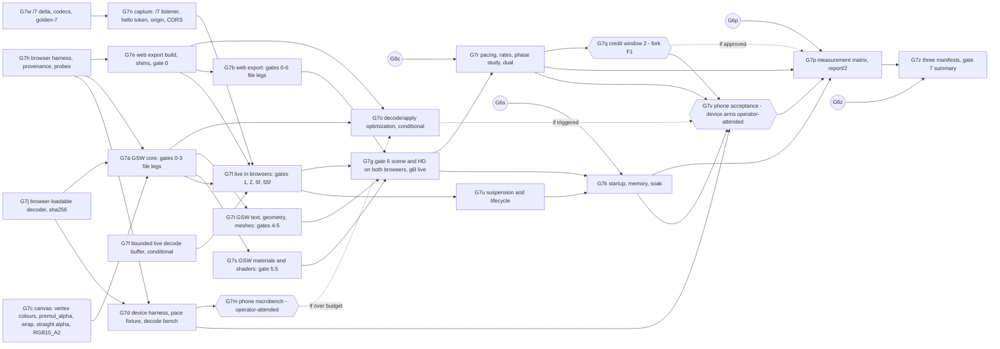

# Gate 7 design: browser receivers

Status: contract for gate 7, written 2026-10-14. At that point gate 6 is complete through G6b and G6l
on `main`. G6c (`rs/gate6-g6c`) and G6s (`rs/gate6-g6s`) are on branches, and G6p and G6z have not
started. Nothing here is implemented yet. Hand it out piecewise. Each increment (G7w, G7j, G7h,
G7c, G7f, G7d, G7e, G7a, G7n, G7m, G7b, G7t, G7s, G7l, G7o, G7g, G7u, G7r, G7k, G7q, G7v, G7p,
G7z) is one verified commit on `main`, implemented by one agent in its own worktree. G7q is gated on
fork F1 at the end of this document. G7f is conditional (D20), and so is G7o (D27).

**Amended 2026-10-14 with a phone acceptance target** (D24 to D28, Q13, increments G7d, G7m, G7o
and G7v, fork F3). The user's requirement: the receiver must easily work at 60/60 on the user's
moto g86 5G, in the browser. Every leg that touches the phone is **operator-attended: it needs the
user's go-ahead and the phone attached** (D28). Desktop legs stay runnable unattended.

Gate 7 needs a new live-transport version, `render-stream/7`. It is specified here as a delta in Q2
and finalized by G7w (D2). The documents this extends are [gate6-design.md](gate6-design.md),
including its "As built (G6c)" section on `rs/gate6-g6c`, and, through it, gates 5.5 to 0. The wire
it builds on is [render-stream-6.md](render-stream-6.md). Background is in
[docs/handoff-headless-render-stream.md](../../../docs/handoff-headless-render-stream.md): the gate 7
row; "Goal and decisions" (two peer browser receivers, chosen per game by manifest); "Configuration
for other games" (the GSW receiver transpiles its subset, the web export compiles exactly); "Slow
receivers and resource dependencies"; and "Validation and measurement".

Source citations are `path:line` in the pinned `../godot-4.5.1-stable` checkout (commit
`f62fdbde15035c5576dad93e586201f4d41ef0cb`), relative to its root. Every cited line was re-read
when this contract was written. Abbreviations: `wm.cpp` is `platform/web/web_main.cpp`, `emws.cpp`
is `modules/websocket/emws_peer.cpp`, `hcw.cpp` is `platform/web/http_client_web.cpp`, `lgd.js` is
`platform/web/js/libs/library_godot_display.js`, `lgf.js` is
`platform/web/js/libs/library_godot_fetch.js`, `wexp.cpp` is `platform/web/export/export_plugin.cpp`,
`sg3.cpp` is `drivers/gles3/shader_gles3.cpp`, `ts3.cpp` is `drivers/gles3/storage/texture_storage.cpp`,
and `rcc.cpp` is `servers/rendering/renderer_canvas_cull.cpp`. GSW paths are relative to this
repository's root.

**No engine or browser probe was run for this contract.** Every engine statement below is read from
source. Every browser statement comes from a web standard or from this repository's own recorded
browser findings (memories `xvfb-does-not-isolate-on-wayland`, `webgpu-parity-findings`,
`pixelmatch-hides-alpha-errors`). Each one marked *(probe)* is checked by G7h before any gate relies
on it. Every count, budget and threshold below is a prediction or a decision that the increments
check by running. A run that disagrees with a prediction is a finding to explain from source. A run
that fails a decided threshold is a finding, never a reason to raise the threshold.

## What gate 7 proves

The handoff's gate 7 row:

> Export the receiver project using Godot Compatibility/WebGL 2, and, as an independent peer, run
> this repository's canvas receiver. Replay the same recordings and live stream through both.
> Repeat pixel, lifecycle and pacing gates for each; account for browser suspension, startup cost
> and memory. Publish each receiver's feature manifest; neither substitutes for the other.

Gate 7 keeps the three independent roles. The two new receivers are additional, independently
launched receivers. Each renders only the captured stream, and each is judged against the same
rendered reference as the native receiver. Gate 7 adds:

1. **A web export of the native receiver.** The project in `receiver/` is exported unchanged in
   behaviour to Godot 4.5.1 Web (Compatibility, WebGL 2, no threads). Two platform shims carry its
   configuration and its evidence, which native reads from the environment and the filesystem (Q4).
   It compiles captured canvas shaders through the engine, exactly as native does.
2. **The GSW canvas receiver.** It is a TypeScript receiver on this repository's canvas stack: the
   render-stream decoder and resolver from `scripts/lib/`, a canvas applier that reimplements
   Godot's canvas ordering, and `packages/canvas`'s WebGL 2 executor. Shaders go through
   `packages/effects`'s transpiler, and everything outside its supported subset is a typed refusal
   (Q5).
3. **The same recordings, references and checkers.** Both browsers replay every receiver leg of
   gates 0 to 6 from a native run of those gates on the same build. Each gate's own checker judges
   them, parameterized by receiver kind, under an explicit per-receiver pixel policy (Q7).
4. **The live stream in a browser.** WebSocket and HTTP fetches go from a page to the loopback
   capture host, with bearer authorization a browser can carry, an `Origin` allowlist and CORS
   (D3, Q2, Q3). The live legs of gates 1, 2, 5, 5.5 and 6 run on each browser.
5. **Lifecycle and suspension.** The browser legs cover a hidden page, a frozen page, reload, a
   closed tab and WebGL context loss, with the gate 1d semantics: bounded pending state, newest
   state on recovery and a host that keeps simulating (Q10).
6. **Pacing.** Credit returns from `requestAnimationFrame`, and the browser rates are reported
   beside the native ones. Gate 7 also takes on G6c's negative finding (60/60 phase-locks to about
   29/s with one transaction in flight). It measures that finding on all three receivers, and it
   defines an opt-in credit window of 2, which is fork F1 (D4, Q9).
7. **Startup cost and memory.** Cold and warm startup are timed from navigation to the first
   applied and submitted transaction. Memory is accounted per process (renderer, GPU, browser) with
   the JS and wasm heaps, and a 300-second soak per browser runs under the budgets from G6s (Q10).
8. **Three feature manifests.** `native`, `web-export` and `gsw-canvas` are generated and checked
   (`render-stream-features/2`, Q11). Every `supported` entry cites evidence from that receiver's
   own legs, so neither browser receiver can borrow the other's evidence.
9. **A phone acceptance target.** Both browser receivers run live on the user's moto g86 5G
   (Android Chrome, Mali-G615) through the perf harness's existing device plumbing. Each is judged
   against decided rate, cadence, main-thread, GPU, thermal, memory and startup budgets at a 60 Hz
   host, separately at credit window 1 and window 2, on a minimal scene, the gate 6 scene and HD
   (D24 to D28, Q13). A decode/apply microbench on the phone runs early, before the big receiver
   work depends on the answer (G7d, G7m).

What gate 7 does **not** do: non-loopback serving, TLS (`wss://`, `https://`) and the target game
(gate 8). It does not negotiate several presentation sizes from one session (gate 8, D12). It adds
no compressed texture formats (gate 8, D19), no threaded web export and no GDExtension in the
browser. It does not cover browsers other than the pinned desktop Chromium (Firefox, WebKit) and
the phone's own Chrome, devices other than the one phone (D24), or a phone on a real network: the
phone reaches the desktop host through `adb reverse` over USB (gate 8 owns Wi-Fi). Presentation
feedback stays `unavailable` under headless Chromium (D13), and on the phone too, where only the
compositor's activation rate is available (Q13a). Payload, atlas
or parameter deltas are not added. GSW gets no MSDF text, no `TIME` and no screen-texture shaders.
All of these are typed or deferred, with owners, in "Deferred".

## Decisions

| #   | Question | Decision |
| --- | -------- | -------- |
| D1  | Two peers | **Two browser receivers, two manifests, no fallback.** The web export and the GSW canvas receiver run every applicable leg independently. A leg that one browser cannot pass is that browser's typed refusal or that browser's failure. It never passes by running the other. The summary and the manifests report each separately (Q11 `manifest-no-substitution`). |
| D2  | Protocol version | **`render-stream/7` is a live-transport delta, negotiated per connection, and file sinks stay on /6.** Browsers need a hello they can send, and authorization without request headers (D3). /1's rule makes control messages part of the version, and `rs_live.cpp:393` rejects an unknown hello key, so both changes need a new version. /7 changes only the magic and strings, the hello, the session's `publication.credit_window`, two `error` reasons, and HTTP CORS behaviour (Q2). Records, transactions, payloads and HTTP routes are byte-identical to /6. The capture's listener accepts both subprotocols, `render-stream.6` and `render-stream.7`. Each connection's session, records and control messages follow the subprotocol it chose (Q3). This is the first time two versions are served side by side, and it is deliberate: every gate from 0 to 6 keeps running on /6, untouched, and no G6b-style switch of every runner is needed. File sinks keep writing /6 until a later cleanup increment chooses to switch them (Deferred). The decoders in all three languages gain `version: … \| 7`, and `golden-2/` to `golden-6/` keep passing. |
| D3  | Browser authorization and origin | **The token travels in the /7 hello, never in a URL or an upgrade header. The host checks `Origin`, and its HTTP endpoint speaks CORS.** A browser's `WebSocket` has no header parameter (G2e finding), and Godot's web peer warns and drops custom headers (`emws.cpp:91-93`). /7's hello carries `token` (64 hex). On a `bearer` session the host sends nothing before a hello with the right token, compared in constant time as G2e does. A wrong or missing token gets `error` `unauthorized` and close 1008, so the reason repeats in the close (memory godot-websocketpeer-drops-msgs-with-close). Resource GETs keep `Authorization: Bearer`, which `fetch` can send (`hcw.cpp:82-106`). New host configuration `GRC_LIVE_ALLOWED_ORIGINS` (a comma list, default empty): an upgrade, GET or `OPTIONS` that carries an `Origin` not in the list gets 403. A request with no `Origin` is exactly as at /6, which keeps native receivers and every /6 gate unchanged. For an allowed origin, GETs answer `Access-Control-Allow-Origin: <origin>` and `Vary: Origin`, and `OPTIONS` on the resource route answers a preflight (Q3). The page receives the token in its URL **fragment** (`#token=…`), which is never sent to a server or in a `Referer`, and removes it with `history.replaceState` before anything else runs. The allowlist is the defence against any website in the operator's browser opening `ws://127.0.0.1:<port>`. |
| D4  | Credit window and 60/60 | **Window 1 stays the default, and window 2 is opt-in, negotiated, and fork F1.** G6c measured that one transaction in flight, sent only at host frame callbacks, and credit returned at the receiver's draw cannot hold 60/60. The receiver's hold (arrival to next draw) is uniform over a frame, so in the bad relative phase of two 60 Hz clocks the round trip exceeds one host frame and the host publishes every other callback. No receiver-side change removes that, only one that shortens the hold. /7's hello carries `credit_window` (1 or 2). The host grants `min(requested, GRC_LIVE_CREDIT_WINDOW_MAX)`, default maximum 1, and declares the grant in `publication.credit_window`. Window 1 is the handoff's rule ("at most one frame transaction in flight per receiver") and stays the correctness baseline. G7r measures the phase lock on all three receivers at window 1, with the "ack closer to draw" variants (native `RS_RECEIVER_LATE_POLL`, browsers' credit in the rAF callback right after submit). Window 2 changes a handoff rule, so its host implementation (G7q) waits for the user (F1). Without it, gate 7 passes with the negative finding restated for browsers. The key and its 1..2 domain are in /7 from the start, so F1 never needs another version. |
| D5  | Web export build | **The non-mono Godot 4.5.1 editor exports `receiver/` with a pinned `web_nothreads_release.zip` and a custom shell.** `mise exec -- godot` resolves to the **mono** 4.5.1 editor (`4.5.1.stable.mono.official.f62fdbde1`). Its template directory `~/.local/share/godot/export_templates/4.5.1.stable.mono/` has no web template, and official Godot 4 .NET builds have none. The non-mono editor is installed at `~/.local/share/mise/installs/godot/4.5.1-stable/Godot_v4.5.1-stable_linux.x86_64`. The template is a **prerequisite not present locally**. Only `4.6.2.stable/web_nothreads_release.zip` exists, and it is the wrong engine. G7e records the download of the official 4.5.1-stable `web_nothreads_release.zip` (from the official export templates archive, with operator approval) into `~/.cache/godot-render-stream/templates/4.5.1-stable/` beside the pinned `linux_release.x86_64`. The preset points at it with `custom_template/release` and pins its sha256. Preset (`receiver/export_presets.cfg`, committed): `variant/thread_support=false` and `variant/extensions_support=false` (both defaults, `wexp.cpp:369-370`; no COOP/COEP needed and no emscripten toolchain, and `emcc` is absent here); `html/canvas_resize_policy=0` (None; the default is 2, `wexp.cpp:377`); `progressive_web_app/enabled=false`; `html/custom_html_shell` set to `receiver/web/shell.html`. The export includes only `receiver/`, never `fixtures/`. The export output is a build product under ignored `artifacts/render-stream/web-receiver/<sha>/`. |
| D6  | Where the GSW receiver lives | **`experiments/render-stream/web/gsw-receiver/` (TypeScript), consuming `@godot-scene-web/canvas` and `@godot-scene-web/effects` through the `development` condition.** Render-stream concepts (sessions, wire ids, credit, manifests) stay in the experiment. Capability gaps that are generic Godot `CanvasItem` drawing go into the packages as generic draw-list features, with their own package tests and a downstream consumer check (G7c, G7s): per-vertex colours, the `premul_alpha` blend, texture wrap modes, straight-alpha sampling, an RGB10_A2 stage target, and item-space shader programs. Nothing in `packages/` learns about render-stream. |
| D7  | GSW render model | **The GSW receiver reimplements `RendererCanvasCull`'s ordering and composition, lowers to a `DrawList`, and renders into an RGB10_A2 target like Godot.** The executor has no item tree, no modulate and no z order (survey of `packages/canvas/src/draw-list.ts`, `executor-webgl.ts`). The applier walks canvases by `(layer, sublayer)` with the root in its declared place, and walks items by `rcc.cpp`'s rules: per-z lists from `CANVAS_ITEM_Z_MIN` concatenated in z order (`rcc.cpp:70-100`), children with `draw_behind_parent` before the parent and the rest after it (`rcc.cpp:468-480`), relative/absolute z, and `top_level` from the wire's canvas parenting. It composes `modulate` down the tree with `self_modulate` last (`rcc.cpp:316`) and multiplies in the canvas modulate. Clips come from `scripts/lib/clip-derive.ts` as Godot's integer scissor (rounded AABB of the transformed rect ∩ ancestor clip; memory godot-canvas-clear-resets-clip), never the executor's rounded-clip SDF. Godot's non-transparent render target is `GL_RGB10_A2` (`ts3.cpp:2144-2150`; memory rs-g55b-cim-facts: alpha has 2 bits). Blending at 10-bit colour precision cannot be reproduced in an 8-bit canvas, so GSW draws into an RGB10_A2 framebuffer and blits it to the canvas. Shots read back from that framebuffer with the same `RGBA`/`UNSIGNED_BYTE` conversion Godot's own readback uses (G7a cites the line). Textures are stored **straight-alpha**, as Godot uploads them, and are premultiplied after sampling, so linear filtering matches Godot's. |
| D8  | Pixel policy | **Per receiver, against the rendered reference, with the native receiver as triangulation (Q7).** Web export: the native receiver's per-region budgets, which are 0 almost everywhere, and a prediction of zero difference from the native receiver on every shot. GSW: exact on every pixel a gate's independent hand model *decides*; a pre-registered `delta1` class for translucent blends; diffs confined to the hand model's *undecided* masks elsewhere; typed regions excluded. Every comparison uses the raw per-channel metric with an explicit limit, never pixelmatch alone (memory pixelmatch-hides-alpha-errors). Bands are pre-registered in a committed `gsw-tolerance.json` with their derivation. An amendment needs a source-cited cause recorded "As built", and widening a band to pass is forbidden. |
| D9  | Browser harness | **Pinned Playwright Chromium `chromium-1223` (Chrome 148.0.7778.96), `--headless=new --enable-gpu --use-angle=vulkan`, with a provenance guard.** These flags give the real RTX 2060 through ANGLE/Vulkan with no window (memory xvfb-does-not-isolate-on-wayland). Never `--enable-features=Vulkan`, which breaks WebGL canvases here. Never headed, never Xvfb, and no gamescope for browsers. The guard refuses the leg (`browser-provenance`, a harness refusal, never a pass) unless `WEBGL_debug_renderer_info` names ANGLE, NVIDIA and Vulkan; no Chromium process holds a Wayland socket (count Wayland FDs, not X11); `DISPLAY` and `WAYLAND_DISPLAY` are unset in the launch environment; and the binary's sha256 matches the recorded one. Also: `--force-device-scale-factor=1`, `--force-color-profile=srgb`, a fresh `--user-data-dir` per cold leg, and the background-throttling switches (`--disable-background-timer-throttling`, `--disable-renderer-backgrounding`, `--disable-backgrounding-occluded-windows`) on every leg **except** suspension legs. Native references and receivers keep gamescope, as before. |
| D10 | Inputs and evidence in a browser | **Over loopback HTTP, in the native receiver's formats.** A harness server (`scripts/lib/browser-harness.ts`) on `127.0.0.1` serves the receiver bundle and each leg's inputs read-only: recording, store, shader library and token-free configuration. It accepts `PUT /evidence/<leg-nonce>/<path>` into that leg's directory only. Both browser receivers write `applied.json`, `shots/seq-<n>.png`, `perf.json`, `perf-timeline.jsonl` and `received.rs7` by PUT. All writes and every PNG encode happen outside timed windows. The page origin (harness) differs from the live host's, which is what D3 is for. |
| D11 | Which legs | **Every receiver leg of gates 0 to 6 on both browsers, the live legs of gates 1, 2, 5, 5.5 and 6, and browser-only lifecycle, pacing, startup and memory legs (Q8).** Legs that are receiver-independent (gate −1, every capture and reference leg) are not repeated. They come from the source run (D21). Headless-receiver legs are `not-applicable` for browsers, which always render. |
| D12 | Presentation size | **Unchanged: one presentation size per capture session (gate6-design.md D2).** Browsers present at `presentation_size` 1:1. The canvas backing store equals it, the harness forces DPR 1, and the CSS size equals the backing size. Any mismatch is typed `presentation-mismatch` and still drawn, scaled by CSS. /7's hello advertises the viewer's backing size, CSS size and DPR (Q2). The host only records them, giving gate 8 the data to choose between a host evaluation per size, renegotiation, or typed resampling (Deferred). |
| D13 | Rates and presentation in a browser | **Receiver frame = one rAF callback that drew; `submitted` = after the GL submit at the end of that callback; presented stays `unavailable`.** Headless Chromium has no display, and no web API reports when a canvas frame was presented. The rAF timestamp of the *next* callback after a submit is reported as `raf_after_submit`, a separately named metric, never as presented. GSW measures GPU completion with a `fenceSync` polled on later frames (`gpu_complete`, measured). The web export reports it `unavailable`, because the engine exposes no fence. GPU render time is measured only where `EXT_disjoint_timer_query_webgl2` is exposed *(probe)*, else `unavailable`. |
| D14 | Suspension | **Hidden and frozen pages are receiver stalls with gate 1d semantics, and the WebSocket stays open.** Predicted from the HTML standard *(probe)*: a hidden document gets no rAF callbacks, and a frozen one runs no tasks. Godot's web loop is rAF-driven (`wm.cpp:167`, `emscripten_set_main_loop(…, -1, …)`) and has no `visibilitychange` handler anywhere in `platform/web/js`. Its `max_fps` skip resets after a gap of more than 1 s, so it does not burst on resume (`wm.cpp:89-97`). Credit is returned only from a drawing rAF callback, so a hidden or frozen page holds no credit, and the host coalesces (`max_in_flight ≤ window`, `max_pending ≤ 1`). On resume, the first applied state is the newest. Reload is reconnect, a closed tab is gate 1d's killed receiver, and WebGL context loss is recovered in place by GSW and by page reload for the web export, whose engine only alerts "please reload" (`lgd.js:735-738`). **As built (G7h): the hidden/frozen premise does not hold under headless=new on chromium-1223 -- see Q1b's "As built (G7h)" note; G7u needs a different mechanism or the user's sign-off to narrow this.** |
| D15 | Startup cost | **Navigation-relative marks, cold and warm.** Cold = a fresh profile (no HTTP cache, no payload cache). Warm = a second load in the same profile. Marks: `navigationStart`, bundle/wasm fetched, wasm compiled (web export), engine ready / receiver ready, socket open, session decoded, first transaction applied, first `submitted`, first `raf_after_submit`. One warmup plus five repeats. Native receiver startup (process start to first `frame_post_draw`) is measured alongside for scale. |
| D16 | Memory accounting | **Per process, from `/proc` and CDP, never from one number.** Renderer, GPU and browser process RSS come from `/proc/<pid>/statm`, using PIDs from CDP `SystemInfo.getProcessInfo`. JS heap comes from CDP `Performance.getMetrics` (`JSHeapUsedSize`). Web export wasm heap comes from the shell (`HEAP8.byteLength`; emscripten never shrinks it). Per-process GPU memory comes from `nvidia-smi`, reusing `packages/perf-harness/src/nvidia.ts`. Engine `get_rendering_info` covers the web export, and GL object counts cover GSW. Soak thresholds are in Q10. |
| D17 | Report schema | **`render-stream-report/2`, a superset of /1 with a browser receiver profile (Q12).** `validate` accepts /1 and /2. `perf-report/1` is not generalized: it describes A/B arms of browser rendering mechanisms, while /2 describes a host-to-receiver pipeline with a native leg in the same document, and gate 6's condition (a concrete second consumer of one shared shape) is still not met. |
| D18 | Manifests | **`render-stream-features/2`, three files under `protocol/features/render-stream-7/` (`native.json`, `web-export.json`, `gsw-canvas.json`), generated by `make-features.ts --receiver <kind>` (Q11).** G6z's planned `render-stream-6.json` (/1) stays the native gate 6 record. /2 adds a structured `receiver`, per-receiver `limits.receiver`, a `receiver-typed` status, and a `band` exactness tied to `gsw-tolerance.json`. The /7 hello carries the manifest's sha256, and the host logs it. |
| D19 | Formats | **No compressed or float texture payloads in gate 7.** Each manifest records the WebGL 2 compression extensions its harness context exposes (S3TC, BPTC, ETC2, ASTC) as evidence for gate 8's decision (gate6-design.md "Deferred"). `unsupported-format` stays a wire refusal. |
| D20 | Native receiver's live buffer | **The receiver must decode live messages in bounded memory before any browser soak.** G6s found `receiver.gd`'s live mode appends every byte to `_data` forever (memory rs-g6s-live-data-unbounded-growth). In a browser this is worse: the wasm heap never shrinks. If gate 6 lands a fix, G7f is void. Otherwise G7f bounds it (decode each message independently, or trim consumed bytes and rebase offsets) and re-runs every live leg of gates 1 to 6 natively. |
| D21 | Source runs | **Browsers replay a native run of each gate made on the same build.** `run-gate7.sh --source <gate>=<run dir>,…` (or `--make-sources`, which runs `run-gate<N>.sh` itself) refuses a source whose recorded `git.commit`, capture library sha256 or template sha256 differs from the current build's, or whose native receiver legs did not pass (`source-run-valid`). Captures, references, `expected.json` and sabotage recordings come from the source. Live legs start their own hosts with the gates' own leg functions (`scripts/lib/legs.sh`, `gate6b-legs.sh`, `gate6h-legs.sh`, G6c's `gate6c-legs.sh`). |
| D22 | Result classes | **Gate 6's classes, plus:** receiver-typed `unsupported` reasons per browser (Q4, Q5); `replay-failure` reasons `context-lost` and `browser-crash`; and harness refusals `browser-provenance` and `source-run-invalid`, which fail the leg as `harness-refused`, never `success`. A browser console `SHADER ERROR` or a WebGL error is `replay-failure` / `shader-compile` or `webgl-error`. |
| D23 | Waves against gate 6 | **Gate 7 lands nothing that needs G6c, G6s, G6p or G6z before they land.** G7w, G7j, G7h, G7c and G7f may be written and landed now: they are disjoint from gate 6's open files, or (G7f) explicitly fix one of its findings. Browser file legs (G7a, G7e, G7b, G7t, G7s) need only what is on `main`. G7r needs G6c, G7k needs G6s, G7p needs G6p, and G7z needs G6z. |
| D24 | Device target and harness | **One phone, the user's moto g86 5G, driven by the perf harness's existing device plumbing, never a parallel one.** Its recorded facts (Q13a) are Android 15, Chrome 151 at the last measurement, `Mali-G615 MC2 (ANGLE)` over OpenGL ES 3.2 (not Vulkan), DPR 3.4876 and a 790×316 CSS landscape viewport. The panel is adaptive "up to 120 Hz" per Motorola, but Chrome measured 89–90 Hz on every committed phone table and 59.5 Hz once, when the panel dropped to 60. So the panel rate is measured per repeat, never assumed. `browser-harness.ts` gains `env: "device"`, built by importing `packages/perf-harness/src/device.ts` (`selectDevice`, `openDeviceBrowser`, `reverseServerPort`, `ensureResponsive`, `sampleConditions`, `readGpuDeviceMetrics`). That gives adb reverse for the harness port and the live host's port, so every URL and the page origin are byte-identical to desktop and D3's allowlist is unchanged. It also gives the flattened CDP attach, the foreground and lock rules, and recorded `isolation` (docs/perf-harness.md "Measuring on a real phone"). The capture host and its gamescope stay on the desktop. Chrome on the phone is attached to, never launched, so D9's flags, binary sha256 and Wayland guard cannot apply. `device-provenance` replaces `browser-provenance` on device legs (Q13b). |
| D25 | Phone acceptance target | **"Easily works at 60/60" means Q13d's decided checks, at a 60 Hz host, on every one of five repeats, for each browser receiver and each of three workloads (`pace`, `scene`, `hd`).** Every receiver budget is relative to T_p, the measured median rAF interval (predicted 11.1 ms at 90 Hz). The checks are: at least 57 new frames drawn per second; new-frame intervals within the 3:2 cadence (p95 ≤ 2·T_p + 1 ms, max ≤ 50 ms); receiver main-thread work per drawn frame p95 ≤ 0.5·T_p; GPU time per drawn frame p95 ≤ 0.5·T_p where it can be measured, plus a draw-twice headroom leg for GSW; no thermal throttling over a 600-s soak; bounded memory; and warm startup ≤ 3 s. Window 1 and window 2 are judged separately, and the result names the window (F1 made window 2 opt-in). A miss is a finding, never a reason to move a budget. |
| D26 | Rate mismatch on the phone | **The phone is a 60 Hz host against a 90 Hz (or 120 Hz) rAF, not G6c's 60/60 phase lock, and Q13c's model predicts it.** On a 90 Hz panel, 60 new frames per second can only be shown 3:2: intervals alternate 11.1 and 22.2 ms. That judder is intrinsic and is not a rate loss, so the checks admit it. At window 1 the hold before the next rAF is shorter than on desktop (< T_p), but the phone's work is longer. 60/s holds at every phase only while work plus transport stays within about 5.6 ms (90 Hz) or 8.3 ms (120 Hz). Window 2 takes the hold off the critical path. A panel that falls to 60 Hz is G6c's case again. The web export runs `--max-fps 0` on the phone: a 60 cap on a 90 Hz rAF skips one tick in three (`wm.cpp:83-97`) and doubles the worst hold. GSW draws only in rAF callbacks that applied a transaction. |
| D27 | Decode risk, measured first | **The web export's GDScript decode is the known risk. A phone microbench settles it before any increment depends on the answer.** On desktop, the native receiver decodes at 6.2–6.5 ms mean per transaction (7.2–7.6 ms under load) and applies at about 0.9–1.0 ms. That is the 400-transaction gate 6 `animate` replay in G6c's README, "Gate 6c result". The live rate-60 leg measured decode p50 2.1 ms and apply 1.5 ms, and 15.8 s of receiver CPU over 30 s. The phone's budget is 5.6 ms for the *whole* frame at 90 Hz. The web export runs the same GDScript in wasm on a Cortex-A78, predicted 3–6× slower, so the prediction is a miss (Q13e). G7d (unattended, wave 1) builds the bench, the minimal fixture and the device harness. G7m (operator-attended, wave 2) runs it on the phone for both receivers, with GSW on G7j's browser-loadable decoder. A miss is the typed finding `device-decode-over-budget`, with per-phase numbers. It triggers G7o, which applies named candidate optimizations under unchanged goldens and budgets. If G7o cannot close the gap, the miss is recorded in that receiver's manifest. No budget is relaxed. G7o is void if G7m passes. |
| D28 | Operator attendance | **Every device leg is operator-attended: it needs the user's go-ahead and the phone attached.** The phone is the user's personal device. No agent runs adb against it, changes one of its settings (refresh mode, stay-awake, developer options) or launches anything on it without the user's go-ahead in that session. An increment whose verification includes a device leg stops before that leg and asks. Every device leg has a desktop control arm on D9's harness that runs unattended. Device results carry their build sha, and any later change to a receiver, `rs_ws` or `rs_live` marks them stale until an attended re-run (Q11 `manifest-device-target`). Unattended runs (`--legs` without `--env device`) never select `g7-dev`'s device arms. |

## Q1. What the engine and the browser do

### Q1a. Godot 4.5.1 on the web

- **Shaders.** Desktop GL compiles every engine shader as `#version 330` with `USE_GLES_OVER_GL`.
  The web compiles them as `#version 300 es` (`sg3.cpp:157-162`). Both declare `precision highp`
  for float, int and samplers (`sg3.cpp:216-222`). No canvas shader branches on
  `USE_GLES_OVER_GL` (the only users are `cube_to_dp.glsl`, `lens_distorted.glsl` and
  `effect_blur.glsl`). The half-float polyfill is off on the web (`drivers/gles3/storage/config.cpp:242-244`),
  as it is under desktop GL on this GPU. The canvas pipeline therefore runs the same GLSL bodies at
  the same precision on both platforms. That is the basis of P-W1 (Q7).
- **Render target.** A non-transparent viewport renders into `GL_RGB10_A2` (`ts3.cpp:2144-2150`).
  It is color-renderable in WebGL 2, so the web export keeps native's target format.
- **WebSocket.** The web peer passes `supported_protocols` to the browser and only warns about
  `handshake_headers` (`emws.cpp:83-93`). Its inbound buffer is
  `nearest_shift(inbound_buffer_size)` (`emws.cpp:109`). The live client already sets
  `inbound_buffer_size` before connecting (`receiver/rs_live_client.gd:36-41`). The web export sets
  it at least to the largest transaction (the HD full transaction is about 813 KB; memory
  rs-g6h-hd-facts) plus control, and declares it in the hello.
- **HTTP.** `HTTPClientWeb` turns each `request()` into one `fetch` with the given headers
  (`hcw.cpp:82-106`; `lgf.js:92-97` passes only method, headers and body, so mode `cors`,
  credentials `same-origin` and cache `default` apply). It goes to `STATUS_DISCONNECTED` after each
  body (`hcw.cpp:220-225`), so there is no keep-alive. `rs_resource_fetcher.gd` already treats
  `DISCONNECTED` after a body as success and opens a new client for the next GET. Cache `default`
  means the browser's HTTP cache serves a repeated hash, and the host's GETs already answer
  `Cache-Control: private, max-age=31536000, immutable` and an `ETag`
  (`capture/src/rs_ws.cpp:576-579`).
- **Main loop and pacing.** `emscripten_set_main_loop(main_loop_callback, -1, false)` (`wm.cpp:167`)
  runs one iteration per rAF. With `max_fps > 0` an iteration is skipped until `target_ticks`. After
  a gap of more than one second, `target_ticks` resets to now (`wm.cpp:83-97`), so a resumed page
  does not burst. `--max-fps` and `--frame-delay` reach the web build through the engine's argument
  list, as on native.
- **Environment.** `OS_Web` derives from `OS_Unix` (`platform/web/os_web.h:44`). Its environment is
  emscripten's synthetic one, so no `RS_*` variable exists. Configuration must come from the
  engine's argument list (`OS.get_cmdline_user_args()`), which the shell sets.
- **Files.** `user://` is IDBFS, persisted only through explicit `FS.syncfs`
  (`platform/web/js/libs/library_godot_os.js:157-160`). `/proc` does not exist, so `rs_perf.gd`'s
  RSS read fails, which is reported as `unavailable`.
- **Display.** With hidpi off the pixel ratio is 1 (`lgd.js:226-227`). Canvas resize policy 0 keeps
  the canvas's own width and height (`lgd.js:740-742`). WebGL context loss shows an alert asking for
  a reload, and the engine does not recover (`lgd.js:735-738`). There is no `visibilitychange`
  handler in `platform/web/js`.

### Q1b. Chromium (each item is a standard's rule; *(probe)* items are checked by G7h)

- The WHATWG `WebSocket` constructor takes a URL and subprotocols only, never headers (G2e met the
  same wall in Node).
- `Authorization` is not a CORS-safelisted request header. A cross-origin `fetch` carrying it is
  preceded by an `OPTIONS` preflight. Chromium caches a preflight per (origin, URL) for at most
  7200 s, in memory, so a new browser process preflights again *(probe)*. Every distinct hash URL
  costs one preflight per browser process.
- The browser HTTP cache may store a response to a request with `Authorization` when the response
  says `private` with a `max-age`. It is keyed by URL and the top-frame site, not by the header
  *(probe: the warm leg's zero-GET prediction)*.
- A hidden document gets no rAF callbacks, and its timers are throttled. A frozen document
  (`Page.setWebLifecycleState`) runs no tasks, while its sockets stay open *(probe)*. How to make
  a headless=new page hidden is itself a probe. The candidates, in order, are a second target
  brought to the front with `Target.activateTarget`, `Browser.setWindowBounds` with
  `windowState: "minimized"`, and `Emulation` focus/visibility overrides. G7h records which one
  yields `document.visibilityState === "hidden"` and stops rAF.
- Readback: under Playwright, 2D canvases do not read back (memory webgpu-parity-findings).
  Receivers read shots from their own WebGL framebuffer with `readPixels` (GSW) or the engine's
  viewport texture (web export). A CDP screenshot of the page is used only as the compositor check
  of an opaque frame (Q7 `compositor-equals-readback`).

**As built (G7h, 2026-10-14).** Every *(probe)* item above was run for real against chromium-1223
(148.0.7778.96, D9's exact flags), through `scripts/lib/browser-harness.ts` and
`scripts/test/self-test-browser-harness.ts` (README "Gate 7h result"). Six of the eight hold or are
confirmed with a caveat; one is a direct contradiction with a consequence for later increments:

1. **The hidden-page bullet does NOT hold, and none of Q1b's three candidates hides a
   headless=new page on this build.** `Target.activateTarget` on an auxiliary page,
   `Browser.setWindowBounds(minimized)` and `Emulation.setFocusEmulationEnabled(false)` all return
   success from CDP but leave `document.visibilityState === "visible"` and rAF running at the full
   rate. Worse, `Page.setWebLifecycleState("frozen")` itself -- the mechanism D14 cites directly
   for "a frozen document runs no tasks" -- has no effect either: rAF and a `setInterval` both kept
   running through a 1.2 s frozen window, no `visibilitychange` fired, and
   `Page.setLifecycleEventsEnabled(true)` never emits a `frozen`/`resume` lifecycle event. This was
   checked three independent ways (direct CDP round-trips, the lifecycle-event listener, and a
   fully passive page that reports its own counters by `console.log` on a timer, so no
   `Runtime.evaluate` poll from Node could itself be "waking" it) before being recorded here.
   **Consequence: G7u (suspension and lifecycle) cannot exercise D14's hidden/frozen legs through
   any CDP override on this Chromium build in this sandbox.** G7u needs either a different
   mechanism (a real display; a different Chromium release; or testing `wm.cpp`'s gap-reset logic
   directly rather than through a browser) or the user's sign-off to report the hidden/frozen legs
   `unavailable` under headless=new and test D14's bounded-pending-state/newest-on-resume claims
   some other way. `SuspensionController`'s `hideVia*`/`freeze` methods are still implemented and
   return a measured `tookEffect` (not the CDP call's bare success), for whichever mechanism G7u
   ultimately uses.
2. **The preflight-caching and HTTP-cache bullets hold, confirmed in an isolated two-process
   probe** (one `node:http` server, no other probe run first): a cold fetch costs one preflight and
   one GET, a same-page repeat and a same-process reload cost zero of each, and a genuinely fresh
   browser process costs one more of each. Inside the FULL G7h probe sequence (after probes 1-4 run
   on the same browser/page), the measured hit counts are confounded -- the first fetch there costs
   two of each instead of one, and the fresh-process phase shows zero new hits -- and this was not
   root-caused further given the cost already sunk into it (README "Gate 7h result" Finding 3). The
   qualitative behaviour is confirmed; an exact hit COUNT from this harness's combined sequence is
   not to be trusted, and G7l should re-measure in isolation if a count becomes load-bearing.
3. **`compositor-equals-readback` holds exactly** (max channel delta 0 over 65 536 px of a flat
   opaque colour), supporting D7's prediction that GSW's RGB10_A2 stage readback and the page
   compositor agree.

### Q1c. What GSW already has (survey of `packages/`, 2026-10-14)

- `packages/canvas` (`draw-list.ts`, `executor-webgl.ts`, `present.ts`, `textures.ts`,
  `clip-stack.ts`) provides a WebGL 2 executor over a numeric `DrawList`. Its commands are
  `DRAW_QUAD` (affine, source rect, premultiplied tint, blend, flips), `DRAW_NINE_PATCH` (no axis
  modes), `DRAW_POLYLINE` (one colour), clip push/pop (scissor, plus an SDF corner radius),
  `DRAW_GLYPHS` (hb-gpu outlines; not used here), `DRAW_TEXTURED_MESH` (indexed, UVs, one tint, **no
  per-vertex colours**), and screen/external effect hooks. Blends are `MIX/ADD/SUB/MUL`, with no
  `premul_alpha`. Wrap is always `CLAMP_TO_EDGE`. The pipeline is premultiplied end to end, and
  values stay in the sRGB domain, as Godot 2D does. The stage is `createCanvasStage`
  (`premultipliedAlpha: true`, no depth or stencil, `antialias: false`).
- `packages/effects/src/shaders/godot-shader.ts` provides `transpileGodotShader` to GLSL ES 3.00.
  It handles `canvas_item` `fragment()` with `COLOR`, `UV`, `TEXTURE`, `TEXTURE_PIXEL_SIZE`,
  uniforms (scalar, vector, matrix, int and bool, plus arrays and extra samplers), helpers,
  `#include` and `render_mode` blend. It rejects with a typed error (`rejectUnsupported`,
  `UNSUPPORTED_BUILTINS`) `VERTEX`, `FRAGCOORD`, lights, `INSTANCE_*`, `while`, `uint` and more.
  `vertex()` is accepted only for constant varyings. It executes as a full-rectangle quad, not
  per canvas-item vertex.
- `experiments/render-stream/scripts/lib/render-stream-2.ts` decodes, validates and resolves /2 to
  /6 with no `fs`. Its only Node dependency is `node:crypto` `createHash` (also in
  `render-stream-mesh.ts` and `render-stream-shader.ts`). `geometry-raster.ts` (GLES3 coverage,
  blend equations including `premul_alpha`, nine-patch axes, mesh topology) and `clip-derive.ts`
  are pure TypeScript. The `StyleBoxFlat` port and the shader twins are Python, but StyleBoxFlat
  arrives already lowered to `add_triangle_array` with per-vertex colours.
- `packages/test-harness/src/image-diff.ts` provides `compareRgbaBuffers` with `maxChannelDelta`
  (the default 255 is not enforced, so every gate 7 call sets it). `packages/perf-harness` has a raw
  CDP launcher (`cdp.ts`), a loopback server with esbuild `conditions:["development"]`
  (`serve.ts`), trace analysis and `nvidia.ts`. `scripts/lib/proc-sampler.ts` samples `/proc`.

## Q2. Wire: render-stream/7

/7 is /6 with exactly these changes. G7w writes them as `protocol/render-stream-7.md`, a delta
document like render-stream-6.md.

- **Magic** `47 52 53 37 0D 0A 1A 0A` (`GRS7`), subprotocol `render-stream.7`, `protocol`
  `"render-stream/7"`. A /7 decoder refuses `GRS6` with `bad-magic`, and a /6 decoder refuses
  `GRS7`. /7 streams exist only as live connections and the receivers' `received.rs7` copies of
  them (D2).
- **Hello** (receiver to host; flat; integers only, as /1). It has nine keys, and every one is
  required:

```
{"type":"hello","protocol":"render-stream/7","receiver":<str ≤64>,
 "receiver_kind":"native"|"web-export"|"gsw-canvas",
 "credit_stage":"submitted"|"applied","credit_window":1|2,
 "inbound_buffer_bytes":<int>,"token":<64 lowercase hex>|null,
 "manifest_sha256":<64 hex>|null,
 "presentation_backing_w":<int>,"presentation_backing_h":<int>,
 "presentation_css_w":<int>,"presentation_css_h":<int>,"dpr_milli":<int>}
```

  That is /6's five keys plus `receiver_kind`, `credit_window`, `token`, `manifest_sha256` and the
  five presentation integers (flat, because /1's control messages are flat). `token` is null
  exactly when the receiver has no token. Headless native receivers send their logical size and
  `dpr_milli` 1000.
- **Host behaviour on the hello.** On a `resources.auth: "bearer"` session, a hello whose `token`
  is null or wrong is `error` `unauthorized`, then close 1008 with reason `unauthorized`. A
  `credit_window` outside 1..2 is `error` `protocol`. The host grants
  `w = min(credit_window, GRC_LIVE_CREDIT_WINDOW_MAX)` (default max 1). The host's live log
  records every key except `token`, and records `token_ok` instead.
- **Session.** `publication` gains `credit_window` (`<int 1..2>`, the grant; 1 on file streams):
  `{"mode","target_fps","credit_window"}`. A new invariant `publication-entry` extension:
  `credit_window` is an integer in 1..2, and it is 1 on a `file` stream. Every other session key is
  /6's.
- **Credit with window w.** The host may hold up to `w` transactions in flight. Each new
  transaction is a patch against the last one *sent* (unchanged), so the receiver applies them in
  sequence and may apply several in one frame, drawing only the last. The host pins the payloads of
  every in-flight transaction's base. `ack` and `resync` are unchanged. A resync for any in-flight
  seq forces the next send to be full and discards the receiver's later in-flight patches (the
  receiver ignores patches until a full transaction, exactly as /1). Window 1 is byte-for-byte /6
  behaviour.
- **Errors.** `error.reason` gains `unauthorized`. The close-code table gains 1008 for
  `unauthorized` (1008 already exists for the queue safety limit).
- **HTTP.** The routes and responses are /6's (`/resources/sha256/<hash>`, `Cache-Control`,
  `ETag`, bearer). New, for every request carrying `Origin`:
  - An origin not in `GRC_LIVE_ALLOWED_ORIGINS` gets 403 on the upgrade, on GET and on `OPTIONS`.
  - For an allowed origin, GETs add `Access-Control-Allow-Origin: <origin>` and `Vary: Origin`.
  - `OPTIONS /resources/sha256/<hash>` for an allowed origin answers 204 with
    `Access-Control-Allow-Origin: <origin>`, `Access-Control-Allow-Methods: GET`,
    `Access-Control-Allow-Headers: authorization`, `Access-Control-Max-Age: 7200` and
    `Vary: Origin`. It answers whether or not the hash is servable, and it carries no token
    (browsers send no credentials on a preflight).
  - The WebSocket upgrade for an allowed origin is unchanged.

  These HTTP rules apply to /6 connections too, because a browser could open one. A request
  without `Origin` is exactly /6.
- **Control vectors** (`golden-7/control/valid|invalid/*.json`, used by the C++ parser test and
  the TypeScript and GDScript self-tests). Valid: hellos with each receiver kind, with
  `credit_window` 1 and 2, and with and without a token. Invalid: a missing key, an unknown key,
  `credit_window` 0 and 3, a non-hex token, a `/6` protocol string, and a float `dpr_milli`.
- **Golden vectors `protocol/golden-7/`** (`make_golden.py --check`, stdlib only): golden-6's
  `rate.rs6` re-encoded as `rate.rs7` (`stream.transport: "websocket"`, `publication`
  `rate`/30/`credit_window` 1), plus `window2.rs7` (the same stream with `credit_window` 2 and
  two consecutive patches whose bases chain). Both resolve to `resolved-rate.json`. File-stream
  states are not re-encoded, because /7 has no file streams. `invalid/` holds `bad-magic` (GRS6),
  `publication-window` (`credit_window` 3) and `publication-file-window` (a file stream with 2).
  Verify inline `record_index` values by decoding (memory g4e1-rs3-version-switch-pattern).

## Q3. Capture: the live listener

Only `rs_ws` and `rs_live` change. The mirror, the hooks, the file sinks and the calibrator are
untouched, so gate −1 must still list 79 hooks and gates 0 to 6 must pass unchanged on /6.

- **Two subprotocols on one listener.** The upgrade accepts `render-stream.6` or
  `render-stream.7`. If both are offered, it chooses /7. The connection's `version` drives
  `Session::version` for its session record and every record it is sent (the C++ encoder is
  version-parameterized since /3). One snapshot copy per frame still serves every connection.
- **Hello, token and window** as in Q2. `GRC_LIVE_CREDIT_WINDOW_MAX` (1..2, default 1) is a new
  variable, added to every runner's `GS_STRIP_VARS`. Window 2 (in-flight accounting, pins over two
  bases, resync of the earlier seq) is G7q's work. Before G7q the host accepts a hello asking for 2
  and grants 1.
- **Origin and CORS** as in Q2. `GRC_LIVE_ALLOWED_ORIGINS` is parsed at arm. An entry must be an
  exact `scheme://host:port` with no path; anything else refuses to arm (`origin-config-invalid`). A
  403 is a new `rs_ws` event, `OriginRejected`, logged like G2e's `AuthRejected` to `stdout.log`
  (`live: 403 origin <origin>`). An `OPTIONS` request is an `HttpGet` event with `method: "OPTIONS"`
  in the hook log's `http-get` line, so preflights are counted per host.
- **Sabotages** (`GRC_SABOTAGE`): `no-cors` (omits every `Access-Control-*` header), `accept-any-origin`
  (allowlist ignored; exists only so `origin-refused` can fail) and `token-ignored` (the hello token
  is not checked).
- **Evidence.** `live-summary.json` gains per connection: `version`, `receiver_kind`,
  `credit_window` (granted), `manifest_sha256`, the presentation integers, `origin`, `token_ok`,
  and `preflights`.

## Q4. The web-export receiver

The same GDScript as native, with two shims and a shell. Native behaviour is unchanged, which G7e
proves by re-running gates 0 to 6 natively.

- **`rs_config.gd`.** Every `RS_RECEIVER_*` value is read through one function, environment first,
  then `--rs-env=NAME=VALUE` from `OS.get_cmdline_user_args()`. On the web only the second exists.
  The 18 variables `receiver.gd` reads today are the list (`RS_RECEIVER_CACHE_DIR` …
  `RS_RECEIVER_URL`), plus G6s's budgets, plus `RS_RECEIVER_TOKEN` (web only: the token itself,
  from the shell's fragment, because there is no token file). `RS_RECEIVER_TOKEN_FILE` stays
  native-only.
- **`rs_io.gd`.** It covers sources and sinks. *Source*: native reads the recording, store and
  shader library from paths. The web fetches `RS_RECEIVER_RECORDING`, `RS_RECEIVER_STORE_DIR` and
  `RS_RECEIVER_SHADER_LIBRARY` as same-origin URLs on the harness, through `HTTPClient`, into
  memory, before `_ready` applies the session. A file-mode fetch is counted as `store_fetches`,
  exactly as reading the store counts as a fetch today. *Sink*: native writes files. The web PUTs
  `RS_RECEIVER_OUT`-relative paths to `RS_RECEIVER_EVIDENCE_URL`. The cache directory
  (`RS_RECEIVER_CACHE_DIR`) is native only. On the web the "disk cache" is the browser's HTTP cache
  (`applied.json` `cache.mode: "http-cache"`). Evicting from it is not possible, so G6s's disk
  budget is typed `cache-budget-unsupported` on the web (D16 measures the profile's disk use
  instead).
- **`rs_perf.gd` on the web.** RSS is `unavailable` there (`/proc` is absent; D16 measures it from
  outside). `gpu_render_ms`/`cpu_render_ms` come from `viewport_get_measured_render_time_*` and are
  reported with whatever status the engine gives on WebGL 2 *(probe in G7e: nonzero means
  `measured`)*.
- **Shell (`receiver/web/shell.html`, committed).** It is Godot's `$GODOT_*` template variables
  plus about 80 lines:
  1. It reads `location.hash` and removes it with `history.replaceState`.
  2. It reads the query string (`?env=<base64url JSON>` from the harness) and builds
     `args: ["--rs-env=…", …, "--max-fps", …]`.
  3. It places `performance.mark` around `Engine.init`, `startGame` and its promise.
  4. It exposes `window.__rsWasmHeap = () => Module.HEAP8.byteLength` for D16.
  5. On `webglcontextlost`, it marks `rs-context-lost` and reloads after a PUT of a
     `context-lost.json` stub.
  6. It sets the canvas `width`/`height` attributes and CSS size from the query (presentation size,
     DPR 1).
- **Live client.** The hello is built from `rs_config` for /7 (`receiver_kind: "web-export"`,
  `credit_window` from `RS_RECEIVER_CREDIT_WINDOW`, default 1). `supported_protocols` is
  `["render-stream.7"]`. Native gains `RS_RECEIVER_PROTOCOL=6|7` (default 6, so every /6 gate is
  untouched), and native /7 legs use the token-in-hello path too.
- **Late poll (native and web; G7r).** `RS_RECEIVER_LATE_POLL=1` moves the socket read and apply
  from `_process` to `RenderingServer.frame_pre_draw`, then acks `submitted` at that frame's
  `frame_post_draw` as today. It exists to measure "ack closer to draw" (D4). It is not a default.
- **Shots.** Unchanged: `get_viewport().get_texture().get_image()` after `frame_post_draw`, PNG
  encoded and PUT outside timed windows.
- **Typed on the web** (receiver-typed, `applied.json` `unsupported` with `seq: null`):
  `cache-budget-unsupported` (disk budget set), and `presentation-mismatch` /
  `oversampling-mismatch` exactly as native (gate6-design.md Q5).
- **Bundle provenance.** `build-web-receiver.sh` writes `build.json` with the editor sha256, the
  template sha256, the preset, the `.pck` sha256 and its file list. `no-source-scene` checks that the
  list has no path under `fixtures/` and no fixture script name.

## Q5. The GSW canvas receiver

`experiments/render-stream/web/gsw-receiver/`, bundled by esbuild with `conditions:["development"]`
(as `packages/perf-harness/src/serve.ts` does).

- **Decode** (G7j). `render-stream-2.ts`, `-mesh.ts` and `-shader.ts` take an injected synchronous
  `sha256` (`scripts/lib/sha256.ts`, pure TypeScript, checked against `node:crypto` on every
  golden). Node callers inject `node:crypto`, and the browser injects the pure one. Each live message
  is decoded on its own, so memory is bounded by construction. Payload bytes are kept by the
  receiver's own cache (the resolver keeps only hashes).
- **Applier** (`rs-canvas-applier.ts`, G7a): resolved state → retained scene → `DrawList` each
  drawn frame. It follows D7 (ordering, modulate, scissor, canvases by `(layer, sublayer)`,
  `top_level`, `visible`, `draw_behind_parent`, `z_as_relative`, `clip_ignore`, `set_transform`).
  The content cache keys on `content_version`, so an item's lowered commands are rebuilt only when
  its commands change. A transform-only change patches transforms (`patchQuadTransform` and
  similar).
- **Lowering table** (op → executor; *exactness predicted*, Q7):

| Wire op | GSW lowering | Predicted |
| ------- | ------------ | --------- |
| `add_rect` | `DRAW_QUAD`, white texel | exact |
| `add_texture_rect`, `_region` (incl. glyph quads) | `DRAW_QUAD`, source rect, straight-alpha texture, item filter/repeat | exact (text: P-G2) |
| `add_nine_patch` (stretch/tile/tile_fit, `draw_center`) | adapter lowers to quads with `geometry-raster.ts` `mapNinePatchAxis`, tiles as repeated quads | exact |
| `add_polygon`, `add_primitive`, `add_triangle_array` (per-vertex colour, optional texture) | `DRAW_TEXTURED_MESH` with per-vertex colours (G7c) | decided px exact; AA feathers `delta1` |
| `add_line`/`add_polyline`/`add_multiline` with width > 0, `add_circle` | adapter lowers to triangles with Godot's own lowering as ported in `geometry-raster.ts` | decided px exact |
| hairlines (width ≤ 0) | 1-px quads along the line | `band` (GL line rasterization is not quads); G7t measures, and an inexact result is typed `gsw-hairline` |
| `add_mesh` (GRM1) | `DRAW_TEXTURED_MESH` with per-vertex colours | decided px exact |
| `add_msdf_texture_rect_region` | none | typed `gsw-msdf` |
| `add_lcd_texture_rect_region` | already a wire refusal | — |
| `add_set_transform`, `add_clip_ignore` | applier state | exact |

- **Textures.** GRT1 payloads are uploaded once per hash into a straight-alpha texture with the
  item's effective filter (nearest or linear) and repeat. Sampling premultiplies after filtering
  (G7c). `CanvasTexture` channels beyond diffuse are already typed on the wire.
- **Materials** (G7s). The `CanvasItemMaterial` builtin (`builtin` descriptor, gate5_5-design.md
  D7) maps blend modes to executor blends (adding `premul_alpha`, G7c). Light mode `unshaded` and
  `normal` draw unlit (there are no lights, Q1d of gate 5.5), and `light_only` draws nothing, which
  is exactly Godot's behaviour without lights. Custom `ShaderMaterial` with a `source` entry:
  - The GRP1 code is preprocessed server code with `@@` include markers (memory
    rs-g55c-shader-fixture-facts). It is normalized and transpiled by `transpileGodotShader`.
  - G7s adds to `packages/canvas` an **item-space program** path. The transpiled `fragment()` body
    replaces the executor's fragment colour stage for that item's quads and meshes, with `UV`,
    `COLOR` (vertex colour × modulate), `TEXTURE` and the material's uniforms, and with
    `instance uniform` values per item draw.
  - Filter hints on `sampler2D` uniforms (`filter_nearest`, …) are honoured, and today's transpiler
    ignores them, which G7s fixes in `packages/effects`.
  - A transpile rejection is the receiver-typed `gsw-shader-transpile` with the transpiler's
    message in `detail`, and the item draws without its material. A `withheld` entry under policy
    `params` uses the harness-served shader library, verified by hash, exactly as native does.
- **Credit and pacing** (G7l). WebSocket `onmessage` decodes and validates, acks `received`, and
  queues. The rAF callback applies every queued transaction in order (a window of 1 means at most
  one), acks `applied`, builds the frame, executes and blits, then acks `submitted`, all in that
  callback. A `fenceSync` inserted after the blit is polled on later frames for `gpu_complete`.
  `RS_RECEIVER_MAX_FPS` skips rAF callbacks with `wm.cpp`'s `target_ticks` rule, so a browser at
  30 behaves like the web export at `--max-fps 30`.
- **Fetch.** One `fetch` at a time, with `Authorization`, polled from rAF, exactly the native
  fetcher's sequential semantics. A transaction stays unapplied until its payloads are verified and
  cached. Concurrency is an option measured in G7p (`RS_RECEIVER_FETCH_CONCURRENCY`, default 1).
- **Budgets.** `RS_RECEIVER_MEMORY_BUDGET_BYTES` is an LRU over payload bytes and GL textures.
  It never evicts the needed set or a hash pinned by an in-progress fetch (gate6-design.md Q5).
- **Context loss.** On `webglcontextrestored` GSW re-creates every GL object for the current
  applied state from its memory cache, refetching evicted hashes, then draws. No transaction is
  needed, and credit continues.
- **Sabotages** (`RS_RECEIVER_SABOTAGE`). It implements the native receiver's: `ignore-clip`,
  `stale-texture`, `ignore-material`, `ignore-canvas-modulate`, `stale-param`,
  `ignore-canvas-stacking`, `ignore-presentation` and `no-evict`, defined on applied state so the
  native predicted (shot, region) sets apply unchanged. It adds GSW-only sabotages:
  `premultiplied-upload` (premultiply on upload, so filtering is wrong), `ignore-z` (draws in
  `draw_index` order only), `ack-on-receipt` (`submitted` from `onmessage`), `ack-while-hidden`
  (`submitted` from a timer) and `leak-gl-textures`.
- **Evidence.** `applied.json` uses `render-stream-receiver-applied/7` (below), shots come from the
  RGB10_A2 framebuffer, and `perf.json`/`perf-timeline.jsonl` use /6's keys plus the browser ones
  (Q12).

`applied.json` schema `render-stream-receiver-applied/7` (all three receivers from G7a/G7e on;
checkers accept /6 and /7) is /6's shape plus a top-level `receiver`:
`{"kind","build_sha256","manifest_sha256","protocol":"render-stream/6"|"render-stream/7","credit_window"}`.

## Q6. Browser harness (`scripts/lib/browser-harness.ts`, `scripts/run-gate7.sh`)

- **Launch**: `playwright-core` `chromium.launch({executablePath: <chromium-1223>, headless: false,
  args: ["--headless=new", "--enable-gpu", "--use-angle=vulkan", …D9]})`, the launch pattern of
  `packages/test-harness`'s glyph suite. One browser per leg, a fresh `--user-data-dir` unless the
  leg is `warm`, and the environment stripped of `DISPLAY` and `WAYLAND_DISPLAY`. A CDP session per
  page provides metrics, lifecycle and screenshots.
- **Servers**: the harness HTTP server (bundle, inputs, evidence PUT), and, for live legs, the host's
  own listener. The page origin is `http://127.0.0.1:<harness port>`, and that exact string is passed
  as `GRC_LIVE_ALLOWED_ORIGINS`. `throttle-proxy.ts` sits between page and host for constrained legs.
  It is a TCP proxy, so `Origin` and every preflight cross it unchanged.
- **Provenance** (`browser-provenance` check, every leg): the renderer string, Chromium sha256 and
  version, the flags, the per-process Wayland FD count (0), the PIDs and types, and the GL
  extensions list. On a mismatch, the leg is `harness-refused`.
- **Suspension controller**: the mechanism G7h's probe selected (Q1b), with
  `hide(ms)`, `freeze(ms)`, `reload()`, `close()` and `loseContext()` (via `WEBGL_lose_context`
  from the page). Each records host-clock timestamps for the checkers.
- **Samplers**: `/proc` RSS for the browser, renderer and GPU PIDs (reusing `proc-sampler.ts`, 1 Hz),
  `Performance.getMetrics` at 1 Hz, `nvidia-smi` per-process memory at 1 Hz, and the page's own
  `perf-timeline.jsonl`.
- **Console**: every console message and page error goes to `console.jsonl`. A `SHADER ERROR`,
  `WebGL:` error or uncaught exception fails the leg (D22). `token-not-logged` greps
  `console.jsonl` too.
- **Compositor check**: `Page.captureScreenshot` clipped to the canvas, at the leg's last shot,
  only on legs whose final frame is opaque.

## Q7. Pixel policy

Notation: R = rendered reference, N = native receiver (rendered, gamescope), W = web export,
G = GSW canvas receiver. Every comparison uses `compareRgbaBuffers` with `maxChannelDelta` set
explicitly, and fails on either pixelmatch or the raw channel budget. Alpha is compared as well as
colour (RGB10_A2's 2-bit alpha is quantized in every model; memory rs-g55b-cim-facts).

| Receiver | Compared with | Region class | Budget | Prediction |
| -------- | ------------- | ------------ | ------ | ---------- |
| N | R | as gates 0–6 | unchanged | unchanged |
| W | R | every region | N's own per-region budget (0 except G6g's measured rings/text) | **P-W1**: W = N byte for byte on every shot of every gate, so W meets N's budgets with no new band |
| W | N | every region | report only (triangulation) | 0 px |
| G | R | `decided` pixels of the gate's hand model | channel 0, pixels 0 | **P-G1**: exact |
| G | R | text glyph pixels | channel 0 | **P-G2**: exact, because glyph quads are integer-aligned with 1:1 texel mapping (gate 4: commands float32-exact against the oracle; at `half`, atlases are oversampled, so it is still 1:1 in physical pixels). At risk, see below |
| G | R | `delta1`: translucent blends and AA-feather vertex-colour interpolation | channel ≤ 1, any count inside the class mask | **P-G3**: channel ≤ 1 |
| G | R | `undecided` masks not covered above (hairlines, filtered scaled images) | diffs only inside the mask, counted and reported, channel ≤ 255 | **P-G4**: inside masks |
| G | R | regions of an op or material GSW types | excluded, typed reasons must match exactly | `gsw-msdf` on gate 4e, `gsw-shader-transpile` on predicted shaders |

- **Masks come from the gates' own `expected.json` and models, never from a GSW run.**
  `scripts/lib/gsw-tolerance.ts` derives each gate's `delta1` and `undecided` masks: blended and
  feathered pixels from `geometry-raster.ts` and gate 5g's ring sets; text boxes from gate 4/6
  expected; the hairline band from gate 5b. It writes them to the committed
  `fixtures/gsw-tolerance.json` (`--check` regenerates byte-identically).
- **Why P-W1.** The same engine executes the same canvas GLSL bodies at `highp` on the same GPU, into
  the same RGB10_A2 target (Q1a). **At risk** and so listed in advance, not pre-granted:
  - gate 4e MSDF (`fwidth` through ANGLE's translation);
  - gate 5g/6 StyleBoxFlat rings (vertex-colour interpolation through Vulkan);
  - gate 5.5c custom shaders (integer `%` and array indexing in GLSL ES 3.00).

  A diff there is a finding explained from ANGLE or engine source before any band is recorded. A
  band is at most `delta1`, needs a same-build W repeat that is identical, and is recorded "As built".
- **Why P-G1 to P-G3.** WebGL 2 over ANGLE/Vulkan rasterizes with the same pixel-centre and
  top-left rules as desktop GL on the same hardware. D7 matches the render target and the alpha
  convention, so geometry the hand model decides cannot differ. Godot blends straight-alpha
  `(SRC_ALPHA, ONE_MINUS_SRC_ALPHA)`. GSW blends premultiplied `(ONE, ONE_MINUS_SRC_ALPHA)` with
  `rgb·a` from the shader. They are mathematically equal, but the multiply happens in different
  units, so a translucent pixel may round differently by one level. That is the only reason
  `delta1` exists.
- **Amendments.** A G run that exceeds a budget is a GSW bug until a source-cited raster-rule
  difference explains it (ANGLE, executor math order, or the engine's own shader). Only then may
  the band be recorded, with the cause, in "As built" and in `gsw-tolerance.json`. Widening a band
  so a run passes is forbidden.
- **Presence and freshness** markers of every gate apply to W and G unchanged.
- **`compositor-equals-readback`** (W and G): the CDP screenshot of the canvas equals the
  receiver's own readback of the same frame, channel 0, for opaque frames. It catches a wrong
  `premultipliedAlpha` declaration or a CSS scale, which no readback can see (memory
  webgpu-parity-findings). Sabotage `css-opacity` (the shell sets `opacity: 0.99`) must fail exactly
  this check.

## Q8. Legs and checks

Leg directories are `<out>/<gate>/<kind>/<leg dir>`, where `<kind>` is `web` or `gsw` and the leg
dir is the native leg's own relative path. Check ids are the gates' own, suffixed `@web` or `@gsw`.
Each gate's checker gains a `receiverKind` parameter and a leg-table mapper. G7a and G7e add
`scripts/lib/gate7-adapters.ts`, one adapter per gate. They do not fork any checker.

| Group | Contents (each for `web` and `gsw` unless marked) | Expected class |
| ----- | ------------------------------------------------- | -------------- |
| `g7-0` | gate 0 receiver legs; `no-source-scene`; `browser-provenance` | `success` |
| `g7-1` | gate 1 file receiver legs (g1a, g1b, g1e incl. sabotages); live g1c (`live`, live-vs-replay equivalence), g1d (`stall`, `resync`, `reconnect`, `killed`) on /7 | gate 1's |
| `g7-2` | gate 2 file legs (g2b, g2d); live g2c (`live`, `warm`, `stall`, `reconnect`, `animate`, sabotages `unpin`, `drop-resource`, `wrong-hash`); auth: `live-auth`, `sabotage-no-token` (→ `replay-failure` `live-connect-failed`, host logs `unauthorized`), `sabotage-bad-http-token`, new `origin-refused` (page from a non-allowed origin → 403, `OriginRejected` logged) and `sabotage-no-cors` (→ `resource-unavailable` at seq 1, host served the GET) | gate 2's; new legs as stated |
| `g7-3` | gate 3 legs (g3a–g3d) | gate 3's |
| `g7-4` | gate 4 legs (g4a–g4f) | gate 4's; `gsw` g4e: `unsupported` with exactly `gsw-msdf` |
| `g7-5` | gate 5 file legs (g5b, g5d, g5e, g5g); live g5f | gate 5's (`gsw` hairline legs per G7t's finding) |
| `g7-55` | gate 5.5 file legs (g55b, g55d, g55e incl. `params` policy); live g55f | gate 5.5's; `gsw` typed per G7s's measured set |
| `g7-6` | g6a receiver legs (scene, patch, inline, animate, refused, receiver sabotages); g6h/g6b receiver legs at `native` and `half` (presentation 1920×1080 and 960×540 backing stores); g6l (`live-scene`, `-warm`, `-stall`, `-reconnect`, `sabotage-live-stale-coalesce`) | gate 6's |
| `g7-lc` | `hidden-2s`, `hidden-30s`, `frozen-30s`, `reload`, `close`, `context-loss`, `sabotage-ack-while-hidden` (gsw), `sabotage-css-opacity` | Q10 |
| `g7-r` | Q9's rate legs per browser, `phase-60` ×5 for `native`, `native-late-poll`, `web`, `gsw` (and window 2 if F1), `dual-native-web`, `dual-native-gsw`, `constrained-<kind>`, `sabotage-ack-on-receipt` (gsw) | Q9 |
| `g7-k` | `startup-cold`, `startup-warm` (1 + 5 each), `soak-<kind>` (300 s), `sabotage-soak-no-evict-<kind>`, `sabotage-leak-gl-textures` (gsw) | Q10 |
| `g7-dev` | Q13d: `dev-<pace\|scene\|hd>-w<1\|2>-<kind>`, `dev-gpu-headroom-<workload>-gsw`, `dev-soak-<kind>`, `dev-startup-<warm\|cold>-<kind>`, report-only `dev-maxfps60-scene-w1-web` and `dev-panel-<hz>-…`; each with an unattended desktop control arm `ctl-…` | Q13d. **Device arms are operator-attended (D28)** |
| `g7-p` | Q12's matrix | report valid |

Gate 7 adds these checks to every browser leg:

| Check | What it requires |
| ----- | ---------------- |
| `browser-provenance` | Q6 |
| `source-run-valid` | D21 |
| `no-source-scene` | the web `.pck` list, or the GSW esbuild metafile inputs, contain nothing under `fixtures/` |
| `console-clean` | Q6 |
| `token-not-logged` | G2e's grep, extended to `console.jsonl`, the harness log and every PUT body |
| `evidence-complete` | every file a native leg writes exists for the browser leg, by the same names |
| `hello-recorded` | live legs: the host's summary shows the expected kind, window, manifest sha and presentation integers |

Device legs (`g7-dev`, Q13) replace `browser-provenance` with `device-provenance`, and they skip
`compositor-equals-readback`, because the canvas is CSS-fitted there. Every other check above
applies.

## Q9. Pacing and rates (G7r; `realtime`, timeline `rate`, `animate`; G6c's as-built bounds)

| Leg | Host | Receiver | Criteria |
| --- | ---- | -------- | -------- |
| `rate-15/30/60-<kind>` | `GRC_PUBLISH_FPS` 15/30/60, `--max-fps 60` | browser rAF (60 under headless *(probe)*) | `rate-achieved` with G6c's as-built lower bound 0.95 × min(nominal, credit capacity); applied within 2 % of published; submitted = applied ± 1; receiver frame rate ∈ [57, 61] |
| `rate-uncapped-<kind>` | uncapped, `--max-fps 0` | rAF | `limited_by` reported (predicted `credit`, rAF-bound) |
| `mismatch-60-recv30-<kind>` | 60 | 30 (`--max-fps 30` / `RS_RECEIVER_MAX_FPS=30`) | G6c's as-built `rate-mismatch` |
| `phase-60-<variant>` ×5 runs | 60, `--max-fps 60` | native, native + late poll, web, web + late poll, gsw (and each at window 2 if F1) | published/s per run, the window's mean credit RTT in host frames, and receiver hold p50/p95, all reported; `phase-classified`: each run is good (mean RTT ≤ 1.1 host frames) or bad (≥ 1.9); runs in between are named. **Decided**: window 1 must pass G6c's bound. **Predicted**: about half the window-1 runs bad on every receiver, fewer with late poll and GSW's in-rAF ack; window 2: all five runs ≥ 0.95 × 60 |
| `dual-native-<kind>` | uncapped, `--max-fps 60`, 2 connections (one /6 native, one /7 browser) | native 60, browser 60 | `dual-independent` as G6c built it; the two connections run on different protocol versions, and one snapshot copy per frame |
| `constrained-<kind>` | 60 via `throttle-proxy` | browser | G6c's `constrained` criteria, plus preflight latency reported |
| `sabotage-ack-on-receipt` (gsw) | 60 | gsw acks `submitted` from `onmessage` | fails exactly `credit-from-paced-loop` (a `submitted` ack whose receive and ack fall within no drawing rAF) |

`credit-from-paced-loop` (every live browser leg): every `submitted` ack follows a rAF callback that
applied that seq and drew, by the receiver's own timeline. Rates are reported as G6c reports them,
plus `raf_after_submit` and `gpu_complete` (GSW). `presented` is `unavailable` with the reason
"headless Chromium: no display and no canvas presentation feedback".

## Q10. Suspension, lifecycle, startup and memory

Lifecycle legs run on `gate6-scene`'s `live` timeline (S = 300, N = 60). The suspension starts
just after the step-2 shot, as G6l's stall does, so a `TEXA` version and step 3 land inside it.

- **`hidden-2s`, `hidden-30s`, `frozen-30s`.**
  - `raf-stopped`: no drawing rAF while suspended (prediction 0).
  - `pending-bounded`: `max_in_flight ≤ window`, `max_pending ≤ 1`, and queued bytes at most one
    transaction plus control.
  - `host-unperturbed`, as G6c built it.
  - `socket-kept`: the same `stream_id` throughout, with no reconnect.
  - `stall-latest`: the first post-resume applied state equals the host's mirror state at that
    transaction's frame.
  - `fetch-latest-only`: G6l's rule.
  - `resume-no-burst`: at most two applies in the first resumed frame at window 1, and none
    skipped silently.
  - `stall-recovery`: the post-resume shots equal the reference at their frames.
- **`reload`.** `location.reload()` mid-stream.
  - `reconnect`: a new `stream_id`, seq 1 full, and the host freed the old connection's state.
  - Warm HTTP cache: GETs only for hashes not fetched before the reload. **Predicted: 0 repeated
    GETs, and one preflight per hash needed again**, because the preflight cache is per process
    and the page is the same process *(probe; if preflights do survive, record it)*.
  - The post-reload shots equal the reference.
- **`close`.** The tab is closed. This is gate 1d's `killed`: the host sees the close, retires
  the connection's pins, and keeps its frame interval (`host-unperturbed`).
- **`context-loss`.** `WEBGL_lose_context.loseContext()`, then `restoreContext()` after 500 ms.
  - GSW: `success`; uploads after restore equal the resident texture and mesh count; credit
    resumes; the shots equal the reference.
  - Web export: `replay-failure` `context-lost` is recorded, then the shell reloads and the leg
    continues as `reload`. Its class is `success` with `recovered: "reload"`, and the gap is
    reported.
- **Sabotages.** `ack-while-hidden` (gsw) fails exactly `credit-from-paced-loop` and
  `pending-bounded` (credit keeps flowing to a page that draws nothing). `css-opacity` fails
  exactly `compositor-equals-readback`.
- **Startup** (`startup-cold`, `startup-warm`; `gate6-scene` live, one warmup plus five repeats).
  The D15 marks are reported as distributions, with no pass threshold beyond
  `startup-complete` (every mark present and ordered) and `startup-warm-fetches` (warm: zero GETs
  for payloads; the bundle, wasm and `.pck` served from the HTTP cache, per the harness log).
  Native startup is reported beside them.
- **Soak** (`soak-<kind>`, 300-s window after 60-s warmup, G6s's budgets: memory 1 MiB). Decided
  thresholds over [60 s, 360 s]:
  - `residency-bounded` as G6s for receiver memory-cache entries, plus GSW GL texture and buffer
    counts.
  - `rss-bounded-renderer` and `rss-bounded-gpu`: median of the last 30 s minus median of the first
    30 s ≤ 16 MiB, and least-squares slope ≤ 2 MiB/min.
  - `js-heap-bounded` (gsw): the same, ≤ 4 MiB and ≤ 0.5 MiB/min.
  - `wasm-heap-bounded` (web): end ≤ value at 60 s + 16 MiB.
  - `gpu-mem-bounded`: per-process `nvidia-smi` end ≤ value at 60 s + 8 MiB.
  - `soak-pixels`: the final shot equals the reference's step-11 shot, as G6s.
  - Sabotages: `no-evict` fails exactly `residency-bounded` on the memory-cache count, and
    `leak-gl-textures` fails exactly `residency-bounded` (GL textures) and `gpu-mem-bounded`.
  - Prediction: the honest legs pass only after D20's fix. Before it, the web leg fails
    `wasm-heap-bounded` at about G6s's measured rate.

## Q11. Feature manifests: `render-stream-features/2`

```
{"schema":"render-stream-features/2",
 "protocol":"render-stream/7","stream_protocols":["render-stream/6","render-stream/7"],
 "engine":{"version":"4.5.1-stable","template":"linux_release","platform":"linux-x86_64"},
 "capture":{"calibrator_version":9,"hooks":79},
 "receiver":{"id":<str>,"kind":"native"|"web-export"|"gsw-canvas",
             "build":{"sha256","godot_editor","web_template_sha256"|null,"bundle_bytes"|null},
             "platform":{"runtime":"godot-4.5.1-gl_compatibility"|"chromium-148.0.7778.96",
                         "graphics":<renderer string>,"angle_backend":"vulkan"|null}},
 "entries":[{"id","kind","name",
             "status":"supported"|"typed-unsupported"|"receiver-typed"|"unobserved"|"declared-unverified",
             "reason","exactness":"exact"|"delta1"|"band"|"repeat-budget"|null,
             "tolerance":<gsw-tolerance id>|null,
             "evidence":[{"gate","fixture","leg","check","receiver_kind"}...],"owner","notes"}...],
 "limits":{ …/1's keys…,
            "receiver":{"max_texture_size","max_message_bytes","credit_windows":[1]|[1,2],
                        "fetch_concurrency","cache":"memory+disk"|"memory+http-cache",
                        "shader_policies":[...],"texture_formats":["rgba8",…],
                        "webgl_compression_extensions":[...]|null,
                        "device_targets":[{"id":"moto-g86-5g-60","workload":"pace"|"scene"|"hd",
                                           "credit_window":1|2,
                                           "status":"met"|"not-met"|"unverified"|"not-applicable",
                                           "panel_hz":<number>|null,"chrome":<str>|null,
                                           "build_sha":<str>|null,"failed_checks":[...],
                                           "evidence":[{"run","leg","check",
                                                        "receiver_kind"}...]}...]}}}
```

- Every file has the same entry ids, the protocol's full entry list. The three files differ in
  `status`, `exactness`, `evidence` and `limits.receiver`.
- `receiver-typed` is a feature the wire carries that this receiver refuses with a receiver-typed
  reason (`gsw-msdf`, `gsw-shader-transpile`, `gsw-hairline`, `cache-budget-unsupported`). It needs
  the reason and an `owner`.
- `band` needs a `tolerance` id present in `fixtures/gsw-tolerance.json`.
- `device_targets` (D25) has one entry per workload and window, so six per browser receiver. The
  `native` file lists them as `not-applicable`, because the phone runs browsers only. `met` and
  `not-met` need a device run of **this receiver's** `g7-dev` legs on the manifest's build.
  Otherwise the entry is `unverified` and quotes the newest device run with its build sha.
  `not-met` lists the failing Q13d checks. A `not-met` entry is a recorded result, not a
  manifest error.
- Checks (G7z):
  - `manifest-check`: `make-features.ts --receiver <kind> --check` regenerates byte-identically.
  - `manifest-matches-session`: as G6z, per receiver.
  - `manifest-evidence`: every evidence `check` passed in the quoted run, under **that receiver's**
    leg.
  - `manifest-no-substitution`: no `supported` entry of `web-export` or `gsw-canvas` cites
    evidence of another kind.
  - `manifest-refused`: every receiver-typed reason observed in a receiver's legs is a
    `receiver-typed` entry of that receiver's file, and vice versa.
  - `manifest-matches-hello`: every live leg's hello `manifest_sha256` equals its file's sha256.
  - `manifest-device-target`: every `met` or `not-met` entry cites `g7-dev` device legs of its
    own receiver kind, on the same build, with `device-provenance` passing. The status equals
    what Q13d's checks give. An entry whose run is on another build is `unverified`, never `met`.
- The README's "Gate 7 summary" renders the three manifests side by side as one table, with the
  device targets as their own table: receiver × workload × window.

## Q12. `render-stream-report/2`

/1 (gate6-design.md Q7f) plus these changes. `validate` accepts both schemas.

- `provenance.receiver` gains `kind`, `browser` (`{product, version, revision: "chromium-1223",
  sha256, args, renderer, extensions_hash}` or null) and `bundle` (`{sha256, bytes}` or null).
  `timing.receiver_clock` is `"performance.now"` for browsers.
- `scenarios[].config` gains `receiver_kind`, `credit_window`, `late_poll`, `fetch_concurrency`
  and `cache` (`cold`, `warm`, or `warm-http` for browsers).
- `repeats[].stages` gains `recv_raf_interval_us`, `recv_raf_after_submit_us`,
  `recv_gpu_complete_us`, `recv_hold_us` (received to submitted) and `recv_preflight_us`.
- `repeats[].startup` (new): one `<dist>` per D15 mark, relative to `navigationStart` or process
  start.
- `repeats[].memory` gains `recv_renderer_rss_*`, `recv_gpu_process_rss_*`, `recv_browser_rss_*`,
  `recv_js_heap_*`, `recv_wasm_heap_*` and `recv_gpu_mem_*` (start, end, slope, max).
- **Device rows (Q13).**
  - `provenance.env` (new, required in /2) is `{"kind": "desktop" | "device", "device": … | null,
    "panel": {"raf_interval_p50_us", "mode_hz", "mode_source"} | null}`.
  - `device` is perf-report/1's `env.device` block verbatim, as `device.ts` produces it:
    `model`, `androidRelease`, `chrome`, `batteryPct`, `thermalStatus`, `after`, `warnings`,
    `isolation`, `viewport`, and the rest (docs/perf-report-contract.md). This copies one shape and
    does not generalize perf-report/1 (D17).
  - `repeats[].stages` gains `recv_main_thread_us` (per drawn frame), `recv_gpu_time_us`
    (timer query, otherwise `unavailable`), `recv_new_frame_interval_us`,
    `recv_credit_rtt_host_frames`, `content_update_hz` and `activation_gap_ms`. The last two are
    the trace's, as perf-harness computes them.
  - `repeats[].memory` gains `recv_renderer_pss_*`, `recv_gpu_process_pss_*` (`dumpsys meminfo`)
    and `recv_gpu_mem_device_*` (`dumpsys gfxinfo`).
  - `repeats[].device` (new) holds the 30-s thermal and battery samples, `hidden_ms` and
    `max_raf_gap_ms`.
- Rules:
  - `presented` is `unavailable` for every receiver. That includes the phone, where
    `content_update_hz` is the compositor's activation rate and is never called presented.
  - `recv_gpu_render_ms` is `measured` only where its source says so.
  - Browser memory is never taken from in-page APIs alone. On desktop, RSS always comes from
    `/proc`. On the device, PSS comes from `dumpsys meminfo`, and `/proc` and `nvidia-smi`
    readings are `unavailable`.
  - `recv_gpu_complete_us` is `measured` only for `gsw-canvas`.
  - A device repeat that fails Q13b's watchdog is reported as `invalid`, with the reason. It is
    never averaged in.

**Matrix (G7p)**: warm cache, one warmup plus five repeats, realtime, hook log off:

- `gate6-scene` streaming at 15, 30, 60 and uncapped-host60, for each of `native` (/7),
  `web-export` and `gsw-canvas`.
- Cold at 60 for each kind.
- `gate6-hd` `native` and `half` at 60 for each browser.
- `fetch_concurrency` 1 vs 4 for `gsw-canvas` at cold 60.
- `constrained` at 60 for each browser.
- Window 2 at 60 for each kind, if F1 is approved.
- **Device rows**: `pace`, `scene` and `hd` at 60, windows 1 and 2, for `web-export` and
  `gsw-canvas` on the phone. Each has its desktop control row beside it, plus the soak and startup
  summaries. G7v's attended run on the same build supplies them. If the build has moved since,
  G7p re-runs them, attended, or omits them and says so (D28).

Derived: per receiver, apply, upload, GPU and frame costs; maximum sustained rate with `limited_by`;
cold−warm startup; preflight cost per fetch; and memory by process. For the device rows, also the
phone/desktop cost ratio per stage, and per receiver the window at which the phone target was met,
if any.

## Q13. Phone acceptance target (D24 to D28)

The user's requirement (2026-10-14) is that the receiver must easily work at 60/60 on the user's
moto g86 5G, using the browser. This section makes that measurable. **Nothing in it was run for
this amendment, because no phone was attached.** The device facts come from the committed
perf-harness phone baselines and [docs/perf-harness.md](../../../docs/perf-harness.md), measured
2026-08-20 to 2026-09-02, and from Motorola's published specification. G7m checks every
*(device probe)* item before a later increment relies on it. Every budget below is a decision.
Every predicted outcome is a prediction.

### Q13a. The device

| Fact | Value | Source |
| ---- | ----- | ------ |
| Model, OS | moto g86 5G, Android 15 (SDK 35), serial `ZY32LL2X8W`, unrooted | `env.device` of `packages/perf-harness/baselines/moto-g86-5g-effects-webgpu-runtime.json` |
| Browser | Chrome 151.0.7922.137 at the last measurement. It auto-updates, so it is recorded per run and never pinned | same |
| GPU | `Mali-G615 MC2 (ANGLE)`, ANGLE over OpenGL ES 3.2 (driver `v1.r44p1`) | docs/perf-harness.md "GPU on the phone" |
| SoC, RAM | MediaTek Dimensity 7300 (Cortex-A78 big cores at 2.5 GHz), 8 GB | Motorola specification; not measured here |
| Viewport | landscape 790×316 CSS px at DPR 3.4876 (`naturalViewport`) | baseline |
| Panel | pOLED, "adaptive refresh rates up to 120 Hz". Chrome measured 89–90 Hz swap on every committed phone table, and 59.5 Hz once, when the adaptive panel had dropped to 60 | Motorola specification; docs/perf-harness.md S5 "panel, not the page", S8, S9 |
| Unavailable unrooted | Mali busy %, perfetto GPU counters, and renderer or GPU `cpuTime` from CDP | docs/perf-harness.md "Three things this device cannot give you" |
| Available | trace `contentUpdateHz` and activation gaps, `cpu.byThread` from trace `tdur`, `dumpsys gfxinfo` GPU memory, and `dumpsys battery` / `thermalservice` | same |

Consequences:

- **The panel rate is measured.** T_p is the median rAF interval over the leg's own window. The
  panel mode is read from `dumpsys display` / `dumpsys SurfaceFlinger` *(device probe: which line
  names the active refresh rate, unrooted)*. The prediction is T_p = 11.1 ms (90 Hz) at the phone's
  default setting. A repeat whose T_p differs from the leg's first repeat by more than 5 % is
  reported as a panel-mode change. It is classified at its own T_p and never averaged with the
  others. The acceptance target is judged at the phone's default refresh setting, as the user
  uses it. Other settings are report-only, and only the user changes them.
- **Presentation is CSS-fitted.** The backing store is the presentation size, and the CSS size is
  fitted to the viewport with Godot's "keep" rule, as perf-harness `fit.ts` does on a device.
  - gate6-scene's 640×360 becomes 562×316 CSS px: about 1960×1102 device px, an upscale of
    about 3.06.
  - gate6-hd's 1920×1080 lands in the same box at about 1.02 device px per backing px.
  - So `presentation-mismatch` (gate6-design.md Q5) is expected on every device leg. It is
    recorded with the hello's CSS size and `dpr_milli` and is not a failure there.
  - Pixel parity is judged on the desktop only, under Q7. Device legs keep each workload's
    presence and freshness markers, read from the receiver's own readback outside timed windows.
  - Landscape is required. A portrait phone is the harness refusal `device-orientation`.
- **Gate 6 text costs no glyph shader on the phone.** It arrives as Godot's pre-rasterized atlas
  quads (`add_texture_rect_region`; Q5's lowering table), so GSW never runs hb-gpu's outline
  dilation. Memory phone-outline-dilation-cost (outlined hb-gpu text at 11 Hz with `outlinePx` 6,
  against 90 Hz plain) describes `packages/canvas`'s own glyph path, not these receivers. It would
  apply only if a receiver drew text itself, and gate 7 has none that does.

### Q13b. Device harness, provenance and transport

- **Reuse.** `browser-harness.ts --env device` wraps perf-harness's `device.ts` (D24). Run
  `--dump-trace-names` first on a new Chrome version, as docs/perf-harness.md requires.
- **`device-provenance`.** It runs on every device leg, and a failure is `harness-refused`, never
  a pass. It requires:
  - model `moto g86 5G`;
  - `WEBGL_debug_renderer_info` naming Mali-G615 and ANGLE;
  - the Chrome version recorded (a change since the previous device run is named in the report,
    not refused);
  - `thermalStatus` `none` and the battery at 20 % or more before the first repeat (perf-harness's
    own invalidation conditions);
  - the phone unlocked and the tab in front (`ensureResponsive`), in landscape.
- **Watchdog.** This is perf-harness's throttle rule. A repeat with hidden time > 0, or with a rAF
  gap > 250 ms the receiver did not cause, is `invalid` and is re-run. It is never read as slow
  (docs/perf-harness.md "A retraction: the 149-second bake was a throttled tab").
- **Screen.** A 10-minute soak outlives the screen timeout. The operator keeps the screen on, or
  approves `adb shell svc power stayon usb` for the session, which is restored afterwards (D28).
- **Transport.** `adb reverse` for the harness port and the live host's port. The page's origin
  is `http://127.0.0.1:<harness port>`, exactly as on desktop. The phone's credit RTT includes the
  USB tunnel, so G7m probes it: WebSocket echo RTT p50/p95 for a 100-byte and an 813-KB message,
  and sustained throughput. The prediction is 1–3 ms RTT and well above gate 6's 1.17 MB/s at
  60/s, all *(device probe)*. adb over USB is not the user's eventual network (gate 8).
- **Samplers.**
  - `sampleConditions` every 30 s (thermal status and max temperature, battery % and temperature).
  - `dumpsys meminfo <pid>` PSS for the renderer and GPU processes at 0.2 Hz. The PIDs come from
    CDP `SystemInfo.getProcessInfo` *(device probe: readable unrooted)*.
  - JS heap from `Performance.getMetrics`, and the wasm heap from the shell.
  - `dumpsys gfxinfo` "Total GPU memory usage", as `gpu.device.gpuMemoryBytes` is read.
  - Every repeat is traced as perf-harness traces a device run. That gives the trace's
    `contentUpdateHz`, activation gaps and `CrRendererMain` `tdur` per task.

### Q13c. The rate mismatch: a 60 Hz host and a 90 or 120 Hz rAF

G6c measured two 60 Hz loops: the 60/60 phase lock, about 29/s in the bad phase. The phone is a
different case, and this model predicts it. Throughout, host frame H = 16.67 ms.

- **Cadence, at any window.** 60 new frames per second on a 90 Hz panel can only be shown 3:2. New
  content stays up for one tick, then two (11.1 ms, then 22.2 ms, mean 16.7 ms). That is judder
  intrinsic to 60-on-90, not lost frames.
  - Prediction at 90 Hz: the receiver's new-frame intervals are bimodal at about 11.1 and 22.2 ms,
    roughly half each.
  - At 120 Hz they are unimodal at 16.7 ms (every second tick).
  - At 60 Hz they are unimodal at 16.7 ms wherever 60/s holds.
  - Measured: the rAF timestamps of drawing callbacks that applied a new seq, beside the trace's
    activation gaps.
  - `dev-cadence` admits the two-tick intervals and judges anything beyond them.
- **Window 1.** The host publishes at callback k+1 only if the credit for k has returned:
  RTT = up + hold + work + down ≤ H − host slack, where hold ∈ [0, T_p).
  - At 90 Hz, two host frames are three ticks. Successive arrivals land at two rAF phases 5.56 ms
    apart, so the larger of the two holds lies in [5.56, 11.1) ms whatever the phase. The clocks
    are independent and the panel is adaptive, so the phase drifts across that range.
  - **Predicted at 90 Hz.**
    - work + transport ≤ about 5 ms (p95): 60/s at every phase.
    - About 5 to 11 ms: phase-dependent. Bad-phase stretches skip callbacks, so the published
      rate is irregular, between 30 and 57/s, and `dev-rate` fails.
    - Above 11 ms: at most every other callback, about 30/s or less.
  - At 120 Hz, arrivals keep one phase (two ticks per host frame) and the hold is < 8.33 ms, so
    the bound is work + transport ≤ about 8 ms.
  - A panel at 60 Hz is G6c's case exactly. About half the repeats are predicted near 29/s.
- **Window 2.** One transaction is in flight while the previous one's credit returns, so the hold
  leaves the critical path. 60/s holds while RTT ≤ 2H (33.3 ms) and the per-frame work fits one
  panel tick.
  - Predicted: window 2 passes `dev-rate` wherever `dev-main-thread` passes, at every panel mode.
  - Window 2 cannot rescue a per-frame cost above a tick.
  - It costs a frame of latency. Host-frame-to-draw latency is reported for both windows.
- **The web export's pacing setting.** Godot runs one main-loop iteration per rAF (`wm.cpp:167`).
  - With `--max-fps 60` on a 90 Hz rAF, the `target_ticks` skip (`wm.cpp:83-97`) draws on two
    ticks of three, unaligned with arrivals, so the worst hold doubles to 22.2 ms. Predicted:
    window 1 fails at every phase. `dev-maxfps60-scene-w1-web` reports it.
  - So the phone's acceptance configuration is `--max-fps 0`, which is rAF-paced. It redraws
    every tick, including about 30 redundant frames per second at 90 Hz, so 1.5× the GPU work
    of 60. That cost is measured, not hidden.
  - GSW draws only in rAF callbacks that applied a transaction (D13's receiver frame), so it has
    no redundant draws.
- **Measured per repeat**: published, applied and drawn new frames per second; credit RTT in host
  frames (mean, p95); hold p50/p95; T_p and the panel mode; the new-frame interval histogram; the
  trace's `contentUpdateHz` and activation gaps; and, at window 1, the good/bad phase class with
  Q9's thresholds.

### Q13d. Workloads, legs and checks

Every device leg is live. The host runs on the desktop at `GRC_PUBLISH_FPS=60` and `--max-fps 60`,
with `realtime` on, the hook log off and a warm cache. Each leg is one warmup plus five repeats,
and each repeat measures a 20-s window after 6 s, as G6c does.

| Workload | Scene | What it separates |
| -------- | ----- | ----------------- |
| `pace` | `fixtures/gate7-pace/` (G7d): one 32×32 opaque texture on a 640×360 root, moving 1 px per host frame and wrapping. Every transaction is one transform patch | fixed per-frame cost: socket, decode, apply, submit and rAF |
| `scene` | gate6-scene at 640×360 on G6c's `rate` timeline | the gate 6 scene's cost |
| `hd` | gate6-hd at `native` presentation, 1920×1080 `canvas_items`, on the live timeline G7g's HD legs use | HD fill, upload and transaction size |

Legs (`g7-dev`):

- `dev-<pace|scene|hd>-w<1|2>-<web|gsw>`: twelve rate legs.
- `dev-gpu-headroom-<workload>-gsw`.
- `dev-soak-<web|gsw>`.
- `dev-startup-<warm|cold>-<web|gsw>`.
- Report-only: `dev-maxfps60-scene-w1-web`, and `dev-panel-<60|120>-scene-w<1|2>-<kind>`. The
  `dev-panel` legs run only if the user switches the refresh setting.
- Each device leg has an unattended desktop control arm, `ctl-<same name>`, on D9's harness. The
  control arms are report-only. They give the phone/desktop ratio per stage, and they keep every
  non-device part of the code path testable without the phone.

Decided checks. Each must hold on all five repeats, at the measured T_p:

| Check | Requires | Why this number |
| ----- | -------- | --------------- |
| `dev-rate` | drawn new frames ≥ 57.0/s, published ≥ 57.0/s, and applied = published ± 1 % | 0.95 × 60, G6c's as-built lower bound. Desktop native at 60/60 in the good phase measured 58.3/s |
| `dev-cadence` | new-frame interval p95 ≤ 2·T_p + 1 ms; max ≤ 50 ms (3H); intervals > 34 ms ≤ 0.5 % of drawn frames; trace `contentUpdateHz` ≥ the drawn rate − 1 | admits the 3:2 cadence of Q13c, and rejects more than one dropped host frame in 200 or a compositor that drops new frames |
| `dev-main-thread` | receiver main-thread work per drawn frame: p95 ≤ 0.5·T_p and p99 ≤ T_p. `CrRendererMain` busy (trace `tdur`) ≤ 50 % of wall. For GSW, the work is `onmessage` decode plus the rAF callback's apply, lowering, execute and submit, from its own timers. For the web export, it is the main-loop task's `tdur` (the rAF task that ran the iteration *(device probe: the task's trace name)*), split by `rs_perf`'s decode and apply timers | The work must fit one tick, or rAF misses a vsync. Half the tick leaves room for Chrome's own main-thread work, for content heavier than the fixtures, and for thermal derating. At 90 Hz, 5.6 ms is also what keeps window 1's worst-phase RTT inside one host frame (Q13c) |
| `dev-gpu` | Where `EXT_disjoint_timer_query_webgl2` is exposed *(device probe)*: GPU time per drawn frame p95 ≤ 0.5·T_p, for GSW and for the web export (`viewport_get_measured_render_time_gpu` with status `measured`). Always, for GSW: `gpu_complete` (submit → fence signalled) p95 ≤ 2·T_p. Otherwise `unavailable`, and named in that receiver's manifest | the same headroom rule as the main thread. A fence also waits on queueing, so it gets two ticks |
| `dev-gpu-headroom` (gsw) | with `RS_RECEIVER_DRAW_REPEAT=2` (each frame drawn twice into the stage target and the first discarded), `dev-rate` and `dev-cadence` still pass | shows 50 % GPU headroom with no GPU counter, which this phone does not expose unrooted. The web export has no such seam, so its GPU evidence is `dev-gpu` or nothing |
| `dev-unthrottled` | Q13b's watchdog holds; thermal `none` before and after every leg | a throttled tab is invalid, not slow |
| `dev-presence` | each workload's presence and freshness markers hold on readback shots | the receiver drew the right content |
| `dev-presentation-typed` | `presentation-mismatch` is recorded, with the hello's CSS size and `dpr_milli` | Q13a |
| `dev-soak` | `hd`, at the lowest window that passed its rate leg (window 1 if neither passed), 60-s warmup then 600 s. `thermalStatusCode` 0 at every 30-s sample. Over the last 60 s, drawn rate ≥ 57/s and main-thread p95 ≤ 1.1 × the first 60 s's. Renderer and GPU-process PSS: last-30-s median − first-30-s median ≤ 16 MiB, slope ≤ 2 MiB/min. JS heap (gsw) ≤ 4 MiB and ≤ 0.5 MiB/min. wasm heap (web) at the end ≤ its value at 60 s + 16 MiB. gfxinfo GPU memory at the end ≤ its value at 60 s + 8 MiB. Renderer PSS peak ≤ 512 MiB. Battery temperature rise reported (perf-harness warns at ≥ 3 °C; USB charging adds heat, so it is recorded, not judged) | Phone throttling builds over minutes, hence twice the desktop's 300 s. `hd` is the heaviest workload. The growth slopes are Q10's. 512 MiB is about 2.3 × the native receiver's whole-process plateau (226 MiB, G6s), a ceiling a correct receiver never approaches |
| `dev-startup` | warm: navigation → first `submitted`, median ≤ 3 s and max ≤ 5 s over five repeats. Cold: reported, with D15's marks and the wasm compile broken out | Warm is how the user reopens the page. Cold over USB adb says nothing about the user's network |

**Acceptance.** A receiver **meets the phone target at window w** when every decided check passes
on all three workloads at window w, on one build. For each receiver, the summary says "met at
window 1", "met at window 2 only (opt-in, F1)" or "not met", and lists the failing checks. F3
decides what gate 7 itself requires.

**Predictions** (checked, not granted):

- gsw:
  - `pace` and `scene` pass at both windows.
  - Window 1 passes only if work plus transport stays within about 5 ms (Q13c).
  - `hd` passes `dev-rate`. Its `dev-gpu-headroom` is at risk: an RGB10_A2 target of about
    2.07 MP, plus the blit and the CSS fit, on a two-core Mali.
- web:
  - `pace` passes.
  - `scene` and `hd` fail `dev-main-thread` and `dev-rate` at both windows until G7o (Q13e).
- Soak:
  - gsw at `hd` is predicted to stay thermal `none`. S8's phone runs stayed `none`, but they lasted
    seconds, not 600 s.
  - web: no basis for a prediction.
- Startup:
  - gsw warm well under 1 s.
  - web warm 1–3 s, with the compiled wasm from Chrome's code cache, and at risk.

### Q13e. The early de-risk: a decode/apply microbench on the phone (G7d, G7m)

**The risk, with numbers.**

- Desktop native receiver, G6c README "Gate 6c result":
  - Headless file replay of the 400-transaction gate 6 `animate` capture: decode 6.2–6.5 ms mean
    per transaction, and 7.2–7.6 ms under another agent's load. Apply 0.9–1.0 ms.
  - The live `rate-60` leg: decode p50 2.1 ms and apply 1.5 ms, and 15.8 s of receiver process
    CPU over 30 s.
- The phone's whole-frame budget at 90 Hz is 0.5·T_p = 5.6 ms, so desktop replay decode alone
  already exceeds it.
- The web export runs the same GDScript in wasm on a Cortex-A78 at 2.5 GHz, against a Ryzen 5 5500.
  The prediction is 2–3× for the core and 1.3–2× for wasm against native, so 3–6× overall. That is
  6–13 ms of live decode and 19–37 ms of replay decode per transaction. The web export would miss
  `dev-main-thread` on `scene` and `hd` from decode alone, at either window. This ratio is an
  estimate, and G7m measures it.
- GSW decodes in V8, with G7j's pure-TypeScript SHA-256 hashing inline payloads. G7j measured
  correctness, not throughput, so GSW has no prediction until G7d's desktop numbers give one.

**The bench** (G7d builds it, unattended; G7m runs it, attended).

- Inputs:
  - the same 400-transaction gate 6 `animate` capture G6c's numbers came from;
  - a gate6-hd capture with a full and patch sequence (G6h's);
  - the `pace` recording.
- Each input is replayed in file mode, one transaction per rAF, as a live receiver would apply
  them. Timers wrap only decode and apply. One warmup plus five repeats.
- Web export: a bench export of `receiver/` built by `build-web-receiver.sh --bench` into ignored
  `artifacts/render-stream/web-bench/<sha>/`.
  - It uses D5's pinned non-mono editor and template, plus a build-time-only entry scene. That
    scene drives the receiver's own `rs2_decoder.gd` and apply path over a recording embedded in
    the bench `.pck`.
  - Committed `receiver/` files are unchanged, so no native re-run is needed.
  - Reported as `decode_us` and `apply_us` from `rs_perf`'s existing timers.
  - If the apply path cannot run without G7e's `rs_config` shim, G7d benches decode only. G7m's
    web apply number then waits for G7e, and G7m still runs before G7b and G7l.
- GSW: a bench page over G7j's decoder: decode, validate and resolve per transaction, with
  `hash_us` split out. The applier does not exist before G7a. Its cost is bounded by what remains
  of the budget, and G7v measures it.
- Arms:
  - native headless (`bench-matches-g6c`: within ±15 % of G6c's unloaded replay means);
  - desktop headless Chromium on D9's harness, both receivers, unattended;
  - the phone, both receivers, attended. The phone arm also runs Q13a's and Q13b's device probes.

**Decision rule** (G7m). For each receiver and input, take p95 of the per-transaction decode plus
apply (GSW: decode, validate and resolve).

- **Pass**: ≤ 0.5·T_p at the phone's measured T_p. The phone track proceeds as planned, and G7o is
  void for that receiver.
- **Miss**: the typed finding `device-decode-over-budget`, with the receiver, the input, p50/p95
  per phase (decode, validate, hash, resolve, apply) and the phone/desktop ratio. It triggers G7o.
- The desktop arm is an early signal. If the web export's desktop wasm bench already exceeds
  5.6 ms, the phone cannot pass. G7o may then start without waiting for the attended run, and it
  still needs G7m's phone numbers to close.

**If it misses (G7o).** Candidates are measured one at a time, ranked by the bench's own per-phase
split. Each must keep every golden (2 to 7) and every native gate byte-identical.

- Web export (GDScript):
  - static typing on the decoder's hot paths (typed locals and `Array[T]`, which GDScript 4 runs as
    typed instructions; memory gdscript-strict-cast-port-gotchas);
  - bulk `PackedByteArray.decode_*` reads instead of per-byte loops;
  - no per-record `Dictionary` or `Array` allocation on patch records;
  - applying patches as deltas instead of rebuilding resolved state;
  - pre-sized buffers.
- GSW:
  - `DataView` decoding with no per-record object churn;
  - inline-payload hashing moved off the rAF path, or a wasm SHA-256;
  - decode in a Worker, posting resolved deltas so the main thread only applies.
- Never a candidate: skipping validation or hash verification (the contract requires both), a
  GDExtension or threads in the web build (out of scope), and moving a budget.
- If G7o's best result still misses, that receiver's `device_targets` are `not-met`, with the
  numbers and an owner. F3 then decides what that means for gate 7.

## Increments

Each increment is one commit on `main`, squashed from its branch. The type is `feat(render-stream): …`
or `test(render-stream): …` with `Changelog: none`, except G7c and G7s's package parts, which are
`feat(canvas): …` / `feat(effects): …` with a real `Changelog:` line (published packages).
A fresh worktree needs `scripts/install-agent-config.sh`, `mise trust`,
`pnpm install --frozen-lockfile` and the receiver's `--import` (memories gate0-wp1-engine-facts,
worktree-needs-pnpm-install, receiver-needs-import-before-script). Run biome only on touched files
(memory preexisting-check-failures). Browsers run only through `browser-harness.ts` (D9). Never
launch headed Chromium, Xvfb, or a desktop window.

**Re-runs.** Every increment runs the pure self-tests: `golden-2/` to `golden-6/`, plus `golden-7/`
from G7w on, and every `self-test-*.ts`. In addition:

| Change | Also re-run |
| ------ | ----------- |
| capture or `rs_ws` (G7n, G7q) | `build-capture.sh` (all ctests), gate −1 (79 hooks), gates 1, 2, 6 (`--legs g6l,g6c`) natively on /6 |
| `receiver/` (G7e, G7f, G7l, G7o, G7r) | gates 0 to 6 natively (every receiver leg; this is what proves native behaviour unchanged) |
| `packages/` (G7c, G7s) | `pnpm test`, `pnpm build`, the canvas pixel suites headless (`canvasPixelXvfb`, `canvasGlyphPixelXvfb` under `--headless=new` Vulkan), the export-surface tests, and the downstream consumer check of AGENTS.md (a scratch vite config in `../sts2-couch-coop/frontend` pointed at the worktree; that checkout stays on clean `main`) |
| a `g7-*` group | that group and every earlier `g7-*` group landed |
| a receiver, `rs_ws` or `rs_live`, after G7v | `g7-dev`'s desktop control arms, unattended. The device arms are marked stale (D28) and re-run only at the next attended session |

### Waves



| Increment | Model | Wave | May start before gate 6 completes? | Waits for |
| --------- | ----- | ---- | ---------------------------------- | --------- |
| G7w | sonnet | 1 | **yes** (codecs and vectors only) | — |
| G7j | sonnet | 1 | **yes** (pure TypeScript) | — |
| G7h | sonnet | 1 | **yes** (harness and probes only) | — |
| G7c | opus (gsw-renderer agent) | 1 | **yes** (packages only) | — |
| G7f | sonnet | 1 | **yes**, if G6s left D20 open; lands after G6s | G6s (land) |
| G7d | opus | 1 | **yes** (harness, fixture and bench; unattended) | G7h, G7j (both landed); template (F2, resolved) |
| G7e | opus | 2 | yes | G7h; prerequisite template (D5) |
| G7a | opus (gsw-renderer agent) | 2 | yes | G7h, G7j, G7c |
| G7n | opus | 2 | yes; rebases `rs_live.cpp` onto G6c | G7w |
| G7m | sonnet | 2 | yes. **Operator-attended**: run as soon as G7d lands and the user attaches the phone | G7d; the user's go-ahead and the phone attached (D28); G7e only if Q13e's apply fallback applies |
| G7b | opus | 3 | yes | G7e |
| G7t | opus (gsw-renderer agent) | 3 | yes | G7a |
| G7s | opus (gsw-renderer agent) | 3 | yes | G7a |
| G7l | opus | 3 | yes | G7n, G7e, G7a, G7f (if needed) |
| G7o | opus | 3 | yes; conditional on G7m's finding (D27), void otherwise | G7m; G7e for the web part, G7a for the GSW part; attended only for its closing phone bench |
| G7g | opus | 4 | no | G7b, G7t, G7s, G7l; gate 6 complete through G6s |
| G7u | sonnet | 4 | no | G7l |
| G7r | opus | 5 | no | G7g, G6c |
| G7k | sonnet | 5 | no | G7g, G7u, G6s |
| G7q | opus | 6 | no; F1 approved 2026-10-14 (opt-in) | G7r |
| G7v | opus | 7 | no. **Device arms operator-attended**; control arms unattended | G7r, G7k, G7q, G7d, G7o (if triggered) |
| G7p | sonnet | 8 | no | G7r, G7k, G7v, G6p (G7q if approved) |
| G7z | sonnet | 9 | no | G7p, G6z (and everything before) |

G7t and G7s both touch `rs-canvas-applier.ts`. The second to land rebases. G7o touches
`receiver/rs2_decoder.gd` and GSW's decode path, so it rebases onto whichever of G7b, G7l and G7t
lands first. Gate 7 passes when every increment except G7q (and G7f and G7o if void) has landed,
and `pnpm render-stream:gate7 -- --legs g7-0,g7-1,g7-2,g7-3,g7-4,g7-5,g7-55,g7-6,g7-lc,g7-r,g7-k`
is green on one build. Its source runs must be from the same build, G7p's report must validate,
and G7z's checks must pass. The phone criterion must also hold: `--env device --legs g7-dev`, an
attended run on that build, meets Q13d's acceptance as F3 settles it. Until F3 is answered, the
default is at least one browser receiver. If F1 is declined, the 60/60 negative finding stands in
the summary for all three receivers.

---

### G7w — render-stream/7 delta, codecs, golden-7 (sonnet)

- **Files**: `protocol/render-stream-7.md` (Q2); `version: … | 7` in `rs2_codec.*`, `rs2_diff.*`,
  `scripts/lib/render-stream-2.ts` and `receiver/rs2_decoder.gd`; hello/error parsing for /7 in the
  C++ control parser (`rs_live.cpp`'s parser only, with no behaviour) and in the GDScript and
  TypeScript self-test helpers; `protocol/golden-7/` (`make_golden.py`, `rate.rs7`, `window2.rs7`,
  `resolved-rate.json`, `invalid/`, `control/`).
- **Checks**: golden-7 `--check`, byte for byte and state for state in all three languages; every
  `control/valid` vector accepted and every `invalid` vector refused with its named code;
  `golden-2/` to `golden-6/` unchanged.
- **Sabotage**: a golden with `credit_window` 2 on a file stream must fail `publication-entry`, and
  a hello with an extra key must fail parsing (both in `invalid/`).

### G7j — browser-loadable decoder (sonnet)

- **Files**: `scripts/lib/sha256.ts` (FIPS 180-4, synchronous); an injected hash in
  `render-stream-2.ts`, `render-stream-mesh.ts` and `render-stream-shader.ts` (Node callers pass
  `node:crypto`, and their behaviour is unchanged); `scripts/test/self-test-browser-decoder.ts`.
- **Checks**: the pure hash equals `node:crypto` on every golden payload and 10 000 random lengths
  (0–70 000 B); every golden (2–7) decodes and resolves identically with either hash; an esbuild
  `platform: "browser"` bundle of the three modules has no `node:` import (metafile check).
- **Sabotage**: a hash that skips the length padding must fail the golden resource-hash checks.

### G7h — browser harness, provenance, probes (sonnet)

- **Files**: `scripts/lib/browser-harness.ts` (Q6); `scripts/run-gate7.sh` skeleton
  (`--source`, `--make-sources`, `--legs`, `--out` defaulting to
  `artifacts/render-stream/gate7/<UTC>/`); `scripts/check-gate7.ts` skeleton;
  `package.json` `render-stream:gate7`; `scripts/lib/browser-probes/` (a minimal WebGL 2 page);
  `scripts/test/self-test-browser-harness.ts`.
- **Probes** (results written to `evidence/probes.json` and quoted "As built"):
  1. The renderer string and extensions under D9's flags.
  2. rAF rate when visible.
  3. Which Q1b mechanism hides a headless=new page, and the rAF count while hidden.
  4. That `Page.setWebLifecycleState` frozen stops tasks and keeps a WebSocket open.
  5. Preflight per URL and the preflight cache's lifetime across reload and across processes.
  6. HTTP-cache reuse for `Authorization` + `private, max-age` GETs.
  7. `EXT_disjoint_timer_query_webgl2` availability.
  8. Readback equals the CDP screenshot on an opaque WebGL frame.
- **Checks**: `browser-provenance` on the probe page; Wayland FD count 0 for every Chromium process;
  an evidence PUT outside the leg nonce rejected; a probe rect read back exactly.
- **Sabotage**: launching with `--use-angle=swiftshader` must make `browser-provenance` refuse.

### G7c — canvas package: vertex colours, premul_alpha, wrap, straight alpha, RGB10_A2 (opus)

- **Files**: `packages/canvas/src/` (`draw-list.ts`, `executor-webgl.ts`, `textures.ts`,
  `present.ts`, and their tests). All additions are generic Godot `CanvasItem` drawing capabilities:
  - per-vertex colours on `DRAW_TEXTURED_MESH` (optional colour stream; existing callers
    unchanged);
  - a `BLEND_PREMUL_ALPHA` mode;
  - texture wrap per binding (`clamp`, `repeat`, `mirror` through WebGL 2 sampler objects);
  - a straight-alpha texture flag that premultiplies after sampling;
  - an optional RGB10_A2 stage target with blit and a readback helper.

  The export-surface tests are updated for the new public names.
- **Checks**: canvas pixel-suite cases for each addition against hand-computed pixels (raw channel
  budget 0); straight-alpha linear filtering equals a CPU model of filter-then-premultiply; the
  RGB10_A2 readback matches 10→8-bit conversion on a ramp; existing suites unchanged; the
  downstream consumer check.
- **Sabotage**: a test variant that premultiplies on upload instead must fail the straight-alpha
  filtering case by a channel delta > 1 at a half-transparent edge.
- **As built (G7c, 2026-10-14)**, details in the README's "Gate 7c result":
  - **No `BLEND_PREMUL_ALPHA` constant.** Widening `BlendMode` broke the consumer typecheck
    (`../sts2-couch-coop` indexes a 4-tuple by it). Godot's PMALPHA pair is this executor's MIX
    state, so the capability is on the data instead: `createTextureBinding(handle,
    { straightAlpha: false })`, `TexturedMeshView.premultipliedVertexColors`, and the straight
    modulate passed as the tint. G7s maps `premul_alpha` to that recipe.
  - **`StageTarget.blit()` for `rgb10_a2` is a rounding draw, not `blitFramebuffer`.** The raw blit
    put 95 of 2048 ramp pixels one level below `readPixels`, so `compositor-equals-readback` could
    never pass. The draw writes `floor(c·255 + 0.5)/255`, which makes the canvas equal the readback.
  - **Q7's `delta1` for translucent MIX is real on this GPU.** A shader-premultiplied source is
    converted to the target's colour levels before the blend: 50.196 became 50, so the result was
    75 where Godot's in-blend multiply would give 76. Alpha is not converted first. RGB10_A2's
    2-bit alpha switches at 192, 512 and 832 of 1023, not at the midpoints 171, 512 and 853.
    Interpolated vertex colours are good to about 0.02 of a level.

### G7f — bounded live decode buffer, conditional (sonnet)

Void if gate 6 fixed D20. Otherwise:

- **Change**: `receiver.gd` live mode decodes each message on its own (or trims consumed bytes and
  rebases `offset`).
- **Checks**: G6s's `soak-scene` `rss-bounded` passes natively. Every live leg of gates 1, 2, 5,
  5.5 and 6 is unchanged.
- **Sabotage**: restoring the append-forever path must fail `rss-bounded` again.

### G7d — device harness, pace fixture, decode/apply bench (opus; unattended)

- **Files**:
  - `scripts/lib/browser-harness.ts` gains `env: "device"`. It imports
    `packages/perf-harness/src/device.ts` and copies nothing from it (D24).
  - `scripts/lib/device-sampler.ts`: `sampleConditions` every 30 s, `dumpsys meminfo` PSS, and
    gfxinfo GPU memory.
  - The `device-provenance` check and the watchdog (Q13b).
  - `run-gate7.sh --env device`. Device arms never run without that flag.
  - `fixtures/gate7-pace/`, with its native capture and reference legs and `expected.json`
    (presence markers).
  - `experiments/render-stream/web/bench/`: the GSW bench page and the web-export bench entry
    scene.
  - `build-web-receiver.sh --bench`.
  - The device probes of Q13a and Q13b, implemented and dry-run against a fake `Adb`.
  - `scripts/test/self-test-device-harness.ts`.
- **Checks** (all unattended):
  - `bench-matches-g6c` natively;
  - the bench's desktop arms on D9's harness for both receivers, with their numbers quoted in
    "As built", which is Q13e's early signal;
  - `device-provenance` and the watchdog against recorded `dumpsys` / CDP fixtures, through the
    fake `Adb`;
  - the pace fixture's native receiver legs pass;
  - `--legs g7-dev` without `--env device` runs only `ctl-` arms.
- **Sabotage**: a fake device reporting another model, or a SwiftShader renderer, must make
  `device-provenance` refuse. A fake trace with 300 ms of hidden time must make the watchdog mark
  the repeat `invalid`.
- G7d never touches the phone. It leaves G7m a single command to run.

### G7e — web export: build, shims, gate 0 (opus)

- **Prerequisite**: the official 4.5.1-stable `web_nothreads_release.zip` in
  `~/.cache/godot-render-stream/templates/4.5.1-stable/`, with its sha256 recorded in
  `scripts/README.md`. It is downloaded only with the operator's approval. If it is absent, the
  increment stops and reports.
- **Files**: `receiver/export_presets.cfg`, `receiver/web/shell.html`, `receiver/rs_config.gd`,
  `receiver/rs_io.gd`; the `receiver.gd`/`rs_perf.gd`/`rs_live_client.gd` call sites moved onto them;
  `RS_RECEIVER_PROTOCOL`; `scripts/build-web-receiver.sh`; `build.json`; the `g7-0` web legs; the
  gate 0 adapter in `gate7-adapters.ts`; `render-stream-receiver-applied/7` in all receivers
  and checkers.
- **Checks**: `g7-0@web`; `no-source-scene`; `compositor-equals-readback`; the web receiver's
  `applied.json` equals native's for the same recording on every field except timings and
  `receiver`; gates 0 to 6 natively unchanged.
- **Sabotages**: `RS_RECEIVER_SABOTAGE` through `--rs-env` (gate 0's receiver sabotages must
  classify exactly as natively); `css-opacity` fails exactly `compositor-equals-readback`.

### G7a — GSW receiver core: gates 0 to 3 file legs (opus)

- **Files**: `experiments/render-stream/web/gsw-receiver/` (`main.ts`, `config.ts`, `source.ts`,
  `rs-canvas-applier.ts`, `textures.ts`, `evidence.ts`, `perf.ts`); `scripts/lib/gsw-tolerance.ts`
  and `fixtures/gsw-tolerance.json` (gates 0 to 3 first); the gate 0 to 3 adapters; the
  `g7-0..g7-3` gsw legs (file only).
- **Checks**: each gate's receiver checks `@gsw` under Q7; `ordering-model`, a unit test of the
  applier's walk against gate 1's z, behind-parent, `top_level` and visibility steps from the
  resolved states (no GPU); `clip-parity` (scissors equal `clip-derive.ts` for every gate 3 item
  and step); `transform-only-no-upload` (gate 2: zero texture uploads on transform-only steps).
- **Sabotages**: the native receiver sabotages with their native predicted sets; `ignore-z` must
  fail exactly gate 1's z steps; `premultiplied-upload` must fail exactly gate 2's
  translucent-filtered regions with channel delta > 1 (pixelmatch alone must be shown not to catch
  it, as the memory says).

### G7n — capture: /7 listener, hello token, origin, CORS (opus)

- **Files**: `capture/src/rs_ws.{h,cpp}` (subprotocol choice, `OPTIONS`, CORS headers, `Origin`
  allowlist, `OriginRejected`); `rs_live.{h,cpp}` (per-connection version, /7 hello, `unauthorized`,
  window grant capped at 1); `entry.cpp` (`GRC_LIVE_ALLOWED_ORIGINS`,
  `GRC_LIVE_CREDIT_WINDOW_MAX`, sabotages `no-cors`, `accept-any-origin`, `token-ignored`); ctests;
  `self-test-rs-ws.ts` interop (Node's raw `http` for `Origin`, preflight and the /7 hello);
  `GS_STRIP_VARS` in every runner.
- **Checks**: the ctests; the interop tests (/6 and /7 on one listener at once; preflight headers
  exact; 403 for a foreign origin on all three routes; `unauthorized` close 1008 with its reason);
  gates 1, 2 and 6 (`g6l`, `g6c`) natively on /6 unchanged.
- **Sabotages**: `token-ignored` must make the interop test's wrong-token case connect (and its
  check fail); `accept-any-origin` must fail the 403 case.

### G7m — phone decode/apply microbench (sonnet; operator-attended)

- **Before anything runs**: the agent asks the user for the go-ahead and for the phone, attached
  over USB with debugging enabled, unlocked, in landscape and with the screen kept on (D28). Without
  them, the increment stops and reports. It never waits on a device or retries one on its own.
- **Runs**:
  - the Q13a and Q13b device probes: trace names, panel mode and T_p, timer-query exposure,
    RGB10_A2 renderable and readable, `dumpsys meminfo` readability, and adb-reverse RTT and
    throughput;
  - Q13e's bench on the phone, for both receivers, one warmup plus five repeats per input.
- **Files**: `evidence/device-probes.json`, the bench results as `render-stream-report/2` device
  rows, and README "Gate 7m result": the phone/desktop/native table per input and phase, the probe
  results, and the decision.
- **Checks**: `device-provenance` and the watchdog on every repeat. Then Q13e's decision rule:
  pass, or `device-decode-over-budget` per receiver and input. The finding is a result, and it
  passes the increment.
- **Consequence**: a probe that contradicts Q13a or Q13b is recorded "As built" here, as G7h did
  for Q1b, before G7v relies on it.

### G7b — web export: every gate's file legs (opus)

- **Files**: the gate 1 to 6 adapters (web side); the `g7-1..g7-6` web file legs; HD presentation
  sizes in the shell.
- **Checks**: every file receiver check `@web` under Q7. P-W1 is reported per shot (the W vs N
  triangulation), and any non-zero diff is a finding with a source explanation before anything
  else.
- **Sabotages**: each gate's receiver sabotages through `--rs-env`, with their native sets.

### G7t — GSW text, geometry, meshes: gates 4 and 5 (opus)

- **Files**: the applier's lowering table (Q5) for nine-patch, lines, polylines, circles,
  polygons, primitives, triangle arrays, meshes (GRM1) and hairlines; `gsw-msdf`; tolerance masks
  for gates 4 and 5; the adapters; `g7-4`, `g7-5` gsw file legs.
- **Checks**: gate 4 and 5 receiver checks `@gsw`; `atlas-upload-parity` (one GSW upload per
  wire atlas version, as the native census); `mesh-upload-parity` (gate 5e); P-G2 reported per
  glyph box.
- **Sabotages**: native receiver sabotages; a lowering sabotage `polygon-winding` (reversed
  triangle fan) must fail exactly gate 5b's polygon regions.
- **As built** must record whether hairlines meet gate 5b's decided set. If they do not, they are
  `gsw-hairline` and the legs that draw them classify `unsupported`.

### G7s — GSW materials and shaders: gate 5.5 (opus)

- **Files**: `packages/canvas` (the item-space program path: a transpiled fragment body inside the
  instanced quad and mesh programs, uniforms per material, instance uniforms per draw);
  `packages/effects` (accepting preprocessed server code with `@@` markers, filter hints on sampler
  uniforms, `instance uniform`); the applier's material path (CIM builtin to blends and light
  modes, `use_parent_material`, canvas modulate, `params` policy through the library); the
  `g7-55` gsw file legs.
- **Predicted transpile set** (gate 5.5c and 6 shaders, checked by running): `sh_a`, `sh_b`,
  `phase`, `phase_tint`, `tint`, `tint_b`, `pal`, `types` and `inst` all transpile and are exact;
  the refused shaders are already wire-typed. Any shader that fails is `gsw-shader-transpile`, and
  its regions are excluded.
- **Checks**: gate 5.5 receiver checks `@gsw`; `shader-param-parity` (GSW's uniform values per
  frame equal the wire's resolved values); package tests and the downstream consumer check.
- **Sabotages**: native `ignore-material`, `stale-param`, `ignore-canvas-modulate` with native sets;
  a GSW `blend-swap` (`sub`↔`add`) must fail exactly gate 5.5b's sub/add regions.

### G7l — live in browsers: gates 1, 2, 5f, 5.5f (opus)

- **Files**: the browser live clients (web: the /7 hello in `rs_live_client.gd`; GSW: `live.ts`,
  `fetcher.ts`); live legs in `run-gate7.sh` reusing `legs.sh` host functions; the token through
  the fragment; `received.rs7`; the `g7-1`, `g7-2` live legs, plus g5f and g55f (gsw after G7t/G7s).
- **Checks**: gate 1/2/5f/55f live checks `@web`, `@gsw`; `live-vs-replay` (the file replay of
  `received.rs7` through the same browser equals the live shots); `hello-recorded`;
  `credit-from-paced-loop`; `token-not-logged`; the auth and origin legs of `g7-2`.
- **Sabotages**: the native live sabotages (`stale-coalesce` and others) with their native sets;
  `no-cors`, `no-token` and `bad-http-token` as `g7-2` states.

### G7o — decode/apply optimization, conditional (opus)

Void unless G7m recorded `device-decode-over-budget`. Otherwise:

- **Change**: Q13e's candidates for the receiver or receivers that missed, one at a time, each kept
  only if the bench measures a gain. Web: `receiver/rs2_decoder.gd` and the apply path. GSW: the
  decode path and, if chosen, a decode Worker.
- **Checks**:
  - golden-2 to golden-7 identical in all three languages;
  - gates 0 to 6 natively unchanged;
  - every `g7-*` group already landed still green;
  - the bench's desktop arms improved;
  - then, **attended**, G7m's phone bench re-run, which must meet Q13e's rule.
- If the best result still misses, the increment lands what it gained. It records
  `device-decode-over-budget` with the new numbers as that receiver's standing finding, and the
  budget is unchanged.
- **Sabotage**: a variant that skips a payload hash check must fail golden `resource-hash`, which
  shows that the optimization did not buy its speed by dropping verification.

### G7g — gate 6 scene and HD on both browsers (opus)

- **Files**: the gate 6 adapters; `g7-6` (file legs at 640×360, 1920×1080 and 960×540, and g6l
  live).
- **Checks**: gate 6's receiver and live checks `@web`, `@gsw` under Q7, every region including
  `HU`; `presentation-check` (each browser's backing store equals `presentation_size`).
- **Sabotages**: g6a's receiver sabotages and `ignore-presentation` / `ignore-canvas-stacking` with
  their native sets.

### G7u — suspension and lifecycle (sonnet)

- **Files**: `g7-lc` legs and checks (Q10), using G7h's controller.
- **Checks**: Q10's lifecycle checks.
- **Sabotages**: `ack-while-hidden` and `css-opacity` with exact failure sets.

### G7r — pacing, rates, phase study, dual (opus)

- **Files**: `g7-r` legs and checks (Q9), reusing G6c's `gate6c-legs.sh` and `gate6c-checks.ts`
  with receiver kinds; `RS_RECEIVER_LATE_POLL` (native and web); `RS_RECEIVER_MAX_FPS` (gsw).
- **Checks**: Q9's table. README "Gate 7r result" tabulates published/s for every phase run per
  receiver and variant, with the good/bad classification and hold distributions.
- **Sabotage**: `ack-on-receipt` (gsw) fails exactly `credit-from-paced-loop` and the
  `rate-mismatch` upper bound.

### G7k — startup, memory, soak (sonnet)

- **Files**: the `g7-k` legs, the samplers' wiring and the soak checks (Q10).
- **Checks**: Q10's startup and soak checks.
- **Sabotages**: `no-evict` and `leak-gl-textures` with exact failure sets.

### G7q — credit window 2 (opus; fork F1, only with the user's go-ahead)

- **Files**: `rs_live.{h,cpp}` (window w in-flight accounting, pins over every in-flight base,
  resync of an earlier seq, the `GRC_LIVE_CREDIT_WINDOW_MAX=2` grant); receivers applying several
  queued transactions per frame (native, web, gsw); the `phase-60` legs at window 2;
  `pending-bounded` generalized to `max_in_flight ≤ w`.
- **Checks**: Q9's window-2 prediction (five of five runs ≥ 0.95 × 60 on every receiver); every
  live leg of gates 1, 2, 6 and 7 at window 2 (stall, reconnect, fetch-latest-only, stale-coalesce
  sets unchanged); window 1 byte-identical to before (golden and live-log comparison).
- **Sabotage**: `GRC_SABOTAGE=window-overrun` (sends a third) must fail exactly `pending-bounded`
  and `queue-bounded`.

### G7v — phone acceptance (opus; device arms operator-attended)

- **Files**:
  - the `g7-dev` legs and checks (Q13d) in `run-gate7.sh` and `check-gate7.ts`;
  - `RS_RECEIVER_DRAW_REPEAT` (gsw);
  - the web export's `--max-fps 0` device configuration in the shell;
  - the new-frame interval and main-thread accounting in both receivers' perf timelines;
  - the report/2 device rows (Q12).
- **Unattended first**: every `ctl-` arm on D9's harness, green and quoted.
- **Then attended** (D28): the agent asks for the go-ahead and the phone, then runs
  `--env device --legs g7-dev`. The window-1 and window-2 legs, the soak and startup legs, and the
  report-only variants run in one session where possible. A session cut short is resumed leg by
  leg on the same build, never mixed across builds.
- **Checks**: Q13d's decided checks for every leg; `device-provenance` and the watchdog on every
  repeat; and the acceptance statement per receiver and window.
- **README "Gate 7v result"**, as G6c's result is tabulated:
  - published, applied and drawn rates per receiver × workload × window, with T_p and the panel
    mode;
  - the new-frame interval histograms against Q13c's predicted 3:2 shape;
  - main-thread and GPU per drawn frame;
  - the phone/desktop ratio per stage;
  - the soak's thermal and memory curves, and startup;
  - which window met the target, per receiver.
  Every miss is reported as measured, with its failing checks.
- **Sabotages**:
  - gsw `ack-on-receipt` on `dev-scene-w1` must fail exactly `credit-from-paced-loop`;
  - `RS_RECEIVER_DRAW_REPEAT=8` on `hd` must fail `dev-gpu-headroom` and `dev-rate`, which shows
    that the headroom leg can fail;
  - a soak with `leak-gl-textures` must fail exactly `dev-soak`'s GPU-memory clause.

### G7p — measurement matrix, report/2 (sonnet)

- **Files**: `render-stream-report.ts` (/2, including `provenance.env` and the device rows),
  `report-gate7.ts`, and the `g7-p` matrix driver.
- **Checks**: `report-valid`, `report-complete` and `repeat-stability` (CoV > 10 % named), as G6p;
  `after-window-shots` per receiver; `device-rows-present` (Q12's device rows, each with its
  `env.device` block, its build sha equal to the report's, and its desktop control row). If the
  device rows come from an older build, they are omitted and named, never shown as current
  (D28).

### G7z — three manifests, gate 7 summary (sonnet)

- **Files**: `make-features.ts --receiver`, `feature-evidence.ts` (per receiver),
  `protocol/features/render-stream-7/{native,web-export,gsw-canvas}.json`, `check-gate7.ts` group
  `g7-z`, and the README.
- **Checks**: Q11's seven checks against one final full run, including `manifest-device-target`.
- **Pass**: one `--legs` run of every group green on one build, with its source runs, and gates −1
  to 6 green on the same build. The phone criterion comes from an attended `g7-dev` run on that
  build (D28, F3). Without one, the device targets are `unverified` and gate 7 is not declared
  passed. The README gains "Gate 7z result" and, last, the "Gate 7 summary":
  - run directories and image paths per group and receiver;
  - per-leg classes;
  - P-W1 and P-G1..4 as measured, and every band with its cause;
  - the three manifests side by side;
  - rates per receiver, including the 60/60 phase study;
  - the phone target per receiver × workload × window (met at window 1, met at window 2 only, or
    not met with its failing checks), with T_p, the panel mode, the Chrome version and the
    thermal outcome;
  - suspension and lifecycle outcomes;
  - startup cold and warm;
  - memory by process;
  - an explicit "what this does not prove" list.

## Deferred, with owners

- **Several presentation sizes per session, and size negotiation**: **gate 8**, now with gate 7's
  hello data (what browser viewers actually present at). The options are unchanged from
  gate6-design.md.
- **Compressed and float textures**: **gate 8**, decided from the manifests'
  `webgl_compression_extensions` and STS2's census.
- **Non-loopback serving, TLS, and capability URLs** instead of `Authorization` on GETs (to avoid a
  preflight per hash): **gate 8**, with G7p's measured preflight cost as its input.
- **Switching file sinks to /7**: a later cleanup increment. Nothing needs it, and doing it means
  a G6b-style switch of every runner.
- **GSW MSDF text** (`gsw-msdf`) and **hairline exactness** if G7t types it: after gate 7, if a
  game's census needs them.
- **GSW shader `TIME`, screen texture, lights**: with the native capability, unchanged from
  gate5_5-design.md.
- **Threaded web export, GDExtension in the browser, other browsers (Firefox, WebKit), real
  displays and presentation feedback**: not scheduled. Each is a separate measurement experiment.
  The one phone of D24 is the exception, measured through compositor activation, never through
  presentation feedback.
- **The phone over Wi-Fi, other phones, and the phone at refresh settings other than its
  default**: the phone over a real network belongs to **gate 8**, with non-loopback serving. Q13's
  `adb reverse` transport is its loopback stand-in. Other devices and refresh settings are
  report-only or unscheduled, and each needs the user's device and go-ahead.
- **A web-export context-loss recovery without reload**: needs an engine change, which this work
  never makes.

Known before this contract, and still true: render-stream/6 carries everything both browser
receivers need, and the native receiver's GDScript is platform-neutral except configuration, files
and `/proc`. Seven things were not known, and they change the design:

1. A browser cannot send the upgrade header G2e's authorization requires, and Godot's web peer
   silently drops it, so /7 is required (D2, D3).
2. The capture's hello parser rejects unknown keys (`rs_live.cpp:393`), so no hello field can be
   added without a version.
3. `mise exec -- godot` is the mono editor, which has no web templates. The non-mono 4.5.1 editor is
   installed, but the 4.5.1 web template is not (D5).
4. Godot's root render target is RGB10_A2. A GSW receiver drawing into an 8-bit canvas could not
   be exact for blends, which forces D7's offscreen target.
5. The GSW executor has no per-vertex colours. StyleBoxFlat arrives as vertex-coloured triangle
   arrays, so every panel and button in gate 6 needs G7c.
6. The native receiver's live buffer grows without bound (G6s), and a browser's wasm heap never
   returns memory (D20).
7. The user's real target is a phone (2026-10-14). There, a 60 Hz host meets a 90 Hz rAF, not
   the 60/60 lock G6c measured. The native receiver's desktop decode (6.2–7.6 ms per transaction
   in replay) already exceeds the phone's whole-frame budget, and the web export runs it in wasm
   on a slower core. That adds a device harness, an early phone microbench and a conditional
   optimization increment (D24 to D28, Q13).

## Open forks for the user

Everything else above follows from the handoff, engine source or recorded findings. These do not:

- **F1. Credit window 2.** The handoff says "at most one frame transaction in flight per receiver".
  G6c showed that this cannot reliably hold 60/60 against a 60 Hz receiver on any clock phase, and
  browsers pace by rAF, so they inherit the problem. Gate 7 measures it either way (G7r). Approving
  F1 lets G7q implement a negotiated window of 2: still bounded, one replaceable pending target,
  pins over two bases. Declining keeps window 1 and records 60/60 as a measured limit.
  **Resolved 2026-10-14: approved as opt-in.** G7q implements window 2 as specified, with window 1
  still the default and the correctness baseline. The user expects window 2 to become the default
  eventually (live streaming normally runs a bounded window rather than stop-and-wait); G7q's
  measurements, not this note, decide whether and when that change is proposed.
- **F2. Downloading the 4.5.1 web export template.** G7e needs the official 4.5.1-stable
  `web_nothreads_release.zip`. It is not on this machine, so it must be fetched from the official
  Godot release archive (the full export-templates `.tpz` is about 1 GB). It is recorded with its
  sha256 and never committed. Nothing in the web-export track can start without it. GSW work and
  the harness can.
  **Resolved 2026-10-14: approved and fetched.** The official `.tpz` passed its sha512 against the
  release's `SHA512-SUMS.txt`; only `web_nothreads_release.zip` was kept, at
  `~/.cache/godot-render-stream/templates/4.5.1-stable/web_nothreads_release.zip`, sha256
  `7f6c5efc9952f6f02509adfb92298161c0152a1f6a81c0bf9b9f4f913676e9c8`.
- **F3. What the phone criterion requires of gate 7** (open, added 2026-10-14). D1 judges each
  browser receiver on its own, and a game picks one by manifest. The user's words are "the
  receiver must easily work at 60/60" on the phone. If one receiver meets Q13d and the other does
  not (the predicted case is the web export missing on decode, D27, even after G7o), gate 7 can do
  one of two things:
  - **(a)** pass the phone criterion with at least one browser receiver meeting it, while the
    other's manifest records `not-met` with numbers and an owner;
  - **(b)** require both to meet it.
  The default until the user answers is (a), because D1 forbids substitution of *evidence*, not a
  per-game choice of receiver. (b) would make gate 7's completion depend on G7o reaching an
  unknown speed-up. Nothing before G7z depends on the answer: every leg runs and is reported the
  same either way. A window-2-only pass counts as met, labelled as such. That follows from F1's
  opt-in approval, so it is not part of this fork.
