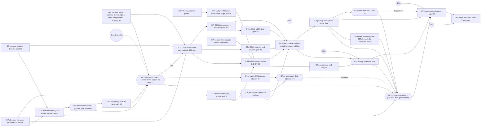

# Gate 7 design: browser receivers

Status: contract for gate 7, written 2026-10-14. At that point gate 6 is complete through G6b and G6l
on `main`. G6c (`rs/gate6-g6c`) and G6s (`rs/gate6-g6s`) are on branches, and G6p and G6z have not
started. Nothing here is implemented yet. Hand it out piecewise. Each increment (G7w, G7j, G7h,
G7c, G7f, G7d, G7e, G7a, G7n, G7m, G7o1, G7x, G7b, G7t, G7s, G7l, G7xn, G7xw, G7xwl, G7g, G7u,
G7r, G7k, G7q, G7v, G7p, G7z) is one verified commit on `main`, implemented by one agent in its own
worktree.
G7q is gated on fork F1 at the end of this document. G7f is conditional (D20). G7xn and G7xw were
gated on fork F4 (approved 2026-10-15). G7o lands nothing since D33 split it.

**Amended 2026-10-14 with a phone acceptance target** (D24 to D28, Q13, increments G7d, G7m, G7o
and G7v, fork F3). The user's requirement: the receiver must easily work at 60/60 on the user's
moto g86 5G, in the browser. Every leg that touches the phone is **operator-attended: it needs the
user's go-ahead and the phone attached** (D28). Desktop legs stay runnable unattended. (The
2026-10-15 amendment below keeps this rule for the g86 and relaxes it for the g31.)

**Amended 2026-10-15: the moto g31 is the baseline device.** The user's product goal: browser
receivers reach at least 60 fps on almost any phone from 2020 onward, and receiver cost is a
first-class design constraint (memory render-stream-perf-goal-2020-phones). The g86 is a 2025
mid-range phone, so it is not that floor. A moto g31 (MediaTek Helio G85, a 2020 SoC; Mali-G52 MC2;
a panel fixed at 60 Hz) is. **"Met" for gate 7's phone target now means met on the g31** (D25). The
g86 stays as the second, faster device, and it is the 90 Hz rate-mismatch case. The g31 is G6c's
60/60 clock-phase case on real hardware (D26). Its legs have the user's standing approval and may
run unattended while it is attached. The g86's legs stay operator-attended (D28). A shared Rust
decode core is allowed where measurement shows it pays (D27). Nothing was run on either phone for
this amendment: the g31's facts in Q13a come from read-only `adb` queries (getprop, dumpsys,
`pm list`, `/proc/cpuinfo`, cpufreq limits).

**Amended 2026-10-15 (later): the shared Rust core** (D29 to D34, Q14, increments G7o1, G7x, G7xn
and G7xw; G7a, G7o, G7t, G7s, G7l, G7u, G7k and G7v revised; fork F4). After G7m's g31 bench and
the receiver decode profile, the user chose one Rust crate for render-stream decode, retained state
and apply. The GSW receiver renders it through `packages/canvas/rust-prototype`, and thin adapters
serve the native receiver and the web export. The TypeScript and GDScript decoders stay as golden
cross-checks (G7gd removed the GDScript one on 2026-10-21, by user decision; D34 amended). Before anything adopts the core, the smallest end-to-end slice (G7x) must beat the
TypeScript path's p95 on the g31. If it does not, the decision goes back to the user (D32). Nothing
was built or run for this amendment. The numbers it cites are G7m's and the decode profile's.

Gate 7 needs a new live-transport version, `render-stream/7`. It is specified here as a delta in Q2
and finalized by G7w (D2). The documents this extends are [gate6-design.md](gate6-design.md),
including its "As built (G6c)" section on `rs/gate6-g6c`, and, through it, gates 5.5 to 0. The wire
it builds on is [render-stream-6.md](render-stream-6.md). Background is in
[docs/handoff-headless-render-stream.md](../../../docs/handoff-headless-render-stream.md): the gate 7
row; "Goal and decisions" (two peer browser receivers, chosen per game by manifest); "Configuration
for other games" (the GSW receiver transpiles its subset, the web export compiles exactly); "Slow
receivers and resource dependencies"; and "Validation and measurement".

Source citations are `path:line` in the pinned `../godot-4.5.1-stable` checkout (commit
`f62fdbde15035c5576dad93e586201f4d41ef0cb`), relative to its root. Every cited line was re-read
when this contract was written. Abbreviations: `wm.cpp` is `platform/web/web_main.cpp`, `emws.cpp`
is `modules/websocket/emws_peer.cpp`, `hcw.cpp` is `platform/web/http_client_web.cpp`, `lgd.js` is
`platform/web/js/libs/library_godot_display.js`, `lgf.js` is
`platform/web/js/libs/library_godot_fetch.js`, `wexp.cpp` is `platform/web/export/export_plugin.cpp`,
`sg3.cpp` is `drivers/gles3/shader_gles3.cpp`, `ts3.cpp` is `drivers/gles3/storage/texture_storage.cpp`,
and `rcc.cpp` is `servers/rendering/renderer_canvas_cull.cpp`. GSW paths are relative to this
repository's root.

**No engine or browser probe was run for this contract.** Every engine statement below is read from
source. Every browser statement comes from a web standard or from this repository's own recorded
browser findings (memories `xvfb-does-not-isolate-on-wayland`, `webgpu-parity-findings`,
`pixelmatch-hides-alpha-errors`). Each one marked *(probe)* is checked by G7h before any gate relies
on it. Every count, budget and threshold below is a prediction or a decision that the increments
check by running. A run that disagrees with a prediction is a finding to explain from source. A run
that fails a decided threshold is a finding, never a reason to raise the threshold.

## What gate 7 proves

The handoff's gate 7 row:

> Export the receiver project using Godot Compatibility/WebGL 2, and, as an independent peer, run
> this repository's canvas receiver. Replay the same recordings and live stream through both.
> Repeat pixel, lifecycle and pacing gates for each; account for browser suspension, startup cost
> and memory. Publish each receiver's feature manifest; neither substitutes for the other.

Gate 7 keeps the three independent roles. The two new receivers are additional, independently
launched receivers. Each renders only the captured stream, and each is judged against the same
rendered reference as the native receiver. Gate 7 adds:

1. **A web export of the native receiver.** The project in `receiver/` is exported unchanged in
   behaviour to Godot 4.5.1 Web (Compatibility, WebGL 2, no threads). Two platform shims carry its
   configuration and its evidence, which native reads from the environment and the filesystem (Q4).
   It compiles captured canvas shaders through the engine, exactly as native does.
2. **The GSW canvas receiver.** It is a TypeScript receiver on this repository's canvas stack: the
   render-stream decoder and resolver from `scripts/lib/`, a canvas applier that reimplements
   Godot's canvas ordering, and `packages/canvas`'s WebGL 2 executor. Shaders go through
   `packages/effects`'s transpiler, and everything outside its supported subset is a typed refusal
   (Q5). *Since D29, if G7x wins:* a TypeScript shell over the shared Rust core, which decodes,
   applies and lowers to a packed draw list, drawn by the Rust renderer's WebGL 2 `canvas-items`
   path (Q14). The scripts/lib decoder stays as the checkers' decoder and the cross-check.
3. **The same recordings, references and checkers.** Both browsers replay every receiver leg of
   gates 0 to 6 from a native run of those gates on the same build. Each gate's own checker judges
   them, parameterized by receiver kind, under an explicit per-receiver pixel policy (Q7).
4. **The live stream in a browser.** WebSocket and HTTP fetches go from a page to the loopback
   capture host, with bearer authorization a browser can carry, an `Origin` allowlist and CORS
   (D3, Q2, Q3). The live legs of gates 1, 2, 5, 5.5 and 6 run on each browser.
5. **Lifecycle and suspension.** The browser legs cover a hidden page, a frozen page, reload, a
   closed tab and WebGL context loss, with the gate 1d semantics: bounded pending state, newest
   state on recovery and a host that keeps simulating (Q10).
6. **Pacing.** Credit returns from `requestAnimationFrame`, and the browser rates are reported
   beside the native ones. Gate 7 also takes on G6c's negative finding (60/60 phase-locks to about
   29/s with one transaction in flight). It measures that finding on all three receivers, and it
   defines an opt-in credit window of 2, which is fork F1 (D4, Q9).
7. **Startup cost and memory.** Cold and warm startup are timed from navigation to the first
   applied and submitted transaction. Memory is accounted per process (renderer, GPU, browser) with
   the JS and wasm heaps, and a 300-second soak per browser runs under the budgets from G6s (Q10).
8. **Three feature manifests.** `native`, `web-export` and `gsw-canvas` are generated and checked
   (`render-stream-features/2`, Q11). Every `supported` entry cites evidence from that receiver's
   own legs, so neither browser receiver can borrow the other's evidence.
9. **A phone acceptance target.** Both browser receivers run live on two phones through the perf
   harness's existing device plumbing: the moto g31 (Mali-G52, 60 Hz), which is the acceptance
   floor, and the moto g86 5G (Mali-G615, 90 Hz), which is the faster second device. Each receiver
   is judged against decided rate, cadence, main-thread, GPU, thermal, memory and startup budgets
   at a 60 Hz host, separately at credit window 1 and window 2, on a minimal scene, the gate 6
   scene and HD. HD is required on the g86 and a stretch target on the g31 (D24 to D28, Q13). A
   decode/apply microbench runs early on both phones, g31 first, before the big receiver work
   depends on the answer (G7d, G7m).

What gate 7 does **not** do: non-loopback serving, TLS (`wss://`, `https://`) and the target game
(gate 8). It does not negotiate several presentation sizes from one session (gate 8, D12). It adds
no compressed texture formats (gate 8, D19), no threaded web export, and no GDExtension in the
browser other than the shared Rust core's dlink adapter (D29, D34, G7xw, fork F4). It does not
cover browsers other than the pinned desktop Chromium (Firefox, WebKit) and each phone's own
Chrome, devices other than the two
phones (D24), or a phone on a real network: each phone reaches the desktop host through
`adb reverse` over USB (gate 8 owns Wi-Fi). Presentation
feedback stays `unavailable` under headless Chromium (D13), and on the phones too, where only the
compositor's activation rate is available (Q13a). Payload, atlas
or parameter deltas are not added. GSW gets no `TIME` and no screen-texture shaders (MSDF text was
excluded too until G7tm drew it, 2026-10-16).
All of these are typed or deferred, with owners, in "Deferred".

## Decisions

| #   | Question | Decision |
| --- | -------- | -------- |
| D1  | Two peers | **Two browser receivers, two manifests, no fallback.** The web export and the GSW canvas receiver run every applicable leg independently. A leg that one browser cannot pass is that browser's typed refusal or that browser's failure. It never passes by running the other. The summary and the manifests report each separately (Q11 `manifest-no-substitution`). |
| D2  | Protocol version | **`render-stream/7` is a live-transport delta, negotiated per connection, and file sinks stay on /6.** Browsers need a hello they can send, and authorization without request headers (D3). /1's rule makes control messages part of the version, and `rs_live.cpp:393` rejects an unknown hello key, so both changes need a new version. /7 changes only the magic and strings, the hello, the session's `publication.credit_window`, two `error` reasons, and HTTP CORS behaviour (Q2). Records, transactions, payloads and HTTP routes are byte-identical to /6. The capture's listener accepts both subprotocols, `render-stream.6` and `render-stream.7`. Each connection's session, records and control messages follow the subprotocol it chose (Q3). This is the first time two versions are served side by side, and it is deliberate: every gate from 0 to 6 keeps running on /6, untouched, and no G6b-style switch of every runner is needed. File sinks keep writing /6 until a later cleanup increment chooses to switch them (Deferred). The decoders in all three languages gain `version: … \| 7`, and `golden-2/` to `golden-6/` keep passing. |
| D3  | Browser authorization and origin | **The token travels in the /7 hello, never in a URL or an upgrade header. The host checks `Origin`, and its HTTP endpoint speaks CORS.** A browser's `WebSocket` has no header parameter (G2e finding), and Godot's web peer warns and drops custom headers (`emws.cpp:91-93`). /7's hello carries `token` (64 hex). On a `bearer` session the host sends nothing before a hello with the right token, compared in constant time as G2e does. A wrong or missing token gets `error` `unauthorized` and close 1008, so the reason repeats in the close (memory godot-websocketpeer-drops-msgs-with-close). Resource GETs keep `Authorization: Bearer`, which `fetch` can send (`hcw.cpp:82-106`). New host configuration `GRC_LIVE_ALLOWED_ORIGINS` (a comma list, default empty): an upgrade, GET or `OPTIONS` that carries an `Origin` not in the list gets 403. A request with no `Origin` is exactly as at /6, which keeps native receivers and every /6 gate unchanged. For an allowed origin, GETs answer `Access-Control-Allow-Origin: <origin>` and `Vary: Origin`, and `OPTIONS` on the resource route answers a preflight (Q3). The page receives the token in its URL **fragment** (`#token=…`), which is never sent to a server or in a `Referer`, and removes it with `history.replaceState` before anything else runs. The allowlist is the defence against any website in the operator's browser opening `ws://127.0.0.1:<port>`. |
| D4  | Credit window and 60/60 | **Window 1 stays the default, and window 2 is opt-in, negotiated, and fork F1.** G6c measured that one transaction in flight, sent only at host frame callbacks, and credit returned at the receiver's draw cannot hold 60/60. The receiver's hold (arrival to next draw) is uniform over a frame, so in the bad relative phase of two 60 Hz clocks the round trip exceeds one host frame and the host publishes every other callback. No receiver-side change removes that, only one that shortens the hold. /7's hello carries `credit_window` (1 or 2). The host grants `min(requested, GRC_LIVE_CREDIT_WINDOW_MAX)`, default maximum 1, and declares the grant in `publication.credit_window`. Window 1 is the handoff's rule ("at most one frame transaction in flight per receiver") and stays the correctness baseline. G7r measures the phase lock on all three receivers at window 1, with the "ack closer to draw" variants (native `RS_RECEIVER_LATE_POLL`, browsers' credit in the rAF callback right after submit). Window 2 changes a handoff rule, so its host implementation (G7q) waits for the user (F1). Without it, gate 7 passes with the negative finding restated for browsers. The key and its 1..2 domain are in /7 from the start, so F1 never needs another version. |
| D5  | Web export build | **The non-mono Godot 4.5.1 editor exports `receiver/` with a pinned `web_nothreads_release.zip` and a custom shell.** `mise exec -- godot` resolves to the **mono** 4.5.1 editor (`4.5.1.stable.mono.official.f62fdbde1`). Its template directory `~/.local/share/godot/export_templates/4.5.1.stable.mono/` has no web template, and official Godot 4 .NET builds have none. The non-mono editor is installed at `~/.local/share/mise/installs/godot/4.5.1-stable/Godot_v4.5.1-stable_linux.x86_64`. The template is a **prerequisite not present locally**. Only `4.6.2.stable/web_nothreads_release.zip` exists, and it is the wrong engine. G7e records the download of the official 4.5.1-stable `web_nothreads_release.zip` (from the official export templates archive, with operator approval) into `~/.cache/godot-render-stream/templates/4.5.1-stable/` beside the pinned `linux_release.x86_64`. The preset points at it with `custom_template/release` and pins its sha256. Preset (`receiver/export_presets.cfg`, committed): `variant/thread_support=false` and `variant/extensions_support=false` (both defaults, `wexp.cpp:369-370`; no COOP/COEP needed and no emscripten toolchain, and `emcc` is absent here); `html/canvas_resize_policy=0` (None; the default is 2, `wexp.cpp:377`); `progressive_web_app/enabled=false`; `html/custom_html_shell` set to `receiver/web/shell.html`. The export includes only `receiver/`, never `fixtures/`. The export output is a build product under ignored `artifacts/render-stream/web-receiver/<sha>/`. |
| D6  | Where the GSW receiver lives | **`experiments/render-stream/web/gsw-receiver/` (TypeScript), consuming `@godot-scene-web/canvas` and `@godot-scene-web/effects` through the `development` condition.** Render-stream concepts (sessions, wire ids, credit, manifests) stay in the experiment. Capability gaps that are generic Godot `CanvasItem` drawing go into the packages as generic draw-list features, with their own package tests and a downstream consumer check (G7c, G7s): per-vertex colours, the `premul_alpha` blend, texture wrap modes, straight-alpha sampling, an RGB10_A2 stage target, and item-space shader programs. Nothing in `packages/` learns about render-stream. *Amended 2026-10-15 (D29, D30):* the directory keeps the TypeScript shell (config, sources, live client, fetcher, evidence, perf, the rAF loop). Decode and apply move to the experiment's Rust crates. The generic parts (the packed draw list and its executor) go into `packages/canvas` as Rust, and they still know nothing about render-stream. |
| D7  | GSW render model | **The GSW receiver reimplements `RendererCanvasCull`'s ordering and composition, lowers to a `DrawList`, and renders into an RGB10_A2 target like Godot.** The executor has no item tree, no modulate and no z order (survey of `packages/canvas/src/draw-list.ts`, `executor-webgl.ts`). The applier walks canvases by `(layer, sublayer)` with the root in its declared place, and walks items by `rcc.cpp`'s rules: per-z lists from `CANVAS_ITEM_Z_MIN` concatenated in z order (`rcc.cpp:70-100`), children with `draw_behind_parent` before the parent and the rest after it (`rcc.cpp:468-480`), relative/absolute z, and `top_level` from the wire's canvas parenting. It composes `modulate` down the tree with `self_modulate` last (`rcc.cpp:316`) and multiplies in the canvas modulate. Clips come from `scripts/lib/clip-derive.ts` as Godot's integer scissor (rounded AABB of the transformed rect ∩ ancestor clip; memory godot-canvas-clear-resets-clip), never the executor's rounded-clip SDF. Godot's non-transparent render target is `GL_RGB10_A2` (`ts3.cpp:2144-2150`; memory rs-g55b-cim-facts: alpha has 2 bits). Blending at 10-bit colour precision cannot be reproduced in an 8-bit canvas, so GSW draws into an RGB10_A2 framebuffer and blits it to the canvas. Shots read back from that framebuffer with the same `RGBA`/`UNSIGNED_BYTE` conversion Godot's own readback uses (G7a cites the line). Textures are stored **straight-alpha**, as Godot uploads them, and are premultiplied after sampling, so linear filtering matches Godot's. *Amended 2026-10-15 (D29):* the model is unchanged. Its implementation moves to `render-stream-core`'s applier, which lowers to Q14b's packed draw list, and the Rust renderer's `canvas-items` executor draws it. The `DrawList` and `executor-webgl.ts` are now the specification the Rust executor is checked against, not the receiver's path. |
| D8  | Pixel policy | **Per receiver, against the rendered reference, with the native receiver as triangulation (Q7).** Web export: the native receiver's per-region budgets, which are 0 almost everywhere, and a prediction of zero difference from the native receiver on every shot. GSW: exact on every pixel a gate's independent hand model *decides*; a pre-registered `delta1` class for translucent blends; diffs confined to the hand model's *undecided* masks elsewhere; typed regions excluded. Every comparison uses the raw per-channel metric with an explicit limit, never pixelmatch alone (memory pixelmatch-hides-alpha-errors). Bands are pre-registered in a committed `gsw-tolerance.json` with their derivation. An amendment needs a source-cited cause recorded "As built", and widening a band to pass is forbidden. |
| D9  | Browser harness | **Pinned Playwright Chromium `chromium-1223` (Chrome 148.0.7778.96), `--headless=new --enable-gpu --use-angle=vulkan`, with a provenance guard.** These flags give the real RTX 2060 through ANGLE/Vulkan with no window (memory xvfb-does-not-isolate-on-wayland). Never `--enable-features=Vulkan`, which breaks WebGL canvases here. Never headed, never Xvfb, and no gamescope for browsers. The guard refuses the leg (`browser-provenance`, a harness refusal, never a pass) unless `WEBGL_debug_renderer_info` names ANGLE, NVIDIA and Vulkan; no Chromium process holds a Wayland socket (count Wayland FDs, not X11); `DISPLAY` and `WAYLAND_DISPLAY` are unset in the launch environment; and the binary's sha256 matches the recorded one. Also: `--force-device-scale-factor=1`, `--force-color-profile=srgb`, a fresh `--user-data-dir` per cold leg, and the background-throttling switches (`--disable-background-timer-throttling`, `--disable-renderer-backgrounding`, `--disable-backgrounding-occluded-windows`) on every leg **except** suspension legs. Native references and receivers keep gamescope, as before. |
| D10 | Inputs and evidence in a browser | **Over loopback HTTP, in the native receiver's formats.** A harness server (`scripts/lib/browser-harness.ts`) on `127.0.0.1` serves the receiver bundle and each leg's inputs read-only: recording, store, shader library and token-free configuration. It accepts `PUT /evidence/<leg-nonce>/<path>` into that leg's directory only. Both browser receivers write `applied.json`, `shots/seq-<n>.png`, `perf.json`, `perf-timeline.jsonl` and `received.rs7` by PUT. All writes and every PNG encode happen outside timed windows. The page origin (harness) differs from the live host's, which is what D3 is for. |
| D11 | Which legs | **Every receiver leg of gates 0 to 6 on both browsers, the live legs of gates 1, 2, 5, 5.5 and 6, and browser-only lifecycle, pacing, startup and memory legs (Q8).** Legs that are receiver-independent (gate −1, every capture and reference leg) are not repeated. They come from the source run (D21). Headless-receiver legs are `not-applicable` for browsers, which always render. |
| D12 | Presentation size | **Unchanged: one presentation size per capture session (gate6-design.md D2).** Browsers present at `presentation_size` 1:1. The canvas backing store equals it, the harness forces DPR 1, and the CSS size equals the backing size. Any mismatch is typed `presentation-mismatch` and still drawn, scaled by CSS. /7's hello advertises the viewer's backing size, CSS size and DPR (Q2). The host only records them, giving gate 8 the data to choose between a host evaluation per size, renegotiation, or typed resampling (Deferred). |
| D13 | Rates and presentation in a browser | **Receiver frame = one rAF callback that drew; `submitted` = after the GL submit at the end of that callback; presented stays `unavailable`.** Headless Chromium has no display, and no web API reports when a canvas frame was presented. The rAF timestamp of the *next* callback after a submit is reported as `raf_after_submit`, a separately named metric, never as presented. GSW measures GPU completion with a `fenceSync` polled on later frames (`gpu_complete`, measured). The web export reports it `unavailable`, because the engine exposes no fence. GPU render time is measured only where `EXT_disjoint_timer_query_webgl2` is exposed *(probe)*, else `unavailable`. |
| D14 | Suspension | **Hidden and frozen pages are receiver stalls with gate 1d semantics, and the WebSocket stays open.** Predicted from the HTML standard *(probe)*: a hidden document gets no rAF callbacks, and a frozen one runs no tasks. Godot's web loop is rAF-driven (`wm.cpp:167`, `emscripten_set_main_loop(…, -1, …)`) and has no `visibilitychange` handler anywhere in `platform/web/js`. Its `max_fps` skip resets after a gap of more than 1 s, so it does not burst on resume (`wm.cpp:89-97`). Credit is returned only from a drawing rAF callback, so a hidden or frozen page holds no credit, and the host coalesces (`max_in_flight ≤ window`, `max_pending ≤ 1`). On resume, the first applied state is the newest. Reload is reconnect, a closed tab is gate 1d's killed receiver, and WebGL context loss is recovered in place by GSW and by page reload for the web export, whose engine only alerts "please reload" (`lgd.js:735-738`). **As built (G7h): the hidden/frozen premise does not hold under headless=new on chromium-1223 -- see Q1b's "As built (G7h)" note; G7u needs a different mechanism or the user's sign-off to narrow this.** **As built (G7u), by the user's decision of 2026-10-18:** the hidden and frozen legs run for real on the g31's Chrome (a new foreground tab or the home key hides the page, `Page.setWebLifecycleState` freezes it), and each is trusted only when the page's own evidence shows it hidden or frozen (`visibilitychange`, `freeze`, rAF and timers stopped). The desktop headless legs pause the page's own rAF loop instead, through an injected test-only shim. They are labelled `simulated-suspension`, their legs are named `sim-*`, and they never count as a pass of hidden or frozen. A Q10 check that no available mechanism can meet is typed `unavailable`, never passed ([results/gate7/g7u.md](../results/gate7/g7u.md)). Measured on the g31: a CDP `Page.setWebLifecycleState` freeze closes the page's WebSockets 1006 when it is set `active` again, so "the WebSocket stays open" does not hold for that freeze mechanism (a natural Android background freeze takes minutes, outside a leg's budget). This holds on both receivers: GSW and the web export each fail only `frozen-30s`, both `live-disconnected`. Before the merge of G7wf the web export also failed `hidden-30s` and `frozen-30s` with `resource-unavailable`, because its payload fetch timeout (`RS_RECEIVER_FETCH_TIMEOUT_MS`, 10 s) counted the suspended wall time. With G7wf's browser `fetch()` the GET completes during a hide, because a hidden page still runs tasks. The deadline is still wall-clock, so a GET in flight across a freeze is still exposed. **As amended (G7u finisher, 2026-10-18, the orchestrator's delegated call):** a frozen page may lose its transport. Recovery is gate 1d's reconnect -- a new connection with a fresh session and hello, the newest state first, no burst, bounded pending state -- and the host treats the dead connection as gate 1d's killed receiver. Hidden pages keep "the WebSocket stays open", which the real hidden legs show. Both receivers reconnect on a lost connection under `RS_RECEIVER_RECONNECT_ON_LOSS=1` (the frozen legs set it), and a frozen leg's `socket-kept` became `socket-kept-or-reconnected`: kept, or lost and recovered as above, never neither. The web export's fetch timeout now counts only time while the page runs (a poll gap over 1 s moves the deadline), after the first reconnecting run timed out a GET whose host response landed just before the freeze. With both, `frozen-30s` passes on the g31 on both receivers; the measured resume-to-newest is dominated by the page staying hidden after `active` until the harness's HOME round trip ([results/gate7/g7u.md](../results/gate7/g7u.md)). |
| D15 | Startup cost | **Navigation-relative marks, cold and warm.** Cold = a fresh profile (no HTTP cache, no payload cache). Warm = a second load in the same profile. Marks: `navigationStart`, bundle/wasm fetched, wasm compiled (web export), engine ready / receiver ready, socket open, session decoded, first transaction applied, first `submitted`, first `raf_after_submit`. One warmup plus five repeats. Native receiver startup (process start to first `frame_post_draw`) is measured alongside for scale. |
| D16 | Memory accounting | **Per process, from `/proc` and CDP, never from one number.** Renderer, GPU and browser process RSS come from `/proc/<pid>/statm`, using PIDs from CDP `SystemInfo.getProcessInfo`. JS heap comes from CDP `Performance.getMetrics` (`JSHeapUsedSize`). Web export wasm heap comes from the shell (`HEAP8.byteLength`; emscripten never shrinks it). Per-process GPU memory comes from `nvidia-smi`, reusing `packages/perf-harness/src/nvidia.ts`. Engine `get_rendering_info` covers the web export, and GL object counts cover GSW. Soak thresholds are in Q10. |
| D17 | Report schema | **`render-stream-report/2`, a superset of /1 with a browser receiver profile (Q12).** `validate` accepts /1 and /2. `perf-report/1` is not generalized: it describes A/B arms of browser rendering mechanisms, while /2 describes a host-to-receiver pipeline with a native leg in the same document, and gate 6's condition (a concrete second consumer of one shared shape) is still not met. |
| D18 | Manifests | **`render-stream-features/2`, three files under `protocol/features/render-stream-7/` (`native.json`, `web-export.json`, `gsw-canvas.json`), generated by `make-features.ts --receiver <kind>` (Q11).** G6z's planned `render-stream-6.json` (/1) stays the native gate 6 record. /2 adds a structured `receiver`, per-receiver `limits.receiver`, a `receiver-typed` status, and a `band` exactness tied to `gsw-tolerance.json`. The /7 hello carries the manifest's sha256, and the host logs it. |
| D19 | Formats | **No compressed or float texture payloads in gate 7.** Each manifest records the WebGL 2 compression extensions its harness context exposes (S3TC, BPTC, ETC2, ASTC) as evidence for gate 8's decision (gate6-design.md "Deferred"). `unsupported-format` stays a wire refusal. |
| D20 | Native receiver's live buffer | **The receiver must decode live messages in bounded memory before any browser soak.** G6s found `receiver.gd`'s live mode appends every byte to `_data` forever (memory rs-g6s-live-data-unbounded-growth). In a browser this is worse: the wasm heap never shrinks. If gate 6 lands a fix, G7f is void. Otherwise G7f bounds it (decode each message independently, or trim consumed bytes and rebase offsets) and re-runs every live leg of gates 1 to 6 natively. |
| D21 | Source runs | **Browsers replay a native run of each gate made on the same build.** `run-gate7.sh --source <gate>=<run dir>,…` (or `--make-sources`, which runs `run-gate<N>.sh` itself) refuses a source whose recorded content key (GRT: template, capture library and calibration sha256, receiver core and every source-shaping file, `scripts/lib/source-key.ts`; the git commit until GRT), capture library sha256 or template sha256 differs from the current build's, or whose native receiver legs did not pass (`source-run-valid`); `--make-sources` reuses a cached source with the same key (`scripts/source-cache.sh`). Captures, references, `expected.json` and sabotage recordings come from the source. Live legs start their own hosts with the gates' own leg functions (`scripts/lib/legs.sh`, `gate6b-legs.sh`, `gate6h-legs.sh`, G6c's `gate6c-legs.sh`). |
| D22 | Result classes | **Gate 6's classes, plus:** receiver-typed `unsupported` reasons per browser (Q4, Q5); `replay-failure` reasons `context-lost` and `browser-crash`; and harness refusals `browser-provenance`, `source-run-invalid`, `device-provenance` and `device-unavailable` (Q13b, D28), which fail the leg as `harness-refused`, never `success`. A browser console `SHADER ERROR` or a WebGL error is `replay-failure` / `shader-compile` or `webgl-error`. |
| D23 | Waves against gate 6 | **Gate 7 lands nothing that needs G6c, G6s, G6p or G6z before they land.** G7w, G7j, G7h, G7c and G7f may be written and landed now: they are disjoint from gate 6's open files, or (G7f) explicitly fix one of its findings. Browser file legs (G7a, G7e, G7b, G7t, G7s) need only what is on `main`. G7r needs G6c, G7k needs G6s, G7p needs G6p, and G7z needs G6z. |
| D24 | Device targets and harness | **Two phones, driven by the perf harness's existing device plumbing, never a parallel one: the moto g31 (`g31`, the baseline) and the moto g86 5G (`g86`, the faster second device).** Their facts are in Q13a. g31: Android 12, Chrome 154.0.8037.127 on 2026-10-15, Mali-G52 MC2 over OpenGL ES 3.2 (driver `r26p0`), 1080×2400 at DPR 2.625, and one display mode, 60 Hz. g86: Android 15, Chrome 151 at its last measurement, `Mali-G615 MC2 (ANGLE)` over OpenGL ES 3.2 (not Vulkan), DPR 3.4876, a 790×316 CSS landscape viewport, and an adaptive panel that Chrome measured at 89–90 Hz on every committed phone table and at 59.5 Hz once. On either phone the panel rate is measured per repeat, never assumed. `browser-harness.ts` gains `env: "device"` and `--device <g31\|g86>`, built by importing `packages/perf-harness/src/device.ts` (`selectDevice`, `openDeviceBrowser`, `reverseServerPort`, `ensureResponsive`, `sampleConditions`, `readGpuDeviceMetrics`). `--device` resolves to the phone's serial through a committed device table (Q13b) and is passed as `selectDevice`'s `serial`, because `selectDevice` refuses to choose when more than one phone is attached. That gives adb reverse for the harness port and the live host's port, so every URL and the page origin are byte-identical to desktop and D3's allowlist is unchanged. It also gives the flattened CDP attach, the foreground and lock rules, and recorded `isolation` (docs/perf-harness.md "Measuring on a real phone"). The capture host and its gamescope stay on the desktop. Chrome on a phone is attached to, never launched, so D9's flags, binary sha256 and Wayland guard cannot apply. `device-provenance` replaces `browser-provenance` on device legs (Q13b). |
| D25 | Phone acceptance target | **"Easily works at 60/60" means Q13d's decided checks, at a 60 Hz host, on every one of five repeats, for each browser receiver, on the g31, for the required workloads `pace` and `scene`.** The g31 is the acceptance floor. `hd` is a stretch target there: it is run, judged and recorded, but not required (Q13d). The g86 runs the same checks on all three workloads, and `hd` is required there. Its results are recorded per receiver. A g86 miss on a workload the g31 meets is a finding, explained from Q13c before G7z, not a separate gate condition. Every receiver budget is relative to T_p, the measured median rAF interval: 16.7 ms on the g31 (60 Hz, its only mode) and a predicted 11.1 ms on the g86 (90 Hz). The checks are: at least 57 new frames drawn per second; new-frame intervals within the panel's cadence for 60/s (one tick at 60 Hz, p95 ≤ T_p + 1 ms; the 3:2 cadence at 90 Hz, p95 ≤ 2·T_p + 1 ms; max ≤ 50 ms on both); receiver main-thread work per drawn frame p95 ≤ 0.5·T_p (8.3 ms on the g31, 5.6 ms on the g86); GPU time per drawn frame p95 ≤ 0.5·T_p where it can be measured, plus a draw-twice headroom leg for GSW; no thermal throttling over a 600-s soak; bounded memory; and warm startup ≤ 3 s. Window 1 and window 2 are judged separately, and the result names the window (F1 made window 2 opt-in). A miss is a finding, never a reason to move a budget. |
| D26 | Rate model per phone | **Each phone is a 60 Hz host against its own panel, and Q13c's model predicts both.** **The g31 is G6c's 60/60 case on real hardware.** Its panel and the host's frame clock are both nominally 60 Hz, so at window 1 the arrivals of one run keep one rAF phase. The hold is nearly constant within a run and drifts only slowly between runs. A run holds 60/s only while up + hold + work + down fits inside one host frame at its phase; otherwise the host publishes every other callback, about 30/s. The hold ranges over [0, 16.7) ms, so no receiver-side speed-up makes every phase good. Predicted, as G6c measured on desktop: about half of the g31's window-1 repeats near 30/s on every receiver, because the round trip including the hold to rAF cannot stay reliably under one frame. So the g31 is predicted not to meet the target at window 1, where `dev-rate` needs all five repeats. Window 2 takes the hold off the critical path, and it is the predicted way the g31 meets the target. Its residual risk is the shared rate itself: a run whose arrivals sit inside the arrival jitter around the rAF deadline gets zero and two transactions in alternate ticks and draws only the newer one (Q13c). **The g86 is a 60 Hz host against a 90 Hz (or 120 Hz) rAF.** On a 90 Hz panel, 60 new frames per second can only be shown 3:2: intervals alternate 11.1 and 22.2 ms. That judder is intrinsic and is not a rate loss, so the checks admit it there. At window 1, 60/s holds at every phase only while work plus transport stays within about 5.6 ms (90 Hz) or 8.3 ms (120 Hz). A g86 panel that falls to 60 Hz is the g31's case. **The web export runs `--max-fps 0` on both phones.** On a 90 Hz rAF a 60 cap skips one tick in three (`wm.cpp:83-97`) and doubles the worst hold. On the g31's 60 Hz rAF, `--max-fps 0` already draws 60/s with no redundant frames, while a 60 cap still skips any tick whose callback fires before the accumulated `target_ticks` (which advance by the integer 16 666 µs), so its skips depend on rAF jitter and the panel's exact rate (report-only). GSW draws only in rAF callbacks that applied a transaction. |
| D27 | Decode risk, measured first | **The web export's GDScript decode is the known risk, and it is worst on the g31. A microbench on both phones, g31 first, settles it before any increment depends on the answer.** On desktop (Ryzen 5 5500), the native receiver decodes at 6.2–6.5 ms mean per transaction (7.2–7.6 ms under load) and applies at about 0.9–1.0 ms. That is the 400-transaction gate 6 `animate` replay in G6c's README, "Gate 6c result". The live rate-60 leg measured decode p50 2.1 ms and apply 1.5 ms, and 15.8 s of receiver CPU over 30 s. The *whole-frame* budget is 0.5·T_p: 8.3 ms on the g31 and 5.6 ms on the g86. The g31's fastest cores are two Cortex-A75s at 2.0 GHz. Predicted for this branchy interpreter work: 4–5× slower than the desktop core (the g86's Cortex-A78 at 2.5 GHz: 2–3×), and wasm adds 1.3–2×, so the web export is 5–10× slower on the g31. That is 10–21 ms of live decode alone, 18–36 ms of live decode plus apply, and 31–65 ms of replay decode per transaction: a 2–4× miss on live transactions. To fit decode plus apply into about half the budget, G7o's GDScript candidates would need a 4–9× gain, and nothing here predicts that much. **So a native-speed decode core is predicted to be required for the web export on the g31** (Q13e). GSW decodes in V8 with no measured base yet. It passes on the g31 only if its desktop decode, validate and resolve p95 is under about 1.7–2 ms (8.3 ms over the 4–5× core factor; any JIT gap tightens it). These ratios are estimates. The decode-profile increment (branch `rs/decode-profile`, in progress) supplies the per-phase desktop breakdown for both decoders, and G7m measures the phones. G7d (unattended, wave 1) builds the bench, the minimal fixture and the device harness. G7m (wave 2) runs the bench on both phones, the g31 first, for both receivers, with GSW on G7j's browser-loadable decoder. A miss on either phone is the typed finding `device-decode-over-budget`, with per-phase numbers. It triggers G7o, which measures named candidates under unchanged goldens and budgets: the GDScript and TypeScript fixes first, then, where the profile shows they cannot close the gap, a shared Rust decode core. That is one crate built as a native GDExtension and as wasm for both browser receivers, allowed by the user's 2026-10-15 goal where measurement shows it pays, and kept only if it passes the same goldens and gates as what it replaces. If G7o cannot close the gap, the miss is recorded in that receiver's manifest. No budget is relaxed. G7o is void if G7m passes on both phones. *Amended 2026-10-15 by D29 to D34:* G7m missed on the g31, so G7o was triggered. Tier 2 is now the plan rather than the last resort, and D33 splits G7o. The budgets, `device-decode-over-budget`, "kept only if the goldens and gates pass" and "no budget is relaxed" are unchanged. |
| D28 | Device attendance | **A device leg needs its phone attached. The g31 has the user's standing approval (2026-10-15), so its legs may run unattended. The g86's legs stay operator-attended.** g31: any increment may run its device legs, with no per-run go-ahead, whenever the g31 is attached (it is, as of 2026-10-15, serial `ZY22FD8XP3`). For a session the harness may set the g31's landscape lock and `svc power stayon usb`. It records every setting it changed and restores it afterwards, and it installs nothing on the phone. g86: it is the user's personal device. No agent runs adb against it, changes one of its settings (refresh mode, stay-awake, developer options) or launches anything on it without the user's go-ahead in that session. An increment whose verification includes a g86 leg stops before that leg and asks. On either phone, a leg whose phone is not attached, not authorized, locked or not in front reports the harness refusal `device-unavailable`. That is never a pass, and never a skip counted as green. Every device leg has a desktop control arm on D9's harness that runs unattended. Device results carry their build sha. Any later change to a receiver, `rs_ws` or `rs_live` marks them stale until a re-run: for the g31 at the next run with it attached, and for the g86 at the next attended session (Q11 `manifest-device-target`). Runs without `--env device` never select `g7-dev`'s device arms. |
| D29 | The shared Rust core (2026-10-15) | **One Rust crate, `render-stream-core`, decodes, validates, resolves, keeps the retained state and applies. Receivers reach it through thin adapters. The TypeScript and GDScript decoders become golden cross-checks.** This was decided with the user on 2026-10-15 (memories rust-core-direction, render-stream-perf-goal-2020-phones). *Scope:* framing, meta and blocks for render-stream/2 to /7 behind one `version` parameter (memory g4e1-rs3-version-switch-pattern). Validation and resolve are **delta-driven from the start**: they cost O(changed), never the O(state) re-walks the decode profile measured. Those re-walks are 42–61 % of GDScript patch decode and 0.82 ms of TypeScript's hd-patch validation. The crate also covers resource-payload verification, the record digest (D31), the retained state, and two outputs: a per-item resolved delta for the Godot adapters, and D7's applier lowering to the packed CanvasItem draw list of Q14b for the GSW renderer. *Adapters:* the browser (wasm32-unknown-unknown, one module with the renderer; G7x, G7a), the native receiver (GDExtension, G7xn) and the web export (emscripten dlink side module, G7xw). GSW draws through `packages/canvas/rust-prototype`'s WebGL 2 `GlBackend`. Capture stays C++ and may share the Rust codec later (not scheduled). The parser, layout and every non-streaming package stay TypeScript. *Evidence:* (1) G7m: GSW's TypeScript decode misses on the g31 at p95, scene-full 12.99 ms and hd-patch 16.79 ms against 8.50 ms, and costs 5.6–14.5× desktop, the worst ratios on the smallest transactions. (2) The decode profile: the Rust cost prototype in V8 wasm decodes the same recordings 2.5–2.9× faster than GSW's TypeScript as shipped and 7–12× faster than GDScript. GDScript's tier 1 projects to 7–17 ms on the g31 for the live scene wire, still a miss. (3) The apply and lowering are not written yet in any language (G7a has not started), so writing them once in Rust costs no rewrite. *What the evidence does not show:* that Rust beats a *fixed* TypeScript decoder on the phone. The profile puts TypeScript after tier 1 within 1.1–1.4× of the Rust prototype on desktop. The remaining arguments are one implementation instead of three, and no GC on the frame path. The second is a hypothesis aimed at G7m's hd-patch validate spread of 3.55/7.22 ms at p50/p95. So D27's "measured first" rule stands: G7x proves it on the g31 before any receiver adopts the core (D32). Supersedes D27's order ("tier 2 only after tier 1 fails"). |
| D30 | Crates and boundaries | **Four crates and no Cargo workspace. The draw list is the renderer's type, never render-stream's.** (1) `packages/canvas/rust-draw-list/` (`gsw-canvas-draw-list`) is the generic packed CanvasItem draw list (Q14b), with no dependency beyond `bytemuck` and no render-stream concept (D6). (2) `packages/canvas/rust-prototype/` gains the cargo feature `canvas-items`, an executor for that list on `GlBackend`. The feature is off in `build-web.sh`'s defaults, so `RustRenderer`'s exports, `scene/2`, `patch/1`, `RSR1`, `RIA1` and every consumer build stay byte-for-byte what they are (Q14f). (3) `experiments/render-stream/rs-core/` (`render-stream-core`) is D29's crate. It depends only on `gsw-canvas-draw-list`, `sha2` and a JSON parser, with no wasm-bindgen, web-sys, wgpu or Godot crate, so every adapter can link it. (4) The adapters: `experiments/render-stream/web/gsw-rs/` (`rs-gsw-wasm`, a cdylib on wasm-bindgen `=0.2.129` as the renderer pins it) links the core and the renderer into **one** wasm module, and `experiments/render-stream/rs-core-capi/` is a C ABI staticlib for G7xn and G7xw. Path dependencies only. Each binary crate keeps its own `Cargo.lock`, and a root workspace would move `rust-prototype`'s lockfile under its consumers. Every target uses stable Rust 1.95.0 except the web export's side module (F4). `decode-proto-rs/` stays as the profile's tool until `rs-core` lands, then joins the experiment-consolidation inventory (the user approves deletions). The per-transaction wasm boundary is Q14c: bytes in once, three calls, a fixed stats block out. The draw list never crosses into JavaScript. |
| D31 | Record digest off the frame path | **The per-record SHA-256 is evidence, so browser receivers compute it after the frame. Resource payload hashes are still verified before use.** Its only consumers are render-stream-0.md "Decoded form", `applied.json`'s `record_sha256` and gate 0's `receiver-consumed-stream`, and nothing compares it at receive time (decode profile). A receiver computes it after the frame's submit or in idle time. It must hold a digest for every accepted record before it writes evidence (`record-digest-complete`). Timers report it as `evidence_hash_us`, outside `decode_us` and `total_us`. TypeScript adopts it in G7o1 and Rust in G7x. The GDScript receivers keep it inline, where it is 3–7 % of decode, until another change touches them. Skipping the digest is never a candidate. |
| D32 | Slice first | **G7x, the smallest end-to-end slice, runs on the g31 before G7a, G7xn or G7xw depends on the core.** It replays the `pace` fixture and the gate 6 scene (plus `hd-patch` as the stretch) through `render-stream-core`, then `canvas-items`, then WebGL 2, using G7d/G7m's four bench recordings and G7d's bench `--env device --device g31`. Each input gets one warmup and five repeats, the arms are interleaved, cpufreq is sampled per repeat, and judgment is at p95 against 0.5·T_p from the *measured* panel (≈8.5 ms; G7m). It wins only on R1 to R4 (G7x). On a loss the numbers are recorded, the `packages/` part does not land, and D29 goes back to the user before G7a starts. The fallback then is Q5's TypeScript receiver with G7o's dropped TypeScript items reinstated (D33). |
| D33 | G7o and the TypeScript path | **G7o is split. Its TypeScript tier 1 ships only the record-digest move (G7o1). The other tier-1 items, TypeScript and GDScript, leave the plan unless G7x or G7xw fails. Tier 2 becomes G7x, G7a, G7xn and G7xw. The TypeScript decode path stays the comparison baseline (bench arm `gsw-ts`) through gate 7, and it stays the checkers' decoder permanently.** G7o1 is small and evidence-only, and it helps every path. It also gives G7x a like-for-like baseline: without it, a Rust win on G7m's numbers would mostly be the digest (48–58 % of TypeScript's desktop time). `rs-core` builds delta-driven validation and resolve in from the start. Typed-array blocks and per-record object churn have no Rust equivalent. A decode Worker is deferred until G7v shows a main-thread miss after G7a, and then it hosts the Rust core. GDScript tier 1 (typed hot paths, packed lifts, delta apply) is dropped for the web export, because the profile projects it to 7–17 ms on the g31, a miss. It returns only if F4 is declined or G7xw's toolchain probe fails and the user picks GDScript. |
| D34 | The Godot adapters adopt late | **G7b stays on the GDScript decoder and proves the web export's correctness. The native receiver keeps GDScript by default through gate 7.** G7xn builds the C ABI and a GDExtension adapter natively first, where it can be debugged, behind `RS_RECEIVER_CORE=gdscript\|rust` (default `gdscript`). It must reproduce every native receiver leg of gates 0–6 byte-identically. G7xw then loads the same adapter into the web export as an emscripten dlink side module, after a toolchain probe. Keeping the native default on GDScript keeps the native receiver an independent triangulation for both browser receivers (D8): a bug in a shared core would otherwise hit all three, and the checkers' TypeScript decoder would be the only independent reader left. The Godot adapters apply from native code: RenderingServer calls for changed items only. Apply costs 1.25 ms on desktop on the live scene wire, nearly all of it GDScript overhead (decode profile), and the web export cannot afford that on the g31. *Known risks (G7xw):* Rust's `wasm32-unknown-emscripten` target is not installed. A side module needs position-independent `std`, which godot-rust gets from nightly `-Zbuild-std` (unverified here; F4). `JavaScriptBridge` cannot pass a `PackedByteArray` (`_variant2js` takes only bool, int, float, String and JavaScriptObject), so the non-dlink fallback moves the transport into JavaScript and pays one copy back per message. The dlink template and emscripten 4.0.11 are already fetched (Q13e). *Amended 2026-10-17 (user-approved): the GDScript decode/apply path is demoted.* It is frozen at /7: new wire features (G7q's window 2 and later) go into `rs-core` and the TypeScript checker decoder only. It runs only in milestone sweeps. An increment flips the native and web-export default to `RS_RECEIVER_CORE=rust` behind a full sweep, and the path is removed in the consolidation pass after G7z unless a target without GDExtension turns up. Independence is kept by the TypeScript checker decoder (D33), the hand models and the host's rendered reference. G7b's preserved shots stay the web export's byte oracle. The GDScript shell (transport, session, evidence) stays as glue over the Rust core. The end state is one Rust implementation for decode, retained state and apply, with GDScript and TypeScript as glue only, and exactly one non-Rust reader, the TypeScript one, kept as the test oracle. *G7xd (2026-10-17) is that increment:* `RS_RECEIVER_CORE` defaults to `rust` in `receiver.gd`, every `--web-core`/`--core` picker (`run-gate7.sh`, `build-web-receiver.sh`, `gate7-tool.ts`, `gate7-bench.ts`, `lib/gate7-live-legs.ts`'s `webCoreOf`) defaults to `rust`, and `gdscript` stays explicitly selectable everywhere, behind a full milestone sweep ([results/gate7/g7xd.md](../results/gate7/g7xd.md)). *Amended 2026-10-21 (user decision): the GDScript decode/apply path is removed now, not after G7z.* G7gd ([results/gate7/g7gd.md](../results/gate7/g7gd.md)) deletes `rs2_decoder.gd`, `rs_applier.gd` and the GDScript payload decoders, the `Web` (GDScript) export preset, every `gdscript` selector value, the `@gdscript` smoke targets and the checks that only asked which core ran (`receiver-core@*`). `RS_RECEIVER_CORE`, `--web-core` and `gate7-bench.ts --core` accept only `rust`. Milestone sweeps run every receiver on the Rust core. Independence is kept as the 2026-10-17 amendment planned: the TypeScript checker decoder, the hand models, the host's rendered reference and G7b's preserved shots. |

## Q1. What the engine and the browser do

### Q1a. Godot 4.5.1 on the web

- **Shaders.** Desktop GL compiles every engine shader as `#version 330` with `USE_GLES_OVER_GL`.
  The web compiles them as `#version 300 es` (`sg3.cpp:157-162`). Both declare `precision highp`
  for float, int and samplers (`sg3.cpp:216-222`). No canvas shader branches on
  `USE_GLES_OVER_GL` (the only users are `cube_to_dp.glsl`, `lens_distorted.glsl` and
  `effect_blur.glsl`). The half-float polyfill is off on the web (`drivers/gles3/storage/config.cpp:242-244`),
  as it is under desktop GL on this GPU. The canvas pipeline therefore runs the same GLSL bodies at
  the same precision on both platforms. That is the basis of P-W1 (Q7).
- **Render target.** A non-transparent viewport renders into `GL_RGB10_A2` (`ts3.cpp:2144-2150`).
  It is color-renderable in WebGL 2, so the web export keeps native's target format.
- **WebSocket.** The web peer passes `supported_protocols` to the browser and only warns about
  `handshake_headers` (`emws.cpp:83-93`). Its inbound buffer is
  `nearest_shift(inbound_buffer_size)` (`emws.cpp:109`). The live client already sets
  `inbound_buffer_size` before connecting (`receiver/rs_live_client.gd:36-41`). The web export sets
  it at least to the largest transaction (the HD full transaction is about 813 KB; memory
  rs-g6h-hd-facts) plus control, and declares it in the hello.
- **HTTP.** `HTTPClientWeb` turns each `request()` into one `fetch` with the given headers
  (`hcw.cpp:82-106`; `lgf.js:92-97` passes only method, headers and body, so mode `cors`,
  credentials `same-origin` and cache `default` apply). It goes to `STATUS_DISCONNECTED` after each
  body (`hcw.cpp:220-225`), so there is no keep-alive. `rs_resource_fetcher.gd` already treats
  `DISCONNECTED` after a body as success and opens a new client for the next GET. Cache `default`
  means the browser's HTTP cache serves a repeated hash, and the host's GETs already answer
  `Cache-Control: private, max-age=31536000, immutable` and an `ETag`
  (`capture/src/rs_ws.cpp:576-579`).
- **Main loop and pacing.** `emscripten_set_main_loop(main_loop_callback, -1, false)` (`wm.cpp:167`)
  runs one iteration per rAF. With `max_fps > 0` an iteration is skipped until `target_ticks`. After
  a gap of more than one second, `target_ticks` resets to now (`wm.cpp:83-97`), so a resumed page
  does not burst. `--max-fps` and `--frame-delay` reach the web build through the engine's argument
  list, as on native.
- **Environment.** `OS_Web` derives from `OS_Unix` (`platform/web/os_web.h:44`). Its environment is
  emscripten's synthetic one, so no `RS_*` variable exists. Configuration must come from the
  engine's argument list (`OS.get_cmdline_user_args()`), which the shell sets.
- **Files.** `user://` is IDBFS, persisted only through explicit `FS.syncfs`
  (`platform/web/js/libs/library_godot_os.js:157-160`). `/proc` does not exist, so `rs_perf.gd`'s
  RSS read fails, which is reported as `unavailable`.
- **Display.** With hidpi off the pixel ratio is 1 (`lgd.js:226-227`). Canvas resize policy 0 keeps
  the canvas's own width and height (`lgd.js:740-742`). WebGL context loss shows an alert asking for
  a reload, and the engine does not recover (`lgd.js:735-738`). There is no `visibilitychange`
  handler in `platform/web/js`.

### Q1b. Chromium (each item is a standard's rule; *(probe)* items are checked by G7h)

- The WHATWG `WebSocket` constructor takes a URL and subprotocols only, never headers (G2e met the
  same wall in Node).
- `Authorization` is not a CORS-safelisted request header. A cross-origin `fetch` carrying it is
  preceded by an `OPTIONS` preflight. Chromium caches a preflight per (origin, URL) for at most
  7200 s, in memory, so a new browser process preflights again *(probe)*. Every distinct hash URL
  costs one preflight per browser process.
- The browser HTTP cache may store a response to a request with `Authorization` when the response
  says `private` with a `max-age`. It is keyed by URL and the top-frame site, not by the header
  *(probe: the warm leg's zero-GET prediction)*.
- A hidden document gets no rAF callbacks, and its timers are throttled. A frozen document
  (`Page.setWebLifecycleState`) runs no tasks, while its sockets stay open *(probe)*. How to make
  a headless=new page hidden is itself a probe. The candidates, in order, are a second target
  brought to the front with `Target.activateTarget`, `Browser.setWindowBounds` with
  `windowState: "minimized"`, and `Emulation` focus/visibility overrides. G7h records which one
  yields `document.visibilityState === "hidden"` and stops rAF.
- Readback: under Playwright, 2D canvases do not read back (memory webgpu-parity-findings).
  Receivers read shots from their own WebGL framebuffer with `readPixels` (GSW) or the engine's
  viewport texture (web export). A CDP screenshot of the page is used only as the compositor check
  of an opaque frame (Q7 `compositor-equals-readback`).

**As built (G7h, 2026-10-14).** Every *(probe)* item above was run for real against chromium-1223
(148.0.7778.96, D9's exact flags), through `scripts/lib/browser-harness.ts` and
`scripts/test/self-test-browser-harness.ts` ([results/gate7/g7h.md](../results/gate7/g7h.md)). Six of the eight hold or are
confirmed with a caveat; one is a direct contradiction with a consequence for later increments:

1. **The hidden-page bullet does NOT hold, and none of Q1b's three candidates hides a
   headless=new page on this build.** `Target.activateTarget` on an auxiliary page,
   `Browser.setWindowBounds(minimized)` and `Emulation.setFocusEmulationEnabled(false)` all return
   success from CDP but leave `document.visibilityState === "visible"` and rAF running at the full
   rate. Worse, `Page.setWebLifecycleState("frozen")` itself -- the mechanism D14 cites directly
   for "a frozen document runs no tasks" -- has no effect either: rAF and a `setInterval` both kept
   running through a 1.2 s frozen window, no `visibilitychange` fired, and
   `Page.setLifecycleEventsEnabled(true)` never emits a `frozen`/`resume` lifecycle event. This was
   checked three independent ways (direct CDP round-trips, the lifecycle-event listener, and a
   fully passive page that reports its own counters by `console.log` on a timer, so no
   `Runtime.evaluate` poll from Node could itself be "waking" it) before being recorded here.
   **Consequence: G7u (suspension and lifecycle) cannot exercise D14's hidden/frozen legs through
   any CDP override on this Chromium build in this sandbox.** G7u needs either a different
   mechanism (a real display; a different Chromium release; or testing `wm.cpp`'s gap-reset logic
   directly rather than through a browser) or the user's sign-off to report the hidden/frozen legs
   `unavailable` under headless=new and test D14's bounded-pending-state/newest-on-resume claims
   some other way. `SuspensionController`'s `hideVia*`/`freeze` methods are still implemented and
   return a measured `tookEffect` (not the CDP call's bare success), for whichever mechanism G7u
   ultimately uses. *G7u (2026-10-18, the user's decision):* real hidden/frozen legs on the g31's Chrome,
   simulated (`simulated-suspension`, never a hidden/frozen pass) on the desktop; see D14's
   "As built (G7u)".
2. **The preflight-caching and HTTP-cache bullets hold, confirmed in an isolated two-process
   probe** (one `node:http` server, no other probe run first): a cold fetch costs one preflight and
   one GET, a same-page repeat and a same-process reload cost zero of each, and a genuinely fresh
   browser process costs one more of each. Inside the FULL G7h probe sequence (after probes 1-4 run
   on the same browser/page), the measured hit counts are confounded -- the first fetch there costs
   two of each instead of one, and the fresh-process phase shows zero new hits -- and this was not
   root-caused further given the cost already sunk into it ([results/gate7/g7h.md](../results/gate7/g7h.md), Finding 3). The
   qualitative behaviour is confirmed; an exact hit COUNT from this harness's combined sequence is
   not to be trusted, and G7l should re-measure in isolation if a count becomes load-bearing.
3. **`compositor-equals-readback` holds exactly** (max channel delta 0 over 65 536 px of a flat
   opaque colour), supporting D7's prediction that GSW's RGB10_A2 stage readback and the page
   compositor agree.

### Q1c. What GSW already has (survey of `packages/`, 2026-10-14)

- `packages/canvas` (`draw-list.ts`, `executor-webgl.ts`, `present.ts`, `textures.ts`,
  `clip-stack.ts`) provides a WebGL 2 executor over a numeric `DrawList`. Its commands are
  `DRAW_QUAD` (affine, source rect, premultiplied tint, blend, flips), `DRAW_NINE_PATCH` (no axis
  modes), `DRAW_POLYLINE` (one colour), clip push/pop (scissor, plus an SDF corner radius),
  `DRAW_GLYPHS` (hb-gpu outlines; not used here), `DRAW_TEXTURED_MESH` (indexed, UVs, one tint, **no
  per-vertex colours**), and screen/external effect hooks. Blends are `MIX/ADD/SUB/MUL`, with no
  `premul_alpha`. Wrap is always `CLAMP_TO_EDGE`. The pipeline is premultiplied end to end, and
  values stay in the sRGB domain, as Godot 2D does. The stage is `createCanvasStage`
  (`premultipliedAlpha: true`, no depth or stencil, `antialias: false`).
- `packages/effects/src/shaders/godot-shader.ts` provides `transpileGodotShader` to GLSL ES 3.00.
  It handles `canvas_item` `fragment()` with `COLOR`, `UV`, `TEXTURE`, `TEXTURE_PIXEL_SIZE`,
  uniforms (scalar, vector, matrix, int and bool, plus arrays and extra samplers), helpers,
  `#include` and `render_mode` blend. It rejects with a typed error (`rejectUnsupported`,
  `UNSUPPORTED_BUILTINS`) `VERTEX`, `FRAGCOORD`, lights, `INSTANCE_*`, `while`, `uint` and more.
  `vertex()` is accepted only for constant varyings. It executes as a full-rectangle quad, not
  per canvas-item vertex.
- `experiments/render-stream/scripts/lib/render-stream-2.ts` decodes, validates and resolves /2 to
  /6 with no `fs`. Its only Node dependency is `node:crypto` `createHash` (also in
  `render-stream-mesh.ts` and `render-stream-shader.ts`). `geometry-raster.ts` (GLES3 coverage,
  blend equations including `premul_alpha`, nine-patch axes, mesh topology) and `clip-derive.ts`
  are pure TypeScript. The `StyleBoxFlat` port and the shader twins are Python, but StyleBoxFlat
  arrives already lowered to `add_triangle_array` with per-vertex colours.
- `packages/test-harness/src/image-diff.ts` provides `compareRgbaBuffers` with `maxChannelDelta`
  (the default 255 is not enforced, so every gate 7 call sets it). `packages/perf-harness` has a raw
  CDP launcher (`cdp.ts`), a loopback server with esbuild `conditions:["development"]`
  (`serve.ts`), trace analysis and `nvidia.ts`. `scripts/lib/proc-sampler.ts` samples `/proc`.

## Q2. Wire: render-stream/7

/7 is /6 with exactly these changes. G7w writes them as `protocol/render-stream-7.md`, a delta
document like render-stream-6.md.

- **Magic** `47 52 53 37 0D 0A 1A 0A` (`GRS7`), subprotocol `render-stream.7`, `protocol`
  `"render-stream/7"`. A /7 decoder refuses `GRS6` with `bad-magic`, and a /6 decoder refuses
  `GRS7`. /7 streams exist only as live connections and the receivers' `received.rs7` copies of
  them (D2).
- **Hello** (receiver to host; flat; integers only, as /1). It has nine keys, and every one is
  required:

```
{"type":"hello","protocol":"render-stream/7","receiver":<str ≤64>,
 "receiver_kind":"native"|"web-export"|"gsw-canvas",
 "credit_stage":"submitted"|"applied","credit_window":1|2,
 "inbound_buffer_bytes":<int>,"token":<64 lowercase hex>|null,
 "manifest_sha256":<64 hex>|null,
 "presentation_backing_w":<int>,"presentation_backing_h":<int>,
 "presentation_css_w":<int>,"presentation_css_h":<int>,"dpr_milli":<int>}
```

  That is /6's five keys plus `receiver_kind`, `credit_window`, `token`, `manifest_sha256` and the
  five presentation integers (flat, because /1's control messages are flat). `token` is null
  exactly when the receiver has no token. Headless native receivers send their logical size and
  `dpr_milli` 1000.
- **Host behaviour on the hello.** On a `resources.auth: "bearer"` session, a hello whose `token`
  is null or wrong is `error` `unauthorized`, then close 1008 with reason `unauthorized`. A
  `credit_window` outside 1..2 is `error` `protocol`. The host grants
  `w = min(credit_window, GRC_LIVE_CREDIT_WINDOW_MAX)` (default max 1). The host's live log
  records every key except `token`, and records `token_ok` instead.
- **Session.** `publication` gains `credit_window` (`<int 1..2>`, the grant; 1 on file streams):
  `{"mode","target_fps","credit_window"}`. A new invariant `publication-entry` extension:
  `credit_window` is an integer in 1..2, and it is 1 on a `file` stream. Every other session key is
  /6's.
- **Credit with window w.** The host may hold up to `w` transactions in flight. Each new
  transaction is a patch against the last one *sent* (unchanged), so the receiver applies them in
  sequence and may apply several in one frame, drawing only the last. The host pins the payloads of
  every in-flight transaction's base. `ack` and `resync` are unchanged. A resync for any in-flight
  seq forces the next send to be full and discards the receiver's later in-flight patches (the
  receiver ignores patches until a full transaction, exactly as /1). Window 1 is byte-for-byte /6
  behaviour.
- **Errors.** `error.reason` gains `unauthorized`. The close-code table gains 1008 for
  `unauthorized` (1008 already exists for the queue safety limit).
- **HTTP.** The routes and responses are /6's (`/resources/sha256/<hash>`, `Cache-Control`,
  `ETag`, bearer). New, for every request carrying `Origin`:
  - An origin not in `GRC_LIVE_ALLOWED_ORIGINS` gets 403 on the upgrade, on GET and on `OPTIONS`.
  - For an allowed origin, GETs add `Access-Control-Allow-Origin: <origin>` and `Vary: Origin`.
  - `OPTIONS /resources/sha256/<hash>` for an allowed origin answers 204 with
    `Access-Control-Allow-Origin: <origin>`, `Access-Control-Allow-Methods: GET`,
    `Access-Control-Allow-Headers: authorization`, `Access-Control-Max-Age: 7200` and
    `Vary: Origin`. It answers whether or not the hash is servable, and it carries no token
    (browsers send no credentials on a preflight).
  - The WebSocket upgrade for an allowed origin is unchanged.

  These HTTP rules apply to /6 connections too, because a browser could open one. A request
  without `Origin` is exactly /6.
- **Control vectors** (`golden-7/control/valid|invalid/*.json`, used by the C++ parser test and
  the TypeScript and GDScript self-tests). Valid: hellos with each receiver kind, with
  `credit_window` 1 and 2, and with and without a token. Invalid: a missing key, an unknown key,
  `credit_window` 0 and 3, a non-hex token, a `/6` protocol string, and a float `dpr_milli`.
- **Golden vectors `protocol/golden-7/`** (`make_golden.py --check`, stdlib only): golden-6's
  `rate.rs6` re-encoded as `rate.rs7` (`stream.transport: "websocket"`, `publication`
  `rate`/30/`credit_window` 1), plus `window2.rs7` (the same stream with `credit_window` 2 and
  two consecutive patches whose bases chain). Both resolve to `resolved-rate.json`. File-stream
  states are not re-encoded, because /7 has no file streams. `invalid/` holds `bad-magic` (GRS6),
  `publication-window` (`credit_window` 3) and `publication-file-window` (a file stream with 2).
  Verify inline `record_index` values by decoding (memory g4e1-rs3-version-switch-pattern).

## Q3. Capture: the live listener

Only `rs_ws` and `rs_live` change. The mirror, the hooks, the file sinks and the calibrator are
untouched, so gate −1 must still list 79 hooks and gates 0 to 6 must pass unchanged on /6.

- **Two subprotocols on one listener.** The upgrade accepts `render-stream.6` or
  `render-stream.7`. If both are offered, it chooses /7. The connection's `version` drives
  `Session::version` for its session record and every record it is sent (the C++ encoder is
  version-parameterized since /3). One snapshot copy per frame still serves every connection.
- **Hello, token and window** as in Q2. `GRC_LIVE_CREDIT_WINDOW_MAX` (1..2, default 1) is a new
  variable, added to every runner's `GS_STRIP_VARS`. Window 2 (in-flight accounting, pins over two
  bases, resync of the earlier seq) is G7q's work. Before G7q the host accepts a hello asking for 2
  and grants 1.
- **Origin and CORS** as in Q2. `GRC_LIVE_ALLOWED_ORIGINS` is parsed at arm. An entry must be an
  exact `scheme://host:port` with no path; anything else refuses to arm (`origin-config-invalid`). A
  403 is a new `rs_ws` event, `OriginRejected`, logged like G2e's `AuthRejected` to `stdout.log`
  (`live: 403 origin <origin>`). An `OPTIONS` request is an `HttpGet` event with `method: "OPTIONS"`
  in the hook log's `http-get` line, so preflights are counted per host.
- **Sabotages** (`GRC_SABOTAGE`): `no-cors` (omits every `Access-Control-*` header), `accept-any-origin`
  (allowlist ignored; exists only so `origin-refused` can fail) and `token-ignored` (the hello token
  is not checked).
- **Evidence.** `live-summary.json` gains per connection: `version`, `receiver_kind`,
  `credit_window` (granted), `manifest_sha256`, the presentation integers, `origin`, `token_ok`,
  and `preflights`.

## Q4. The web-export receiver

The same GDScript as native, with two shims and a shell. Native behaviour is unchanged, which G7e
proves by re-running gates 0 to 6 natively.

*Amended 2026-10-15 (D34):* this stays the web export through G7b. G7xw adds a second preset that
swaps decode and apply for the Rust core's dlink adapter (Q14e). That preset must reproduce G7b's
legs byte for byte, and the GDScript preset stays the oracle for it.

- **`rs_config.gd`.** Every `RS_RECEIVER_*` value is read through one function, environment first,
  then `--rs-env=NAME=VALUE` from `OS.get_cmdline_user_args()`. On the web only the second exists.
  The 18 variables `receiver.gd` reads today are the list (`RS_RECEIVER_CACHE_DIR` …
  `RS_RECEIVER_URL`), plus G6s's budgets, plus `RS_RECEIVER_TOKEN` (web only: the token itself,
  from the shell's fragment, because there is no token file). `RS_RECEIVER_TOKEN_FILE` stays
  native-only.
- **`rs_io.gd`.** It covers sources and sinks. *Source*: native reads the recording, store and
  shader library from paths. The web fetches `RS_RECEIVER_RECORDING`, `RS_RECEIVER_STORE_DIR` and
  `RS_RECEIVER_SHADER_LIBRARY` as same-origin URLs on the harness, through `HTTPClient`, into
  memory, before `_ready` applies the session. A file-mode fetch is counted as `store_fetches`,
  exactly as reading the store counts as a fetch today. *Sink*: native writes files. The web PUTs
  `RS_RECEIVER_OUT`-relative paths to `RS_RECEIVER_EVIDENCE_URL`. The cache directory
  (`RS_RECEIVER_CACHE_DIR`) is native only. On the web the "disk cache" is the browser's HTTP cache
  (`applied.json` `cache.mode: "http-cache"`). Evicting from it is not possible, so G6s's disk
  budget is typed `cache-budget-unsupported` on the web (D16 measures the profile's disk use
  instead).
- **`rs_perf.gd` on the web.** RSS is `unavailable` there (`/proc` is absent; D16 measures it from
  outside). `gpu_render_ms`/`cpu_render_ms` come from `viewport_get_measured_render_time_*` and are
  reported with whatever status the engine gives on WebGL 2 *(probe in G7e: nonzero means
  `measured`)*.
- **Shell (`receiver/web/shell.html`, committed).** It is Godot's `$GODOT_*` template variables
  plus about 80 lines:
  1. It reads `location.hash` and removes it with `history.replaceState`.
  2. It reads the query string (`?env=<base64url JSON>` from the harness) and builds
     `args: ["--rs-env=…", …, "--max-fps", …]`.
  3. It places `performance.mark` around `Engine.init`, `startGame` and its promise.
  4. It exposes `window.__rsWasmHeap = () => Module.HEAP8.byteLength` for D16.
  5. On `webglcontextlost`, it marks `rs-context-lost` and reloads after a PUT of a
     `context-lost.json` stub.
  6. It sets the canvas `width`/`height` attributes and CSS size from the query (presentation size,
     DPR 1).
- **Live client.** The hello is built from `rs_config` for /7 (`receiver_kind: "web-export"`,
  `credit_window` from `RS_RECEIVER_CREDIT_WINDOW`, default 1). `supported_protocols` is
  `["render-stream.7"]`. Native gains `RS_RECEIVER_PROTOCOL=6|7` (default 6, so every /6 gate is
  untouched), and native /7 legs use the token-in-hello path too.
- **Late poll (native and web; G7r).** `RS_RECEIVER_LATE_POLL=1` moves the socket read and apply
  from `_process` to `RenderingServer.frame_pre_draw`, then acks `submitted` at that frame's
  `frame_post_draw` as today. It exists to measure "ack closer to draw" (D4). It is not a default.
- **Shots.** Unchanged: `get_viewport().get_texture().get_image()` after `frame_post_draw`, PNG
  encoded and PUT outside timed windows.
- **Typed on the web** (receiver-typed, `applied.json` `unsupported` with `seq: null`):
  `cache-budget-unsupported` (disk budget set), and `presentation-mismatch` /
  `oversampling-mismatch` exactly as native (gate6-design.md Q5).
- **Bundle provenance.** `build-web-receiver.sh` writes `build.json` with the editor sha256, the
  template sha256, the preset, the `.pck` sha256 and its file list. `no-source-scene` checks that the
  list has no path under `fixtures/` and no fixture script name.

**As built (G7e, 2026-10-15; [results/gate7/g7e.md](../results/gate7/g7e.md)).** P-W1 held on gate 0: 25/25 web shots
byte-equal to native. The sources land in emscripten's in-memory filesystem at the same absolute
paths, so `FileAccess` reads are unchanged. PUTs run only at exit, then dispose, then quit. Three
findings:

- The web readback path differs from native's. GLES does a shader copy into RGBA8 and then
  `glReadPixels`; desktop GL does `glGetTexImage`; see `texture_storage.cpp:1117-1198`. It was not
  listed under "at risk" above. It matched on gate 0's flat colours; G7b watches midpoint values.
- `viewport_get_measured_render_time_gpu` is always 0 on WebGL 2, so it is `unavailable`, while
  the CPU time is measured per frame.
- Godot's print hooks must go in the `Engine` constructor's config.

`RS_RECEIVER_PROTOCOL` and the /7 hello wait for G7w and G7n (G7l).

**As built (G7wf, 2026-10-18; [results/gate7/g7wf.md](../results/gate7/g7wf.md)).** Live resource
payload GETs on the web export no longer go through `HTTPClient`. `rs_resource_fetcher.gd` calls
the browser's own `fetch()` through `JavaScriptBridge` (`RS_RECEIVER_WEB_FETCH`, default `fetch`;
`httpclient` keeps the old path for the A/B). The request is the same: the same URL, and
`Authorization: Bearer` only with a token, so a token-less GET is never preflighted (D3). The
cache rules are the same, and so is verification before use (D31).
- **Latency.** A GET completes in its promise callback between frames: 2.8/4.5 ms p50/p95,
  against 66.2/66.7 ms over `HTTPClient`.
- **Rates.** The web export now meets `rate-achieved` at 15/s and 30/s. Its good-phase runs
  publish 58.4–59.0/s, as GSW's do.
- **Unchanged.** File-mode sources (`rs_io.gd`) and native receivers still use `HTTPClient`.

## Q5. The GSW canvas receiver

`experiments/render-stream/web/gsw-receiver/`, bundled by esbuild with `conditions:["development"]`
(as `packages/perf-harness/src/serve.ts` does).

*Amended 2026-10-15 (D29, D30):* if G7x wins, the decode, the applier, the lowering table, textures
and the sabotages below are implemented in `render-stream-core` and the renderer's `canvas-items`
executor (Q14). The TypeScript files keep config, sources, the live client, the fetcher, credit,
evidence and perf. Every behaviour, check and prediction in this section is unchanged. Only where
the code lives changes. If G7x loses (D32), this section stands as written.

- **Decode** (G7j). `render-stream-2.ts`, `-mesh.ts` and `-shader.ts` take an injected synchronous
  `sha256` (`scripts/lib/sha256.ts`, pure TypeScript, checked against `node:crypto` on every
  golden). Node callers inject `node:crypto`, and the browser injects the pure one. Each live message
  is decoded on its own, so memory is bounded by construction. Payload bytes are kept by the
  receiver's own cache (the resolver keeps only hashes).
- **Applier** (`rs-canvas-applier.ts`, G7a): resolved state → retained scene → `DrawList` each
  drawn frame. It follows D7 (ordering, modulate, scissor, canvases by `(layer, sublayer)`,
  `top_level`, `visible`, `draw_behind_parent`, `z_as_relative`, `clip_ignore`, `set_transform`).
  The content cache keys on `content_version`, so an item's lowered commands are rebuilt only when
  its commands change. A transform-only change patches transforms (`patchQuadTransform` and
  similar).
- **Lowering table** (op → executor; *exactness predicted*, Q7):

| Wire op | GSW lowering | Predicted |
| ------- | ------------ | --------- |
| `add_rect` | `DRAW_QUAD`, white texel | exact |
| `add_texture_rect`, `_region` (incl. glyph quads) | `DRAW_QUAD`, source rect, straight-alpha texture, item filter/repeat | exact (text: P-G2) |
| `add_nine_patch` (stretch/tile/tile_fit, `draw_center`) | adapter lowers to quads with `geometry-raster.ts` `mapNinePatchAxis`, tiles as repeated quads | exact |
| `add_polygon`, `add_primitive`, `add_triangle_array` (per-vertex colour, optional texture) | `DRAW_TEXTURED_MESH` with per-vertex colours (G7c) | decided px exact; AA feathers `delta1` |
| `add_line`/`add_polyline`/`add_multiline` with width > 0, `add_circle` | adapter lowers to triangles with Godot's own lowering as ported in `geometry-raster.ts` | decided px exact |
| hairlines (width ≤ 0) | 1-px quads along the line | `band` (GL line rasterization is not quads); G7t measures, and an inexact result is typed `gsw-hairline` |
| `add_mesh` (GRM1) | `DRAW_TEXTURED_MESH` with per-vertex colours | decided px exact |
| `add_msdf_texture_rect_region` | *G7tm:* a region rect with `DRAW_MSDF` and `[px_range, outline]`, drawn by canvas.glsl's MSDF branch (G7t typed it `gsw-msdf`) | glyph boxes `delta1` |
| `add_lcd_texture_rect_region` | already a wire refusal | — |
| `add_set_transform`, `add_clip_ignore` | applier state | exact |

- **Textures.** GRT1 payloads are uploaded once per hash into a straight-alpha texture with the
  item's effective filter (nearest or linear) and repeat. Sampling premultiplies after filtering
  (G7c). `CanvasTexture` channels beyond diffuse are already typed on the wire.
- **Materials** (G7s). The `CanvasItemMaterial` builtin (`builtin` descriptor, gate5_5-design.md
  D7) maps blend modes to executor blends (adding `premul_alpha`, G7c). Light mode `unshaded` and
  `normal` draw unlit (there are no lights, Q1d of gate 5.5), and `light_only` draws nothing, which
  is exactly Godot's behaviour without lights. Custom `ShaderMaterial` with a `source` entry:
  - The GRP1 code is preprocessed server code with `@@` include markers (memory
    rs-g55c-shader-fixture-facts). It is normalized and transpiled by `transpileGodotShader`.
  - G7s adds to `packages/canvas` an **item-space program** path. The transpiled `fragment()` body
    replaces the executor's fragment colour stage for that item's quads and meshes, with `UV`,
    `COLOR` (vertex colour × modulate), `TEXTURE` and the material's uniforms, and with
    `instance uniform` values per item draw.
  - Filter hints on `sampler2D` uniforms (`filter_nearest`, …) are honoured, and today's transpiler
    ignores them, which G7s fixes in `packages/effects`.
  - A transpile rejection is the receiver-typed `gsw-shader-transpile` with the transpiler's
    message in `detail`, and the item draws without its material. A `withheld` entry under policy
    `params` uses the harness-served shader library, verified by hash, exactly as native does.
- **Credit and pacing** (G7l). WebSocket `onmessage` decodes and validates, acks `received`, and
  queues. The rAF callback applies every queued transaction in order (a window of 1 means at most
  one), acks `applied`, builds the frame, executes and blits, then acks `submitted`, all in that
  callback. A `fenceSync` inserted after the blit is polled on later frames for `gpu_complete`.
  `RS_RECEIVER_MAX_FPS` skips rAF callbacks with `wm.cpp`'s `target_ticks` rule, so a browser at
  30 behaves like the web export at `--max-fps 30`.
- **Fetch.** One `fetch` at a time, with `Authorization`, polled from rAF, exactly the native
  fetcher's sequential semantics. A transaction stays unapplied until its payloads are verified and
  cached. Concurrency is an option measured in G7p (`RS_RECEIVER_FETCH_CONCURRENCY`, default 1).
- **Budgets.** `RS_RECEIVER_MEMORY_BUDGET_BYTES` is an LRU over payload bytes and GL textures.
  It never evicts the needed set or a hash pinned by an in-progress fetch (gate6-design.md Q5).
- **Context loss.** On `webglcontextrestored` GSW re-creates every GL object for the current
  applied state from its memory cache, refetching evicted hashes, then draws. No transaction is
  needed, and credit continues.
- **Sabotages** (`RS_RECEIVER_SABOTAGE`). It implements the native receiver's: `ignore-clip`,
  `stale-texture`, `ignore-material`, `ignore-canvas-modulate`, `stale-param`,
  `ignore-canvas-stacking`, `ignore-presentation` and `no-evict`, defined on applied state so the
  native predicted (shot, region) sets apply unchanged. It adds GSW-only sabotages:
  `premultiplied-upload` (premultiply on upload, so filtering is wrong), `ignore-z` (draws in
  `draw_index` order only), `ack-on-receipt` (`submitted` from `onmessage`), `ack-while-hidden`
  (`submitted` from a timer) and `leak-gl-textures`.
- **Evidence.** `applied.json` uses `render-stream-receiver-applied/7` (below), shots come from the
  RGB10_A2 framebuffer, and `perf.json`/`perf-timeline.jsonl` use /6's keys plus the browser ones
  (Q12).

`applied.json` schema `render-stream-receiver-applied/7` (all three receivers from G7a/G7e on;
checkers accept /6 and /7) is /6's shape plus a top-level `receiver`:
`{"kind","build_sha256","manifest_sha256","protocol":"render-stream/6"|"render-stream/7","credit_window"}`.

## Q6. Browser harness (`scripts/lib/browser-harness.ts`, `scripts/run-gate7.sh`)

- **Launch**: `playwright-core` `chromium.launch({executablePath: <chromium-1223>, headless: false,
  args: ["--headless=new", "--enable-gpu", "--use-angle=vulkan", …D9]})`, the launch pattern of
  `packages/test-harness`'s glyph suite. One browser per leg, a fresh `--user-data-dir` unless the
  leg is `warm`, and the environment stripped of `DISPLAY` and `WAYLAND_DISPLAY`. A CDP session per
  page provides metrics, lifecycle and screenshots.
- **Servers**: the harness HTTP server (bundle, inputs, evidence PUT), and, for live legs, the host's
  own listener. The page origin is `http://127.0.0.1:<harness port>`, and that exact string is passed
  as `GRC_LIVE_ALLOWED_ORIGINS`. `throttle-proxy.ts` sits between page and host for constrained legs.
  It is a TCP proxy, so `Origin` and every preflight cross it unchanged.
- **Provenance** (`browser-provenance` check, every leg): the renderer string, Chromium sha256 and
  version, the flags, the per-process Wayland FD count (0), the PIDs and types, and the GL
  extensions list. On a mismatch, the leg is `harness-refused`.
- **Suspension controller**: the mechanism G7h's probe selected (Q1b), with
  `hide(ms)`, `freeze(ms)`, `reload()`, `close()` and `loseContext()` (via `WEBGL_lose_context`
  from the page). Each records host-clock timestamps for the checkers.
- **Samplers**: `/proc` RSS for the browser, renderer and GPU PIDs (reusing `proc-sampler.ts`, 1 Hz),
  `Performance.getMetrics` at 1 Hz, `nvidia-smi` per-process memory at 1 Hz, and the page's own
  `perf-timeline.jsonl`.
- **Console**: every console message and page error goes to `console.jsonl`. A `SHADER ERROR`,
  `WebGL:` error or uncaught exception fails the leg (D22). `token-not-logged` greps
  `console.jsonl` too.
- **Compositor check**: `Page.captureScreenshot` clipped to the canvas, at the leg's last shot,
  only on legs whose final frame is opaque.

## Q7. Pixel policy

Notation: R = rendered reference, N = native receiver (rendered, gamescope), W = web export,
G = GSW canvas receiver. Every comparison uses `compareRgbaBuffers` with `maxChannelDelta` set
explicitly, and fails on either pixelmatch or the raw channel budget. Alpha is compared as well as
colour (RGB10_A2's 2-bit alpha is quantized in every model; memory rs-g55b-cim-facts).

| Receiver | Compared with | Region class | Budget | Prediction |
| -------- | ------------- | ------------ | ------ | ---------- |
| N | R | as gates 0–6 | unchanged | unchanged |
| W | R | every region | N's own per-region budget (0 except G6g's measured rings/text) | **P-W1**: W = N byte for byte on every shot of every gate, so W meets N's budgets with no new band |
| W | N | every region | report only (triangulation) | 0 px |
| G | R | `decided` pixels of the gate's hand model | channel 0, pixels 0 | **P-G1**: exact |
| G | R | text glyph pixels | channel 0 | **P-G2**: exact, because glyph quads are integer-aligned with 1:1 texel mapping (gate 4: commands float32-exact against the oracle; at `half`, atlases are oversampled, so it is still 1:1 in physical pixels). At risk, see below |
| G | R | `delta1`: translucent blends and AA-feather vertex-colour interpolation | channel ≤ 1, any count inside the class mask | **P-G3**: channel ≤ 1 |
| G | R | `undecided` masks not covered above (hairlines, filtered scaled images) | diffs only inside the mask, counted and reported, channel ≤ 255 | **P-G4**: inside masks |
| G | R | regions of an op or material GSW types | excluded, typed reasons must match exactly | `gsw-shader-transpile` on predicted shaders (gate 4e's `gsw-msdf` until G7tm) |

- **Masks come from the gates' own `expected.json` and models, never from a GSW run.**
  `scripts/lib/gsw-tolerance.ts` derives each gate's `delta1` and `undecided` masks: blended and
  feathered pixels from `geometry-raster.ts` and gate 5g's ring sets; text boxes from gate 4/6
  expected; the hairline band from gate 5b. It writes them to the committed
  `fixtures/gsw-tolerance.json` (`--check` regenerates byte-identically).
- **Why P-W1.** The same engine executes the same canvas GLSL bodies at `highp` on the same GPU, into
  the same RGB10_A2 target (Q1a). **At risk** and so listed in advance, not pre-granted:
  - gate 4e MSDF (`fwidth` through ANGLE's translation);
  - gate 5g/6 StyleBoxFlat rings (vertex-colour interpolation through Vulkan);
  - gate 5.5c custom shaders (integer `%` and array indexing in GLSL ES 3.00).

  A diff there is a finding explained from ANGLE or engine source before any band is recorded. A
  band is at most `delta1`, needs a same-build W repeat that is identical, and is recorded "As built".
- **Why P-G1 to P-G3.** WebGL 2 over ANGLE/Vulkan rasterizes with the same pixel-centre and
  top-left rules as desktop GL on the same hardware. D7 matches the render target and the alpha
  convention, so geometry the hand model decides cannot differ. Godot blends straight-alpha
  `(SRC_ALPHA, ONE_MINUS_SRC_ALPHA)`. GSW blends premultiplied `(ONE, ONE_MINUS_SRC_ALPHA)` with
  `rgb·a` from the shader. They are mathematically equal, but the multiply happens in different
  units, so a translucent pixel may round differently by one level. That is the only reason
  `delta1` exists.
- **Amendments.** A G run that exceeds a budget is a GSW bug until a source-cited raster-rule
  difference explains it (ANGLE, executor math order, or the engine's own shader). Only then may
  the band be recorded, with the cause, in "As built" and in `gsw-tolerance.json`. Widening a band
  so a run passes is forbidden.
- **Presence and freshness** markers of every gate apply to W and G unchanged.
- **`compositor-equals-readback`** (W and G): the CDP screenshot of the canvas equals the
  receiver's own readback of the same frame, channel 0, for opaque frames. It catches a wrong
  `premultipliedAlpha` declaration or a CSS scale, which no readback can see (memory
  webgpu-parity-findings). Sabotage `css-opacity` (the shell sets `opacity: 0.99`) must fail exactly
  this check.

## Q8. Legs and checks

Leg directories are `<out>/<gate>/<kind>/<leg dir>`, where `<kind>` is `web` or `gsw` and the leg
dir is the native leg's own relative path. Check ids are the gates' own, suffixed `@web` or `@gsw`.
Each gate's checker gains a `receiverKind` parameter and a leg-table mapper. G7a and G7e add
`scripts/lib/gate7-adapters.ts`, one adapter per gate. They do not fork any checker.

| Group | Contents (each for `web` and `gsw` unless marked) | Expected class |
| ----- | ------------------------------------------------- | -------------- |
| `g7-0` | gate 0 receiver legs; `no-source-scene`; `browser-provenance` | `success` |
| `g7-1` | gate 1 file receiver legs (g1a, g1b, g1e incl. sabotages); live g1c (`live`, live-vs-replay equivalence), g1d (`stall`, `resync`, `reconnect`, `killed`) on /7 | gate 1's |
| `g7-2` | gate 2 file legs (g2b, g2d); live g2c (`live`, `warm`, `stall`, `reconnect`, `animate`, sabotages `unpin`, `drop-resource`, `wrong-hash`); auth: `live-auth`, `sabotage-no-token` (→ `replay-failure` `live-connect-failed`, host logs `unauthorized`), `sabotage-bad-http-token`, new `origin-refused` (page from a non-allowed origin → 403, `OriginRejected` logged) and `sabotage-no-cors` (→ `resource-unavailable` at seq 1, host served the GET) | gate 2's; new legs as stated |
| `g7-3` | gate 3 legs (g3a–g3d) | gate 3's |
| `g7-4` | gate 4 legs (g4a–g4f) | gate 4's (G7t: `gsw` g4e `unsupported` with exactly `gsw-msdf`; G7tm: gate 4e's own checks, and its MSDF sabotages) |
| `g7-5` | gate 5 file legs (g5b, g5d, g5e, g5g); live g5f | gate 5's (`gsw` hairline legs per G7t's finding) |
| `g7-55` | gate 5.5 file legs (g55b, g55d, g55e incl. `params` policy); live g55f | gate 5.5's; `gsw` typed per G7s's measured set |
| `g7-6` | g6a receiver legs (scene, patch, inline, animate, refused, receiver sabotages); g6h/g6b receiver legs at `native` and `half` (presentation 1920×1080 and 960×540 backing stores); g6l (`live-scene`, `-warm`, `-stall`, `-reconnect`, `sabotage-live-stale-coalesce`) | gate 6's |
| `g7-lc` | `hidden-2s`, `hidden-30s`, `frozen-30s`, `reload`, `close`, `context-loss`, `sabotage-ack-while-hidden` (gsw), `sabotage-css-opacity` | Q10 |
| `g7-r` | Q9's rate legs per browser, `phase-60` ×5 for `native`, `native-late-poll`, `web`, `gsw` (and window 2 if F1), `dual-native-web`, `dual-native-gsw`, `constrained-<kind>`, `sabotage-ack-on-receipt` (gsw) | Q9 |
| `g7-k` | `startup-cold`, `startup-warm` (1 + 5 each), `soak-<kind>` (300 s), `sabotage-soak-no-evict-<kind>`, `sabotage-leak-gl-textures` (gsw) | Q10 |
| `g7-dev` | Q13d, per device (`--device g31\|g86`): `dev-<pace\|scene\|hd>-w<1\|2>-<kind>`, `dev-gpu-headroom-<workload>-gsw`, `dev-soak-<kind>`, `dev-startup-<warm\|cold>-<kind>`, report-only `dev-maxfps60-scene-w1-web` and `dev-panel-<hz>-…`; each with an unattended desktop control arm `ctl-…` | Q13d. **g31 arms need the g31 attached and may run unattended; g86 arms are operator-attended (D28)** |
| `g7-p` | Q12's matrix | report valid |

Gate 7 adds these checks to every browser leg:

| Check | What it requires |
| ----- | ---------------- |
| `browser-provenance` | Q6 |
| `source-run-valid` | D21 |
| `no-source-scene` | the web `.pck` list, or the GSW esbuild metafile inputs, contain nothing under `fixtures/` |
| `console-clean` | Q6 |
| `token-not-logged` | G2e's grep, extended to `console.jsonl`, the harness log and every PUT body |
| `evidence-complete` | every file a native leg writes exists for the browser leg, by the same names |
| `hello-recorded` | live legs: the host's summary shows the expected kind, window, manifest sha and presentation integers |

Device legs (`g7-dev`, Q13) replace `browser-provenance` with `device-provenance`, and they skip
`compositor-equals-readback`, because the canvas is CSS-fitted there. A device leg whose phone is
absent is `device-unavailable` (D28). Every other check above applies.

## Q9. Pacing and rates (G7r; `realtime`, timeline `rate`, `animate`; G6c's as-built bounds)

| Leg | Host | Receiver | Criteria |
| --- | ---- | -------- | -------- |
| `rate-15/30/60-<kind>` | `GRC_PUBLISH_FPS` 15/30/60, `--max-fps 60` | browser rAF (60 under headless *(probe)*) | `rate-achieved` with G6c's as-built lower bound 0.95 × min(nominal, credit capacity); applied within 2 % of published; submitted = applied ± 1; receiver frame rate ∈ [57, 61] |
| `rate-uncapped-<kind>` | uncapped, `--max-fps 0` | rAF | `limited_by` reported (predicted `credit`, rAF-bound) |
| `mismatch-60-recv30-<kind>` | 60 | 30 (`--max-fps 30` / `RS_RECEIVER_MAX_FPS=30`) | G6c's as-built `rate-mismatch` |
| `phase-60-<variant>` ×5 runs | 60, `--max-fps 60` | native, native + late poll, web, web + late poll, gsw (and each at window 2 if F1) | published/s per run, the window's mean credit RTT in host frames, and receiver hold p50/p95, all reported; `phase-classified`: each run is good (mean RTT ≤ 1.1 host frames) or bad (≥ 1.9); runs in between are named. **Decided**: window 1 must pass G6c's bound. **Predicted**: about half the window-1 runs bad on every receiver, fewer with late poll and GSW's in-rAF ack; window 2: all five runs ≥ 0.95 × 60 |
| `dual-native-<kind>` | uncapped, `--max-fps 60`, 2 connections (one /6 native, one /7 browser) | native 60, browser 60 | `dual-independent` as G6c built it; the two connections run on different protocol versions, and one snapshot copy per frame |
| `constrained-<kind>` | 60 via `throttle-proxy` | browser | G6c's `constrained` criteria, plus preflight latency reported |
| `sabotage-ack-on-receipt` (gsw) | 60 | gsw acks `submitted` from `onmessage` | fails exactly `credit-from-paced-loop` (a `submitted` ack whose receive and ack fall within no drawing rAF) |

`credit-from-paced-loop` (every live browser leg): every `submitted` ack follows a rAF callback that
applied that seq and drew, by the receiver's own timeline. Rates are reported as G6c reports them,
plus `raf_after_submit` and `gpu_complete` (GSW). `presented` is `unavailable` with the reason
"headless Chromium: no display and no canvas presentation feedback".

*As built (G7q, window 2, opt-in; [results/gate7/g7q.md](../results/gate7/g7q.md)).* The
window-2 prediction held on every receiver. Running `--credit-window 2` five times per receiver,
every run published at least 0.95 × 60: native 59.77–59.85/s, web 59.05–60.00/s, GSW
58.95–59.06/s. All five GSW runs sat at a mean credit RTT of 1.38–1.40 frames, which is
`between` by window 1's classes. That phase cost a GSW window-1 control run 49.6/s. At window 2
the class no longer predicts the rate, so `phase-window2-rate` (≥ 57/s) is the gating window-2
check, and `phase-classified` is reported. The window-overrun sabotage fails exactly
`pending-bounded` and `queue-bounded`. The first build's GSW credit-RTT p95 at window 2,
38.9–47.1 ms against 22.5–31.7 ms at window 1, came from cancelling and refetching on a fold.
With GSW's fold in place it is 19.5–28.7 ms, at 59.84/s on five of five runs. The native receiver
and the web export keep their window-1 tails. G7q recommends making window 2 the default (`GRC_LIVE_CREDIT_WINDOW_MAX=2`) once G7v measures it
on the g31, with window 1 kept as the correctness baseline.

## Q10. Suspension, lifecycle, startup and memory

Lifecycle legs run on `gate6-scene`'s `live` timeline (S = 300, N = 60). The suspension starts
just after the step-2 shot, as G6l's stall does, so a `TEXA` version and step 3 land inside it.

- **`hidden-2s`, `hidden-30s`, `frozen-30s`.**
  - `raf-stopped`: no drawing rAF while suspended (prediction 0).
  - `pending-bounded`: `max_in_flight ≤ window`, `max_pending ≤ 1`, and queued bytes at most one
    transaction plus control.
  - `host-unperturbed`, as G6c built it.
  - `socket-kept`: the same `stream_id` throughout, with no reconnect.
  - `stall-latest`: the first post-resume applied state equals the host's mirror state at that
    transaction's frame.
  - `fetch-latest-only`: G6l's rule.
  - `resume-no-burst`: at most two applies in the first resumed frame at window 1, and none
    skipped silently.
  - `stall-recovery`: the post-resume shots equal the reference at their frames.
- **`reload`.** `location.reload()` mid-stream.
  - `reconnect`: a new `stream_id`, seq 1 full, and the host freed the old connection's state.
  - Warm HTTP cache: GETs only for hashes not fetched before the reload. **Predicted: 0 repeated
    GETs, and one preflight per hash needed again**, because the preflight cache is per process
    and the page is the same process *(probe; if preflights do survive, record it)*.
  - The post-reload shots equal the reference.
- **`close`.** The tab is closed. This is gate 1d's `killed`: the host sees the close, retires
  the connection's pins, and keeps its frame interval (`host-unperturbed`).
- **`context-loss`.** `WEBGL_lose_context.loseContext()`, then `restoreContext()` after 500 ms.
  - GSW: `success`; uploads after restore equal the resident texture and mesh count; credit
    resumes; the shots equal the reference.
  - Web export: `replay-failure` `context-lost` is recorded, then the shell reloads and the leg
    continues as `reload`. Its class is `success` with `recovered: "reload"`, and the gap is
    reported.
- **Sabotages.** `ack-while-hidden` (gsw) fails exactly `credit-from-paced-loop` and
  `pending-bounded` (credit keeps flowing to a page that draws nothing). `css-opacity` fails
  exactly `compositor-equals-readback`.
- **Startup** (`startup-cold`, `startup-warm`; `gate6-scene` live, one warmup plus five repeats).
  The D15 marks are reported as distributions, with no pass threshold beyond
  `startup-complete` (every mark present and ordered) and `startup-warm-fetches` (warm: zero GETs
  for payloads; the bundle, wasm and `.pck` served from the HTTP cache, per the harness log).
  Native startup is reported beside them.
- **Soak** (`soak-<kind>`, 300-s window after 60-s warmup, G6s's budgets: memory 1 MiB). Decided
  thresholds over [60 s, 360 s]:
  - `residency-bounded` as G6s for receiver memory-cache entries, plus GSW GL texture and buffer
    counts.
  - `rss-bounded-renderer` and `rss-bounded-gpu`: median of the last 30 s minus median of the first
    30 s ≤ 16 MiB, and least-squares slope ≤ 2 MiB/min.
  - `js-heap-bounded` (gsw): the same, ≤ 4 MiB and ≤ 0.5 MiB/min.
  - `wasm-heap-bounded` (web): end ≤ value at 60 s + 16 MiB.
  - `gpu-mem-bounded`: per-process `nvidia-smi` end ≤ value at 60 s + 8 MiB.
  - `soak-pixels`: the final shot equals the reference's step-11 shot, as G6s.
  - Sabotages: `no-evict` fails exactly `residency-bounded` on the memory-cache count, and
    `leak-gl-textures` fails exactly `residency-bounded` (GL textures) and `gpu-mem-bounded`.
  - Prediction: the honest legs pass only after D20's fix. Before it, the web leg fails
    `wasm-heap-bounded` at about G6s's measured rate.

## Q11. Feature manifests: `render-stream-features/2`

```
{"schema":"render-stream-features/2",
 "protocol":"render-stream/7","stream_protocols":["render-stream/6","render-stream/7"],
 "engine":{"version":"4.5.1-stable","template":"linux_release","platform":"linux-x86_64"},
 "capture":{"calibrator_version":9,"hooks":79},
 "receiver":{"id":<str>,"kind":"native"|"web-export"|"gsw-canvas",
             "build":{"sha256","godot_editor","web_template_sha256"|null,"bundle_bytes"|null},
             "platform":{"runtime":"godot-4.5.1-gl_compatibility"|"chromium-148.0.7778.96",
                         "graphics":<renderer string>,"angle_backend":"vulkan"|null}},
 "entries":[{"id","kind","name",
             "status":"supported"|"typed-unsupported"|"receiver-typed"|"unobserved"|"declared-unverified",
             "reason","exactness":"exact"|"delta1"|"band"|"repeat-budget"|null,
             "tolerance":<gsw-tolerance id>|null,
             "evidence":[{"gate","fixture","leg","check","receiver_kind"}...],"owner","notes"}...],
 "limits":{ …/1's keys…,
            "receiver":{"max_texture_size","max_message_bytes","credit_windows":[1]|[1,2],
                        "fetch_concurrency","cache":"memory+disk"|"memory+http-cache",
                        "shader_policies":[...],"texture_formats":["rgba8",…],
                        "webgl_compression_extensions":[...]|null,
                        "device_targets":[{"id":"moto-g31-60"|"moto-g86-5g-60",
                                           "device":"g31"|"g86","baseline":true|false,
                                           "workload":"pace"|"scene"|"hd",
                                           "required":true|false,"credit_window":1|2,
                                           "status":"met"|"not-met"|"unverified"|"not-applicable",
                                           "panel_hz":<number>|null,"chrome":<str>|null,
                                           "build_sha":<str>|null,"failed_checks":[...],
                                           "evidence":[{"run","leg","check",
                                                        "receiver_kind"}...]}...]}}}
```

- Every file has the same entry ids, the protocol's full entry list. The three files differ in
  `status`, `exactness`, `evidence` and `limits.receiver`.
- `receiver-typed` is a feature the wire carries that this receiver refuses with a receiver-typed
  reason (`gsw-shader-transpile`, `cache-budget-unsupported`; `gsw-msdf` and `gsw-hairline` were
  retired by G7tm and G7t). It needs
  the reason and an `owner`.
- `band` needs a `tolerance` id present in `fixtures/gsw-tolerance.json`.
- `device_targets` (D25) has one entry per device, workload and window, so twelve per browser
  receiver: six for the g31 (`baseline: true`) and six for the g86. `required` is false only for
  the g31's `hd` entries (the stretch target). The `native` file lists them as `not-applicable`,
  because the phones run browsers only. `met` and `not-met` need a device run of **this
  receiver's** `g7-dev` legs **on that device**, on the manifest's build. Otherwise the entry is
  `unverified` and quotes that device's newest run with its build sha. One device's result never
  stands in for the other's. `not-met` lists the failing Q13d checks. A `not-met` entry is a
  recorded result, not a manifest error.
- Checks (G7z):
  - `manifest-check`: `make-features.ts --receiver <kind> --check` regenerates byte-identically.
  - `manifest-matches-session`: as G6z, per receiver.
  - `manifest-evidence`: every evidence `check` passed in the quoted run, under **that receiver's**
    leg.
  - `manifest-no-substitution`: no `supported` entry of `web-export` or `gsw-canvas` cites
    evidence of another kind.
  - `manifest-refused`: every receiver-typed reason observed in a receiver's legs is a
    `receiver-typed` entry of that receiver's file, and vice versa.
  - `manifest-matches-hello`: every live leg's hello `manifest_sha256` equals its file's sha256.
  - `manifest-device-target`: every `met` or `not-met` entry cites `g7-dev` device legs of its
    own receiver kind and its own device, on the same build, with `device-provenance` passing for
    that device. The status equals what Q13d's checks give. An entry whose run is on another build
    or another device is `unverified`, never `met`.
- The README's "Gate 7 summary" renders the three manifests side by side as one table, with the
  device targets as their own table: receiver × device × workload × window, the g31 first.

## Q12. `render-stream-report/2`

/1 (gate6-design.md Q7f) plus these changes. `validate` accepts both schemas.

- `provenance.receiver` gains `kind`, `browser` (`{product, version, revision: "chromium-1223",
  sha256, args, renderer, extensions_hash}` or null) and `bundle` (`{sha256, bytes}` or null).
  `timing.receiver_clock` is `"performance.now"` for browsers.
- `scenarios[].config` gains `receiver_kind`, `credit_window`, `late_poll`, `fetch_concurrency`
  and `cache` (`cold`, `warm`, or `warm-http` for browsers).
- `repeats[].stages` gains `recv_raf_interval_us`, `recv_raf_after_submit_us`,
  `recv_gpu_complete_us`, `recv_hold_us` (received to submitted) and `recv_preflight_us`.
- `repeats[].startup` (new): one `<dist>` per D15 mark, relative to `navigationStart` or process
  start.
- `repeats[].memory` gains `recv_renderer_rss_*`, `recv_gpu_process_rss_*`, `recv_browser_rss_*`,
  `recv_js_heap_*`, `recv_wasm_heap_*` and `recv_gpu_mem_*` (start, end, slope, max).
- **Device rows (Q13).**
  - `provenance.env` (new, required in /2) is `{"kind": "desktop" | "device", "device_id": "g31" |
    "g86" | null, "device": … | null, "panel": {"raf_interval_p50_us", "mode_hz", "mode_source"} |
    null}`.
  - `device` is perf-report/1's `env.device` block verbatim, as `device.ts` produces it:
    `model`, `androidRelease`, `chrome`, `batteryPct`, `thermalStatus`, `after`, `warnings`,
    `isolation`, `viewport`, and the rest (docs/perf-report-contract.md). This copies one shape and
    does not generalize perf-report/1 (D17).
  - `repeats[].stages` gains `recv_main_thread_us` (per drawn frame), `recv_gpu_time_us`
    (timer query, otherwise `unavailable`), `recv_new_frame_interval_us`,
    `recv_credit_rtt_host_frames`, `recv_multi_apply_ticks` (drawing callbacks that applied more
    than one seq, Q13c), `content_update_hz` and `activation_gap_ms`. The last two are the
    trace's, as perf-harness computes them.
  - `repeats[].memory` gains `recv_renderer_pss_*`, `recv_gpu_process_pss_*` (`dumpsys meminfo`)
    and `recv_gpu_mem_device_*` (`dumpsys gfxinfo`).
  - `repeats[].device` (new) holds the 30-s thermal and battery samples, the per-cluster CPU
    frequency caps where readable (Q13b), `hidden_ms` and `max_raf_gap_ms`.
- Rules:
  - `presented` is `unavailable` for every receiver. That includes the phones, where
    `content_update_hz` is the compositor's activation rate and is never called presented.
  - `recv_gpu_render_ms` is `measured` only where its source says so.
  - Browser memory is never taken from in-page APIs alone. On desktop, RSS always comes from
    `/proc`. On the device, PSS comes from `dumpsys meminfo`, and `/proc` and `nvidia-smi`
    readings are `unavailable`.
  - `recv_gpu_complete_us` is `measured` only for `gsw-canvas`.
  - A device repeat that fails Q13b's watchdog is reported as `invalid`, with the reason. It is
    never averaged in.

**Matrix (G7p)**: warm cache, one warmup plus five repeats, realtime, hook log off:

- `gate6-scene` streaming at 15, 30, 60 and uncapped-host60, for each of `native` (/7),
  `web-export` and `gsw-canvas`.
- Cold at 60 for each kind.
- `gate6-hd` `native` and `half` at 60 for each browser.
- `fetch_concurrency` 1 vs 4 for `gsw-canvas` at cold 60.
- `constrained` at 60 for each browser.
- Window 2 at 60 for each kind, if F1 is approved.
- **Device rows**, for the g31: `pace`, `scene` and `hd` at 60, windows 1 and 2, for `web-export`
  and `gsw-canvas`. Each has its desktop control row beside it, plus the soak and startup
  summaries. G7v's run on the same build supplies them. If the build has moved since, G7p re-runs
  the g31's rows (unattended, if it is attached). Rows it cannot re-run are omitted and named
  (D28). **The g86 is descoped (user, 2026-10-22): it has no rows and nothing is pending for it.**

**As built (G7p, 2026-10-22; [results/gate7/g7p.md](../results/gate7/g7p.md)).** One report per receiver
kind, built by `report-gate7.ts` from `run-gate7.sh --live --legs g7-p` (G6p's group with
`G7P_MATRIX=1`, a run per kind and credit window). `fetch_concurrency` 4 was not run: GSW's fetcher
is one `fetch` at a time, and adding the option would move the bundle the g31 rows were measured on
(D28). The matrix legs fill the browser stages the evidence carries (`recv_raf_interval_us`,
`recv_raf_after_submit_us`, `recv_gpu_complete_us`, `recv_hold_us`); the browser memory fields, the
per-repeat `startup` block and `recv_preflight_us` are G7k's, G7v's, or the constrained leg's proxy
statistics and are `unavailable` or `null` in a matrix repeat. The g86 has no rows (descoped).

Derived: per receiver, apply, upload, GPU and frame costs; maximum sustained rate with `limited_by`;
cold−warm startup; preflight cost per fetch; and memory by process. For the device rows, also the
phone/desktop and g31/g86 cost ratios per stage, and per receiver and device the window at which
the phone target was met, if any.

## Q13. Phone acceptance target (D24 to D28)

The user's requirement (2026-10-14) was that the receiver must easily work at 60/60 on the user's
moto g86 5G, using the browser. The product goal set on 2026-10-15 widens it: at least 60 fps on
almost any phone from 2020 onward. So the acceptance floor is a moto g31, and the g86 is the second,
faster device. This section makes that measurable. **Nothing in it was run on either phone.** The
g86's facts come from the committed perf-harness phone baselines and
[docs/perf-harness.md](../../../docs/perf-harness.md), measured 2026-08-20 to 2026-09-02, and from
Motorola's published specification. The g31's facts come from read-only adb queries on 2026-10-15:
getprop, `adb devices -l`, `dumpsys display`, `dumpsys SurfaceFlinger`, `dumpsys thermalservice`,
`dumpsys package`, `pm list packages`, `wm size`, `wm density`, `/proc/cpuinfo`, `/proc/meminfo`
and the cpufreq `cpuinfo_max_freq` limits. G7m checks every *(device probe)* item on both phones
before a later increment relies on it. Every budget below is a decision. Every predicted outcome is
a prediction.

### Q13a. The devices

| Fact | g31 (baseline) | g86 | Source |
| ---- | -------------- | --- | ------ |
| Model, OS | moto g31 (device `coful`, product `coful_g`), Android 12, serial `ZY22FD8XP3`, unrooted | moto g86 5G, Android 15 (SDK 35), serial `ZY32LL2X8W`, unrooted | g31: getprop, `adb devices -l`. g86: `env.device` of `packages/perf-harness/baselines/moto-g86-5g-effects-webgpu-runtime.json` |
| Browser | Chrome 154.0.8037.127 (`com.android.chrome`) on 2026-10-15 | Chrome 151.0.7922.137 at its last measurement | g31: `dumpsys package`. g86: same baseline. Both auto-update, so the version is recorded per run and never pinned |
| GPU | Mali-G52 MC2, OpenGL ES 3.2, driver `v1.r26p0`. Whether Chrome reaches it through ANGLE is *(device probe)* | `Mali-G615 MC2 (ANGLE)`, ANGLE over OpenGL ES 3.2 (driver `v1.r44p1`) | g31: the `GLES:` line of `dumpsys SurfaceFlinger`. g86: docs/perf-harness.md "GPU on the phone" |
| SoC, CPU | MediaTek Helio G85 (`MT6769V/CZ`, platform `mt6768`): six Cortex-A55 (cpu0–5, part `0xd05`, 1.8 GHz max) and two Cortex-A75 (cpu6–7, part `0xd0a`, 2.0 GHz max) | MediaTek Dimensity 7300 (Cortex-A78 big cores at 2.5 GHz) | g31: `/proc/cpuinfo`, `cpuinfo_max_freq`. g86: Motorola specification, not measured |
| RAM | 3.8 GB (`MemTotal` 3 806 668 kB; a 4 GB phone) | 8 GB | g31: `/proc/meminfo`. g86: specification |
| Display | 1080×2400 px, density 420, so DPR 2.625: a 411×914 CSS px screen | DPR 3.4876; landscape viewport 790×316 CSS px (`naturalViewport`) | g31: `wm size`, `wm density`. g86: baseline |
| Panel | one mode only, 1080×2400 at 60.00 Hz: `supportedModes` lists `fps=60.0` with empty `alternativeRefreshRates`, and SurfaceFlinger reports `refresh-rate: 60.00fps` | pOLED, "adaptive refresh rates up to 120 Hz". Chrome measured 89–90 Hz swap on every committed phone table, and 59.5 Hz once, when the panel had dropped to 60 | g31: `dumpsys display`, `dumpsys SurfaceFlinger`. g86: Motorola specification; docs/perf-harness.md S5 "panel, not the page", S8, S9 |
| Thermal | thermal HAL 2.0 connected; headline `Thermal Status: 0`; sensors CPU, GPU, NPU, SKIN, BATTERY and POWER_AMPLIFIER (CPU 45.5 °C, skin 29.0 °C at the query, screen on, idle) | as recorded by the baselines | g31: `dumpsys thermalservice` |
| Unavailable unrooted | not yet probed. The g86's list is predicted to hold, since the g31 is also a MediaTek Mali phone *(device probe)* | Mali busy %, perfetto GPU counters, and renderer or GPU `cpuTime` from CDP | docs/perf-harness.md "Three things this device cannot give you", measured on the g86 only |
| Available | predicted as on the g86 *(device probe)* | trace `contentUpdateHz` and activation gaps, `cpu.byThread` from trace `tdur`, `dumpsys gfxinfo` GPU memory, and `dumpsys battery` / `thermalservice` | same |

Consequences:

- **The panel rate is measured.** T_p is the median rAF interval over the leg's own window. The
  panel mode is read from `dumpsys display` / `dumpsys SurfaceFlinger`. On the g31 both name it:
  `activeMode … refreshRate=60.00fps` and `refresh-rate : 60.00fps`. On the g86, which line names
  the active rate unrooted is still *(device probe)*.
  - g31: T_p = 16.7 ms, its only mode. A repeat whose T_p is not within 5 % of 16.7 ms is a
    finding, because no other mode exists.
  - g86: the prediction is T_p = 11.1 ms (90 Hz) at the phone's default setting. A repeat whose
    T_p differs from the leg's first repeat by more than 5 % is reported as a panel-mode change.
    It is classified at its own T_p and never averaged with the others. The target is judged at
    the default refresh setting, as the user uses it. Other settings are report-only, and only the
    user changes them.
- **Presentation is CSS-fitted.** The backing store is the presentation size, and the CSS size is
  fitted to the viewport with Godot's "keep" rule, as perf-harness `fit.ts` does on a device.
  - g31, landscape: the screen is 914×411 CSS px, and Chrome's own UI takes part of the height.
    About 914×377 CSS px is predicted, from the 34 CSS px the g86 loses *(device probe)*.
    gate6-scene's 640×360 fits to about 670×377 CSS px: 1759×990 device px, an upscale of about
    2.75. gate6-hd's 1920×1080 lands in the same box at about 0.92 device px per backing px. That
    is a downscale: 2.07 MP rendered for 1.74 MP shown.
  - g86: gate6-scene's 640×360 becomes 562×316 CSS px: about 1960×1102 device px, an upscale of
    about 3.06. gate6-hd lands in the same box at about 1.02 device px per backing px.
  - So `presentation-mismatch` (gate6-design.md Q5) is expected on every device leg. It is
    recorded with the hello's CSS size and `dpr_milli` (2625 on the g31) and is not a failure
    there.
  - Pixel parity is judged on the desktop only, under Q7. Device legs keep each workload's
    presence and freshness markers, read from the receiver's own readback outside timed windows.
  - Landscape is required. A portrait phone is the harness refusal `device-orientation`.
- **HD is required on the g86 and a stretch target on the g31.** The Mali-G52 MC2 is a 2018
  entry-tier Bifrost GPU with two cores at about 1 GHz. By public benchmark tiers it has roughly a
  third of the Mali-G615 MC2's throughput (an estimate; nothing was benchmarked here), and the
  Helio G85's LPDDR4X gives it about 14 GB/s at most, shared with the CPUs and the compositor.
  - One GSW `hd` frame fills a 2.07 MP RGB10_A2 target (clear plus the scene's overdraw) and blits
    2.07 MP into the canvas, and then the compositor draws 1.74 MP. That is at least 6 MP per
    frame before overdraw, and twice the content for `dev-gpu-headroom`: about 0.4–0.7 Gpx/s and
    2–3 GB/s at 60 Hz, inside an 8.3-ms GPU budget, on a GPU that also runs Chrome's own
    compositing. The web export does the same with its own root target.
  - The backing store also has about 19 % more pixels than the g31's fitted box shows, so that
    fill buys nothing visible. The remedy is rendering at the viewer's presentation size, which is
    gate 8's negotiation (D12, "Deferred"), not a gate 7 receiver change.
  - So on the g31, `hd` legs run with every check and are recorded with `required: false`.
    Acceptance there is `pace` and `scene`. Predicted: GSW misses `dev-gpu-headroom` on the g31's
    `hd`, and its `dev-rate` there is marginal.
- **Gate 6 text costs no glyph shader on either phone.** It arrives as Godot's pre-rasterized atlas
  quads (`add_texture_rect_region`; Q5's lowering table), so GSW never runs hb-gpu's outline
  dilation. Memory phone-outline-dilation-cost (outlined hb-gpu text at 11 Hz with `outlinePx` 6,
  against 90 Hz plain, on the g86) describes `packages/canvas`'s own glyph path, not these
  receivers. It would apply only if a receiver drew text itself, and gate 7 has none that does.

### Q13b. Device harness, provenance and transport

- **Reuse.** `browser-harness.ts --env device --device <g31|g86>` wraps perf-harness's `device.ts`
  (D24). Run `--dump-trace-names` first on each phone and on each new Chrome version, as
  docs/perf-harness.md requires.
- **The perf-harness device path is not g86-specific** (read from `device.ts` and `cli.ts` for this
  amendment; not run). `selectDevice` takes the serial from `--device-serial`, then
  `ANDROID_SERIAL`, then the only ready device, and refuses when more than one is ready.
  `readDeviceProps` reads model, manufacturer and Android version by getprop. The DevTools socket
  is discovered from `/proc/net/unix`, and the Chrome package for `dumpsys gfxinfo` comes from
  `/json/version`. `parseThermal` reads the `Thermal Status: N` headline, which the g31 prints.
  `deviceEnvLabel` gives `android12-moto-g31-chrome-154`. The g86-specific parts are all in this
  contract, and G7d generalizes them:
  - `device-provenance` below named only the g86's model and GPU. It now reads a committed device
    table, `experiments/render-stream/fixtures/gate7-devices.json`: per id, the serial, model, GPU
    name, whether ANGLE is required, the panel modes, the attendance rule (D28), and which
    workloads are required (Q13d).
  - `browser-harness.ts` must pass the table's serial to `selectDevice`, because both phones may
    be attached at once.
  - The "unavailable unrooted" list was measured on the g86 only. G7m re-probes it on the g31.
- **`device-provenance`.** It runs on every device leg, and a failure is `harness-refused`, never
  a pass. It requires:
  - the model the device table names for `--device` (`moto g31` or `moto g86 5G`), on that serial;
  - `WEBGL_debug_renderer_info` naming that device's GPU: Mali-G52 on the g31 (its ANGLE backend
    recorded, not required), Mali-G615 and ANGLE on the g86;
  - the Chrome version recorded (a change since that device's previous run is named in the report,
    not refused);
  - `thermalStatus` `none` and the battery at 20 % or more before the first repeat (perf-harness's
    own invalidation conditions);
  - the phone unlocked and the tab in front (`ensureResponsive`), in landscape.
- **`device-unavailable`** (D28). The phone is not in `adb devices`, is not authorized, is locked,
  or its tab never comes to the front. The leg is `harness-refused` with that reason, never a pass.
- **Watchdog.** This is perf-harness's throttle rule. A repeat with hidden time > 0, or with a rAF
  gap > 250 ms the receiver did not cause, is `invalid` and is re-run. It is never read as slow
  (docs/perf-harness.md "A retraction: the 149-second bake was a throttled tab").
- **Screen and orientation.** A 10-minute soak outlives the screen timeout. On the g31 the harness
  sets `adb shell svc power stayon usb` and the landscape lock for the session, records both and
  restores them (D28). On the g86 the operator keeps the screen on, or approves the same for the
  session.
- **Transport.** `adb reverse` for the harness port and the live host's port. The page's origin
  is `http://127.0.0.1:<harness port>`, exactly as on desktop. A phone's credit RTT includes the
  USB tunnel, so G7m probes it on each phone: WebSocket echo RTT p50/p95 for a 100-byte and an
  813-KB message, and sustained throughput. The prediction is 1–3 ms RTT and well above gate 6's
  1.17 MB/s at 60/s, all *(device probe)*. adb over USB is not the user's eventual network
  (gate 8).
- **Samplers.**
  - `sampleConditions` every 30 s (thermal status and max temperature, battery % and temperature).
  - **CPU frequency caps** (g31 first). A MediaTek thermal governor can cap clocks while
    `Thermal Status` stays 0, because that status is the HAL's severity, not the kernel's
    frequency limit. G7m probes whether `scaling_max_freq` and `scaling_cur_freq` for cpu0 (A55)
    and cpu6 (A75), and the GPU's devfreq limit, are readable unrooted. Where they are, the
    sampler records them every 30 s, and a cap below `cpuinfo_max_freq` is reported as `derated`.
    That is report-only: the soak's decided clauses catch any derating that costs rate or time.
  - `dumpsys meminfo <pid>` PSS for the renderer and GPU processes at 0.2 Hz. The PIDs come from
    CDP `SystemInfo.getProcessInfo` *(device probe: readable unrooted)*.
  - JS heap from `Performance.getMetrics`, and the wasm heap from the shell.
  - `dumpsys gfxinfo` "Total GPU memory usage", as `gpu.device.gpuMemoryBytes` is read.
  - Every repeat is traced as perf-harness traces a device run. That gives the trace's
    `contentUpdateHz`, activation gaps and `CrRendererMain` `tdur` per task.

### Q13c. The rate model: a 60 Hz host against each phone's panel

G6c measured two 60 Hz loops on desktop: the 60/60 phase lock, about 29/s in the bad phase, with a
rate-60 credit RTT of 15.0 ms median and 27.2 ms p95. Throughout, host frame H = 16.67 ms, and
RTT = up + hold + work + down. The hold runs from arrival to the next drawing rAF, and the work is
what the receiver does before it acks. At window 1 the host publishes at callback k+1 only if the
credit for k has returned: RTT ≤ H − host slack.

**The g31: a 60 Hz panel, which is G6c's case on real hardware.**

- **Cadence.** Wherever 60/s holds, new-frame intervals are unimodal at 16.7 ms: one tick, with no
  intrinsic judder. A bad-phase run at window 1 is unimodal at 33.3 ms. So `dev-cadence` admits
  one tick on a 60 Hz panel, not the 90 Hz panel's two (Q13d).
- **Window 1.**
  - The host's frame clock and the panel are independent clocks at nominally the same rate. Every
    arrival of a run lands at about the same rAF phase φ, so the hold is about φ for the whole run.
    The phase drifts only at the clocks' rate difference, which G7m measures (hold p50 over time).
  - A run is good while φ + work + transport ≤ H − slack, and bad otherwise. A bad run publishes
    every other callback, about 30/s. A run that drifts across the boundary falls between Q9's
    thresholds and is named.
  - Across runs φ is spread over [0, 16.7) ms, so the good fraction is about
    (H − slack − work − transport) / T_p. No receiver speed-up brings it to 1, because the hold
    alone spans a whole frame.
  - **Predicted**, as G6c measured on desktop: about half the window-1 repeats near 30/s, on every
    receiver. GSW decodes in `onmessage` during the hold and acks right after submit in the rAF
    callback, so it is at the better end: with 1–3 ms of USB transport and a few ms of in-rAF
    work, about half to two thirds of phases are good. The web export decodes inside its
    main-loop iteration, after the hold, so its work includes decode (D27) and nearly every phase
    is bad.
  - `dev-rate` needs all five repeats. So window 1 is predicted **not met on the g31** by either
    receiver at any workload, unless all five repeats happen to share a good phase. The late-poll
    and in-rAF-ack variants shrink the work, not the hold. They are reported, and they cannot
    change this prediction.
- **Window 2.**
  - One transaction is in flight while the previous one's credit returns, so the hold leaves the
    critical path. 60/s holds while RTT ≤ 2H (33.3 ms) and the per-frame work fits one tick.
    **Predicted**: window 2 passes `dev-rate` wherever `dev-main-thread` passes. This is the
    predicted way the g31 meets the target.
  - The residual risk is the shared rate itself. Arrivals still keep one phase, so a run whose
    phase sits inside the arrival jitter around the rAF deadline gets no transaction in one tick
    and two in the next. The receiver applies both and draws only the newer one, so a new frame is
    never drawn while `published` stays at 60. The jitter is the host's frame-interval jitter
    (desktop p95 17.36 ms against 16.67, G6c) plus the USB tunnel's *(device probe)*. At about
    ±1–1.5 ms, roughly 10–20 % of phases are affected.
  - **Predicted**: most window-2 repeats pass. Any that fail show `recv_multi_apply_ticks` > 0,
    drawn below published, and 33-ms intervals in `dev-cadence`. That failure is recorded as the
    finding `phase-alias`, with those numbers. A remedy, such as a one-tick present queue that
    draws queued seqs one per tick, would change window 2's receiver semantics, so it is not part
    of this contract. G7v names it as a candidate if the finding occurs.
  - It costs a frame of latency. Host-frame-to-draw latency is reported for both windows.

**The g86: a 60 Hz host against a 90 or 120 Hz rAF.**

- **Cadence, at any window.** 60 new frames per second on a 90 Hz panel can only be shown 3:2. New
  content stays up for one tick, then two (11.1 ms, then 22.2 ms, mean 16.7 ms). That is judder
  intrinsic to 60-on-90, not lost frames.
  - Prediction at 90 Hz: the receiver's new-frame intervals are bimodal at about 11.1 and 22.2 ms,
    roughly half each.
  - At 120 Hz they are unimodal at 16.7 ms (every second tick).
  - Measured: the rAF timestamps of drawing callbacks that applied a new seq, beside the trace's
    activation gaps.
  - `dev-cadence` admits the two-tick intervals there and judges anything beyond them.
- **Window 1**, with hold ∈ [0, T_p).
  - At 90 Hz, two host frames are three ticks. Successive arrivals land at two rAF phases 5.56 ms
    apart, so the larger of the two holds lies in [5.56, 11.1) ms whatever the phase. The clocks
    are independent and the panel is adaptive, so the phase drifts across that range.
  - **Predicted at 90 Hz.**
    - work + transport ≤ about 5 ms (p95): 60/s at every phase.
    - About 5 to 11 ms: phase-dependent. Bad-phase stretches skip callbacks, so the published
      rate is irregular, between 30 and 57/s, and `dev-rate` fails.
    - Above 11 ms: at most every other callback, about 30/s or less.
  - At 120 Hz, arrivals keep one phase (two ticks per host frame) and the hold is < 8.33 ms, so
    the bound is work + transport ≤ about 8 ms.
  - A g86 panel that falls to 60 Hz is the g31's case above.
- **Window 2.** As on the g31, the hold leaves the critical path. Predicted: window 2 passes
  `dev-rate` wherever `dev-main-thread` passes, at every panel mode. It cannot rescue a per-frame
  cost above a tick.

**The web export's pacing setting.** Godot runs one main-loop iteration per rAF (`wm.cpp:167`).

- g86: with `--max-fps 60` on a 90 Hz rAF, the `target_ticks` skip (`wm.cpp:83-97`) draws on two
  ticks of three, unaligned with arrivals, so the worst hold doubles to 22.2 ms. Predicted:
  window 1 fails at every phase.
- g31: `--max-fps 0` on its 60 Hz rAF draws 60 times per second, with no redundant frames. A 60 cap
  advances `target_ticks` by the integer 16 666 µs and skips any callback that fires before them,
  so whether it skips depends on rAF jitter and the panel's exact rate.
- `dev-maxfps60-scene-w1-web` reports the cap on both phones. The acceptance configuration is
  `--max-fps 0` on both. On the g86 that redraws every tick, including about 30 redundant frames
  per second at 90 Hz, so 1.5× the GPU work of 60. That cost is measured, not hidden.
- GSW draws only in rAF callbacks that applied a transaction (D13's receiver frame), so it has no
  redundant draws.

**Measured per repeat**: published, applied and drawn new frames per second; credit RTT in host
frames (mean, p95); hold p50/p95; T_p and the panel mode; the new-frame interval histogram;
`recv_multi_apply_ticks`; the trace's `contentUpdateHz` and activation gaps; and, at window 1, the
good/bad phase class with Q9's thresholds.

### Q13d. Workloads, legs and checks

Every device leg is live. The host runs on the desktop at `GRC_PUBLISH_FPS=60` and `--max-fps 60`,
with `realtime` on, the hook log off and a warm cache. Each leg is one warmup plus five repeats,
and each repeat measures a 20-s window after 6 s, as G6c does.

| Workload | Scene | What it separates | Required on |
| -------- | ----- | ----------------- | ----------- |
| `pace` | `fixtures/gate7-pace/` (G7d): one 32×32 opaque texture on a 640×360 root, moving 1 px per host frame and wrapping. Every transaction is one transform patch | fixed per-frame cost: socket, decode, apply, submit and rAF | g31, g86 |
| `scene` | gate6-scene at 640×360 on G6c's `rate` timeline | the gate 6 scene's cost | g31, g86 |
| `hd` | gate6-hd at `native` presentation, 1920×1080 `canvas_items`, on the live timeline G7g's HD legs use | HD fill, upload and transaction size | g86; a stretch target on the g31 (Q13a) |

Legs (`g7-dev`), each run per phone with `--device g31|g86`, the g31 first in any session that has
both:

- `dev-<pace|scene|hd>-w<1|2>-<web|gsw>`: twelve rate legs per phone.
- `dev-gpu-headroom-<workload>-gsw`.
- `dev-soak-<web|gsw>`: on the g31 at `scene`, its heaviest required workload, and on the g86 at
  `hd`. On the g31 a report-only `dev-soak-hd-<kind>` also runs, if that receiver passed the g31's
  `hd` rate leg.
- `dev-startup-<warm|cold>-<web|gsw>`.
- Report-only: `dev-maxfps60-scene-w1-web` on both phones; and on the g86 only,
  `dev-panel-<60|120>-scene-w<1|2>-<kind>`, which run only if the user switches the refresh
  setting. The g31 has one display mode, so it has no `dev-panel` legs.
- Each device leg has an unattended desktop control arm, `ctl-<same name>`, on D9's harness. The
  control arms are report-only. They give the phone/desktop ratio per stage, and they keep every
  non-device part of the code path testable without a phone.

Decided checks. Each must hold on all five repeats, at the measured T_p. Where a budget is given
in milliseconds, the g31's (T_p = 16.7 ms) comes first and the g86's (predicted T_p = 11.1 ms)
second:

| Check | Requires | Why this number |
| ----- | -------- | --------------- |
| `dev-rate` | drawn new frames ≥ 57.0/s, published ≥ 57.0/s, and applied = published ± 1 % | 0.95 × 60, G6c's as-built lower bound. Desktop native at 60/60 in the good phase measured 58.3/s. The same on both phones: the target is a frame rate, not a hardware-relative cost |
| `dev-cadence` | new-frame interval p95 ≤ k·T_p + 1 ms, where k is the number of panel ticks one host frame needs: k = 1 at 60 Hz (g31: 17.7 ms), k = 2 at 90 Hz (g86: 23.2 ms) and k = 2 at 120 Hz (17.7 ms). Max ≤ 50 ms (3H); intervals > 34 ms ≤ 0.5 % of drawn frames; trace `contentUpdateHz` ≥ the drawn rate − 1 | **Chosen differently on the g31.** At 90 Hz, k = 2 admits Q13c's intrinsic 3:2 cadence. At 60 Hz there is no intrinsic judder, and 2·T_p + 1 ms (34.3 ms) would admit a whole bad-phase run of 33.3-ms intervals. One tick is the g31's true cadence, and a p95 at one tick still allows the 5 % loss that `dev-rate` allows. The other clauses reject more than one dropped host frame in 200, or a compositor that drops new frames |
| `dev-main-thread` | receiver main-thread work per drawn frame: p95 ≤ 0.5·T_p (8.3 / 5.6 ms) and p99 ≤ T_p (16.7 / 11.1 ms). `CrRendererMain` busy (trace `tdur`) ≤ 50 % of wall. For GSW, the work is `onmessage` decode plus the rAF callback's apply, lowering, execute and submit, from its own timers. For the web export, it is the main-loop task's `tdur` (the rAF task that ran the iteration *(device probe: the task's trace name)*), split by `rs_perf`'s decode and apply timers | The work must fit one tick, or rAF misses a vsync. Half the tick leaves room for Chrome's own main-thread work, for content heavier than the fixtures, and for thermal derating. At 90 Hz, 5.6 ms is also what keeps window 1's worst-phase RTT inside one host frame (Q13c). At 60 Hz no work bound does that, so on the g31 the half tick rests on headroom alone. The g31's 8.3 ms is 1.5× the g86's time, but on cores predicted about 2× slower (D27), so it is the harder budget |
| `dev-gpu` | Where `EXT_disjoint_timer_query_webgl2` is exposed *(device probe, on each phone)*: GPU time per drawn frame p95 ≤ 0.5·T_p (8.3 / 5.6 ms), for GSW and for the web export (`viewport_get_measured_render_time_gpu` with status `measured`). Always, for GSW: `gpu_complete` (submit → fence signalled) p95 ≤ 2·T_p (33.3 / 22.2 ms). Otherwise `unavailable`, and named in that receiver's manifest | the same headroom rule as the main thread. A fence also waits on queueing, so it gets two ticks |
| `dev-gpu-headroom` (gsw) | with `RS_RECEIVER_DRAW_REPEAT=2` (each frame drawn twice into the stage target and the first discarded), `dev-rate` and `dev-cadence` still pass | shows 50 % GPU headroom with no GPU counter, which the g86 does not expose unrooted (and the g31 is predicted not to). The web export has no such seam, so its GPU evidence is `dev-gpu` or nothing |
| `dev-unthrottled` | Q13b's watchdog holds; thermal `none` before and after every leg | a throttled tab is invalid, not slow |
| `dev-presence` | each workload's presence and freshness markers hold on readback shots | the receiver drew the right content |
| `dev-presentation-typed` | `presentation-mismatch` is recorded, with the hello's CSS size and `dpr_milli` | Q13a |
| `dev-soak` | the g31 at `scene`, the g86 at `hd`, each at the lowest window that passed its rate leg (window 1 if neither passed); 60-s warmup then 600 s. `thermalStatusCode` 0 at every 30-s sample. Over the last 60 s, drawn rate ≥ 57/s and main-thread p95 ≤ 1.1 × the first 60 s's. Renderer and GPU-process PSS: last-30-s median − first-30-s median ≤ 16 MiB, slope ≤ 2 MiB/min. JS heap (gsw) ≤ 4 MiB and ≤ 0.5 MiB/min. wasm heap (web) at the end ≤ its value at 60 s + 16 MiB. gfxinfo GPU memory at the end ≤ its value at 60 s + 8 MiB. Renderer PSS peak ≤ 512 MiB. Reported, not judged: the battery temperature rise (perf-harness warns at ≥ 3 °C; USB charging adds heat) and, where readable, the CPU frequency caps and any `derated` sample (Q13b) | Phone throttling builds over minutes, hence twice the desktop's 300 s, on both phones. The soak runs each phone's heaviest *required* workload. The g31 may cap clocks without a thermal status change, so its caps are recorded, and the last-60-s rate and main-thread clauses are what judge any derating that matters. The growth slopes are Q10's. 512 MiB is about 2.3 × the native receiver's whole-process plateau (226 MiB, G6s), a ceiling a correct receiver never approaches. It is also about 13 % of the g31's 3.8 GB, so it is not raised for the smaller phone |
| `dev-startup` | warm: navigation → first `submitted`, median ≤ 3 s and max ≤ 5 s over five repeats. Cold: reported, with D15's marks and the wasm compile broken out | Warm is how the user reopens the page. That is a user-facing wait, not a hardware-relative cost, so the g31 gets the same 3 s. Cold over USB adb says nothing about the user's network |

**Acceptance.** A receiver **meets the phone target on a device at window w** when every decided
check passes on that device's required workloads at window w, on one build: `pace` and `scene` on
the g31, and all three workloads on the g86. **Gate 7's phone target is the g31's**: a receiver
"meets the phone target" when it meets it on the g31. For each receiver and device, the summary
says "met at window 1", "met at window 2 only (opt-in, F1)" or "not met", lists the failing checks,
and shows the g31's `hd` stretch result beside it. A g86 miss on a workload the g31 meets is
explained from Q13c before G7z (D25). F3 decides what gate 7 itself requires.

**Predictions** (checked, not granted):

- g31:
  - Window 1 is not met by either receiver: about half the repeats phase-lock near 30/s (Q13c).
  - gsw: `pace` and `scene` pass at window 2 if its desktop decode, validate and resolve p95 stays
    under about 1.7–2 ms (D27). A `phase-alias` repeat is the named risk. `hd` (stretch) fails
    `dev-gpu-headroom`, and its `dev-rate` is marginal.
  - web: `pace` passes at window 2, though the engine's fixed per-iteration cost on an A75 is
    unmeasured. `scene` fails `dev-main-thread` and `dev-rate` at both windows until G7o, and it
    is predicted to need the shared decode core (D27, Q13e).
- g86:
  - gsw: `pace` and `scene` pass at window 2, and at window 1 only if work plus transport stays
    within about 5 ms (Q13c). `hd` passes `dev-rate`. Its `dev-gpu-headroom` is at risk: an
    RGB10_A2 target of about 2.07 MP, plus the blit and the CSS fit, on a two-core Mali.
  - web: `pace` passes. `scene` and `hd` fail `dev-main-thread` and `dev-rate` at both windows
    until G7o (Q13e).
- Soak:
  - gsw at the g86's `hd` is predicted to stay thermal `none`. S8's phone runs stayed `none`, but
    they lasted seconds, not 600 s.
  - The g31, and web on either phone: no basis for a prediction. On the g31 the frequency-cap
    samples are what will show throttling first.
- Startup:
  - gsw warm well under 1 s on the g86, and under 2 s on the g31.
  - web warm 1–3 s on the g86, with the compiled wasm from Chrome's code cache, and at risk. On
    the g31 it is predicted to miss 3 s: engine start-up and the GLES3 canvas shader compiles on a
    Mali-G52 are predicted at 2–5 s, unmeasured.

### Q13e. The early de-risk: a decode/apply microbench on both phones (G7d, G7m)

**The risk, with numbers.**

- Desktop native receiver (Ryzen 5 5500), G6c README "Gate 6c result":
  - Headless file replay of the 400-transaction gate 6 `animate` capture: decode 6.2–6.5 ms mean
    per transaction, and 7.2–7.6 ms under another agent's load. Apply 0.9–1.0 ms.
  - The live `rate-60` leg: decode p50 2.1 ms and apply 1.5 ms, and 15.8 s of receiver process
    CPU over 30 s.
- The whole-frame budget is 0.5·T_p: 8.3 ms on the g31 and 5.6 ms on the g86. Desktop replay
  decode alone already exceeds the g86's and nearly reaches the g31's.
- Core factors, estimates against the Ryzen 5 5500 (Zen 3, up to 4.2 GHz) on this branchy,
  interpreter-bound work: 4–5× for the g31's Cortex-A75 at 2.0 GHz, and 2–3× for the g86's
  Cortex-A78 at 2.5 GHz. wasm adds 1.3–2× against native Godot.
- **Web export.** It runs the same GDScript in wasm.
  - g31: 5–10× overall. That is 10–21 ms of live decode, 18–36 ms of live decode plus apply, and
    31–65 ms of replay decode per transaction: 2–4× over the budget even on live transactions.
  - g86: 3–6× overall, so 6–13 ms of live decode and 19–37 ms of replay decode.
  - It misses `dev-main-thread` on `scene` from decode alone, on both phones and at either window.
    The g31 is the binding phone.
  - To fit decode plus apply into about half the g31's budget (about 4 ms, leaving the rest for
    the engine's draw and Chrome), a fix must buy 4.5–9× over the live numbers. The GDScript
    candidates below are predicted to give about 1.5–3× together, an estimate that the decode
    profile replaces. So **the web export is predicted to need a native-speed decode core on the
    g31**.
- **GSW.** It decodes in V8, with G7j's pure-TypeScript SHA-256 hashing inline payloads. G7j
  measured correctness, not throughput, so there is no measured base. The derived line: GSW's
  decode, validate and resolve pass on the g31 if their desktop p95 is under about 1.7–2 ms
  (8.3 ms over the 4–5× factor), and on the g86 under about 1.9–2.8 ms. The g31's line is the
  tighter one. Any JIT gap between V8 on the phone and on the desktop tightens both.
- **The decode profile.** The decode-profile increment (branch `rs/decode-profile`, in progress)
  profiles the native GDScript decoder and the TypeScript decoder on desktop, per phase: framing,
  validation, hashing, resolve and apply. Its breakdown ranks G7o's candidates and says whether a
  Rust core would pay. G7m's phone split checks that the ranking holds on the phones. All of the
  ratios above are estimates, and G7m measures them.

**The bench** (G7d builds it, unattended; G7m runs it).

- Inputs:
  - the same 400-transaction gate 6 `animate` capture G6c's numbers came from;
  - a gate6-hd capture with a full and patch sequence (G6h's);
  - the `pace` recording.
- Each input is replayed in file mode, one transaction per rAF, as a live receiver would apply
  them. Timers wrap only decode and apply. One warmup plus five repeats.
- Web export: a bench export of `receiver/` built by `build-web-receiver.sh --bench` into ignored
  `artifacts/render-stream/web-bench/<sha>/`.
  - It uses D5's pinned non-mono editor and template, plus a build-time-only entry scene. That
    scene drives the receiver's own `rs2_decoder.gd` and apply path over a recording embedded in
    the bench `.pck`.
  - Committed `receiver/` files are unchanged, so no native re-run is needed.
  - Reported as `decode_us` and `apply_us` from `rs_perf`'s existing timers.
  - If the apply path cannot run without G7e's `rs_config` shim, G7d benches decode only. G7m's
    web apply number then waits for G7e, and G7m still runs before G7b and G7l.
- GSW: a bench page over G7j's decoder: decode, validate and resolve per transaction, with
  `hash_us` split out. The applier does not exist before G7a. Its cost is bounded by what remains
  of the budget, and G7v measures it.
- Arms:
  - native headless (`bench-matches-g6c`: within ±15 % of G6c's unloaded replay means; since G7xd
    the Rust core, bounded at a tenth (decode) and a quarter (apply) of them);
  - desktop headless Chromium on D9's harness, both receivers, unattended;
  - **the g31 first**, both receivers, unattended while it is attached (D28);
  - then the g86, both receivers, attended.
  - Each phone arm also runs Q13a's and Q13b's device probes on that phone.

**Decision rule** (G7m). For each receiver, input and phone, take p95 of the per-transaction decode
plus apply (GSW: decode, validate and resolve).

- **Pass**: ≤ 0.5·T_p at that phone's measured T_p (8.3 ms on the g31, about 5.6 ms on the g86).
  G7o is void for a receiver only if it passes on both phones.
- **Miss**: the typed finding `device-decode-over-budget`, with the receiver, the phone, the
  input, p50/p95 per phase (decode, validate, hash, resolve, apply) and the phone/desktop and
  g31/g86 ratios. It triggers G7o. The g31's miss is the binding one.
- The desktop arm is an early signal. If the web export's desktop wasm bench already exceeds
  8.3 ms, neither phone can pass, and above 5.6 ms the g86 cannot. G7o may then start without
  waiting for the phone runs, and it still needs G7m's phone numbers to close.

**If it misses (G7o).** Candidates are measured one at a time, ranked by the decode profile and the
bench's own per-phase split. Each must keep every golden (2 to 7) and every native gate
byte-identical.

- Tier 1, the existing languages:
  - Web export (GDScript):
    - static typing on the decoder's hot paths (typed locals and `Array[T]`, which GDScript 4 runs
      as typed instructions; memory gdscript-strict-cast-port-gotchas);
    - bulk `PackedByteArray.decode_*` reads instead of per-byte loops;
    - no per-record `Dictionary` or `Array` allocation on patch records;
    - applying patches as deltas instead of rebuilding resolved state;
    - pre-sized buffers.
  - GSW:
    - `DataView` decoding with no per-record object churn;
    - inline-payload hashing moved off the rAF path, or a wasm SHA-256;
    - decode in a Worker, posting resolved deltas so the main thread only applies.
- Tier 2, **the shared Rust decode core**, measured only where the profile and tier 1's best show
  that tier 1 cannot close the gap. It is allowed by the user's 2026-10-15 goal where measurement
  shows it pays, and it is never forced.
  - One crate covers framing, validation, hashing and resolve to a delta the receiver applies. It
    is built as a native GDExtension and as wasm: GSW imports the wasm module directly, and the
    web export loads it as a GDExtension side module.
  - It is kept only if golden-2 to golden-7 pass through it identically, every gate the adopting
    receiver runs is unchanged, and the bench measures the gain on the phones. It replaces the
    decoder in a receiver that adopts it, never runs beside it, and the GDScript and TypeScript
    decoders stay as the goldens' cross-checks.
  - The web-export path has two prerequisites that are not present here: a dlink-enabled
    `web_dlink_nothreads_release.zip` (D5's preset sets `variant/extensions_support=false`, which
    G7o changes only if the web export adopts the core) and an emscripten toolchain (`emcc` is
    absent, D5). Both are downloads that need the operator's approval, as F2's template did. GSW's
    path needs neither. **Approved and fetched 2026-10-15:** `web_dlink_nothreads_release.zip`
    from the same sha512-verified official 4.5.1 `.tpz`, beside D5's template, sha256
    `68162ae9249ca3b7ce53dde8cdfab59463bd6518dca9123df41e5cc8fb1bd454`; emscripten 4.0.11 (Godot
    4.5.1's own web CI `EM_VERSION`) via emsdk at `~/.cache/godot-render-stream/emsdk`.
- Never a candidate: skipping validation or hash verification (the contract requires both),
  threads in the web build (out of scope), and moving a budget.
- If G7o's best result still misses, that receiver's `device_targets` are `not-met` on that phone,
  with the numbers and an owner. F3 then decides what that means for gate 7.
- *Amended 2026-10-15 (D33):* G7m triggered G7o for GSW on the g31. Tier 1 now ships only the
  record-digest move (G7o1). Tier 2 is the plan: G7x, then G7a, G7xn and G7xw (Q14). The
  tier-1 lists above are the fallback if G7x or G7xw fails.

## Q14. The shared Rust core (D29 to D34)

Nothing in this section was built or run. Sizes and layouts are decisions that G7x may refine. Any
change is recorded "As built" with its measured reason.

### Q14a. Crates

| Crate | Path | Depends on | Built for | First landed by |
| ----- | ---- | ---------- | --------- | --------------- |
| `gsw-canvas-draw-list` | `packages/canvas/rust-draw-list/` | `bytemuck` | every target | G7x (win) |
| `godot-scene-web-rust-prototype` + feature `canvas-items` | `packages/canvas/rust-prototype/` | the above, plus today's deps | wasm32-unknown-unknown (WebGL 2 `GlBackend` only) | G7x (win) |
| `render-stream-core` | `experiments/render-stream/rs-core/` | `gsw-canvas-draw-list`, `sha2`, a JSON parser | native, wasm32-unknown-unknown, wasm32-unknown-emscripten (PIC) | G7x (win or loss) |
| `rs-gsw-wasm` | `experiments/render-stream/web/gsw-rs/` | the core and the renderer; wasm-bindgen `=0.2.129` | wasm32-unknown-unknown, one module | G7x (win) |
| `rs-core-capi` | `experiments/render-stream/rs-core-capi/` | the core | native and emscripten staticlib, linked by a C++ GDExtension shim | G7xn |

The core carries a CLI, `rs-core-check` (native): `goldens`, `diff --inputs <inputs.json>` (a
canonical resolved state per transaction, for Q14d) and `dump-pdl <rec> <seq>`.
`scripts/build-rs-core.sh` builds the native CLI, the wasm module and its wasm-bindgen glue into
ignored `artifacts/render-stream/rs-core/<sha>/`.

### Q14b. The packed draw list (`gsw-canvas-draw-list`)

This is generic Godot CanvasItem drawing with no wire ids, sessions or other render-stream concept.
The producer owns it as little-endian POD arrays (struct of arrays). The executor borrows it for
one `execute` call.

- **Target**: width and height in pixels, format `rgb10a2` (D7, the default) or `rgba8`, and the
  clear colour as f32 RGBA. The executor draws into an offscreen target of that format, blits it
  to the canvas, and reads shots back with D7's conversion (G7c's semantics).
- **Items** (`[Item]`, 48 B each): the final transform as 2×3 f32 (canvas × item, D7), the composed
  modulate as f32 RGBA (down the tree, `self_modulate` last, times the canvas modulate), and flags.
  The executor keeps them in an RGBA32F data texture, three texels per item, and the vertex shader
  fetches its item's row.
- **Vertices** (`[Vertex]`, 36 B each): item-local position f32×2, uv f32×2, straight colour f32×4,
  and the item index as u32. **Indices** are u32.
- **Draws** (`[Draw]`, in final paint order): first index, index count, texture id (0 is the white
  texel), sampler bits (nearest or linear, repeat), blend (`mix`, `add`, `sub`, `mul`,
  `premul_alpha`, `disabled`), program id (0 is the builtin; G7s adds item-space programs), and an
  integer scissor `[x, y, w, h]` or none. The scissor is D7's rounded AABB intersected with the
  ancestors' (from `clip-derive.ts`, ported), never the renderer's SDF clip. The executor merges
  only *adjacent* draws whose texture, sampler, blend, program and scissor are equal, so paint
  order is preserved.
- **Dirty ranges**: changed item rows, changed vertex and index ranges, and a `draws_changed` flag.
  The executor uploads only those ranges (`bufferSubData`, and `texSubImage2D` for item rows). A
  transform-only patch therefore moves one item row and zero vertex bytes, and the core re-lowers
  an item's vertices only when its `content_version` changes (Q5's content cache).
- **Texture ops**, beside the list rather than in it: `upload {id, w, h, straight RGBA8 bytes}` and
  `free {id}`. The bytes are a slice of wasm memory handed to `texImage2D` with no extra copy.
  Storage is straight alpha, premultiplied after sampling (D7).
- **`PDL1`**: a byte dump of one frame's list (a header plus the arrays) for tests and evidence.
  It is never on the frame path.

The spec of record for the executor is G7c's TypeScript executor and its package tests. The Rust
executor's own tests draw a fixed set of lists through both, headless (D9), and require
byte-identical readback. Only the GL backend gets `canvas-items`. A wgpu/WebGPU path is deferred.

### Q14c. The wasm/TypeScript boundary (browser)

Per transaction:

1. **Bytes in.** File mode loads the whole recording into wasm memory once, outside every timer.
   Live mode copies each WebSocket message once into a wasm-owned receive buffer (`rx(len)` returns
   a pointer), and `total_us` counts that copy.
2. **`accept(len)`** decodes, validates, resolves and checks payload references. The needed hashes
   are read from a view (32 B each). The TypeScript fetcher copies each payload once into wasm
   (`payload(len)`), and `provide(len)` verifies its SHA-256 before use.
3. **`apply()`** takes the queued transactions to the retained state and the draw list's dirty
   ranges.
4. **`draw()`** runs the texture ops, the dirty uploads, the GL draws and the blit. Rust issues GL
   through `glow` on the context the renderer owns.
5. **Out**: a fixed `#[repr(C)]` stats block (status, seq, ack fields, counters), read through
   `Uint32Array`/`Float64Array` views. The views are re-derived whenever `memory.buffer` changed,
   because growth detaches them.

Off the frame path: `digest()` (D31), `evidence_json()` (the `applied.json` body and `unsupported`),
and `shot(seq)`. **Never across**: decoded meta, per-command objects, the draw list, or per-frame
JSON. The expectation is one copy in per message and per payload, and zero copies of decoded data.
GLSL from `packages/effects`' transpiler (TypeScript) crosses once per shader resource (G7s).
TypeScript times `accept`, `apply` and `draw` separately with `performance.now()`, and one wall
timer around steps 1 to 4 is `total_us`, which includes the boundary.

### Q14d. Cross-checks

- **Goldens.** `rs-core-check goldens` decodes every valid vector of golden-2 to golden-7 to the
  canonical decoded form, which must equal `*.decoded.json`. It resolves each to `resolved*.json`,
  with memory rs1-resolved-json-excepted-fields' exceptions implemented identically. Every
  invalid vector must fail with its index's code, using per-check codes (memory
  rs-schema-self-coded-errors).
  The same run executes under the wasm build in Node. G7x needs golden-6, G7a adds golden-2 to
  golden-5, and golden-7 follows from G7w on.
- **Real recordings.** `scripts/test/self-test-rs-core.ts --inputs <inputs.json>` feeds every record
  through Rust (native) and `render-stream-2.ts`. After each transaction it compares the canonical
  resolved state and the `unsupported` set, and it compares `record_sha256` per record. It covers
  the four bench recordings from G7x, and every gate's source-run recording from G7a on. GDScript
  stays in the loop through its own goldens and the native receiver legs (D34).
- **Lowering.** The Rust ports of `clip-derive.ts` and `geometry-raster.ts` are differential-tested
  against the TypeScript: scissors equal for every gate 3 item and step, and f32 vertex arrays
  bit-equal for every gate 5 case (G7a, G7t).
- **Verification cannot be bought.** The sabotage `skip-payload-hash` must fail golden
  `resource-hash`.
- No TypeScript or GDScript decoder is deleted while a checker or a golden test uses it. *(G7gd,
  2026-10-21, by user decision: the GDScript decoder went with the only test that used it,
  `codec2_selftest.gd`; the TypeScript decoder stays the checkers' oracle.)*

### Q14e. Adapters

- **Browser** (G7x, G7a): the TypeScript shell in `web/gsw-receiver/` plus `rs-gsw-wasm`, as Q14c.
- **Native receiver** (G7xn): `rs-core-capi` exposes new/free, accept, needed, provide and
  per-changed-item delta views (packed f32, i32 and colour arrays). A C++ shim over raw
  `gdextension_interface.h` registers `RsCore`, with no godot-cpp, as the capture extension does. It
  hands `PackedByteArray`s in and issues RenderingServer ptrcalls for changed items. GDScript keeps
  config, IO, evidence and shots.
- **Web export** (G7xw): the same shim and staticlib built by emcc 4.0.11 as a `SIDE_MODULE`, loaded
  by `web_dlink_nothreads_release.zip` (sha256 `68162ae9…`). The Rust side is built with the pinned
  nightly of F4, `-Zbuild-std` and `-C relocation-model=pic`. The nothreads dlink template needs
  no cross-origin isolation (`platform/web/js/engine/features.js:94-101`). Its `EXPORT_ALL` main
  module's startup is measured under D15.

### Q14f. Consumers (sequencing only; nothing in gate 7 acts on them)

`../sts2-couch-coop` aliases `@godot-scene-web/canvas` (including `/rust-prototype`) to TypeScript
source. It builds `rust-prototype` itself (`scripts/build-rust-prototype.sh` runs `build-web.sh`)
and drives `RustRenderer` (`createRustDrawListExecutor.ts`). `../spirectl` imports the packages as
peer dependencies from source. `packages/core`'s scene-state shape is mirrored by spirectl's C#
DTOs.

1. **Through gate 7, consumers see no change.** `canvas-items` is off by default, and the
   `RustRenderer` exports, its wire contracts, and every TypeScript export of
   `@godot-scene-web/canvas` (the export-surface tests) stay as they are. Every landing that
   touches `packages/canvas/rust-*` runs the downstream consumer check. That includes
   sts2-couch-coop's `build-rust-prototype.sh` and its Rust parity specs against the worktree,
   through a scratch vite config, with that checkout left on clean `main`.
2. **After gate 7**, `packages/canvas`'s TypeScript `DrawList` executor may gain the packed-list
   Rust backend behind its existing API, as an opt-in. Consumers switch by an option, never by an
   import change. Rust grows behind the public TypeScript API, with no big-bang rewrite.
3. **`packages/core`'s scene state is untouched** by this plan, because render-stream does not use
   it. Any later move into Rust changes the spirectl DTOs in the same sequence: a field on one side
   only is a silent renderer gap.
4. **Each repo's legacy inventory** (memory rust-core-direction) is approved by the user per repo.
   Deletions follow the API move here, never in the middle of a migration.

## Increments

Each increment is one commit on `main`, squashed from its branch. The type is `feat(render-stream): …`
or `test(render-stream): …` with `Changelog: none`, except G7c and G7s's package parts, which are
`feat(canvas): …` / `feat(effects): …` with a real `Changelog:` line (published packages). G7x on a
win is also `feat(canvas): …` with a real `Changelog:` line, and the same goes for G7a, G7t, G7tm
and G7s when they extend `canvas-items`. Docs-only amendments are `docs(render-stream): …`.
A fresh worktree needs `scripts/install-agent-config.sh`, `mise trust`,
`pnpm install --frozen-lockfile` and the receiver's `--import` (memories gate0-wp1-engine-facts,
worktree-needs-pnpm-install, receiver-needs-import-before-script). Run biome only on touched files
(memory preexisting-check-failures). Browsers run only through `browser-harness.ts` (D9). Never
launch headed Chromium, Xvfb, or a desktop window.

**Re-runs.** Every increment runs the pure self-tests: `golden-2/` to `golden-6/`, plus `golden-7/`
from G7w on, and every `self-test-*.ts`. In addition:

| Change | Also re-run |
| ------ | ----------- |
| capture or `rs_ws` (G7n, G7q) | `build-capture.sh` (all ctests), gate −1 (79 hooks), gates 1, 2, 6 (`--legs g6l,g6c`) natively on /6 |
| `receiver/` (G7e, G7f, G7l, G7r, G7xn, G7xw) | gates 0 to 6 natively (every receiver leg; this is what proves native behaviour unchanged), on the Rust core, the only one since G7gd (until then, under each `RS_RECEIVER_CORE` value whose code the change touched) |
| Rust crates (G7x, G7a, G7t, G7tm, G7s, G7xn, G7xw) | `cargo test` in each touched crate; `rs-core-check goldens`, natively and as wasm in Node; `self-test-rs-core.ts` on the four bench inputs (Q14d). For `packages/canvas/rust-*`, also: the rust-prototype README's pixel and integration suites on both backends, headless; `build-web.sh`'s default exports unchanged; and the downstream consumer check, including sts2-couch-coop's `scripts/build-rust-prototype.sh` and its Rust parity specs (Q14f) |
| `packages/` (G7c, G7s) | `pnpm test`, `pnpm build`, the canvas pixel suites headless (`canvasPixelXvfb`, `canvasGlyphPixelXvfb` under `--headless=new` Vulkan), the export-surface tests, and the downstream consumer check of AGENTS.md (a scratch vite config in `../sts2-couch-coop/frontend` pointed at the worktree; that checkout stays on clean `main`) |
| a `g7-*` group | that group, plus every earlier landed `g7-*` group on each receiver (and web-export core) whose code path the change touches |
| a receiver, `rs_ws` or `rs_live`, after G7v | `g7-dev`'s desktop control arms, unattended, and the g31's device arms if the g31 is attached (`device-unavailable` otherwise, never a pass). The g86's device arms are marked stale (D28) and re-run only at its next attended session |

**Scoped re-runs and milestone sweeps (amended 2026-10-17, user-approved).** An increment re-runs only
the receivers, web-export cores and groups whose code its diff can reach, and its result doc lists what
it ran and why the rest was out of scope. A shared-core change (`rs-core`) reaches every receiver that
links it, and a wire or capture change reaches every receiver. G7xwl's full sweep took about 10 h of
wall time. 4.0 h of that was the web export's GDScript core, which the change never touched and which
reproduced G7b byte for byte, and its legs waited about 2.2 h on the quiet lock behind parallel
agents. **Full sweeps** (every landed group on every receiver, plus native gates 0–6; until G7gd
also under both cores, since G7gd on the Rust core only) run at milestones only: before G7v, before G7z, and before anything adopts a new
receiver default. The orchestrator runs them, and a regression a sweep finds is assigned to the
increment that introduced it. At most two increments run validation at once. *Amended
2026-10-21 (user-approved):* the sweep before G7v stays complete; the sweep before G7z is a delta
sweep, `validate-increment.sh --milestone --base <the pre-G7v sweep's commit>`: the full tier over
the targets the diff since that commit reaches, with every sabotage leg of those targets. It
escalates to a complete sweep by itself when capture, the wire, `rs-core` or a receiver's apply
path changed, because those paths reach every target in `smoke-map.json`. G7z's manifests cite both.

**Tiers (GRT, 2026-10-20, user-approved; `results/grt.md`).** `scripts/validate-increment.sh` turns
the paragraph above into a plan: **pure** (golden checks and every pure `self-test-*.ts`, holding no
lock, every increment), **scoped** (the targets `scripts/smoke-map.json` maps the diff to; an
unmatched path reaches every target), **sabotage** (native sabotage legs only when a checker,
runner, sabotage or mutation file is in the diff, else reported skipped-by-tier) and **milestone**
(`--milestone`: every target, every sabotage leg; the sweeps above; with `--base <commit>`, the
delta sweep). Sources are reused across the native, gsw and web halves and across increments by
their input key (D21 as amended); two runs missing the same key make it once (a single flight on
the key), and the cache keeps the most recently used keys (GRT4a). Every tier runs its correctness
runs first and its timing runs (native gate 6, the timing live groups, `g7x`) last, in their own
phase, so exclusive timing legs never stall a correctness run of the same tier (G7q's full tier:
3.8–4.9 ks of a browser live run's own lock wait). Fast frames (GRT3) apply in every tier,
milestones included since GRT4a, to the allowlisted correctness legs only; every timing leg (rate,
pacing, phase, startup, lifecycle, soak, gate 6's timing groups, g7-r/lc/k/6, benches, devices)
stays real time.
Within the scoped tier an increment works in two passes: it iterates on **smoke** (one
representative leg per reached live group and browser, one receiver leg per file group, native
gates without their sabotage legs; a diff reaching three or more groups on a receiver smokes only
the first and lists the rest as deferred) and runs the **full** tier (`--tier full`: every leg of
every reached group, with sabotage legs when the diff touches a checker, runner, sabotage or mutation
file) once before the commit. An increment does not sleep or poll waiting for another increment to
land; the orchestrator orders landings, and a rebase finds any conflict. Measured: G7hp spent 75 of
98 min in `g7-1` runs it did not need in full (11 legs per receiver, about 2.2 min per live leg),
and writing its code took 1.7 min.

### Waves



Each increment's design detail and "As built" notes live in its own `gate7/<id>.md`, linked from the Increment column.

| Increment | Model | Wave | May start before gate 6 completes? | Waits for |
| --------- | ----- | ---- | ---------------------------------- | --------- |
| [G7w](gate7/g7w.md) | sonnet | 1 | **yes** (codecs and vectors only) | — |
| [G7j](gate7/g7j.md) | sonnet | 1 | **yes** (pure TypeScript) | — |
| [G7h](gate7/g7h.md) | sonnet | 1 | **yes** (harness and probes only) | — |
| [G7c](gate7/g7c.md) | opus (gsw-renderer agent) | 1 | **yes** (packages only) | — |
| [G7f](gate7/g7f.md) | sonnet | 1 | **yes**, if G6s left D20 open; lands after G6s | G6s (land) |
| [G7d](gate7/g7d.md) | opus | 1 | **yes** (harness, fixture and bench; unattended) | G7h, G7j (both landed); template (F2, resolved) |
| [G7e](gate7/g7e.md) | opus | 2 | yes | G7h; prerequisite template (D5) |
| [G7n](gate7/g7n.md) | opus | 2 | yes; rebases `rs_live.cpp` onto G6c | G7w |
| [G7m](gate7/g7m.md) | sonnet | 2 | yes. **g31 first**, unattended while it is attached (attached as of 2026-10-15); the g86 arm operator-attended | G7d; the g31 attached; for the g86 arm, the user's go-ahead and the g86 attached (D28); G7e only if Q13e's apply fallback applies |
| [G7o1](gate7/g7o1.md) | sonnet | 2 | **yes** (a TypeScript decoder option and the bench; its g31 run unattended) | G7m (landed) |
| [G7x](gate7/g7x.md) | opus (gsw-renderer agent) | 2 | **yes** (new crates, a feature-gated renderer path and a bench arm; its g31 run unattended) | G7c, G7d, G7m (all landed); G7o1 landed before its g31 run (R3's baseline) |
| [G7a](gate7/g7a.md) | opus (gsw-renderer agent) | 3 | yes | **G7x's win** (D32); G7h, G7j, G7c |
| [G7b](gate7/g7b.md) | opus | 3 | yes | G7e |
| [G7xn](gate7/g7xn.md) | opus | 3 | yes; the native receiver's first GDExtension, default off (D34) | `rs-core` landed by G7x (win or loss); F4 answered yes |
| [G7t](gate7/g7t.md) | opus (gsw-renderer agent) | 4 | yes | G7a |
| [G7s](gate7/g7s.md) | opus (gsw-renderer agent) | 4 | yes | G7a |
| [G7l](gate7/g7l.md) | opus | 4 | yes | G7n, G7e, G7a, G7f (if needed) |
| [G7xw](gate7/g7xw.md) | opus | 4 | yes | G7xn, G7b; F4 (a pinned nightly); the dlink template and emscripten 4.0.11 (fetched, Q13e) |
| [G7tm](gate7/g7tm.md) | opus (rs-increment agent) | 4 | yes (a `canvas-items` program and a draw-list field) | G7t |
| [G7xwl](gate7/g7xwl.md) | opus | 4 | yes | G7xw, G7l |
| [G7o2](gate7/g7o2.md) | opus (rs-increment agent) | 4 | yes (rs-core, GSW, the capi and receiver.gd's web file mode; its g31 runs unattended) | G7xwl, G7tm |
| [G7xd](gate7/g7xd.md) | sonnet (rs-increment agent) | 4 | yes (a default flip behind a full milestone sweep; no new code path) | G7xn, G7xw, G7xwl, G7o2 (all landed; D34 amended) |
| [G7gd](../results/gate7/g7gd.md) | opus (rs-increment agent) | — | yes (a deletion: the GDScript decode/apply core, its selectors, its checks and its web preset; the Rust core becomes the only receiver core; user decision 2026-10-21, D34 amended) | G7xd |
| [G7hp](gate7/g7hp.md) | sonnet (rs-increment agent) | — | **yes** (evidence hygiene only; no new code path) | G7l (its `gate7-live-legs.ts` daemon) |
| [G7o](gate7/g7o.md) | — | — | restructured by D33 into G7o1 and tier 2 (G7x, G7a, G7xn, G7xw); lands nothing | — |
| [G7g](gate7/g7g.md) | opus | 5 | no | G7b, G7t, G7tm, G7s, G7l; gate 6 complete through G6s |
| [G7u](gate7/g7u.md) | sonnet | 5 | no | G7l |
| [G7r](gate7/g7r.md) | opus | 6 | no | G7g, G6c |
| [G7wf](gate7/g7wf.md) | opus (rs-increment agent) | 6 | no (G7r's finding) | G7r, G7xd (both landed) |
| [G7o3](gate7/g7o3.md) | sonnet (rs-increment agent) | 6 | yes (rs-core and the web export's payload-arrival path; its g31 runs unattended) | G7o2, G7xd (both landed) |
| [G7o4](../results/gate7/g7o4.md) | opus (rs-increment agent) | 6 | yes (rs-core, the `canvas-items` executor and a draw-list flag; its g31 runs unattended) | G7o3 (landed) |
| [G7k](gate7/g7k.md) | sonnet | 6 | no | G7g, G7u, G6s |
| [G7q](gate7/g7q.md) | opus | 7 | no; F1 approved 2026-10-14 (opt-in) | G7r |
| [G7v](../results/gate7/g7v.md) | opus | 8 | no. g31 device arms unattended while it is attached; g86 descoped by the user (2026-10-22); control arms unattended | G7r, G7wf, G7k, G7q, G7d, G7x; G7xw if it landed (the web export's arms otherwise run GDScript) |
| [G7p](../results/gate7/g7p.md) | sonnet (rs-increment agent) | 9 | no (the g31 rows come from G7v, or an unattended re-run) | G7r, G7k, G7v, G6p (G7q if approved) |
| [G7z](gate7/g7z.md) | sonnet | 10 | no | G7p, G6z (and everything before) |

G7t and G7s both touch `rs-core`'s applier and the `canvas-items` executor (or
`rs-canvas-applier.ts` if G7x lost). The second to land rebases. G7xn and G7xw touch `receiver.gd`'s
decode and apply call sites and `rs_config.gd`, so they rebase onto whichever of G7b and G7l lands
first. G7o1 and G7x both touch `gate7-bench.ts` and `web/bench/`, and G7x rebases onto G7o1. Gate 7
passes when two things hold. First, every increment has landed except G7q, G7o (restructured,
D33), G7f if void, and G7xn and G7xw if F4 is declined or G7xw's toolchain probe fails. In that last
case the web export is judged on GDScript and its result is recorded (moot since G7gd: both
landed, and the GDScript core is gone). Second,
`pnpm render-stream:gate7 -- --legs g7-0,g7-1,g7-2,g7-3,g7-4,g7-5,g7-55,g7-6,g7-lc,g7-r,g7-k`
is green on one build. Its source runs must be from the same build, G7p's report must validate,
and G7z's checks must pass. The phone criterion must also hold: `--env device --device g31 --legs
g7-dev` on that build meets Q13d's acceptance on the g31, as F3 settles it. The g86's run on the
same build (attended) is recorded beside it, and any g86 miss on a workload the g31 meets is
explained (D25). Until F3 is answered, the default is at least one browser receiver meeting the
target on the g31. If F1 is declined, the 60/60 negative finding stands in
the summary for all three receivers.

---

## Deferred, with owners

- **Several presentation sizes per session, and size negotiation**: **gate 8**, now with gate 7's
  hello data (what browser viewers actually present at). The options are unchanged from
  gate6-design.md.
- **Compressed and float textures**: **gate 8**, decided from the manifests'
  `webgl_compression_extensions` and STS2's census.
- **Non-loopback serving, TLS, and capability URLs** instead of `Authorization` on GETs (to avoid a
  preflight per hash): **gate 8**, with G7p's measured preflight cost as its input.
- **Switching file sinks to /7**: a later cleanup increment. Nothing needs it, and doing it means
  a G6b-style switch of every runner.
- ~~**GSW MSDF text** (`gsw-msdf`) and **hairline exactness** if G7t types it~~: both landed. G7t
  met gate 5b's hairline set, and G7tm drew MSDF text (gate 6's Kreon needs it).
- **GSW shader `TIME`, screen texture, lights**: with the native capability, unchanged from
  gate5_5-design.md.
- **Threaded web export, GDExtension in the browser beyond the core's dlink adapter (D34), other
  browsers (Firefox, WebKit), real displays and presentation feedback**: not scheduled.
- **The Rust core beyond gate 7** (D29, Q14f): switching the native receiver's default to `rust`;
  the capture sharing the Rust codec; `canvas-items` on wgpu/WebGPU; a Rust backend for
  `packages/canvas`'s TypeScript `DrawList` executor; a decode Worker hosting the core (D33); and
  the experiment-consolidation inventory, whose deletions the user approves per repo. Each is
  sequenced after gate 7, and none is scheduled. Each is a
  separate measurement experiment. The two phones of D24 are the exception, measured through
  compositor activation, never through presentation feedback.
- **Rendering at the viewer's own size on a phone**: the g31's `hd` stretch result (Q13a) is input
  to **gate 8**'s presentation-size negotiation (D12).
- **The phones over Wi-Fi, other phones, and the g86 at refresh settings other than its default**:
  a phone over a real network belongs to **gate 8**, with non-loopback serving. Q13's
  `adb reverse` transport is its loopback stand-in. Other devices and refresh settings are
  report-only or unscheduled, and each needs the user's device and go-ahead.
- **A web-export context-loss recovery without reload**: needs an engine change, which this work
  never makes.

Known before this contract, and still true: render-stream/6 carries everything both browser
receivers need, and the native receiver's GDScript is platform-neutral except configuration, files
and `/proc`. Eight things were not known, and they change the design:

1. A browser cannot send the upgrade header G2e's authorization requires, and Godot's web peer
   silently drops it, so /7 is required (D2, D3).
2. The capture's hello parser rejects unknown keys (`rs_live.cpp:393`), so no hello field can be
   added without a version.
3. `mise exec -- godot` is the mono editor, which has no web templates. The non-mono 4.5.1 editor is
   installed, but the 4.5.1 web template is not (D5).
4. Godot's root render target is RGB10_A2. A GSW receiver drawing into an 8-bit canvas could not
   be exact for blends, which forces D7's offscreen target.
5. The GSW executor has no per-vertex colours. StyleBoxFlat arrives as vertex-coloured triangle
   arrays, so every panel and button in gate 6 needs G7c.
6. The native receiver's live buffer grows without bound (G6s), and a browser's wasm heap never
   returns memory (D20).
7. The user's real target is a phone (2026-10-14), and since 2026-10-15 almost any phone from
   2020 onward, with the moto g31 as the floor. On the g31 a 60 Hz host meets a 60 Hz panel, so
   G6c's 60/60 phase lock is the baseline case, not a desktop curiosity; on the g86 it meets a
   90 Hz rAF. The native receiver's desktop decode (6.2–7.6 ms per transaction in replay) already
   exceeds the g86's whole-frame budget and nearly reaches the g31's, and the web export runs it in
   wasm on cores predicted 4–5× slower than the desktop's. That adds a device harness for two
   phones, an early microbench on both, and a conditional optimization increment that may reach a
   shared Rust decode core (D24 to D28, Q13).
8. Measured on 2026-10-15, GSW's TypeScript decode misses the g31's half-frame budget at p95 on
   full snapshots and HD patches (G7m). The profile also projects that GDScript cannot reach that
   budget even after its own fixes. The user chose one shared Rust core rendered by the existing
   Rust renderer, proven first by a g31 slice against the TypeScript path (D29 to D34, Q14).

## Open forks for the user

Everything else above follows from the handoff, engine source or recorded findings. These do not:

- **F1. Credit window 2.** The handoff says "at most one frame transaction in flight per receiver".
  G6c showed that this cannot reliably hold 60/60 against a 60 Hz receiver on any clock phase, and
  browsers pace by rAF, so they inherit the problem. Gate 7 measures it either way (G7r). Approving
  F1 lets G7q implement a negotiated window of 2: still bounded, one replaceable pending target,
  pins over two bases. Declining keeps window 1 and records 60/60 as a measured limit.
  **Resolved 2026-10-14: approved as opt-in.** G7q implements window 2 as specified, with window 1
  still the default and the correctness baseline. The user expects window 2 to become the default
  eventually (live streaming normally runs a bounded window rather than stop-and-wait); G7q's
  measurements, not this note, decide whether and when that change is proposed.
- **F2. Downloading the 4.5.1 web export template.** G7e needs the official 4.5.1-stable
  `web_nothreads_release.zip`. It is not on this machine, so it must be fetched from the official
  Godot release archive (the full export-templates `.tpz` is about 1 GB). It is recorded with its
  sha256 and never committed. Nothing in the web-export track can start without it. GSW work and
  the harness can.
  **Resolved 2026-10-14: approved and fetched.** The official `.tpz` passed its sha512 against the
  release's `SHA512-SUMS.txt`; only `web_nothreads_release.zip` was kept, at
  `~/.cache/godot-render-stream/templates/4.5.1-stable/web_nothreads_release.zip`, sha256
  `7f6c5efc9952f6f02509adfb92298161c0152a1f6a81c0bf9b9f4f913676e9c8`.
- **F3. What the phone criterion requires of gate 7** (**resolved 2026-10-15: (a)** — the user:
  "one browser receiver is enough to pass gate 7"; added 2026-10-14; amended 2026-10-15 for the
  g31 baseline). D1 judges each browser receiver on its own, and a game picks
  one by manifest. The user's words are "the receiver must easily work at 60/60" on the phone, and
  the floor is now the g31 (D25). If one receiver meets Q13d on the g31 and the other does not (the
  predicted case is the web export missing on decode, D27, even after G7o's tier 1), gate 7 can do
  one of two things:
  - **(a)** pass the phone criterion with at least one browser receiver meeting the target on the
    g31, while the other's manifest records `not-met` with numbers and an owner;
  - **(b)** require both to meet it on the g31.
  The default until the user answers is (a), because D1 forbids substitution of *evidence*, not a
  per-game choice of receiver. (b) would make gate 7's completion depend on G7o reaching an
  unknown speed-up, which on the g31 likely means the shared Rust decode core (D27). Either way the
  g86's results are recorded and do not decide F3. Nothing before G7z depends on the answer:
  every leg runs and is reported the same either way. A window-2-only pass counts as met,
  labelled as such. That follows from F1's opt-in approval, so it is not part of this fork. On the
  g31 it is the predicted outcome (D26), which makes F1's eventual window-2 default more pressing,
  though G7q's measurements still decide it.
- **F4. A pinned nightly Rust toolchain for the web export's side module** (added 2026-10-15; D34,
  G7xn, G7xw). An emscripten `SIDE_MODULE` needs position-independent code throughout, including
  Rust's `std`. The prebuilt `std` is not built that way, so the Rust core can join the dlink web
  export only through nightly `-Zbuild-std` with `rust-src` (godot-rust documents the same for web
  builds). That is a download and a nightly compiler in the build, which earlier downloads (F2, the
  dlink template, emsdk) needed the user's approval for.
  - **(a)** Approve. G7xw installs one dated nightly (`nightly-YYYY-MM-DD`, chosen by its toolchain
    probe and recorded in `build.json`) with `rust-src`, used only for the side-module build. Stable
    1.95.0 stays the toolchain for everything else.
  - **(b)** Decline. G7xn and G7xw are void. The web export stays on GDScript, and its g31 result is
    recorded as measured (`not-met` if it misses). F3 (a) already lets GSW carry the phone
    criterion.
  The default until the user answers: G7xn and G7xw do not start. Nothing before them depends on
  the answer, and G7x, G7a and the GSW track proceed either way. If G7xw's probe fails even with
  (a), the choice between the JavaScriptBridge split and GDScript goes back to the user (D34).
  **Resolved 2026-10-15: (a) approved.** G7xn starts once G7x lands `rs-core`, and G7xw after
  G7xn and G7b, as the increments table says. The nightly is used only for the side-module build.
